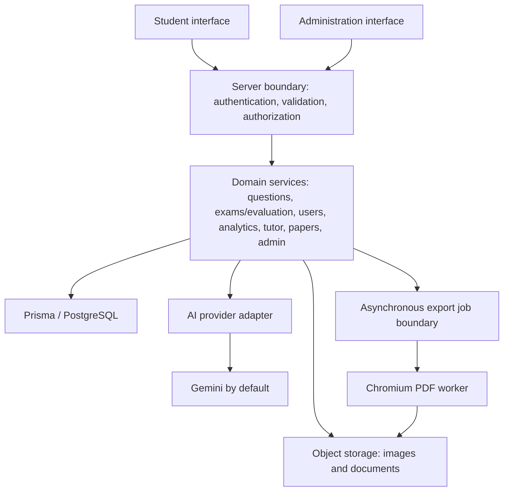

# System architecture

**Purpose and scope.** Describe the approved system shape, trust boundaries and data flows. This is a planning specification, not evidence of a running deployment. The original [README](../../README.md) §§3–5, 9, 13 and 15 supplies the baseline.

## Responsibilities and boundaries

ICT Atlas is a **modular monolith**: one Next.js/React application, one TypeScript codebase and one primary PostgreSQL database accessed through Prisma. Student and administration interfaces are separate experiences over the same backend, not separate microservices. Business rules live in server-side domain services; UI components render data and collect input, but do not calculate official scores, make authorization decisions or query answer keys.

The worker is a supporting asynchronous execution environment for PDF snapshots, not a reason to split the domain into microservices. Its deployment and queue are unresolved. Browser print remains the primary PDF path; only the server worker produces an archived server snapshot. External services do not become authorities for scores or answer keys.

| Boundary | Enforced responsibility |
|---|---|
| Browser → server | Treat all data, timers, identifiers, local state and role claims as untrusted. Validate input and authorize the action and target resource on the server. |
| Service → service | Call the owning module's server interface; keep domain invariants and writes in that module. Do not use UI logic or a second module's tables as a shortcut. |
| Service → database | PostgreSQL is the relational source of truth; Prisma is the planned access layer. Use transactions for coordinated state, scoring and result writes. |
| Server → AI | The tutor and ingestion parser use an internal adapter. Only the adapter integrates a vendor SDK; Gemini 2.5 Flash is the blueprint default. AI never decides correctness or awards CQ marks. |
| Server → files | Files live in object storage, with authorized references and validated uploads. Student-facing projections must not disclose keys or protected files. |

## Critical flows

1. **Authoring:** an authorized administrator creates or revises structured content and sources through the Question Bank; publishing and sensitive key changes are audited. Published question versions must remain reproducible.
2. **Examination:** the server selects and snapshots question versions, starts a session using server time, saves responses, checks the deadline and finalizes/evaluates under transactional guards. A client countdown is only a display. The [exam specification](../modules/examination-engine.md) owns timing and retry details.
3. **Results:** individual responses and evaluation provenance feed results and analytics. MCQ accuracy is distinct from self-assessed CQ marks. Student-facing exam APIs never return official answer keys, including after finalization.
4. **Learning:** authorized tutor/review use is separate from the exam-taking API. The README calls for post-finalization correct-answer and rubric review; its permitted release channel and overlap rules are still open. No answer-revealing path may bypass active-exam protection.
5. **Paper:** the editor modifies a document model, not a PDF. Shared rendering produces print output; server snapshots are asynchronous and preserve selectable text.

## Dependencies

All domains depend on identity/authorization and validated server boundaries; exam/evaluation depends on versioned Question Bank data. Analytics reads examination records; tutor and Paper Studio use authorized question versions. Administration orchestrates domain operations without owning their business rules. Object storage, managed identity, the AI provider and the PDF worker are infrastructure dependencies, not domain authorities. See the [module map](module-architecture.md).

## OPEN DECISION

See [OD-02, OD-10–OD-12, OD-14–OD-17 and OD-22](technology-decisions.md#open-decision-register) for worker hosting, snapshot/timer semantics, answer release, identity, API transport and operations. No unapproved decomposition or alternative data store is implied.

## Related documentation

[Module architecture](module-architecture.md) · [Technology decisions](technology-decisions.md) · [Database design](../database/database-design.md) · [API architecture](../api/api-architecture.md) · [Deployment](../deployment/deployment-architecture.md)
