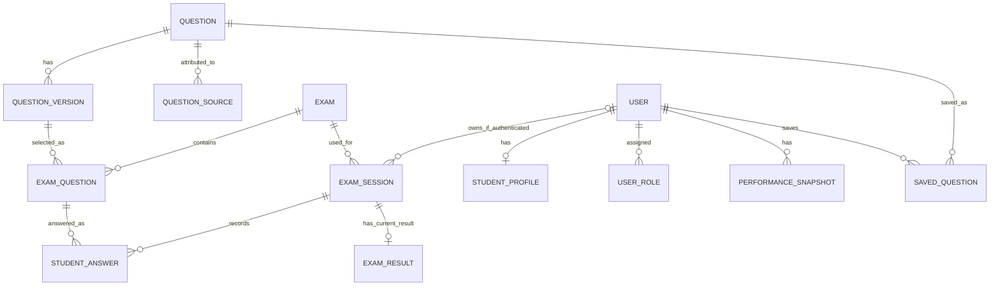

# Entity relationships

**Purpose and scope.** Describe every logical entity group in README §6 and the additional paper/export concepts required by the blueprint. Relationships below are domain requirements or explicitly marked candidates; they do not prescribe a final Prisma schema. Cardinalities refer to logical records, not storage layouts.

## Responsibilities and boundaries

The owning domain controls each relationship's writes. Foreign keys and uniqueness should enforce approved cardinalities where possible; application validation enforces cross-record rules and access. Historical exam evidence must not depend on a mutable current question. Sensitive key/rubric associations are server-only.

### Academic structure and question bank

| Relationship | Cardinality / constraint | Qualification |
|---|---|---|
| `EducationLevel` ↔ `Subject` | A level can include subjects; a subject may be relevant to multiple levels. | Exact many-to-many/join and curriculum revisions: **OD-09**. `Group` is a required filter concept, not an approved table. |
| `Subject` → `Chapter` → `Topic` → `Subtopic` | A chapter belongs to one subject; a subject has chapters. Topics belong to chapters; subtopics belong to topics. Parents may have multiple children. | Which descendants are optional, how curricula change, and any non-ICT exceptions: **OD-09**. |
| `Question` → academic classification | A question is classified against related subject/chapter/topic data, with level/group/subtopic as applicable. | Mandatory fields and valid cross-hierarchy checks: **OD-09**. Never use free-text board/year/subject/topic as the relational authority. |
| `Question` → `QuestionVersion` | One question has zero or more versions while being authored; any question selected into an exam must reference a stable version. A version belongs to one question. | Immutable storage and publication semantics: **OD-10**. |
| Question/version → `QuestionOption` | An MCQ version must present four options with exactly one correct choice for the initial exam format. | Whether option rows attach to a question or version and how historical options are frozen: **OD-10/OD-18**. Correctness is not exposed on an option DTO. |
| Question/version → `AnswerKey` | Authoritative correctness or a CQ rubric is associated with the question and its appropriate historical evaluation basis. Drafts can lack a verified key. | Key/version/part cardinality and correction handling: **OD-10/OD-13**; keys are private. |
| Question/version ↔ `QuestionAsset` | A question may reference multiple assets; an asset may be reused by multiple questions/versions. | Join, content-block reference, historical retention and asset visibility: **OD-18/OD-19**. |
| `Question` ↔ tag(s) via `QuestionTag` | A question may have multiple tags; the same tag may be applied to multiple questions. | Whether `QuestionTag` is the tag entity or join is **OD-18**. |
| `Question` → `QuestionSource` | One question may have multiple source records; each source record belongs to a question. | Board/college/year linkage and source/version history: **OD-08**. |
| `QuestionSource` → `Board`, `College`, `AcademicYear` | Sources reference the applicable relational source entities; a board, college or year can occur in many sources. | Which FKs are present or exclusive and whether year is required are **OD-08**. The README is contradictory; no invented CHECK constraint is approved. |

### Examination, students and analytics

The diagram is a **candidate logical arrangement**, not a choice of physical tables. `Exam` sharing/reuse, where snapshots attach, whether `ExamQuestion` is an exam- or session-specific item, guest ownership, and versioned saved questions are open. For authenticated attempts, exactly one owning user is required even though the diagram allows an unowned guest only if OD-04 is approved. An `ExamSession` has at most one current `ExamResult`; it may have none before evaluation. The blueprint requires one persisted result on finalization, while CQ updates and expiry need the lifecycle resolved under OD-03/OD-13.

| Relationship | Invariant / unresolved detail |
|---|---|
| `Exam` → selected `ExamQuestion` → `QuestionVersion` | Each selected item identifies the exact version and order/marks as needed to reproduce the attempt. Exam/session snapshot placement and answer-key basis are **OD-10**. |
| `ExamSession` → `StudentAnswer` → selected item | An answer belongs to one session and an item in that session's snapshot. A session may have no answers or many; handling of CQ parts and multiple revisions is **OD-12/OD-13**. |
| `ExamSession` → `ExamResult` | At most one current result; the finalization operation must not create duplicates. Whether result components/revisions have separate records is **OD-13**. |
| `ExamResult` → evaluated answers / selected items | Each per-question or per-part mark must be traceable to the session's selected item and applicable answer/evaluation source, including unanswered items where evaluated. The physical relationship and revised CQ marks are **OD-13/OD-21**. |
| `User` → `StudentProfile` | At most one logical profile per user; when a profile is created and mapping to managed identity are **OD-15**. |
| `User` ↔ role(s) via `UserRole` | A user may have multiple role assignments; a role may apply to many users. Role representation, scope, grants and revocation are **OD-16**. |
| `User` ↔ `Question` via `SavedQuestion` | A user can save multiple questions and a question can be saved by multiple users. Whether a bookmark pins a version is **OD-10**. |
| `User` → `PerformanceSnapshot` | Zero or more derived snapshots per user, based on authorized recorded answers/results and taxonomy. Periodicity and materialization are **OD-21**. |

### AI, administration and papers

| Relationship | Cardinality / boundary |
|---|---|
| `User` → `TutorConversation` → `TutorMessage` | A user may own conversations; each conversation has messages. Message role, retention and guest availability are **OD-04/OD-29**. |
| `AIExplanation` → question version and optional answer context | Cache entries depend on a version and model/prompt identity; reuse across users, links to messages and answer hashes are **OD-29**. No cached content may bypass release checks. |
| `AdminAuditLog` → actor and affected resource | Each event records actor, action, target and time; the target may be a question, key, role or setting. How polymorphic targets, protected before/after values and retention are stored is **OD-20/OD-27**. |
| `SystemSetting` | Settings have an administrative owner and auditable changes; scope, storage and secret handling are **OD-16/OD-20**. Secrets are not ordinary public settings. |
| Paper/document → sections → question entries | The paper model contains ordered sections and entries referencing selected questions and/or edited document content. Ownership, references to exact versions and whether these are relational records are **OD-28**. Editing a paper never edits its bank source. |
| Export job → paper version → stored artifact | Server snapshot jobs logically refer to a particular paper state, requester and output artifact; exact cardinalities, queue and retention are **OD-02/OD-28**. Browser print need not create a server job. |

## Dependencies

Question/version data is consumed by Examination, Tutor and Paper Studio; users and authorization scope all private data. Analytics derives from recorded examination evidence. Asset storage and the AI adapter are infrastructure dependencies, not relational entities. Detailed attributes and sensitivity are in the [data dictionary](data-dictionary.md).

## OPEN DECISION

All uncertain cardinalities, nullability, candidate joins, result revisions and external-object associations above remain open. See [OD-02, OD-04, OD-08–OD-10, OD-12–OD-13, OD-15–OD-16, OD-18–OD-21 and OD-27–OD-29](../architecture/technology-decisions.md#open-decision-register). No assumption in the diagram overrides those items.

## Related documentation

[Database design](database-design.md) · [Data dictionary](data-dictionary.md) · [Question Bank](../modules/question-bank.md) · [Examination Engine](../modules/examination-engine.md) · [Paper Studio](../modules/paper-studio.md)
