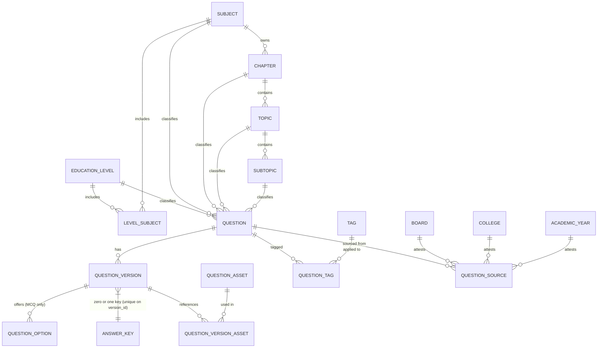

# Phase 04A — Question Bank Physical Schema: Approval Report (Revised)

**Project:** ICT Atlas — HSC / ALIM ICT Question Bank & Online Examination Platform
**Branch:** `arena/bb085c32-hsc-alim-ict-question-bank` (base `8b37e1c4`)
**Author role:** Senior PostgreSQL database architect / Prisma engineer
**Status:** Revised per reviewer clarifications — **no migration created, `prisma/schema.prisma` untouched, no application code written**
**Related docs:** README.md §2, §4.4, §6; `docs/database/`; `docs/architecture/technology-decisions.md` (open-decision register OD-01…OD-32 + blueprint inconsistencies); `docs/modules/question-bank.md`; `docs/modules/examination-engine.md`; `docs/development/database-migrations.md`

---

## Reviewer decision summary

| # | Decision | Reviewer disposition |
|---|---|---|
| 1 | OD-08 — Source model | **APPROVED** (Option B) |
| 2 | OD-09 — Taxonomy / education level | **APPROVED WITH CHANGE** — add `educationLevelId` to `Question`; enforce subject↔level membership |
| 3 | OD-10 — Versioning / snapshots / keys | **APPROVED WITH CONDITIONS** (Option B) |
| 4 | Migration 0001 scope | **NOT YET APPROVED** — 18-table inventory below, pending final scope approval |
| 5 | JSONB usage | **APPROVED IN PRINCIPLE** — OD-18 content-block schema below, pending final approval |
| 6 | Deletion and integrity | **APPROVED WITH CLARIFICATIONS** |
| 7 | OD-11 / OD-12 / OD-13 | **ACKNOWLEDGED** — deferred to Phase 05 |

---

## 1. Inspection findings

### 1.1 What exists in the repository

| Artifact | State |
|---|---|
| `README.md` | v2.2 blueprint — single source of truth; decision register §4.4; non-negotiables §15 |
| `docs/architecture/` | system-architecture, module-architecture, technology-decisions (locked baseline + open register OD-01…OD-32 + blueprint inconsistencies) |
| `docs/database/` | database-design, data-dictionary, entity-relationships (logical model only — explicitly **not** a physical schema) |
| `docs/modules/question-bank.md` | Question Bank module scope: taxonomy, MCQ/CQ, versions, keys, assets, sources, search |
| `prisma/schema.prisma` | Generator + datasource only. **No domain models**, by design (comments cite OD-08…OD-13 etc.) |
| `prisma/migrations/` | Does not exist. No migration has ever been created. |
| `lib/db.ts` | Lazy Prisma singleton via `@prisma/adapter-pg` on `DATABASE_URL`; server-only. No domain service uses it yet. |
| `package.json` | Prisma 7.10.1, `@prisma/client` 7.10.1, PostgreSQL datasource, Zod validation layer present but empty (`lib/validation/` has only a README) |

### 1.2 Inconsistencies found (mapped to decisions, not silently resolved)

| # | Conflict | Where | Decision it maps to |
|---|---|---|---|
| 1 | §1.1 says provenance lives only in `QuestionSource`; §6.2 sketches direct board/year FKs on `Question`. | README | **OD-08** |
| 2 | §5.2 / §7.2.1 (immediate expiry) vs §7.2.2 (grace window + `SUBMITTED_LATE`). | README | **OD-11** |
| 3 | §7.2.2 vs O3: strict lock vs "evaluate last saved answers after expiry". | README | OD-03 / OD-11 |
| 4 | §1.2 / §7.2.5 (CQ answered on paper) vs §7.2.4 / §17.7.5 (typed rich-text CQ answers). | README | **OD-13** |
| 5 | L6/R8/§7.2.5 (AI must not grade CQ) vs §7.2.4 / roadmap v3 (AI-assisted evaluation). | README/register | **OD-24** — stricter locked prohibition stands |
| 6 | §7.2.5 / §17.7.6 (reveal answer/rubric after finalization) vs no keys through any student-facing API. | README/task | **OD-14** — no exception assumed |
| 7 | O2 (serverless PDF) vs §7.5.3 / §13 (Chromium not in request path). | README | **OD-02** |
| 8 | §7.5.4 claims `TextDecoder` fails on invalid UTF-8 (it replaces by default). | README | **OD-28** |
| 9 | §7.6.3a: parser draft "nothing saved yet" vs "enters a draft state". | README | **OD-27** |
| 10 | §4.4 R7 vs §7.4.3: AI example JSON repeats fields without untrusted-input qualifications. | README | OD-14 / OD-29 |

None of these is silently resolved in this proposal; each maps to its open decision.

---

## 2. Decision review OD-08 … OD-13

Decision definitions are quoted from the open-decision register in `docs/architecture/technology-decisions.md`.

### OD-08 — Source model — APPROVED (Option B)

**Exact question:** "Source model: board/college/year exclusivity, `TEST_EXAM` taxonomy and whether any direct question FKs exist. README §1.1 says provenance via `QuestionSource`; §6.2 also sketches direct board/year fields."

**Approved option:** `QuestionSource` exclusively carries provenance; conditional nullable FKs `boardId` / `collegeId` / `academicYearId`; database CHECK ensures at most one of `boardId`/`collegeId` per source row; `SourceType` enum includes `TEST_EXAM`; **no** direct board/year/college columns on `Question`.

**Technical consequences:** `question_sources.question_id` → `questions.id` (CASCADE); `question_sources.boardId` → `boards.id` (RESTRICT); `question_sources.collegeId` → `colleges.id` (RESTRICT); `question_sources.academicYearId` → `academic_years.id` (RESTRICT). Service logic enforces source-type-appropriate requirement (BOARD ⇒ board, COLLEGE / TEST_EXAM ⇒ college; year optional on any source).

**Migration-0001 impact:** table `question_sources` plus dimension tables `boards`, `colleges`, `academic_years`.

---

### OD-09 — Education level / subject cardinalities — APPROVED WITH CHANGE

**Exact question:** "Education-level/group/subject cardinalities, curriculum revisions and optional topic/subtopic relationships. A multi-level relational taxonomy and first-class `Chapter` are required; joins and revision rules are not specified."

**Approved option:** Explicit `level_subjects` join table (many-to-many); hierarchy `Subject → Chapter → Topic → Subtopic`; `Chapter` carries `chapterNumber`, `titleBn`, `titleEn`; `subjectId` mandatory on `Question`; `chapterId`/`topicId`/`subtopicId` nullable with publish-time service enforcement; **no `Group` table yet**.

**REQUIRED CHANGE:** Add `educationLevelId` to `Question` so a question's education level is unambiguously and directly identifiable (primary filter facet per README §7.1.1). Enforce that the selected `subjectId` belongs to that `educationLevelId` via the `level_subjects` join table. Enforcement is server-side at authoring/publish time (cross-table rule; triggers are banned by the migration workflow). Alternative considered and rejected: deriving level solely through `subjectId → level_subjects` (requires a join for every level filter; level is a top-level filter and deserves a direct column).

**Question FKs on `Question`:** `subjectId` (mandatory, RESTRICT), `educationLevelId` (mandatory, RESTRICT), `chapterId`/`topicId`/`subtopicId` (nullable, RESTRICT). Service enforces cross-hierarchy consistency (topic's chapter matches question's chapter; subject belongs to education level).

**Migration-0001 impact:** `education_levels`, `subjects`, `level_subjects`, `chapters`, `topics`, `subtopics`, `questions` (with `educationLevelId`).

---

### OD-10 — Immutable versioning / snapshots / answer-key versioning — APPROVED WITH CONDITIONS (Option B)

**Exact question:** "Exact immutable version/snapshot and answer-key versioning strategy, including corrections and historical scoring. Exams must retain what was seen and be reproducible; never expose stored keys. Physical tables and correction policy are not specified."

**Approved option:** `QuestionVersion` rows (`versionNumber` 1-based per question, `status`); options and answer key attached to versions (`AnswerKey.versionId` unique); one published version per question enforced by partial unique index `WHERE status = 'PUBLISHED'`; key correction publishes a new version (never mutate an examined version); immutability once referenced by an examination enforced server-side (triggers banned); `Exam*` tables deferred to Phase 05. Drafts may lack a verified key.

**Migration-0001 impact:** `questions` (identity only), `question_versions`, `question_options`, `answer_keys`.

---

### OD-11 / OD-12 / OD-13 — ACKNOWLEDGED

Direction noted in the earlier report; required before Phase 05 (examinations), not before migration 0001. No values invented during Phase 04.

---

## 3. Complete 18-table inventory (migration 0001 scope — NOT YET APPROVED)

Migration 0001 scope is **not yet approved**; the reviewer will confirm after reviewing this list. Tables are grouped essential vs supporting. Dependency order assumes a single migration 0001 creating all tables; if split, order within groups must be preserved.

### 3.1 Essential question-bank tables (14)

| # | Table | Purpose | Key relationships | Migration depends on |
|---|---|---|---|---|
| 1 | `education_levels` | Curriculum levels (HSC, Alim). Dimension table. | Referenced by `level_subjects`, `questions` | — |
| 2 | `subjects` | Subjects (ICT, …). Dimension table. | Referenced by `level_subjects`, `chapters`, `questions` | — |
| 3 | `level_subjects` | Many-to-many join: level ↔ subject. Enforces which subjects belong to which levels. | FK → `education_levels.id`; FK → `subjects.id` | `education_levels`, `subjects` |
| 4 | `chapters` | First-class chapter entity (6 initial ICT chapters). | FK → `subjects.id` (RESTRICT); 1:N to `topics`, `questions` | `subjects` |
| 5 | `topics` | Topic within a chapter. | FK → `chapters.id` (RESTRICT); 1:N to `subtopics`, `questions` | `chapters` |
| 6 | `subtopics` | Subtopic within a topic. | FK → `topics.id` (RESTRICT); 1:N to `questions` | `topics` |
| 7 | `questions` | Question identity + classification (content lives in versions). | FK → `subjects.id`, `education_levels.id`; FK → `chapters/topics/subtopics` (nullable); 1:N to `question_versions`, `question_sources`, `question_tags` | `education_levels`, `subjects`, `chapters`, `topics`, `subtopics` |
| 8 | `question_versions` | Immutable content snapshot per question version. | FK → `questions.id` (CASCADE); 1:0..1 `answer_keys`; 1:N `question_options`, `question_version_assets` | `questions` |
| 9 | `question_options` | MCQ choices (4 options, exactly one correct). | FK → `question_versions.id` (CASCADE) | `question_versions` |
| 10 | `answer_keys` | Authoritative correctness / CQ rubric (server-only). | FK → `question_versions.id` (CASCADE, UNIQUE) | `question_versions` |
| 11 | `question_assets` | Asset metadata only; bytes live in object storage. | 1:N via `question_version_assets` | — |
| 12 | `question_version_assets` | Join: which assets a version renders (pins historical rendering). | FK → `question_versions.id` (CASCADE); FK → `question_assets.id` (RESTRICT) | `question_versions`, `question_assets` |
| 13 | `tags` | Tag entity (name, slug). | 1:N via `question_tags` | — |
| 14 | `question_tags` | Join: question ↔ tag. | FK → `questions.id` (CASCADE); FK → `tags.id` (CASCADE) | `questions`, `tags` |

### 3.2 Supporting source/provenance tables (4)

| # | Table | Purpose | Key relationships | Migration depends on |
|---|---|---|---|---|
| 15 | `boards` | Education boards (Dhaka, Rajshahi, MADRASAH, BTEB, …). | 1:N via `question_sources` | — |
| 16 | `colleges` | College / institution records. | 1:N via `question_sources` | — |
| 17 | `academic_years` | Examination years (2024, 2025, …). | 1:N via `question_sources` | — |
| 18 | `question_sources` | Provenance: board/college/year attribution per question (OD-08). | FK → `questions.id` (CASCADE); conditional FK → `boards.id` / `colleges.id` / `academic_years.id` (RESTRICT) | `questions`, `boards`, `colleges`, `academic_years` |

### 3.3 Migration dependency order (single migration 0001)

If migration 0001 is created as one migration (recommended for greenfield), dependency order within it is:

1. `education_levels`
2. `subjects`
3. `boards`, `colleges`, `academic_years` (independent dimensions — any order)
4. `level_subjects` (needs 1, 2)
5. `chapters` (needs 2)
6. `topics` (needs 5)
7. `subtopics` (needs 6)
8. `questions` (needs 1, 2, 5, 6, 7)
9. `question_versions` (needs 8)
10. `question_options` (needs 9)
11. `answer_keys` (needs 9)
12. `question_assets` (standalone)
13. `question_version_assets` (needs 9, 12)
14. `tags` (standalone)
15. `question_tags` (needs 8, 14)
16. `question_sources` (needs 8, 15, 16, 17)

**Deferred (NOT in migration 0001):** `Exam`, `ExamQuestion`, `ExamSession`, `StudentAnswer`, `ExamResult`, user linkage (`createdBy`/`updatedBy`), moderation states beyond `DRAFT|PUBLISHED|ARCHIVED`, full-text search indexes, paper/export document model.

---

## 4. Revised ER diagram (Mermaid)



Notes:
- `QUESTION` now carries `educationLevelId` directly (OD-09 change).
- `QUESTION_VERSION ||--o{ ANSWER_KEY` is drawn one-to-many for diagramming convenience; `@unique` on `answer_keys.version_id` enforces zero-or-one.
- `QUESTION_VERSION_ASSET` is a join table — an asset may be reused by many versions; a version references many assets.
- Deferred exam tables (Phase 05) would add: `EXAM ||--o{ EXAM_QUESTION`, `EXAM_QUESTION }|--|| QUESTION_VERSION`, `EXAM ||--o{ EXAM_SESSION`, `EXAM_SESSION ||--o{ STUDENT_ANSWER`, `EXAM_SESSION ||--|| EXAM_RESULT`.

---

## 5. Revised proposed Prisma models

```prisma
// ICT Atlas — Phase 04A Question Bank physical schema (PROPOSAL — REVISED)
//
// DO NOT APPLY until the reviewer confirms migration 0001 scope (18-table
// inventory in §3) and the OD-18 content-block schema (§7). Migration 0001
// is created with `npm run db:migrate` against a disposable database and
// reviewed before any deployment. `prisma/schema.prisma` is NOT modified
// in this phase.

generator client {
  provider = "prisma-client"
  output   = "../lib/generated/prisma"
}

datasource db {
  provider = "postgresql"
  url      = env("DATABASE_URL")
}

enum BoardType {
  GENERAL
  MADRASAH
  TECHNICAL
}

enum QuestionType {
  MCQ
  CQ
}

enum QuestionStatus {
  DRAFT
  PUBLISHED
  ARCHIVED
}

enum QuestionDifficulty {
  EASY
  MEDIUM
  HARD
}

enum QuestionOrigin {
  MANUAL
  BULK_IMPORT
  AI_PARSER
}

enum VersionStatus {
  DRAFT
  PUBLISHED
  ARCHIVED
}

enum SourceType {
  BOARD
  COLLEGE
  MODEL_TEST
  TEST_EXAM
  INSTITUTION
  ORIGINAL
}

model EducationLevel {
  id        String       @id @default(uuid())
  code      String       @unique
  nameBn    String
  nameEn    String
  isActive  Boolean      @default(true)
  createdAt DateTime     @default(now())
  updatedAt DateTime     @updatedAt
  levelSubjects LevelSubject[]
  questions   Question[]
  @@map("education_levels")
}

model Subject {
  id            String       @id @default(uuid())
  code          String       @unique
  nameBn        String
  nameEn        String
  isActive      Boolean      @default(true)
  createdAt     DateTime     @default(now())
  updatedAt     DateTime     @updatedAt
  levelSubjects LevelSubject[]
  chapters      Chapter[]
  questions     Question[]
  @@map("subjects")
}

model LevelSubject {
  levelId    String
  subjectId  String
  level      EducationLevel @relation(fields: [levelId], references: [id], onDelete: Cascade)
  subject    Subject        @relation(fields: [subjectId], references: [id], onDelete: Cascade)
  createdAt  DateTime       @default(now())
  @@id([levelId, subjectId])
  @@map("level_subjects")
}

model Chapter {
  id          String   @id @default(uuid())
  subjectId   String
  chapterNumber Int     @default(1)
  titleBn     String
  titleEn     String
  isActive    Boolean  @default(true)
  createdAt   DateTime @default(now())
  updatedAt   DateTime @updatedAt
  subject     Subject  @relation(fields: [subjectId], references: [id], onDelete: Restrict)
  topics      Topic[]
  questions   Question[]
  @@unique([subjectId, chapterNumber])
  @@map("chapters")
}

model Topic {
  id          String   @id @default(uuid())
  chapterId   String
  nameBn      String
  nameEn      String
  orderIndex  Int      @default(0)
  isActive    Boolean  @default(true)
  createdAt   DateTime @default(now())
  updatedAt   DateTime @updatedAt
  chapter     Chapter  @relation(fields: [chapterId], references: [id], onDelete: Restrict)
  subtopics   Subtopic[]
  questions   Question[]
  @@unique([chapterId, orderIndex])
  @@map("topics")
}

model Subtopic {
  id          String   @id @default(uuid())
  topicId     String
  nameBn      String
  nameEn      String
  isActive    Boolean  @default(true)
  createdAt   DateTime @default(now())
  updatedAt   DateTime @updatedAt
  topic       Topic    @relation(fields: [topicId], references: [id], onDelete: Restrict)
  questions   Question[]
  @@map("subtopics")
}

model Board {
  id        String   @id @default(uuid())
  code      String   @unique
  nameBn    String?
  nameEn    String
  type      BoardType @default(GENERAL)
  isActive  Boolean  @default(true)
  createdAt DateTime @default(now())
  updatedAt DateTime @updatedAt
  sources   QuestionSource[]
  @@map("boards")
}

model College {
  id        String   @id @default(uuid())
  name      String   @unique
  code      String?
  isActive  Boolean  @default(true)
  createdAt DateTime @default(now())
  updatedAt DateTime @updatedAt
  sources   QuestionSource[]
  @@map("colleges")
}

model AcademicYear {
  id        String   @id @default(uuid())
  label     String   @unique
  year      Int?     @unique
  isActive  Boolean  @default(true)
  createdAt DateTime @default(now())
  updatedAt DateTime @updatedAt
  sources   QuestionSource[]
  @@map("academic_years")
}

model Question {
  id             String           @id @default(uuid())
  type           QuestionType
  status         QuestionStatus   @default(DRAFT)
  difficulty     QuestionDifficulty @default(MEDIUM)
  createdVia     QuestionOrigin   @default(MANUAL)
  educationLevelId String
  subjectId      String
  chapterId      String?
  topicId        String?
  subtopicId     String?
  marks          Int              @default(1)
  negativeMarks  Int              @default(0)
  createdAt      DateTime         @default(now())
  updatedAt      DateTime         @updatedAt
  educationLevel EducationLevel @relation(fields: [educationLevelId], references: [id], onDelete: Restrict)
  subject        Subject          @relation(fields: [subjectId], references: [id], onDelete: Restrict)
  chapter        Chapter?         @relation(fields: [chapterId], references: [id], onDelete: Restrict)
  topic          Topic?           @relation(fields: [topicId], references: [id], onDelete: Restrict)
  subtopic       Subtopic?        @relation(fields: [subtopicId], references: [id], onDelete: Restrict)
  versions       QuestionVersion[]
  sources        QuestionSource[]
  tags           QuestionTag[]
  @@index([educationLevelId])
  @@index([subjectId])
  @@index([chapterId])
  @@index([topicId])
  @@index([subtopicId])
  @@index([educationLevelId, subjectId])
  @@index([type, status])
  @@index([status, type, difficulty])
  @@index([subjectId, chapterId, topicId])
  @@map("questions")
}

model QuestionVersion {
  id        String      @id @default(uuid())
  questionId String
  versionNumber Int    @default(1)
  status    VersionStatus @default(DRAFT)
  content   Json
  createdAt DateTime    @default(now())
  question  Question    @relation(fields: [questionId], references: [id], onDelete: Cascade)
  options   QuestionOption[]
  answerKey AnswerKey?
  assets    QuestionVersionAsset[]
  @@unique([questionId, versionNumber])
  @@index([questionId])
  @@index([status])
  @@index([questionId, status])
  @@map("question_versions")
}

model QuestionOption {
  id        String   @id @default(uuid())
  versionId String
  key       String   // "A"…"D" or "ক"…"ঘ"
  content   Json
  order     Int      @default(0)
  isCorrect Boolean @default(false)
  version   QuestionVersion @relation(fields: [versionId], references: [id], onDelete: Cascade)
  @@index([versionId])
  @@index([versionId, isCorrect])
  @@map("question_options")
}

model AnswerKey {
  id             String   @id @default(uuid())
  versionId      String   @unique
  mcqCorrectOptionKey String?
  cqRubric       Json?
  isVerified     Boolean  @default(false)
  verifiedAt     DateTime?
  notes          String?
  createdAt      DateTime @default(now())
  updatedAt      DateTime @updatedAt
  version        QuestionVersion @relation(fields: [versionId], references: [id], onDelete: Cascade)
  @@map("answer_keys")
}

model QuestionAsset {
  id             String   @id @default(uuid())
  storageKey     String   @unique
  mimeType       String
  sizeBytes      Int
  width          Int?
  height         Int?
  altText        String
  longDescription String?
  checksum       String?
  createdAt      DateTime @default(now())
  versions       QuestionVersionAsset[]
  @@map("question_assets")
}

model QuestionVersionAsset {
  versionId  String
  assetId    String
  blockRef   String?
  version    QuestionVersion @relation(fields: [versionId], references: [id], onDelete: Cascade)
  asset      QuestionAsset   @relation(fields: [assetId], references: [id], onDelete: Restrict)
  @@id([versionId, assetId])
  @@index([assetId])
  @@map("question_version_assets")
}

model Tag {
  id        String   @id @default(uuid())
  name      String   @unique
  slug      String   @unique
  createdAt DateTime @default(now())
  questions QuestionTag[]
  @@map("tags")
}

model QuestionTag {
  questionId String
  tagId      String
  question   Question @relation(fields: [questionId], references: [id], onDelete: Cascade)
  tag        Tag      @relation(fields: [tagId], references: [id], onDelete: Cascade)
  @@id([questionId, tagId])
  @@index([tagId])
  @@map("question_tags")
}

model QuestionSource {
  id             String      @id @default(uuid())
  questionId     String
  sourceType     SourceType
  boardId        String?
  collegeId      String?
  academicYearId String?
  sourceName     String?
  createdAt      DateTime    @default(now())
  question       Question    @relation(fields: [questionId], references: [id], onDelete: Cascade)
  board          Board?      @relation(fields: [boardId], references: [id], onDelete: Restrict)
  college        College?    @relation(fields: [collegeId], references: [id], onDelete: Restrict)
  academicYear   AcademicYear? @relation(fields: [academicYearId], references: [id], onDelete: Restrict)
  @@index([questionId])
  @@index([sourceType])
  @@index([boardId])
  @@index([collegeId])
  @@index([academicYearId])
  @@map("question_sources")
}
```

**Supplementary migration SQL (partial indexes & checks not expressible in Prisma):**

```sql
-- one published version per question
CREATE UNIQUE INDEX one_published_version_per_question
  ON question_versions(question_id) WHERE status = 'PUBLISHED';

-- at most one correct option per version
CREATE UNIQUE INDEX at_most_one_correct_option_per_version
  ON question_options(version_id) WHERE is_correct = true;

-- no duplicate fully-specified source record
CREATE UNIQUE INDEX no_duplicate_question_source
  ON question_sources(question_id, source_type, board_id, college_id, academic_year_id)
  WHERE board_id IS NOT NULL AND college_id IS NOT NULL AND academic_year_id IS NOT NULL;

-- domain checks
ALTER TABLE questions ADD CONSTRAINT questions_marks_nonnegative CHECK (marks >= 0);
ALTER TABLE questions ADD CONSTRAINT questions_negative_marks_nonnegative CHECK (negative_marks >= 0);
ALTER TABLE question_versions ADD CONSTRAINT qv_version_number_positive CHECK (version_number > 0);
ALTER TABLE question_options ADD CONSTRAINT qo_key_single_char CHECK (char_length(key) = 1);
ALTER TABLE question_sources ADD CONSTRAINT qs_board_or_college_not_both CHECK ((board_id IS NULL) OR (college_id IS NULL));
ALTER TABLE question_assets ADD CONSTRAINT qa_size_positive CHECK (size_bytes > 0);
```

---

## 6. Index and constraint rationale

- **FK indexes on every foreign key** — filter paths (level/subject/chapter/topic/subtopic/type/difficulty/source joins) are the entire question-bank access pattern (§7.1.1).
- **Composite `(educationLevelId, subjectId)`** — serves the level→subject filter cascade entry point.
- **Composite `(subjectId, chapterId, topicId)`** — serves the chapter→topic cascade.
- **`(status, type, difficulty)`** — published listing with type/difficulty facets.
- **Partial unique indexes** — publish-safety (one current version), answer integrity (one correct MCQ option), source dedup — declarative where PostgreSQL allows it.
- **Checks** — `marks >= 0`, `negative_marks >= 0`, `version_number > 0`, single-char option key, at-most-one org per source: cheap immutable guardrails.
- **No GIN/full-text indexes yet** — search indexing/tokenization is OD-32; a `GIN` on `question_versions.content` can be added additively.
- **No `ORDER BY RANDOM()`-friendly structures** — random selection is a service algorithm (§7.1.3), not a schema concern.

---

## 7. OD-18 content-block schema — complete specification (APPROVED IN PRINCIPLE)

JSONB is limited to `question_versions.content`, `question_options.content`, and `answer_keys.cq_rubric`. The whole question is **never** stored as JSONB.

### 7.1 Content document structure (`question_versions.content`)

```json
{
  "format": "rich_blocks",
  "version": 1,
  "blocks": [
    { "type": "paragraph", "data": { "text": "...", "lang": "bn|en" } },
    { "type": "heading",   "data": { "text": "...", "level": 1, "lang": "bn|en" } },
    { "type": "list",      "data": { "ordered": false, "items": [ { "text": "...", "lang": "bn|en" } ] } },
    { "type": "table",     "data": { "caption": "...", "rows": [[...]], "lang": "bn|en" } },
    { "type": "image",     "data": { "assetId": "...", "alt": "...", "longDescription": "...", "display": "inline|block" } },
    { "type": "math",      "data": { "latex": "...", "lang": "bn|en" } },
    { "type": "code",      "data": { "language": "c|html|sql|pseudo", "code": "...", "caption": "..." } },
    { "type": "flowchart", "data": { "assetId": "...", "alt": "...", "description": "..." } },
    { "type": "callout",   "data": { "kind": "info|warning|important", "text": "...", "lang": "bn|en" } },
    { "type": "subquestion", "data": { "part": "ক|খ|গ|ঘ", "maxMarks": 1|2|3|4, "instruction": "...", "blocks": [...] } }
  ]
}
```

### 7.2 Supported block types

| Block | `type` | Required `data` fields | Optional `data` fields | Notes |
|---|---|---|---|---|
| Paragraph | `paragraph` | `text` | `lang` | Mixed Bengali/English text |
| Heading | `heading` | `text`, `level` | `lang` | level 1–3 |
| List | `list` | `ordered`, `items` | — | items: array of `{text, lang?}` |
| Table | `table` | `rows` | `caption`, `lang` | rows: 2D array of cells |
| Image | `image` | `assetId` | `alt`, `longDescription`, `display` | `assetId` resolved via `question_version_assets.block_ref` |
| Math | `math` | `latex` | `lang` | KaTeX LaTeX source |
| Code | `code` | `language`, `code` | `caption` | language: c, html, sql, pseudo |
| Flowchart | `flowchart` | `assetId` | `alt`, `description` | SVG/raster diagram asset |
| Callout | `callout` | `kind`, `text` | `lang` | kind: info, warning, important |
| Subquestion | `subquestion` | `part`, `maxMarks` | `instruction`, `blocks` | CQ parts ক/খ/গ/ঘ; maxMarks 1/2/3/4; nested content blocks |

### 7.3 Validation rules

- `content` must be valid JSON with `blocks` as a non-empty array.
- Every block `type` must be one of the supported types above.
- Every block must have a `data` object matching its type's required fields.
- `image` and `flowchart` blocks: `assetId` must reference a row in `question_assets` linked through `question_version_assets` where `block_ref` points at this block's JSON pointer.
- `subquestion` blocks: `part` must be one of ক/খ/গ/ঘ; `maxMarks` must be 1, 2, 3, or 4; a CQ version must contain exactly four subquestion blocks (ক, খ, গ, ঘ).
- MCQ versions must not contain `subquestion` blocks; CQ versions must not contain top-level option content (options live in `question_options`).
- `lang` values: `bn` or `en`; defaults to `en` when omitted.
- Validation happens in the service layer (Zod) at authoring/publish time; the DB stores `Json` and does not enforce block shape (OD-18 leaves exact shapes to service validation).

### 7.4 Option content (`question_options.content`)

Same block schema as above, restricted to inline content (paragraph, math, image, code). An MCQ option may not contain subquestions or tables.

### 7.5 CQ rubric (`answer_keys.cq_rubric`)

```json
{
  "parts": [
    { "part": "ক", "maxMarks": 1, "criteria": "..." },
    { "part": "খ", "maxMarks": 2, "criteria": "..." },
    { "part": "গ", "maxMarks": 3, "criteria": "..." },
    { "part": "ঘ", "maxMarks": 4, "criteria": "..." }
  ],
  "totalMaxMarks": 10
}
```

### 7.6 Example — MCQ question version content

```json
{
  "format": "rich_blocks",
  "version": 1,
  "blocks": [
    { "type": "paragraph", "data": { "text": "নিচের HTML কোডটি লক্ষ করো:", "lang": "bn" } },
    { "type": "code", "data": { "language": "html", "code": "<h1>Hello</h1>\n<p>Welcome</p>", "caption": "নমুনা কোড" } },
    { "type": "paragraph", "data": { "text": "উপরে কোন HTML element ব্যবহার করা হয়েছে?", "lang": "bn" } }
  ]
}
```

### 7.7 Example — CQ question version content

```json
{
  "format": "rich_blocks",
  "version": 1,
  "blocks": [
    { "type": "paragraph", "data": { "text": "একটি বাইনারি সংখ্যা DISCUSSION", "lang": "bn" } },
    { "type": "subquestion", "data": { "part": "ক", "maxMarks": 1, "instruction": "বাইনারি সংখ্যা বলতে কী বোঝায়?" } },
    { "type": "subquestion", "data": { "part": "খ", "maxMarks": 2, "instruction": "(১০১)₂ কে দশমিকে রূপান্তর করো", "blocks": [ { "type": "math", "data": { "latex": "1\\times2^2 + 0\\times2^1 + 1\\times2^0 = 5" } } ] } },
    { "type": "subquestion", "data": { "part": "গ", "maxMarks": 3, "instruction": "দশমিক ১৩ কে বাইনারিতে রূপান্তর করো", "blocks": [] } },
    { "type": "subquestion", "data": { "part": "ঘ", "maxMarks": 4, "instruction": "বাইনারি যোগফল (১১০১)₂ + (১০১১)₂ নির্ণয় করো", "blocks": [] } }
  ]
}
```

---

## 8. Data integrity and deletion policy — APPROVED WITH CLARIFICATIONS

- **Taxonomy rows:** `RESTRICT` on delete while referenced; soft-retire via `is_active = false`. Hard delete only when nothing references the row.
- **Questions:** never hard-deleted once any version is published or referenced by an exam (Phase 05) or any student answer exists. `status = ARCHIVED` is the soft-delete. Hard-delete permitted only for draft, unreferenced questions.
- **Question versions:** never deleted once published or referenced by an exam; draft versions deletable only when unreferenced. "Immutable once used in an exam" is enforced in the transactional service layer (triggers banned by the migration workflow) and covered by tests.
- **Options / answer keys / version-asset links:** cascade with question deletion; never mutated historically — a correction publishes a new version.
- **Assets:** bytes are immutable in object storage (new upload = new `storage_key` row); asset metadata may be updated; the version→asset join pins historical rendering. Orphan cleanup and retention periods are OD-20.
- **Answer keys:** never exposed through student-facing exam APIs, including result endpoints (task rule; stricter than README's pre-submission restriction). Any post-finalization release requires OD-14.
- **Created/updated-by linkage to `users`:** not in this migration (OD-15/OD-16); added when Student Management lands, with an additive migration.

---

## 9. Migration impact assessment

- **Greenfield:** no production data exists, so migration 0001 creates all 18 tables, enums, indexes, and checks with **zero data-migration risk**.
- **Workflow:** edit `prisma/schema.prisma` → `npm run db:migrate --name <descriptive>` against a disposable database → review generated SQL in `prisma/migrations/` → `npm run db:validate` + `npm run db:generate` → test against isolated PostgreSQL → `npm run db:deploy` on staging/production (migrations apply before dependent code). Never edit applied migrations; no `db push --force-reset` or `DROP/TRUNCATE` on shared databases.
- **No triggers or stored procedures:** all business rules (version immutability once examined, source-type FK requirements, answer-key type matching, subject↔level membership) live in `server/` domain services, per the migration workflow and module architecture.
- **Rollback:** forward-only migrations (never edit applied); development databases are disposable and may be reset.
- **Forward compatibility:** `question_versions.id` is pre-designed as the target of Phase 05's `ExamQuestion.versionId`; adding exam tables later is purely additive.
- **Client regeneration:** any schema change requires `npm run db:generate`; `lib/db.ts` needs no changes.
- **Blast radius:** editing `prisma/schema.prisma` does not affect any running application until a migration is applied, the client regenerated, and dependent code written — none of which happens in this phase.

---

## 10. Classification of decisions (current state)

### Already approved (baseline — no action needed)
Modular monolith (L1); PostgreSQL + Prisma with JSONB limited to structured content/snapshots (L2, R6); server-authoritative exams (L3); answer keys never exposed to clients (task rule: extended to **all** student-facing exam APIs incl. results); structured, versioned question content; AI behind adapter, Gemini default, AI never awards marks (L6, L7, R8); print-first selectable-vector PDF; design tokens + WCAG 2.2 AA; audit logging and automated testing.

### Approved by reviewer (this report)
1. OD-08 — Option B (`QuestionSource` exclusively).
2. OD-09 — `levelSubjects` join + `educationLevelId` on `Question`; subject↔level membership enforced server-side; no `Group` table.
3. OD-10 — Option B versioning with conditions (immutable once examined; corrections via new version; `Exam*` deferred).
4. JSONB boundaries — in principle (OD-18 schema below pending final approval).
5. Deletion/integrity policy — with clarifications.

### Reviewed — direction noted, gated to Phase 05 (exams), not migration 0001
6. OD-11 — grace window + `SUBMITTED_LATE`.
7. OD-12 — per-answer idempotency key, one result per session.
8. OD-13 — CQ rubric JSONB in `answer_keys` (included); responses/self-assessment/teacher override deferred.

### Explicitly unresolved (not decided here; do not implement against)
Migration 0001 final scope (pending reviewer confirmation of §3); OD-18 final content-block schema and validation rules (pending reviewer confirmation of §7); Group entity; user linkage (OD-15); moderation states beyond draft/published/archived (OD-27); RLS (OD-16); full-text search (OD-32); retention periods (OD-20); rate-limit store (OD-06); CQ assessment modality (OD-01); strict-expiry vs auto-submit (OD-03); guest practice (OD-04); post-release answer review (OD-14); PDF worker host (OD-02); paper/export model (OD-28); AI cache/isolation (OD-29).

---

## 11. Decisions still awaiting your final approval

A. **Migration 0001 scope** — confirm the 18-table inventory in §3 (14 essential + 4 supporting) and the dependency order before migration 0001 is created.

B. **OD-18 content-block schema** — confirm the complete block schema, validation rules, supported block types, and examples in §7 before JSONB is used in migration 0001.

Once you approve A and B, I will wait for your explicit final signal before creating the migration or modifying `prisma/schema.prisma`.