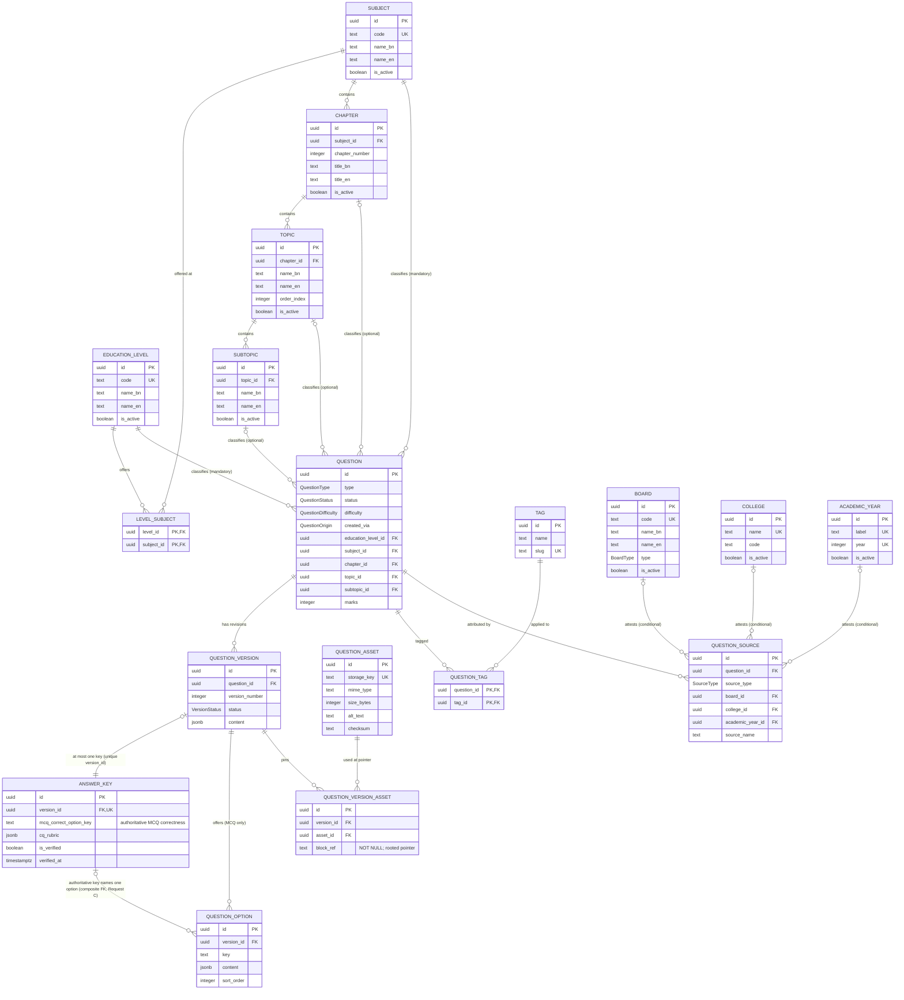
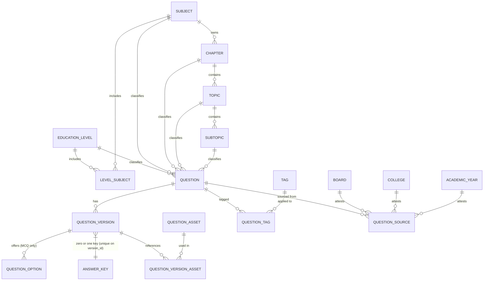

# Phase 04A — Question Bank Physical Schema: Approval Report (Revision 14 — full 18-table schema and migration 0001 authored)

**Project:** ICT Atlas — HSC / ALIM ICT Question Bank & Online Examination Platform
**Branch:** `arena/1042a18a-hsc-alim-ict-question-bank` (base `153ef5c`)
**Revision 4 scope (superseded by Revision 5 only where noted — the `topics` ordering constraint):** **all Phase 04A requests are now decided.** A (18-table migration scope), B (OD‑18 content-block schema), C (five composite FKs + three support keys, conditional on the Prisma-drift spike), D (single MCQ correctness authority) and the asset-pointer decision are **APPROVED**. Request E is fully dispositioned: eleven items accepted, three already resolved, **E‑7 and E‑9 changed**, **E‑10 rejected**. Two pre-migration gates remain (§11.3).
**Revision 5 scope:** **one narrowly scoped correction to Revision 4.** The consequential E‑7 extension to `topics` is **reverted**: `chapters` keeps its plain global `UNIQUE (subject_id, chapter_number)`, while topic display order returns to an **active-only partial unique index** `(chapter_id, order_index) WHERE is_active`. Rationale: a chapter number is a curriculum identifier; a topic's `order_index` is only a display position, so retiring a topic must free its position without changing the retired topic's identity or the historical question references to it. No other decision changes, and both gates remain open. §3.3.5, §3.10, §3.14, §3.15/§3.15.2, §5, §6, §10 and §11 are updated accordingly.
**Author role:** Senior PostgreSQL database architect / Prisma engineer
**Revision 14 scope:** Author the **real** Phase 04A schema and its baseline migration, then run G‑3 against them. `prisma/schema.prisma` gains all 18 models; `prisma/migrations/0001_phase04a_question_bank/` is created with a Prisma-generated Part A and hand-written Parts B–D; `docs/database/g1-spike/option-c/g3-full/` holds the full-schema driver, a 33-case enforcement suite and a local SQL verifier; `.github/workflows/phase04a-g3-full-schema-gate.yml` runs it in CI. **`negative_marks` is still absent**, the deferred decisions are still deferred, and no application code is written. The pre-implementation audit found five specification issues, recorded in §11.9.
**Revision 13 scope:** **G‑2 DEFERRED; `negative_marks` removed from the Phase 04A model.** The clarified requirement is that negative marking is **configurable** — **off by default**, switchable by an authorised user when configuring an examination or marking profile, with the **penalty rule configured independently of the switch**. A per-question decimal cannot express that (a `NOT NULL DEFAULT 0` column cannot distinguish "off" from "on with a zero penalty"; a nullable one hides an unvalidated rule while disabled), so **the column does not belong in the question master**. `questions.negative_marks`, `ck_questions_negative_marks_nonnegative` (E‑12) and `ck_questions_negative_marks_not_above_marks` (E‑9) are **removed**; the hand-written `CHECK` count goes 49 → **47**. **The Revision 12 `numeric(4,2)` investigation is preserved unaltered in §3.15.3 as historical research, explicitly not an approved implementation decision** — its PostgreSQL measurements still apply to any future penalty type. **OD‑21 remains open** and is not closed; a new open decision **OD‑NM‑1** records that it is **not assumed** whether the setting belongs to an examination, a marking profile, or another entity. G‑1 remains **FAILED**; G‑3 remains prototype-only. **No schema, migration, service, validator, DTO or UI change.**
**Revision 12 scope:** **G‑2 investigated, recommended, and left open for approval.** The `negative_marks` precision/scale question is answered with evidence rather than convention: **`numeric(4,2)` is recommended**, because two decimals are *necessary* (the MBBS/BDS admission test — the same HSC cohort — deducts exactly **0.25** per wrong answer against a pass mark of 40, so `39.75` is a real failing score) and because `numeric(4,1)` was **measured** to store `0.3` instead of `0.25`, silently, with every `CHECK` unable to see it. Scale 3 is rejected as having no evidenced use case. The investigation also found that **E‑12 alone does not exclude `NaN`** (`'NaN' >= 0` is true) and that **E‑9 is what excludes it**. **G‑2 is not passed** — approval is requested in §3.15.3.8. **OD‑21 remains completely untouched**, G‑1 remains FAILED, G‑3 remains closed for the prototype only, and no schema, migration or application code changed. §3.15.1 is preserved verbatim with a status banner; nothing earlier was rewritten.
**Revision 11 scope:** **Option C conditionally approved; G‑3 opened; G‑1 left FAILED.** The reviewer resolved D‑1…D‑4 (§11.4.8): Option C is **conditionally approved** as the migration workflow, **Option A is not approved**, **Option B is rejected for this schema**, and **G‑1 remains FAILED — it is not re-scored and its history is not rewritten**. A new gate, **G‑3** (§11.6), covers production-readiness of the Option C workflow with six mandatory criteria, an explicit acceptance list, and a residual-risk table. Hardening implemented in this revision: a repository/CI guard rejecting `prisma migrate dev` (`option-c/repo-guard.sh`), a shared protected-FK definition plus a checksum check of applied migrations (`option-c/guard.py`), a pre/post-deployment `migrate status` check, a live-catalog assertion for C‑1…C‑5 after every deployment, a migration-SQL integrity check, and documented approved commands. All six G‑3 criteria passed in CI run `45263567929`, **three earlier runs failed on real defects that are recorded rather than hidden**, and the gate must be re-run on the full 18-table model before migration 0001 — **which Revision 14 did: G‑3 PASSED for the full 18-table schema in run `45273840004`.** **G‑3 PASSED for the reduced prototype** in CI run `45263567929` (all six criteria, every control negative-tested); it must still be re-run on the full 18-table model before migration 0001. §11.6.4 states exactly what that run does and does not prove. The constrained-column study (§11.6.2) overturned an earlier assumption: a *coercible* change leaves the constraint intact, and only a *non-coercible* change forces a hand-written drop+re-create. No constraint was weakened, C‑1…C‑5 are unchanged, `prisma/schema.prisma` is untouched and there is no `prisma/migrations/` directory.
**Revision 10 scope:** **Request C's architectural alternatives analysed; Option C prototyped and verified; decision requested.** G‑1 remains **FAILED** and is not re-scored. Option A is **not** adopted. The approved physical design and C‑1…C‑5 are unchanged. Option C (controlled migration workflow) passed a nine-claim CI prototype, including confirmation that a schema-to-schema diff never proposes dropping the five constraints, and a negative test proving the CI guard detects an injected destructive migration. See [§11.4](#114-architectural-alternatives-for-request-c--analysis-and-decision-request) for the decision matrix and the four open decisions (D‑1…D‑4).
**Revision 9 scope:** **G‑1 experiment 2 executed; still FAILED, now precisely isolated.** Prisma's workflow *can* create, deploy and enforce all five composite FKs when they are appended to a Prisma-generated migration — but its no-change `migrate dev` treats them as drift and generates a migration that removes them. The diff is confined to exactly the five, with no ordinary FK or unique involved, so the earlier ambiguity is gone. [§11.3.3](#1133-g1-experiment-2--result-fail-but-decisive). Option A is not adopted; Option B remains the approved design and implementation stays blocked.
**Revision 8 scope:** **G‑1 FAILED.** The hardened pipeline ran on a real GitHub Actions runner with the project's pinned Prisma 7.10.1 and a disposable PostgreSQL 16. Steps 0–3b passed: all five composite FKs are created, PostgreSQL enforces every one (14/14 enforcement cases), introspection sees all ten tables, and the spike datamodel agrees with the SQL schema exactly (fidelity diff: 0 bytes). **Step 4 then failed: Prisma's no-change diff emits `DROP CONSTRAINT` for all five approved composite FKs, and for every plain foreign key in the schema as well.** G‑1 is therefore **FAIL** on its own acceptance criteria; Request C moves to its documented fallback, which needs re-approval. Evidence and run URL: [§11.3.2](#1132-g1-verdict--fail).
**Revision 7 scope:** **G‑1 hardened, still BLOCKED.** The spike's test harness was audited and corrected (fail-fast, pipeline status, an asserted case count, empty-output detection, pinned-toolchain enforcement, valid Prisma 7 flags and config handling, and a `migrate dev` step that can no longer pass by generating nothing). A dedicated GitHub Actions workflow now runs the full gate on a disposable PostgreSQL 16 with the project's pinned Prisma 7.10.1. **No workflow run has happened yet**, so G‑1 remains BLOCKED and Request C remains conditional. No approved constraint was changed or weakened.
**Revision 6 scope:** **G‑1 was attempted and is BLOCKED.** The PostgreSQL half is verified (all five composite FKs created and enforced on PostgreSQL 16.2); the Prisma-drift half could not run because the Prisma schema engine's download host was unreachable. The spike is committed as a reproducible artifact under [`g1-spike/`](g1-spike/README.md) and the outcome is recorded in [§11.3.1](#1131-g1-result-revision-67--blocked--superseded-by-1132). No approved constraint was changed or weakened.
**Status (Revision 15):** **The approved audit decisions A1–A6 are executed, and Option C is authorised for the workflow only.** Four documentation corrections were applied — §3.9 and §3.3.12 now carry the **parenthesised** `block_ref` `CHECK` (A1, pattern byte‑identical, 129 octets, nine pointer cases unchanged), §5 no longer shows a plain `@unique` on `Tag.name` (A2) or `College.name` (A3) and instead states that the expression index is the sole uniqueness rule, §3.4.2 now says the plain unique is **replaced** and warns against restoring one, and §3.3.1 explains why **no** support key is required on `education_levels` (A5). `ck_question_options_key_single_char` is **KEPT** by owner decision, so the `CHECK` count **remains 47** and **no migration was created** (A4). Three further discrepancies are **recorded and left unfixed** in §11.9.7b (A6). **Option C is accepted as the controlled migration workflow (B1a); G‑3 is PASSED on the full 18‑table schema; G‑1 remains FAILED and is not re‑scored; production deployment of migration 0001 and production creation of C‑1…C‑5 are NOT AUTHORISED (B2 withheld), with five verification tasks V‑1…V‑5 required first (§11.12).** **No schema, no migration, no gate and no application code changed in this revision** — it is documentation only. **Deferred and untouched:** G‑2, OD‑21, OD‑NM‑1, OD‑11/12/13, users/RLS, Phase 05 examination tables.

**Status (Revision 14):** **The Phase 04A physical schema now exists as code.** `prisma/schema.prisma` is the real **18-table** datamodel and `prisma/migrations/0001_phase04a_question_bank/migration.sql` is the committed baseline: Prisma-generated DDL plus the reviewed hand-written artifacts Prisma cannot express (47 `CHECK`s, 6 partial/expression indexes, the 5 composite FKs of Request C). Verified on PostgreSQL 16.2 — 18 tables, 7 enums, 26 FKs (21 single + 5 composite), 47 CHECKs, 6 hand-written indexes, and **33/33 enforcement cases**. **G‑3 is PASSED for the full 18-table schema**: CI run [`45273840004`](https://github.com/Tanim-Boss/HSC-ALIM-ICT-Question-Bank/actions/runs/45273840004) passed all six criteria — migration history, `migrate status`, reproducibility through Prisma, `migrate diff` visibility, tampering detection and the live catalog — with every control negative-tested, plus `prisma validate` on the real datamodel. **G‑1 remains FAILED** and is not re-scored. The audit's five findings are in [§11.9](#119-pre-implementation-audit--what-the-full-schema-authoring-found); only the unappliable SQL was corrected. **Deferred and untouched:** G‑2, OD‑21, OD‑NM‑1, OD‑11/12/13, users/RLS, Phase 05 examination tables. No application code, services, DTOs or UI.
**Status (Revision 13, historical):** **G‑2 is DEFERRED, not passed and not closed by a type choice.** Negative marking is configurable and off by default, so `negative_marks` is not part of the Phase 04A schema and there is no precision/scale to approve. The Revision 12 `numeric(4,2)` recommendation survives as **historical research only**. **OD‑21 remains open**; **OD‑NM‑1** records the unresolved question of which entity owns the setting. **G‑1 remains FAILED**; **G‑3 remains prototype-only** with full 18-table validation pending. Documentation only — **no migration, no `prisma/migrations/` directory, `prisma/schema.prisma` untouched, no application code**.
**Status (Revision 12, historical):** **G‑2 is investigated and recommended, not passed.** `numeric(4,2)` is proposed with technical justification; the reviewer must approve (Q‑G2‑1). **G‑1 remains FAILED**, **G‑3 remains passed on the prototype only** with full 18-table validation pending, and **OD‑21 remains open and untouched**. Documentation and research only — **no migration created, no `prisma/migrations/` directory, `prisma/schema.prisma` untouched, no application code written**. The approved physical model is unchanged pending the G‑2 approval.
**Status (Revision 11, historical):** **Option C is conditionally approved; G‑3 passed for the reduced prototype and must be re-run on the full model.** G‑1 remains **FAILED** and its record is unchanged. The approved physical design and C‑1…C‑5 are unchanged. Implementation is **not** authorised: G‑3 has not passed on the full schema, and G‑2 and OD‑21 remain undecided. Documentation and an isolated, disposable prototype only — **no migration created, no `prisma/migrations/` directory, `prisma/schema.prisma` untouched, no application code written**.
**Status (Revision 10, historical):** **G‑1 remains FAILED; Request C was not approved for implementation at that revision.** A viable workflow (Option C) has now been prototyped and passes, but adopting it is your decision (D‑1), as is how the workflow result interacts with G‑1 (D‑2). The Option A fallback remains **not adopted**.
**Status (Revision 9):** **G‑1 has FAILED again, and this time the finding is unambiguous: Prisma generates a migration that would delete the constraint layer.** Request C remains the approved architectural design (Option B) but is **not approved for implementation**. The Option A fallback is **not adopted**. A reviewer decision is required. The fallback — service validation plus a scheduled integrity query plus a publish-gate re-check — requires an explicit reviewer decision before migration 0001 can be written. Documentation only — **no migration created, no `prisma/migrations/` directory, `prisma/schema.prisma` untouched, no application code written**. The `g1-spike/` directory is an isolated, disposable test harness and is not part of the application build. Design authority remains approved; implementation is still gated on G‑1 and G‑2 (§11.3).
**Related docs:** README.md §2, §4.4, §6; `docs/database/`; `docs/architecture/technology-decisions.md` (open-decision register OD-01…OD-32 + blueprint inconsistencies); `docs/modules/question-bank.md`; `docs/modules/examination-engine.md`; `docs/development/database-migrations.md`

---

## Revision history

| Revision | Scope | State |
|---|---|---|
| 1 | Inspection findings, OD-08/OD-09/OD-10 review, abbreviated table list, ER sketch, Prisma sketch, index rationale, JSONB-in-principle, deletion policy | Preserved in full below; its approved decisions are unchanged |
| 2 | **§3 completed** (full 18-table inventory with types, nullability, defaults, keys, FKs, constraints, indexes, archival rules, complete ER diagram, dependency-ordered creation, supporting-table justification, partial unique index SQL, domain `CHECK`s, the `educationLevelId`+`subjectId` composite-FK analysis, migration impact and rollback) and **§7 completed** (OD-18 envelope, ten block types with valid *and* invalid examples, profiles, document versioning, rejection behaviour, sanitization and Zod strategy, rubric schema, hard limits) | Documentation only. §3 and §7 await approval (requests **A** and **B**); three further schema decisions raised as **C**, **D** and **E** |
| 3 | **Review findings applied.** ① Request **D resolved**: `question_options.is_correct` removed, `uq_question_options_one_correct_per_version` removed, `answer_keys.mcq_correct_option_key` made the single authority, guarantee re-expressed via `UNIQUE (answer_keys.version_id)` + composite FK, publish gate retained (I‑4, I‑13). ② **Asset pointers**: `block_ref` is `NOT NULL` with a rooted grammar covering stem, option and nested-subquestion content, `UNIQUE (version_id, block_ref)`, new §7.6.5 worked example. ③ **Request C** restated as five named composite FKs with a mandatory six-step Prisma-drift spike; no claim that Prisma represents them. ④ **Request E** split into 17 individually reviewed items with recommendation, consequence and "changes the model?" per item. ⑤ Consistency sweep across ER diagram, SQL, Prisma sketch, examples and the register. | Documentation only. Requests **A**, **B** and **C** plus 14 open **E** items awaited disposition; **D** (E‑16) and the asset-pointer decision (E‑2/E‑17) resolved. No migration, no schema change, no application code |
| 4 | (superseded by revision 5, preserved for audit) **Final approval recorded.** A, B, C (conditional on G‑1), D and asset pointers **approved**. Request E fully dispositioned: **E‑1, E‑3, E‑4, E‑5, E‑6, E‑8, E‑11, E‑12, E‑13, E‑14, E‑15 accepted**; **E‑2, E‑16, E‑17 already resolved**; **E‑7 changed** to globally unique `(subject_id, chapter_number)` (no reuse without a curriculum-revision model); **E‑9 changed** — `negative_marks <= marks` retained, column type `integer` → `numeric` with **precision/scale left as an open pre-migration decision**; **E‑10 rejected** — global CQ-total `CHECK` removed, structure moved to the `cq_stem` profile + publish check I‑15. SQL, ER diagram, Prisma sketch, examples and §6 updated accordingly. | **Approved design, not yet implemented.** No migration, no schema change, no application code. Two gates remain: G‑1 Prisma-drift spike, G‑2 `numeric(p,s)` |
| 5 (superseded by revision 6, preserved for audit) | **One correction to Revision 4.** The **E‑7 extension to `topics` is reverted**: `chapters` keeps the approved **global** `UNIQUE (subject_id, chapter_number)`; `topics` returns to the **active-only partial unique index** `(chapter_id, order_index) WHERE is_active = true`. Rationale: chapter numbers are curriculum identifiers (reuse makes "chapter 3" ambiguous), whereas `order_index` is a display position — retiring a topic must free its former position without changing the retired topic's identity or historical question references. Consistency sweep: §3.3.5 (unique/index/rationale), §3.10 hand-written SQL, §3.14 count 4 → **5** hand-written indexes with movement trail, §3.15 E‑7 row + §3.15.2, §5 Prisma `Topic` sketch, §6 rationale, §10 item 10, §11.2. **G‑1 and G‑2 remain open; `numeric(p,s)` still not chosen; OD‑21 floor still unresolved; OD‑11/12/13 still deferred.** | **Approved design, not yet implemented.** Documentation only — no migration, no schema change, no application code. Gates G‑1 (Prisma-drift spike) and G‑2 (`numeric(p,s)`) still open |
| 6 (superseded by revision 7, preserved for audit) | **G‑1 attempted.** A disposable PostgreSQL 16.2 instance was built and the five composite FKs of Request C plus their three support keys were created and exercised: all five reject invalid writes with `23503` and accept consistent ones, and C‑5's `MATCH SIMPLE` skip works for a NULL key. **The Prisma half could not run** — `binaries.prisma.sh`, where the Prisma CLI fetches its schema engine, was unreachable, so `validate`, `format`, `generate`, `db pull`, `migrate diff`, `migrate dev` and `migrate status` all failed before reaching a database. **G‑1 is recorded as BLOCKED, not PASS.** No constraint was weakened. A reproducible, self-checking spike is added under [`g1-spike/`](g1-spike/README.md) with the exact procedure to clear the gate. G‑2, OD‑21, OD‑11/12/13 untouched. | **Still approved design, not implemented; G‑1 and G‑2 both open.** Documentation and isolated spike artifacts only — no migration, no `prisma/schema.prisma` change, no application code |
| 7 (superseded by revision 8, preserved for audit) | **G‑1 harness hardened and made CI-runnable; the gate is still BLOCKED.** The first `run.sh` had defects that could have turned an incomplete run into a pass — no `set -e`, a `tee` pipeline masking the suite's exit status, no assertion on the number of enforcement cases, empty Prisma output treated as success, and a `migrate dev` step that could pass on producing nothing. All are listed and fixed in [§11.3.1](#1131-g1-result-revision-67--blocked--superseded-by-1132). A dedicated GitHub Actions workflow (`.github/workflows/g1-prisma-drift-spike.yml`) now runs the complete seven-step procedure against a disposable `postgres:16` with the pinned Prisma 7.10.1. **The workflow has not been executed** — there is no run URL and no Prisma evidence, and none is claimed. | **Still BLOCKED, still approved-with-condition.** Documentation, isolated spike artefacts and a CI workflow only — no production migration, no `prisma/schema.prisma` change, no application code |
| 8 (superseded by revision 9, preserved for audit) | **G‑1 ran in CI and FAILED.** With the harness corrected, GitHub Actions ran the complete procedure on a disposable PostgreSQL 16 with the project's pinned Prisma 7.10.1. PostgreSQL creates and enforces all five composite FKs (14/14 cases), introspection sees all ten tables, and the spike datamodel matches the SQL schema exactly (fidelity diff: 0 bytes). **Prisma's no-change diff then proposes `DROP CONSTRAINT` for all five composite FKs — and for every other foreign key in the schema.** Per the gate's own acceptance criteria that is **FAIL**, not PASS; Request C reverts to its documented fallback pending re-approval ([§11.3.2](#1132-g1-verdict--fail)). No constraint was weakened to change the result. | **G‑1 FAILED — fallback decision required.** Documentation, spike artefacts and a CI workflow only: no production migration, no `prisma/schema.prisma` change, no application code |
| 9 (superseded by revision 10, preserved for audit) | **G‑1 experiment 2 run in CI; still FAILED, but now decisive.** The schema is created BY Prisma (real migration history) and the five composite FKs are appended to Prisma's own generated migration, with the three support uniques declared in the datamodel so they cannot be the explanation. Baseline generation, ordinary FK/unique representation, deployment and enforcement all PASS (13 ordinary FKs + 5 composite = 18; 14/14 enforcement cases). The no-change diff is **confined to exactly the five composite FKs** — no ordinary FK, no ordinary unique. But Prisma's own no-change `migrate dev` generates a migration that would `DROP` all five: it reads them as drift. Criterion 4 fails, so 5–6 were never reached. [§11.3.3](#1133-g1-experiment-2--result-fail-but-decisive). Option A is **not** adopted; Option B remains the approved design and implementation stays blocked. | **G‑1 FAILED — decisive. Awaiting a reviewer decision on how to proceed.** Documentation, spike artefacts and a CI workflow only: no production migration, no `prisma/schema.prisma` change, no application code |
| 10 | **Architectural alternatives analysed and an Option C prototype built.** Option C — keep C‑1…C‑5, Prisma generates the baseline, the constraints are appended as reviewed SQL, later migrations come from schema-to-schema diffs, `migrate dev` is prohibited — was prototyped in CI at `d1ead77` and **passed all nine claims**, including a negative test of the CI guard. The crucial sub-finding: `migrate diff --from-migrations` does **not** work as a drift check (it introspects the shadow catalog and reports all five as drift), but snapshot-to-snapshot diffing does, and was shown not to be vacuous. **Nothing is adopted**; G‑1 remains FAILED; Option A is not adopted; decisions D‑1…D‑4 await review. [§11.4](#114-architectural-alternatives-for-request-c--analysis-and-decision-request). | **Analysis + prototype only.** G‑1 stays FAILED. Documentation, spike artefacts and two CI workflows: no production migration, no `prisma/schema.prisma` change, no application code |

---

## Reviewer decision summary

| # | Decision | Reviewer disposition |
|---|---|---|
| 1 | OD-08 — Source model | **APPROVED** (Option B) |
| 2 | OD-09 — Taxonomy / education level | **APPROVED WITH CHANGE** — add `educationLevelId` to `Question`; enforce subject↔level membership |
| 3 | OD-10 — Versioning / snapshots / keys | **APPROVED WITH CONDITIONS** (Option B) |
| 4 | Migration 0001 scope (request **A**) | **APPROVED** — all 18 tables (14 essential + 4 supporting), creation order, constraints and rollback |
| 5 | JSONB usage / OD‑18 content-block schema (request **B**) | **APPROVED** — envelope, ten block types, profiles, validation, versioning, sanitization, Zod strategy |
| 6 | Deletion and integrity | **APPROVED WITH CLARIFICATIONS** |
| 7 | OD-11 / OD-12 / OD-13 | **ACKNOWLEDGED** — deferred to Phase 05; **no values invented in this revision** |
| 8 | MCQ correctness authority (request **D**) | **APPROVED** — `answer_keys.mcq_correct_option_key` is the sole authority; `question_options.is_correct` and its partial unique index permanently removed |
| 9 | Asset pointer integrity | **APPROVED** — `question_version_assets.block_ref` `NOT NULL`, rooted `/content…` or `/options/{KEY}…` grammar, unique per version, covering stem/option/nested-subquestion content |
| 10 | Composite foreign keys (request **C**) | **APPROVED WITH CONDITION** — five FKs + three support keys, conditional on a **successful** disposable-PostgreSQL Prisma-drift spike (G‑1). Prisma does not represent them natively |
| 11 | Physical-schema tightenings (request **E**) | **DECIDED IN FULL** — 11 accepted, 3 already resolved, **E‑7 changed** (no chapter-number reuse; *Revision 5 restores the active-only partial unique for topic display order, which is not a curriculum identifier*), **E‑9 changed** (`numeric`, precision open), **E‑10 rejected** (no global CQ-total `CHECK`). No E item open |
| 12 | Pre-migration gates | **OPEN — three gates now tracked.** **G‑1** Prisma-drift spike (condition of C) **FAILED**. PostgreSQL creates and enforces all five composite FKs (14/14), and the spike datamodel matches the SQL exactly, and a second experiment with real Prisma migration history isolates them cleanly — yet Prisma's own no-change `migrate dev` generates a migration that `DROP`s exactly those five ([§11.3.3](#1133-g1-experiment-2--result-fail-but-decisive)). Option A is not adopted. **G‑2** is still open. **G‑2** `numeric(p,s)` for `negative_marks` is still undecided. Migration 0001 may not be created until both clear (§11.3) | **Superseded in part by row 14:** the G‑2 half is now **DEFERRED** and the `negative_marks` column is removed from Phase 04A; G‑1 remains FAILED and G‑3 remains prototype-only as recorded here. |
| 13 | G‑2 `negative_marks` precision/scale | **SUPERSEDED by row 14 — preserved for audit.** Revision 12 investigated the type and recommended `numeric(4,2)` after measuring that `numeric(4,1)` silently stores `0.25` as `0.3`. The clarified requirement (row 14) makes the question moot for Phase 04A. The research is retained below as historical research, not an approved decision. |
| 14 | G‑2 deferred — negative marking is configurable | **DEFERRED, and the column removed.** Negative marking must be **configurable, default OFF, switchable by an authorised user**, with the **penalty rule configured independently of the switch**. A per-question decimal cannot represent that pair of states, so `questions.negative_marks` and both its `CHECK`s (E‑9, E‑12) are **removed** from the Phase 04A model; `CHECK` count 49 → **47**. **G‑2 is deferred** to the examination/marking configuration phase, which must support: a default-disabled enable/disable setting; a separately configurable penalty value/rule; validation against the applicable question marks; and consistent behaviour in exam scoring and result calculation. Whether the setting belongs to an **examination**, a **marking profile**, or another entity is **NOT assumed** — recorded as **OD‑NM‑1**. **OD‑21 remains open and is not silently closed.** G‑1 still **FAILED**; G‑3 still prototype-only. Documentation only — no schema, migration, service or UI change. |
| 15 | Full 18-table schema + migration 0001 + full-schema G‑3 | **Implemented.** The real `prisma/schema.prisma` (18 models) and `prisma/migrations/0001_phase04a_question_bank` are authored from §3/§5, with the five composite FKs and all 47 CHECKs and 6 hand-written indexes appended as reviewed SQL. No transcription: the G‑3 full-schema gate deploys the **committed migration** with `prisma migrate deploy`. Verified on PostgreSQL 16.2: **18 tables, 7 enums, 26 FKs (21+5), 47 CHECKs, 6 hand indexes**, and **33/33 enforcement cases** including all five protected FKs, E‑7 partial uniqueness, E‑10/E‑11, `NULLS NOT DISTINCT` and the expression uniques. The audit found and recorded five specification issues (§11.9): one **unappliable CHECK statement** (fixed by parenthesising, pattern unchanged), two **§3/§5 uniqueness contradictions** (resolved by applying §3 as normative), one **redundant CHECK** (kept, not removed) and one **stale cross-reference** (left for the reviewer). G‑1 still **FAILED** and not re-scored; G‑3 is **PASSED for the full schema** — CI run `45273840004`, all six criteria, every control negative-tested. **No application code, services, DTOs or UI.** |
| 16 | **Approved audit decisions A1–A6 executed; Option C authorised for the workflow only (B1a).** A1: §3.9 and §3.3.12 now state the parenthesised `block_ref` `CHECK`; both agree with the already‑correct migration 0001 and the pattern is unchanged (129 octets, nine pointer cases identical). A2/A3: §5's `Tag` and `College` no longer show a plain `@unique` on `name`, and §3.4.2 was rewritten to say the plain unique is **replaced** by `uq_colleges_name_lower` with an explicit warning against restoring one. A4: `ck_question_options_key_single_char` is **KEPT** — `CHECK` count stays **47**, no constraint altered, **no migration created**, and the recorded G‑3 pass stays valid. A5: §3.3.1 now explains why no support key is needed (C‑1 references `level_subjects`' primary key). A6: three further discrepancies (§3.14's five‑index list, §11.9.7's checksum wording, §11.8 vs the status line) are recorded in §11.9.7b as **unresolved**, each with its own owner‑decision requirement, and **none was fixed**. B1a: **Option C accepted as the controlled migration workflow**, with the `migrate dev`/`reset`/`db push`/`diff --from-migrations` prohibition and the seven safeguards as **approved conditions**. B1b and B1c **not approved**; **B2 explicitly withheld** — production creation of C‑1…C‑5 is not authorised, and V‑1…V‑5 must be completed and recorded first (§11.12). G‑1 remains **FAILED** and is not re‑scored. | **Documentation only — no schema, migration, gate or application code change.** |

---

## 1. Inspection findings

### 1.1 What exists in the repository

| Artifact | State |
|---|---|
| `README.md` | v2.2 blueprint — single source of truth; decision register §4.4; non-negotiables §15 |
| `docs/architecture/` | system-architecture, module-architecture, technology-decisions (locked baseline + open register OD-01…OD-32 + blueprint inconsistencies) |
| `docs/database/` | database-design, data-dictionary, entity-relationships (logical model only — explicitly **not** a physical schema) |
| `docs/modules/question-bank.md` | Question Bank module scope: taxonomy, MCQ/CQ, versions, keys, assets, sources, search |
| `prisma/schema.prisma` | Generator + datasource only. **No domain models**, by design (comments cite OD-08…OD-13 etc.) |
| `prisma/migrations/` | **Exists** — baseline `0001_phase04a_question_bank` (Prisma-generated DDL plus the reviewed hand-written artifacts), deployed through `prisma migrate deploy` in CI and validated by full-schema G‑3 (run `45273840004`). **Not authorised for production** — decision B2 withheld (§11.12.3). |
| `lib/db.ts` | Lazy Prisma singleton via `@prisma/adapter-pg` on `DATABASE_URL`; server-only. No domain service uses it yet. |
| `package.json` | Prisma 7.10.1, `@prisma/client` 7.10.1, PostgreSQL datasource, Zod validation layer present but empty (`lib/validation/` has only a README) |

### 1.2 Inconsistencies found (mapped to decisions, not silently resolved)

| # | Conflict | Where | Decision it maps to |
|---|---|---|---|
| 1 | §1.1 says provenance lives only in `QuestionSource`; §6.2 sketches direct board/year FKs on `Question`. | README | **OD-08** |
| 2 | §5.2 / §7.2.1 (immediate expiry) vs §7.2.2 (grace window + `SUBMITTED_LATE`). | README | **OD-11** |
| 3 | §7.2.2 vs O3: strict lock vs "evaluate last saved answers after expiry". | README | OD-03 / OD-11 |
| 4 | §1.2 / §7.2.5 (CQ answered on paper) vs §7.2.4 / §17.7.5 (typed rich-text CQ answers). | README | **OD-13** |
| 5 | L6/R8/§7.2.5 (AI must not grade CQ) vs §7.2.4 / roadmap v3 (AI-assisted evaluation). | README/register | **OD-24** — stricter locked prohibition stands |
| 6 | §7.2.5 / §17.7.6 (reveal answer/rubric after finalization) vs no keys through any student-facing API. | README/task | **OD-14** — no exception assumed |
| 7 | O2 (serverless PDF) vs §7.5.3 / §13 (Chromium not in request path). | README | **OD-02** |
| 8 | §7.5.4 claims `TextDecoder` fails on invalid UTF-8 (it replaces by default). | README | **OD-28** |
| 9 | §7.6.3a: parser draft "nothing saved yet" vs "enters a draft state". | README | **OD-27** |
| 10 | §4.4 R7 vs §7.4.3: AI example JSON repeats fields without untrusted-input qualifications. | README | OD-14 / OD-29 |

None of these is silently resolved in this proposal; each maps to its open decision.

---

## 2. Decision review OD-08 … OD-13

Decision definitions are quoted from the open-decision register in `docs/architecture/technology-decisions.md`.

### OD-08 — Source model — APPROVED (Option B)

**Exact question:** "Source model: board/college/year exclusivity, `TEST_EXAM` taxonomy and whether any direct question FKs exist. README §1.1 says provenance via `QuestionSource`; §6.2 also sketches direct board/year fields."

**Approved option:** `QuestionSource` exclusively carries provenance; conditional nullable FKs `boardId` / `collegeId` / `academicYearId`; database CHECK ensures at most one of `boardId`/`collegeId` per source row; `SourceType` enum includes `TEST_EXAM`; **no** direct board/year/college columns on `Question`.

**Technical consequences:** `question_sources.question_id` → `questions.id` (CASCADE); `question_sources.boardId` → `boards.id` (RESTRICT); `question_sources.collegeId` → `colleges.id` (RESTRICT); `question_sources.academicYearId` → `academic_years.id` (RESTRICT). Service logic enforces source-type-appropriate requirement (BOARD ⇒ board, COLLEGE / TEST_EXAM ⇒ college; year optional on any source).

**Migration-0001 impact:** table `question_sources` plus dimension tables `boards`, `colleges`, `academic_years`.

---

### OD-09 — Education level / subject cardinalities — APPROVED WITH CHANGE

**Exact question:** "Education-level/group/subject cardinalities, curriculum revisions and optional topic/subtopic relationships. A multi-level relational taxonomy and first-class `Chapter` are required; joins and revision rules are not specified."

**Approved option:** Explicit `level_subjects` join table (many-to-many); hierarchy `Subject → Chapter → Topic → Subtopic`; `Chapter` carries `chapterNumber`, `titleBn`, `titleEn`; `subjectId` mandatory on `Question`; `chapterId`/`topicId`/`subtopicId` nullable with publish-time service enforcement; **no `Group` table yet**.

**REQUIRED CHANGE:** Add `educationLevelId` to `Question` so a question's education level is unambiguously and directly identifiable (primary filter facet per README §7.1.1). Enforce that the selected `subjectId` belongs to that `educationLevelId` via the `level_subjects` join table. Enforcement is server-side at authoring/publish time (cross-table rule; triggers are banned by the migration workflow). Alternative considered and rejected: deriving level solely through `subjectId → level_subjects` (requires a join for every level filter; level is a top-level filter and deserves a direct column).

**Question FKs on `Question`:** `subjectId` (mandatory, RESTRICT), `educationLevelId` (mandatory, RESTRICT), `chapterId`/`topicId`/`subtopicId` (nullable, RESTRICT). Service enforces cross-hierarchy consistency (topic's chapter matches question's chapter; subject belongs to education level).

**Migration-0001 impact:** `education_levels`, `subjects`, `level_subjects`, `chapters`, `topics`, `subtopics`, `questions` (with `educationLevelId`).

---

### OD-10 — Immutable versioning / snapshots / answer-key versioning — APPROVED WITH CONDITIONS (Option B)

**Exact question:** "Exact immutable version/snapshot and answer-key versioning strategy, including corrections and historical scoring. Exams must retain what was seen and be reproducible; never expose stored keys. Physical tables and correction policy are not specified."

**Approved option:** `QuestionVersion` rows (`versionNumber` 1-based per question, `status`); options and answer key attached to versions (`AnswerKey.versionId` unique); one published version per question enforced by partial unique index `WHERE status = 'PUBLISHED'`; key correction publishes a new version (never mutate an examined version); immutability once referenced by an examination enforced server-side (triggers banned); `Exam*` tables deferred to Phase 05. Drafts may lack a verified key.

**Migration-0001 impact:** `questions` (identity only), `question_versions`, `question_options`, `answer_keys`.

---

### OD-11 / OD-12 / OD-13 — ACKNOWLEDGED

Direction noted in the earlier report; required before Phase 05 (examinations), not before migration 0001. No values invented during Phase 04.

---

## 3. Migration 0001 — complete 18-table inventory

**Status: SPECIFICATION COMPLETE — APPROVED (Request A), with two pre-migration gates open.** This section replaces the earlier abbreviated inventory. It is a reviewable design, not authorization to create a migration: `prisma/schema.prisma` stays untouched and no `prisma/migrations/` directory is created until the reviewer approves §3 and §7 ([§11](#11-approval-register--final-state)).

Every table below is **APPROVED** (Request A), with per-item dispositions recorded in [§3.15](#315-corrections-and-tightenings--final-request-e-decisions). Three schema decisions were taken by the reviewer and are marked accordingly: MCQ correctness authority (Request **D**), asset-pointer integrity, and the Request E dispositions. The two items still open are **not** schema design questions — they are the Prisma-drift spike (**G‑1**, a condition of Request C) and `negative_marks` precision/scale (**G‑2**, E‑9) — both in [§11.3](#113-pre-migration-gates--all-must-clear-before-migration-0001-is-created). Nothing in this section changes an approved decision: [§3.1.4](#314-approved-decisions-this-section-preserves) maps each preserved decision to the artifact that enforces it.

### 3.1 Scope, conventions and preserved decisions

#### 3.1.1 Physical conventions

| Topic | Decision in this specification | Reason |
|---|---|---|
| Identifier type | `uuid` primary keys on every table | Stable, non-enumerable identifiers in URLs, exports and exam snapshots. |
| Identifier generation | Generated by the Prisma client (`@default(uuid())`); **no** database default | One generator only. A database default plus a client default would let two writers disagree. Raw-SQL inserts must supply an explicit `id` — acceptable because migrations and seed scripts are reviewed. |
| Timestamps | `timestamptz(3)`, stored in UTC | Exam timing, publication order and audit comparisons are server-authoritative and must not depend on server time zone. Requires `@db.Timestamptz(3)` on every `DateTime` ([§3.12](#312-prisma--postgresql-type-mapping)). |
| `created_at` | `NOT NULL DEFAULT now()` | Prisma emits this database default for `@default(now())`. |
| `updated_at` | `NOT NULL`, no database default, written by Prisma `@updatedAt` | A missing application write should fail loudly rather than silently reuse a stale default. |
| Naming | `snake_case` tables and columns | Predictable raw SQL, index and constraint names. Prisma models stay PascalCase with explicit `@@map`/`@map`. |
| Reserved words | No column is named `order`; the option ordering column is `sort_order` | `order` is a reserved word in PostgreSQL and would require quoting in every hand-written statement. Prisma field stays `order` with `@map("sort_order")`. |
| Text columns | `text` plus an explicit `CHECK` for format or length | Keeps Prisma and PostgreSQL aligned without `@db.VarChar(n)` annotations, while still bounding input. |
| Enumerations | Native PostgreSQL enum types | Closed sets are cheap to enforce and cheap to index. |
| JSONB | Only `question_versions.content`, `question_options.content`, `answer_keys.cq_rubric` | Approved JSONB boundary (L2/R6). Never the whole question record. |
| Triggers / procedures | None | Banned by [database migrations](../development/database-migrations.md). Invariants that would need them are listed in [§3.13](#313-invariants-that-cannot-be-enforced-declaratively). |
| Row-level security | None in 0001 | RLS, roles and policies remain **OD-16**; server authorization is the only approved control. |
| Constraint naming | Prisma-generated names by default; hand-written artifacts use `ck_`, `uq_`, `ix_` prefixes | Hand-written artifacts are exactly those PostgreSQL features Prisma cannot express (partial indexes, `CHECK`s, and the five composite foreign keys of request **C** in [§3.11.6](#3116-composite-foreign-keys-request-c)). |

#### 3.1.2 Deletion-action matrix

| Child column | Parent | `ON UPDATE` | `ON DELETE` | Why |
|---|---|---|---|---|
| `level_subjects.level_id` | `education_levels.id` | CASCADE | **RESTRICT** | Membership rows are cheap to delete explicitly; a level must never disappear while a question, or a membership still in use, depends on it. |
| `level_subjects.subject_id` | `subjects.id` | CASCADE | **RESTRICT** | Same reasoning; the earlier draft's `Cascade` was corrected — item **E‑1**. |
| `chapters.subject_id` | `subjects.id` | CASCADE | **RESTRICT** | A subject with chapters is never hard-deleted (retire with `is_active = false`). |
| `topics.chapter_id` | `chapters.id` | CASCADE | **RESTRICT** | Curriculum history is preserved. |
| `subtopics.topic_id` | `topics.id` | CASCADE | **RESTRICT** | Curriculum history is preserved. |
| `questions.education_level_id`, `subject_id`, `chapter_id`, `topic_id`, `subtopic_id` | taxonomy | CASCADE | **RESTRICT** | A taxonomy row that classifies questions cannot be deleted; retire instead. |
| `question_versions.question_id` | `questions.id` | CASCADE | **CASCADE** | A draft question's versions are an owned component. Published versions are protected by the retention rules in [§8](#8-data-integrity-and-deletion-policy--approved-with-clarifications), not by the FK. |
| `question_options.version_id` | `question_versions.id` | CASCADE | **CASCADE** | Options are an owned component of an immutable version. |
| `answer_keys.version_id` | `question_versions.id` | CASCADE | **CASCADE** | A key cannot outlive its version. |
| `question_version_assets.version_id` | `question_versions.id` | CASCADE | **CASCADE** | The rendering pin dies with the version, which can only happen when nothing references it. |
| `question_version_assets.asset_id` | `question_assets.id` | CASCADE | **RESTRICT** | An asset referenced by any version cannot be deleted; retention is **OD-20**. |
| `answer_keys.(version_id, mcq_correct_option_key)` | `question_options(version_id, key)` | CASCADE | **RESTRICT** (request **C**) | The key must name an option of its own version; deleting a published version's option cannot silently orphan the authoritative key. |
| `question_tags.question_id` | `questions.id` | CASCADE | **CASCADE** | Tag associations are not historical evidence. |
| `question_tags.tag_id` | `tags.id` | CASCADE | **CASCADE** | Removing a tag removes its associations. |
| `question_sources.question_id` | `questions.id` | CASCADE | **CASCADE** | Provenance rows belong to the question identity. |
| `question_sources.board_id`, `college_id`, `academic_year_id` | `boards`, `colleges`, `academic_years` | CASCADE | **RESTRICT** | Source dimensions are historical evidence; they are retired, never deleted while referenced. |

#### 3.1.3 Cardinality summary

| Relationship | Cardinality | Enforced by |
|---|---|---|
| `question_versions` per `questions` | 1 : 0..n | FK + `UNIQUE (question_id, version_number)` |
| Published `question_versions` per `questions` | 1 : 0..1 | Partial unique index ([§3.10](#310-partial-and-expression-unique-index-sql)) |
| `question_options` per `question_versions` | 1 : 0..n | FK; "exactly four for an MCQ version" is a service invariant (I‑4) |
| correct MCQ option per MCQ `question_versions` | exactly 1 option named by 0..1 key row | `UNIQUE (answer_keys.version_id)` + composite FK to `question_options(version_id, key)`; presence is I‑13 |
| `answer_keys` per `question_versions` | 1 : 0..1 | `UNIQUE (version_id)` |
| `question_sources` per `questions` | 1 : 0..n | FK |
| `questions` per `level_subjects` | n : 1 | Two FK columns; academic validity of the pair in [§3.11](#311-can-educationlevelid--subjectid-be-an-invalid-pair) |
| `question_assets` per `question_versions` | n : m through `question_version_assets` | `UNIQUE (version_id, block_ref)` — one asset per located block; the same asset may appear at many pointers |
| `question_assets` per located block | at most 1 | `UNIQUE (version_id, block_ref)` + I‑8 (`assetId` at that pointer must match) |

#### 3.1.4 Approved decisions this section preserves

| Decision | How migration 0001 honours it | Explicitly absent |
|---|---|---|
| **OD-08** — provenance exclusively through `QuestionSource` | `question_sources` is the only provenance table; it carries `board_id`, `college_id`, `academic_year_id` and `source_type`; at most one of board/college per row is a database `CHECK` | **No** `board_id`, `college_id`, `academic_year_id`, `board`, `year`, `paper_year`, `institution` or similar column on `questions` |
| **OD-09** — `level_subjects` join; mandatory `educationLevelId`/`subjectId` on `Question` | `level_subjects` join table; `questions.education_level_id` and `questions.subject_id` are `NOT NULL`; `chapter_id`/`topic_id`/`subtopic_id` are `NULL` with a chain `CHECK` | No `Group` table, no group column on `questions` |
| **OD-10** — versioned questions; options and keys on the version | `question_versions`, `question_options.version_id`, `answer_keys.version_id UNIQUE`, one published version per question | No mutable "current key" column on `questions`; no options attached to `questions` |
| Phase 05 deferral | Not created in 0001 | `Exam`, `ExamQuestion`, `ExamSession`, `StudentAnswer`/exam-answer tables, `ExamResult` |
| User linkage deferred (**OD-15/OD-16**) | Not created in 0001 | `created_by`, `updated_by`, `verified_by`, any `users` FK |
| Moderation beyond the three approved states (**OD-27**) | `QuestionStatus` and `VersionStatus` stay `DRAFT/PUBLISHED/ARCHIVED` | `IN_REVIEW`, `APPROVED`, rejection reasons |

### 3.2 Table catalogue

Fourteen **essential** tables are required to author, classify, version, publish and render a question. The `#` column below is a **stable table identifier used throughout this section**, not a creation order — the last column gives the dependencies, and the authoritative creation sequence is [§3.6](#36-dependency-based-creation-order-single-migration-0001). Four **supporting** tables supply provenance and the dimensions that provenance references; they are in scope for 0001 for the reasons in [§3.7](#37-why-each-supporting-table-belongs-in-migration-0001).

| # | Table | Group | Purpose | Depends on (creation order) |
|---|---|---|---|---|
| 1 | `education_levels` | Essential | Curriculum level dimension (HSC, Alim, …) | — |
| 2 | `subjects` | Essential | Subject dimension (ICT, …) | — |
| 3 | `level_subjects` | Essential | Which subjects belong to which level (many-to-many, OD-09) | 1, 2 |
| 4 | `chapters` | Essential | First-class chapter under a subject | 2 |
| 5 | `topics` | Essential | Topic under a chapter | 4 |
| 6 | `subtopics` | Essential | Subtopic under a topic | 5 |
| 7 | `questions` | Essential | Question identity and classification (no content) | 1, 2, 4, 5, 6 |
| 8 | `question_versions` | Essential | Immutable structured content revision | 7 |
| 9 | `question_options` | Essential | MCQ choices for a version | 8 |
| 10 | `answer_keys` | Essential | Authoritative MCQ key or CQ marking guide; **the only home of MCQ correctness** | 8, 9 |
| 11 | `question_assets` | Essential | Asset metadata; bytes in object storage | — |
| 12 | `question_version_assets` | Essential | Pins which assets a version renders, by JSON Pointer | 8, 11 |
| 13 | `tags` | Essential | Tag dimension | — |
| 14 | `question_tags` | Essential | Question ↔ tag association | 7, 13 |
| 15 | `boards` | Supporting | Education board dimension | — |
| 16 | `colleges` | Supporting | Institution dimension | — |
| 17 | `academic_years` | Supporting | Examination year dimension | — |
| 18 | `question_sources` | Supporting | Provenance attribution (OD-08) | 7, 15, 16, 17 |

Enum types created before any table: `BoardType`, `QuestionType`, `QuestionStatus`, `QuestionDifficulty`, `QuestionOrigin`, `VersionStatus`, `SourceType` — the values are the ones declared in the [§5](#5-proposed-prisma-model-sketch-illustrative--3-is-normative) sketch, unchanged by this revision.

### 3.3 Essential tables (14)

#### 3.3.1 `education_levels` — curriculum level dimension

**Purpose.** The closed, curated list of curriculum levels (initial content: HSC and Alim). It exists so a question's level is a relational facet, never free text, and so `level_subjects` can constrain which subjects are legal at that level.

**Columns.**

| Column | PostgreSQL type | Null | Default | Notes |
|---|---|---|---|---|
| `id` | `uuid` | no | none (client-generated) | Primary key |
| `code` | `text` | no | none | Stable machine code, e.g. `HSC`, `ALIM`; unique |
| `name_bn` | `text` | no | none | Bangla display name |
| `name_en` | `text` | no | none | English display name |
| `is_active` | `boolean` | no | `true` | Soft-retire flag |
| `created_at` | `timestamptz(3)` | no | `now()` | |
| `updated_at` | `timestamptz(3)` | no | none | Written by Prisma |

**Primary key.** `(id)`.

**Foreign keys.** None.

**Unique / CHECK.** `UNIQUE (code)`; `ck_education_levels_code_format` (`code ~ '^[A-Z][A-Z0-9_]{1,31}$'`); `ck_education_levels_name_en_not_blank`; `ck_education_levels_name_bn_not_blank` ([§3.9](#39-required-domain-check-constraints)). **No §3.11.6 support key is required on this table, and none exists.** A support key is needed only where a composite foreign key must reference a non‑primary key: `chapters`, `topics` and `subtopics` each carry one (`UNIQUE (id, subject_id)`, `UNIQUE (id, chapter_id)`, `UNIQUE (id, topic_id)`) because C‑2/C‑3/C‑4 point at them. C‑1 references `level_subjects(level_id, subject_id)`, which is that table's **primary key**, and no composite foreign key references `education_levels` at all — so `(id)` alone is the complete key set. (Corrected under **A5** / Q‑AUD‑5, §11.9.6.)

**Indexes.** Primary key only. The dimension is small (single-digit rows); `is_active` needs no index.

**Soft delete / archival.** `is_active = false`. Hard delete is allowed only when no `level_subjects` row, no `questions` row and no composite-FK reference uses the row — in practice never, because FK actions are `RESTRICT`.

**Dependencies.** None. Every taxonomy table downstream depends on it.

#### 3.3.2 `subjects` — subject dimension

**Purpose.** Curated subjects (initial content: ICT). Carries the subject identity that chapters hang from and that questions are filtered by.

**Columns.**

| Column | PostgreSQL type | Null | Default | Notes |
|---|---|---|---|---|
| `id` | `uuid` | no | none | Primary key |
| `code` | `text` | no | none | e.g. `ICT`; unique |
| `name_bn` | `text` | no | none | |
| `name_en` | `text` | no | none | |
| `is_active` | `boolean` | no | `true` | Soft-retire flag |
| `created_at` | `timestamptz(3)` | no | `now()` | |
| `updated_at` | `timestamptz(3)` | no | none | |

**Primary key.** `(id)`.

**Foreign keys.** None.

**Unique / CHECK.** `UNIQUE (code)`; `ck_subjects_code_format`; non-blank name checks.

**Indexes.** Primary key only.

**Soft delete / archival.** `is_active = false`; deletion `RESTRICT`ed by `level_subjects`, `chapters` and `questions`.

**Dependencies.** None.

**Note on multi-level subjects.** A subject deliberately has **no** `education_level_id` column. A subject's levels come from `level_subjects` (OD-09). Adding a level column here would re-create the one-to-many assumption that OD-09 rejected.

#### 3.3.3 `level_subjects` — level ↔ subject membership

**Purpose.** The approved many-to-many join that defines which subjects are offered at which level. It is the referential anchor that makes a question's `(education_level_id, subject_id)` pair checkable ([§3.11](#311-can-educationlevelid--subjectid-be-an-invalid-pair)) and the source of facet values for the level→subject filter cascade.

**Columns.**

| Column | PostgreSQL type | Null | Default | Notes |
|---|---|---|---|---|
| `level_id` | `uuid` | no | none | FK → `education_levels.id` (RESTRICT) |
| `subject_id` | `uuid` | no | none | FK → `subjects.id` (RESTRICT) |
| `created_at` | `timestamptz(3)` | no | `now()` | |

**Primary key.** `(level_id, subject_id)` — also the unique key that a composite foreign key from `questions` can reference, because the column order matches `(education_level_id, subject_id)`.

**Foreign keys.** `level_id` → `education_levels(id)`; `subject_id` → `subjects(id)`. Both `RESTRICT` on delete.

**Unique / CHECK.** Primary key supplies `UNIQUE (level_id, subject_id)`. No further `CHECK`.

**Indexes.** PK covers `level_id` prefixes. Add `ix_level_subjects_subject_id` on `(subject_id)` for the reverse lookup ("which levels offer this subject").

**Soft delete / archival.** None. Membership is either present or absent. Removal must be restricted while questions reference the pair (via the request‑C composite FK C‑1) or must be preceded by re-classifying those questions (service responsibility, I‑1).

**Dependencies.** `education_levels`, `subjects`.

#### 3.3.4 `chapters` — first-class chapter

**Purpose.** A chapter is a real entity, not an integer on the question (README §6.2 v2 rule): chapter titles are bilingual and change with curriculum revision, analytics groups by chapter, and renumbering must not break filters. Initial ICT content has six chapters.

**Columns.**

| Column | PostgreSQL type | Null | Default | Notes |
|---|---|---|---|---|
| `id` | `uuid` | no | none | Primary key |
| `subject_id` | `uuid` | no | none | FK → `subjects.id` (RESTRICT) |
| `chapter_number` | `integer` | no | `1` | Curriculum numbering within the subject |
| `title_bn` | `text` | no | none | |
| `title_en` | `text` | no | none | |
| `is_active` | `boolean` | no | `true` | Soft-retire flag |
| `created_at` | `timestamptz(3)` | no | `now()` | |
| `updated_at` | `timestamptz(3)` | no | none | |

**Primary key.** `(id)`.

**Foreign keys.** `subject_id` → `subjects(id)` `RESTRICT`.

**Unique / CHECK.** `UNIQUE (id, subject_id)` — the support key for composite FK C‑2 in [§3.11.6](#3116-composite-foreign-keys-request-c), needed only if request **C** is approved; it is what lets `questions(chapter_id, subject_id)` prove the chapter belongs to the question's subject. **`UNIQUE (subject_id, chapter_number)` — a plain, global unique constraint (item E‑7, decided).** `CHECK (chapter_number > 0)`; non-blank title checks.

**Chapter numbering is globally unique per subject — no reuse of a retired number (E‑7 decision).** The earlier proposal used a partial unique index `… WHERE is_active` so that a retired chapter's number could be reused after a curriculum revision. The reviewer **rejected that**: there is no curriculum-revision entity or versioning policy in the approved model, and reuse without one makes "chapter 3" ambiguous across two different curricula in the same subject. A retired chapter therefore keeps its number reserved while its row exists; renumbering or replacement requires an explicit, reviewed data change. **A future curriculum-revision model may revisit this** — if a `curriculum_revisions` entity (or versioned taxonomy) is ever approved, this constraint becomes the thing to relax, by migration, with the historical-mapping question answered first.

**Indexes.** `UNIQUE (subject_id, chapter_number)` covers `subject_id` prefixes and is the only index the table needs beyond the primary key and the C‑2 support key.

**Soft delete / archival.** `is_active = false`; a chapter stays visible to historical questions through its FK. Deletion is `RESTRICT`ed while any topic or question references it.

**Dependencies.** `subjects`.

#### 3.3.5 `topics` — topic under a chapter

**Purpose.** Curriculum topic; the facet behind `(subject, chapter, topic)` filtering and topic-level analytics.

**Columns.**

| Column | PostgreSQL type | Null | Default | Notes |
|---|---|---|---|---|
| `id` | `uuid` | no | none | Primary key |
| `chapter_id` | `uuid` | no | none | FK → `chapters.id` (RESTRICT) |
| `name_bn` | `text` | no | none | |
| `name_en` | `text` | no | none | |
| `order_index` | `integer` | no | `0` | Display order within the chapter |
| `is_active` | `boolean` | no | `true` | Soft-retire flag |
| `created_at` | `timestamptz(3)` | no | `now()` | |
| `updated_at` | `timestamptz(3)` | no | none | |

**Primary key.** `(id)`.

**Foreign keys.** `chapter_id` → `chapters(id)` `RESTRICT`.

**Unique / CHECK.** `UNIQUE (id, chapter_id)` (support key for composite FK C‑3, request **C**); `CHECK (order_index >= 0)`; non-blank name checks. Display order is **not** a plain global unique: uniqueness is scoped to active rows by the partial unique index `(chapter_id, order_index) WHERE is_active = true` ([§3.10](#310-partial-and-expression-unique-index-sql)).

**Indexes.** `uq_topics_chapter_order` — the partial unique index on `(chapter_id, order_index) WHERE is_active = true` — covers `chapter_id` prefixes. It is hand-written SQL because Prisma cannot express a partial index ([§3.10](#310-partial-and-expression-unique-index-sql)).

**Topic order is a display position, not a curriculum identifier — a retired position is reusable (E‑7, extension reverted in Revision 5).** The E‑7 "no reuse" decision applies to **chapter numbers**, because a number is a curriculum identifier: reusing it would make "chapter 3" mean two different things in the same subject. `topics.order_index` carries no such identity — it only says where a topic sits in a list. Retiring a topic must therefore allow its former position to be taken by a new topic **without** changing the identity of the retired topic or the historical question references that point at it (those references are by `topic_id`, not by position). The active-only partial unique index enforces exactly the rule that matters: **no two active topics share a position within a chapter**, while a retired row and a live row may. Global uniqueness here would instead make a retired position permanently unusable and would force renumbering of live topics. See [§3.15.2](#3152-note-on-the-reverted-e7-extension-to-topics).

**Soft delete / archival.** As `chapters`.

**Dependencies.** `chapters`.

#### 3.3.6 `subtopics` — subtopic under a topic

**Purpose.** The finest approved taxonomy level; `questions.subtopic_id` is optional.

**Columns.**

| Column | PostgreSQL type | Null | Default | Notes |
|---|---|---|---|---|
| `id` | `uuid` | no | none | Primary key |
| `topic_id` | `uuid` | no | none | FK → `topics.id` (RESTRICT) |
| `name_bn` | `text` | no | none | |
| `name_en` | `text` | no | none | |
| `is_active` | `boolean` | no | `true` | Soft-retire flag |
| `created_at` | `timestamptz(3)` | no | `now()` | |
| `updated_at` | `timestamptz(3)` | no | none | |

**Primary key.** `(id)`.

**Foreign keys.** `topic_id` → `topics(id)` `RESTRICT`.

**Unique / CHECK.** `UNIQUE (id, topic_id)` (P, for the composite FK); non-blank name checks. No order column in 0001: subtopics are rendered alphabetically/insertion-order and ordering was never approved. Adding `order_index` later is additive.

**Indexes.** `ix_subtopics_topic_id` on `(topic_id)`.

**Soft delete / archival.** As `chapters`.

**Dependencies.** `topics`.

#### 3.3.7 `questions` — question identity and classification

**Purpose.** The stable, non-versioned identity of a question: its type, lifecycle status, difficulty, ingestion origin, academic classification and marks. **No content, no options, no answers and no provenance columns live here** — those are in `question_versions`, `question_options`, `answer_keys` and `question_sources`.

**Columns.**

| Column | PostgreSQL type | Null | Default | Notes |
|---|---|---|---|---|
| `id` | `uuid` | no | none | Primary key |
| `type` | `"QuestionType"` | no | none | `MCQ` \| `CQ`; immutable after the first published version (I‑6) |
| `status` | `"QuestionStatus"` | no | `'DRAFT'` | `DRAFT` \| `PUBLISHED` \| `ARCHIVED`; rollup of version status (I‑3) |
| `difficulty` | `"QuestionDifficulty"` | no | `'MEDIUM'` | `EASY` \| `MEDIUM` \| `HARD` |
| `created_via` | `"QuestionOrigin"` | no | `'MANUAL'` | `MANUAL` \| `BULK_IMPORT` \| `AI_PARSER` (README §6.2) |
| `education_level_id` | `uuid` | no | none | FK → `education_levels.id` (RESTRICT); **mandatory** (OD-09) |
| `subject_id` | `uuid` | no | none | FK → `subjects.id` (RESTRICT); **mandatory** (OD-09) |
| `chapter_id` | `uuid` | yes | `NULL` | FK → `chapters.id` (RESTRICT) |
| `topic_id` | `uuid` | yes | `NULL` | FK → `topics.id` (RESTRICT); requires `chapter_id` |
| `subtopic_id` | `uuid` | yes | `NULL` | FK → `subtopics.id` (RESTRICT); requires `topic_id` |
| `marks` | `integer` | no | `1` | MCQ: mark value. CQ: total, which must equal the sum of the rubric's subquestion marks at publish (I‑15) |
| ~~`negative_marks`~~ | **REMOVED (Revision 13)** — not in the Phase 04A schema | — | — | **Negative marking is a configurable examination/marking concern, not a question attribute.** See [§3.15.4](#3154-g2-revised--negative-marking-is-configurable-deferred-to-the-examination-model). The Revision 12 `numeric(4,2)` research is preserved as **historical research only, not an approved implementation decision**. |
| `created_at` | `timestamptz(3)` | no | `now()` | |
| `updated_at` | `timestamptz(3)` | no | none | |

**Primary key.** `(id)`.

**Foreign keys.** Five, all `RESTRICT` on delete: `education_level_id`, `subject_id`, `chapter_id`, `topic_id`, `subtopic_id`.

**Unique / CHECK.** No natural unique key: two identical-looking stems are two questions until content hashing is decided (**OD‑27**). Checks: `marks >= 0`; `topic_id IS NULL OR chapter_id IS NOT NULL`; `subtopic_id IS NULL OR topic_id IS NOT NULL`; `type <> 'MCQ' OR marks >= 1` (**E‑11**). **`ck_questions_negative_marks_nonnegative` (E‑12) and `ck_questions_negative_marks_not_above_marks` (E‑9) are REMOVED in Revision 13**, because both constrain `negative_marks`, which is no longer a column of this table. They are not rejected — they travel with the deferred negative-marking design (§3.15.4.4).

**No `CHECK (type <> 'CQ' OR marks = 10)` — E‑10 rejected.** The global CQ-total constraint is removed. The 1 + 2 + 3 + 4 = 10 structure is a property of the **current HSC/ALIM ICT curriculum**, not of the `CQ` question type, and enforcing it in the database would block any future level whose CQ structure differs — which OD‑09 explicitly requires the model to support. The structure is retained in the **`cq_stem` content profile** ([§7.5](#75-document-profiles)) and enforced at publish by **I‑15**: a question's `marks` must equal the sum of its rubric parts' marks and of the `maxMarks` declared by the content's four subquestions.

**`negative_marks` is not part of this table (Revision 13).** Negative marking is a
**configurable examination/marking concern**, not an attribute of a question. The
product requires it to be **off by default**, switchable by an authorised user, with a
penalty value/rule configured *independently* of the switch. That configuration belongs
to the examination model, which does not exist in Phase 04A, so the column, its
`numeric(4,2)` candidate and both its `CHECK`s are **deferred** rather than approved —
see [§3.15.4](#3154-g2-revised--negative-marking-is-configurable-deferred-to-the-examination-model).

**The OD‑21 negative-mark floor is NOT decided here, and has been joined by more.** With
no `negative_marks` column, no exam-level floor can be expressed in this schema at all.
The floor, the enable/disable default, penalty-rule selection, per-item versus per-paper
application and unanswered handling all move to **OD‑21** and the future examination
model. Nothing in Phase 04A constrains them.

**Indexes.** `(education_level_id)`, `(subject_id)`, `(chapter_id)`, `(topic_id)`, `(subtopic_id)`, `(education_level_id, subject_id)` (level→subject facet entry point), `(subject_id, chapter_id, topic_id)` (chapter→topic cascade), `(type, status)`, `(status, type, difficulty)` (published listing with facets). Optional, not proposed for 0001: `(created_at DESC)` for "recently added" admin listings (no measured need yet). No GIN or full-text index — search is **OD-32**.

**Soft delete / archival.** `status = 'ARCHIVED'` is the soft delete ([§8](#8-data-integrity-and-deletion-policy--approved-with-clarifications)). No `deleted_at` column: two deletion mechanisms (`status` and a timestamp) would let a row be archived-but-not-deleted, or deleted-but-active. Hard delete is permitted only for a draft question with no published version, no source-row history worth keeping and no exam reference (none can exist in Phase 04). "Why no `archived_at`" is recorded in [§3.15](#315-corrections-and-tightenings--final-request-e-decisions): status-transition timestamps belong to the audit log (**OD-27**), which is not in 0001.

**Dependencies.** `education_levels`, `subjects`, `chapters`, `topics`, `subtopics`.

#### 3.3.8 `question_versions` — immutable content revision

**Purpose.** Holds the structured content (`content` JSONB, [§7](#7-od-18-content-block-schema--complete-specification)) that a student actually sees, so an exam can reproduce exactly what was shown. Rows are content-immutable once published; a correction publishes a new version (OD-10).

**Columns.**

| Column | PostgreSQL type | Null | Default | Notes |
|---|---|---|---|---|
| `id` | `uuid` | no | none | Primary key; the target of Phase 05 `ExamQuestion.version_id` |
| `question_id` | `uuid` | no | none | FK → `questions.id` (CASCADE) |
| `version_number` | `integer` | no | `1` | 1-based, contiguous per question |
| `status` | `"VersionStatus"` | no | `'DRAFT'` | `DRAFT` \| `PUBLISHED` \| `ARCHIVED` |
| `content` | `jsonb` | no | none | OD-18 document ([§7.2](#72-envelope-and-document-structure)) |
| `created_at` | `timestamptz(3)` | no | `now()` | Authoring time |
| `updated_at` | `timestamptz(3)` | no | none | Only `status` may change; content never changes after `PUBLISHED` (I‑5) |

**Primary key.** `(id)`.

**Foreign keys.** `question_id` → `questions(id)` `CASCADE`.

**Unique / CHECK.** `UNIQUE (question_id, version_number)`; `CHECK (version_number > 0)`; `CHECK (jsonb_typeof(content) = 'object')`; envelope-presence check `content ? 'format' AND content ? 'version' AND content ? 'blocks'` (a syntax guard only, **not** a content validator); size cap `pg_column_size(content) <= 262144` (matches the [§7.12](#712-hard-limits) limit). The published-uniqueness rule is a partial index, not a constraint ([§3.10](#310-partial-and-expression-unique-index-sql)).

**Indexes.** `(question_id)` (also covered by the unique constraint's prefix), `(status)`, `(question_id, status)`, and the partial unique index below. A GIN index on `content` is deliberately deferred until **OD-32** defines the search need.

**Soft delete / archival.** `status = 'ARCHIVED'`. Never deleted once published or once referenced by an exam (Phase 05); draft versions are deletable while unreferenced. Immutability is not a database rule — see I‑5.

**Dependencies.** `questions`.

#### 3.3.9 `question_options` — MCQ choices for a version

**Purpose.** The four choices of an MCQ version. Content is a structured block document ([§7.6](#76-worked-examples)), never a string, so options can carry math, small images or code. Attached to the **version**, not the question (OD-10), so historical exams keep their options.

**Columns.**

| Column | PostgreSQL type | Null | Default | Notes |
|---|---|---|---|---|
| `id` | `uuid` | no | none | Primary key |
| `version_id` | `uuid` | no | none | FK → `question_versions.id` (CASCADE) |
| `key` | `text` | no | none | One character: `A`–`D` for the initial format (also accepts `ক`–`ঘ`) |
| `content` | `jsonb` | no | none | Inline-only block document ([§7.6.2](#762-four-option-mcq--stem-plus-option-content)) |
| `sort_order` | `integer` | no | `0` | Render order; `order` avoided as a reserved word (item **E‑3**) |
| `created_at` | `timestamptz(3)` | no | `now()` | |

**There is no `is_correct` column** (review disposition, request **D**). Correctness lives only in `answer_keys.mcq_correct_option_key`; see "Correctness authority" below.

**Primary key.** `(id)`.

**Foreign keys.** `version_id` → `question_versions(id)` `CASCADE`.

**Unique / CHECK.** `UNIQUE (version_id, key)`; `CHECK (char_length(key) = 1)`; `CHECK (key IN ('A','B','C','D','ক','খ','গ','ঘ'))`; `CHECK (sort_order >= 0)`; `CHECK (jsonb_typeof(content) = 'object')`. There is **no** "one correct option per version" partial unique index any more — that index referenced the dropped `is_correct` column, and the guarantee is now provided by `answer_keys` + the composite FK ([§3.3.10](#3310-answer_keys--authoritative-correctness-or-cq-marking-guide)). "Exactly four options per MCQ version, zero per CQ version" cannot be a `CHECK` (it is a row-count rule) — it is I‑4.

**Indexes.** `(version_id)` and `UNIQUE (version_id, key)`. The `(version_id, is_correct)` index is **removed** with the column. `UNIQUE (version_id, key)` now carries a second duty: it is the unique key that the composite FK `answer_keys(version_id, mcq_correct_option_key) → question_options(version_id, key)` references ([§3.11.6](#3116-composite-foreign-keys-request-c)). No index on `key` means correctness is never a query entry point.

**Soft delete / archival.** None: options are an owned component of an immutable version. They disappear only when the version row is deleted, which the retention rules prevent for published or examined versions. Individual option edits are forbidden after publish; publish a new version instead (I‑5).

**Correctness authority (resolved by review — request D).** `answer_keys.mcq_correct_option_key` is the **single** source of MCQ correctness. There is no correctness column on `question_options`, so the two-writable-sources-of-truth problem the earlier revision flagged cannot arise: a reader either joins the key (staff/server paths) or has no access to correctness at all. Options are pure render rows — `key`, `content`, `sort_order` — and a leaked option row leaks nothing.

How "exactly one valid correct option per MCQ version" is then guaranteed, without a correctness column:

| Requirement | Guaranteed by |
|---|---|
| **At most one** answer key per version | `UNIQUE (version_id)` on `answer_keys` |
| The key names **a real option of that same version** | composite FK `(version_id, mcq_correct_option_key) → question_options(version_id, key)` ([§3.11.6](#3116-composite-foreign-keys-request-c)) |
| The key can match **at most one** option row (no ambiguity) | the FK's referenced key is unique: `UNIQUE (version_id, key)` on `question_options` |
| An MCQ version **must have** a key, and a CQ version must not have an MCQ key | `CHECK (num_nonnulls(mcq_correct_option_key, cq_rubric) = 1)` on `answer_keys` + I‑13 (publish gate, because it depends on `questions.type`) |
| **Exactly four** distinct option rows per MCQ version | I‑4 (publish gate, row-count rule) — `UNIQUE (version_id, key)` supplies the distinctness half |

So the composite FK does the job the partial index used to do, and does it more strongly: the index only proved "one row says it is correct", whereas the FK proves "the single key names an option that actually exists in this version". The FK is `MATCH SIMPLE` and `mcq_correct_option_key` is nullable, so a CQ rubric row is skipped — correct behaviour for the rubric case. What the composite FK cannot express is that an MCQ's key *must be present*; that is I‑13.

**Publish-time validation is retained and is mandatory.** The database cannot count rows, cannot see `questions.type`, and cannot check that four options were authored. The publish gate therefore still requires, in one transaction: (1) exactly four distinct option keys for an MCQ version and zero for a CQ version; (2) exactly one valid MCQ answer key naming one of those four keys (or, for CQ, exactly one rubric and no MCQ key); (3) `answer_keys` written before the version transitions to `PUBLISHED`, so a published MCQ version can never be keyless. See [§3.13](#313-invariants-that-cannot-be-enforced-declaratively) I‑4 and I‑13, and [§7.11](#711-zod-validation-strategy-server-side) step 6.

**Dependencies.** `question_versions`. With request **C** adopted, `answer_keys` also depends on `question_options` (the composite FK). If **C** is declined, the FK is absent and only the publish gate prevents a key naming a non-existent option — which is exactly why declining **C** has a real cost.

#### 3.3.10 `answer_keys` — authoritative correctness or CQ marking guide

**Purpose.** The server-only answer authority for a version: one MCQ key **or** one CQ marking rubric. Never projected into any student-facing exam DTO, including result endpoints. Since request **D**, this table is the **only** home of MCQ correctness anywhere in the schema.

**Columns.**

| Column | PostgreSQL type | Null | Default | Notes |
|---|---|---|---|---|
| `id` | `uuid` | no | none | Primary key |
| `version_id` | `uuid` | no | none | FK → `question_versions.id` (CASCADE); unique, so at most one key per version |
| `mcq_correct_option_key` | `text` | yes | `NULL` | **Authoritative** for MCQ. One of the same version's `question_options.key` values, enforced by the composite FK ([§3.11.6](#3116-composite-foreign-keys-request-c)) |
| `cq_rubric` | `jsonb` | yes | `NULL` | OD-18 rubric document ([§7.7](#77-answer_keyscq_rubric-schema-and-example)) |
| `is_verified` | `boolean` | no | `false` | Drafts may publish without a verified key (OD-10 condition) |
| `verified_at` | `timestamptz(3)` | yes | `NULL` | Required when `is_verified` |
| `notes` | `text` | yes | `NULL` | Internal reviewer note; never student-facing |
| `created_at` | `timestamptz(3)` | no | `now()` | |
| `updated_at` | `timestamptz(3)` | no | none | |

**Primary key.** `(id)`.

**Foreign keys.** `version_id` → `question_versions(id)` `CASCADE`. Plus request **C**: composite FK `(version_id, mcq_correct_option_key)` → `question_options(version_id, key)`, `ON UPDATE CASCADE ON DELETE RESTRICT` — see [§3.11.6](#3116-composite-foreign-keys-request-c).

**Composite FK is not optional decoration.** With `is_correct` removed this FK is the only declarative proof that the authoritative key points at an option that exists in the same version. It is still Request **C** because Prisma cannot model it, so it requires hand-written migration SQL and the Prisma-drift spike; but declining **C** now removes a correctness guarantee rather than merely a redundancy, and the approval register says so.

**Unique / CHECK.** `UNIQUE (version_id)`; `CHECK (num_nonnulls(mcq_correct_option_key, cq_rubric) = 1)` — exactly one payload, so an MCQ key can never carry a rubric and a CQ version can never carry an MCQ key; `CHECK (mcq_correct_option_key IS NULL OR char_length(mcq_correct_option_key) = 1)`; `CHECK (NOT is_verified OR verified_at IS NOT NULL)`; `CHECK (cq_rubric IS NULL OR jsonb_typeof(cq_rubric) = 'object')`.

**Indexes.** `UNIQUE (version_id)` is the only required index: keys are always loaded by version. No index on `mcq_correct_option_key` — correctness must never be a query entry point. The composite FK adds no child-side index (PostgreSQL does not require one; the referenced `question_options(version_id, key)` index does the lookup).

**Soft delete / archival.** Cascade with the version. A key is never "soft deleted": correcting a key means publishing a new version (OD-10). The row is the most sensitive data in 0001 and is audited at the service layer.

**Dependencies.** `question_versions`, and `question_options` (request **C** composite FK) — which is why `answer_keys` is created after `question_options` in [§3.6](#36-dependency-based-creation-order-single-migration-0001).

#### 3.3.11 `question_assets` — asset metadata

**Purpose.** Metadata for images, diagrams, flowcharts and other approved attachments whose bytes live in object storage. The row is the only handle a renderer may resolve; content JSONB never carries a URL.

**Columns.**

| Column | PostgreSQL type | Null | Default | Notes |
|---|---|---|---|---|
| `id` | `uuid` | no | none | Primary key; referenced by block `assetId` |
| `storage_key` | `text` | no | none | Object-storage key; unique; immutable per uploaded object |
| `mime_type` | `text` | no | none | Validated by service and `CHECK` |
| `size_bytes` | `integer` | no | none | `> 0`; `integer` caps at ~2 GiB, which is adequate for approved image/SVG assets |
| `width` | `integer` | yes | `NULL` | Pixels, when known |
| `height` | `integer` | yes | `NULL` | Pixels, when known |
| `alt_text` | `text` | no | none | Accessibility baseline (README §17.9); `NOT NULL` |
| `long_description` | `text` | yes | `NULL` | For complex diagrams |
| `checksum` | `text` | yes | `NULL` | `sha256:<64 hex>` for de-duplication and integrity |
| `created_at` | `timestamptz(3)` | no | `now()` | |
| `updated_at` | `timestamptz(3)` | no | none | Metadata may be corrected — item **E‑5** |

**Primary key.** `(id)`.

**Foreign keys.** None inbound except `question_version_assets.asset_id` (`RESTRICT`).

**Unique / CHECK.** `UNIQUE (storage_key)`; `CHECK (size_bytes > 0)`; `CHECK (mime_type ~ '^[a-z0-9][a-z0-9!#$&^_.+-]*/[a-z0-9][a-z0-9!#$&^_.+-]*$')`; `CHECK (width IS NULL OR width > 0)`; `CHECK (height IS NULL OR height > 0)`; `CHECK (btrim(alt_text) <> '')`; `CHECK (checksum IS NULL OR checksum ~ '^sha256:[0-9a-f]{64}$')`.

**Indexes.** `UNIQUE (storage_key)` (also the resolve path); `ix_question_assets_checksum` on `(checksum) WHERE checksum IS NOT NULL` for de-duplication; no index on `mime_type` (low selectivity, not a filter path).

**Soft delete / archival.** No deletion flag in 0001: bytes are immutable and a new upload always creates a new row and a new `storage_key`. Deletion is `RESTRICT`ed while any version pins the asset. Orphan cleanup, retention periods and lifecycle rules are **OD-20**; the *policy* must not be invented here. Metadata rows are never reused for different bytes.

**Dependencies.** None (standalone), which is why it can be created early.

#### 3.3.12 `question_version_assets` — version → asset pin

**Purpose.** Records which assets a specific version renders **and exactly where**, so historical rendering survives later asset changes and so publish-time validation can prove that every `assetId` in the version's content is legitimately linked, at the pointer where it appears.

**Columns.**

| Column | PostgreSQL type | Null | Default | Notes |
|---|---|---|---|---|
| `id` | `uuid` | no | none | Primary key |
| `version_id` | `uuid` | no | none | FK → `question_versions.id` (CASCADE) |
| `asset_id` | `uuid` | no | none | FK → `question_assets.id` (RESTRICT) |
| `block_ref` | `text` | **no** (review disposition) | none | **Canonical asset pointer** — see the namespace below |
| `created_at` | `timestamptz(3)` | no | `now()` | |

**`block_ref` is `NOT NULL`.** The earlier revision left it nullable "in case a version links an asset without naming a location". That state is not legitimate: an asset a version renders is *always* rendered by some block, and a link with no pointer cannot be resolved by the renderer, cannot be validated against content, and cannot be cleaned up safely (which asset belongs to which block becomes unknowable). Making it `NOT NULL` also lets the uniqueness rule below be a plain `UNIQUE`/primary-key-shaped constraint instead of a partial index. Consequence: links are created only from a parsed content document during publish, never ad hoc — which is how they are created anyway.

**The pointer namespace — one canonical grammar covering all three content homes.** An asset location must be unique within a *question version*, but a version's renderable content spans three places: the version document, the option documents, and the blocks nested inside CQ subquestions. `block_ref` is therefore a **rooted path string**, not a bare RFC 6901 pointer into `question_versions.content`, and the root segment selects which document it addresses:

| Root | Addresses | JSONB column actually indexed | Example | Max depth |
|---|---|---|---|---|
| `/content` | a block in the version's stem/stimulus document | `question_versions.content` | `/content/blocks/2` | 3 segments |
| `/content/…/data/blocks` | a block nested inside a CQ `subquestion` | `question_versions.content` | `/content/blocks/3/data/blocks/0` | 5 segments |
| `/options/{KEY}` | one MCQ option's document | `question_options.content` **where `key = {KEY}`** | `/options/A/blocks/0` | 3 segments |

Grammar (all segments are literal; no escaping, no `~0`/`~1`, no empty segments, no trailing slash):

```text
block_ref := "/content/blocks/" index ("/data/blocks/" index)?
           | "/options/" option_key "/blocks/" index
option_key := "A" | "B" | "C" | "D" | "ক" | "খ" | "গ" | "ঘ"
index      := "0" | [1-9][0-9]{0,2}      (no leading zeros)
```

Rules that make the mapping unique:

1. **A root is mandatory.** A bare `/blocks/2` is rejected, because the same token would be ambiguous between stem and option documents.
2. **`/options/{KEY}` is keyed by `key`, not by row id or `sort_order`.** `key` is immutable for a version and is already `UNIQUE (version_id, key)`, so the pointer stays valid if sort order is ever corrected, and it cannot drift when an option row is re-ordered. Option `id`s are deliberately not used: they are internal, and a pointer stored in an immutable version should not encode a surrogate.
3. **Nesting is addressed by data path, not by a subquestion index.** A CQ part's blocks sit at `content.blocks[i].data.blocks[j]`, so the pointer is `/content/blocks/i/data/blocks/j`. Depth is bounded at 5 segments precisely because `subquestion` may not nest (OD-18).
4. **Resolution is exact.** `block_ref` must resolve to a block object whose own `data.assetId` equals this row's `asset_id`. A pointer that resolves to a block of another type, or to a block exposing a different asset, is a publish error (I‑8).
5. **Uniqueness is per version, across all three roots.** Because the roots are disjoint and each grammar is unambiguous, one `UNIQUE` constraint over `(version_id, block_ref)` guarantees "one asset per location"; the reverse is **not** unique — the same asset may legitimately appear at several pointers (a reused diagram), which is why `(version_id, asset_id)` is not the key.

**Primary key.** `(id)`. A surrogate key plus `UNIQUE (version_id, block_ref)` (both P). The earlier revision's `(version_id, asset_id)` key could only represent an asset once per version and broke reused images.

**Foreign keys.** `version_id` → `question_versions(id)` `CASCADE`; `asset_id` → `question_assets(id)` `RESTRICT`.

**Unique / CHECK.** `UNIQUE (version_id, block_ref)`; `ck_question_version_assets_block_ref_pointer` — `CHECK (block_ref ~ ('^(/content/blocks/(0|[1-9][0-9]{0,2})(/data/blocks/(0|[1-9][0-9]{0,2}))?' || '|/options/[ABCDকখগঘ]/blocks/(0|[1-9][0-9]{0,2}))$'))` ([§3.9](#39-required-domain-check-constraints)). **The parentheses are mandatory:** `~` and `||` share precedence and associate left, so without them the expression is `text`, not `boolean`, and PostgreSQL rejects the `CHECK`. This two‑literal form is byte‑identical to the single literal previously written here (129 octets, measured on PostgreSQL 16.2). Both this copy and §3.9 now match the deployed constraint in migration 0001 (approved as **A1**, §11.9.2). An index segment must be `0` or a non-zero-padded number, so `/content/blocks/01` is rejected — an ambiguous index is a pointer that can resolve to a different block under a different parser. This is a **grammar** guard only: it proves the pointer is well-formed and rooted, never that it resolves. Resolution, the `assetId` match, and "the asset is actually reachable" are I‑8 at the publish gate, because they require parsing JSONB.

**Indexes.** `(asset_id)` (required for "where is this asset used" and for the `RESTRICT` check). `(version_id)` is covered by the `UNIQUE (version_id, block_ref)` prefix. No index on `block_ref` alone: it is only ever read as part of a version load.

**Soft delete / archival.** No flag: rows are part of the immutable version snapshot and cascade with it. Because `asset_id` is `RESTRICT` and `block_ref` is `NOT NULL`, an asset cannot be orphaned by a link row and a link row cannot exist without a location.

**Dependencies.** `question_versions`, `question_assets`.

#### 3.3.13 `tags` — tag dimension

**Purpose.** Free-form topical classification (e.g. "logic gate", "boolean algebra") that is orthogonal to the curated taxonomy. It does not replace chapters, topics or sources.

**Columns.**

| Column | PostgreSQL type | Null | Default | Notes |
|---|---|---|---|---|
| `id` | `uuid` | no | none | Primary key |
| `name` | `text` | no | none | Display name, may be Bangla or English |
| `slug` | `text` | no | none | URL/filter-safe identifier |
| `created_at` | `timestamptz(3)` | no | `now()` | |

**Primary key.** `(id)`.

**Foreign keys.** None inbound except `question_tags.tag_id` (`CASCADE`).

**Unique / CHECK.** `UNIQUE (slug)`; `CHECK (slug ~ '^[a-z0-9]+(-[a-z0-9]+)*$')`; `CHECK (btrim(name) <> '')`; `UNIQUE (lower(name))` as an expression index instead of a plain `UNIQUE (name)`, so "Logic Gate" and "logic gate" cannot both exist.

**Indexes.** The two unique indexes above. `question_tags(tag_id)` covers the "questions with tag" join.

**Soft delete / archival.** No flag. Deleting a tag removes its associations; tag *merging* is a service operation, and whether historical tags must be retained is **OD-27**-adjacent and not invented here.

**Dependencies.** None.

#### 3.3.14 `question_tags` — question ↔ tag association

**Purpose.** The many-to-many association between a question identity and tags. Tags attach to the question, not the version: a typo fix does not re-tag.

**Columns.**

| Column | PostgreSQL type | Null | Default | Notes |
|---|---|---|---|---|
| `question_id` | `uuid` | no | none | FK → `questions.id` (CASCADE) |
| `tag_id` | `uuid` | no | none | FK → `tags.id` (CASCADE) |
| `created_at` | `timestamptz(3)` | no | `now()` | |

**Primary key.** `(question_id, tag_id)` — also prevents duplicate tagging.

**Foreign keys.** Both `CASCADE` on delete.

**Unique / CHECK.** The primary key is the only uniqueness rule; no `CHECK`.

**Indexes.** `ix_question_tags_tag_id` on `(tag_id)`; the PK covers `question_id`.

**Soft delete / archival.** None; an association is present or absent.

**Dependencies.** `questions`, `tags`.

### 3.4 Supporting tables (4)

#### 3.4.1 `boards` — education board dimension

**Purpose.** The board that attested a question (Dhaka, Rajshahi, Madrasah, BTEB, …). Only reachable through `question_sources`; it is never referenced from `questions`.

**Columns.**

| Column | PostgreSQL type | Null | Default | Notes |
|---|---|---|---|---|
| `id` | `uuid` | no | none | Primary key |
| `code` | `text` | no | none | e.g. `DHAKA`, `MADRASAH`, `BTEB`; unique |
| `name_bn` | `text` | yes | `NULL` | Not every board has an approved Bangla short name yet |
| `name_en` | `text` | no | none | |
| `type` | `"BoardType"` | no | `'GENERAL'` | `GENERAL` \| `MADRASAH` \| `TECHNICAL` |
| `is_active` | `boolean` | no | `true` | Soft-retire flag |
| `created_at` | `timestamptz(3)` | no | `now()` | |
| `updated_at` | `timestamptz(3)` | no | none | |

**Primary key.** `(id)`.

**Foreign keys.** None inbound except `question_sources.board_id` (`RESTRICT`).

**Unique / CHECK.** `UNIQUE (code)`; `ck_boards_code_format`; `CHECK (btrim(name_en) <> '')`.

**Indexes.** Primary key plus the unique `code`. No `is_active` index (single-digit rows).

**Soft delete / archival.** `is_active = false`; a board named by any source row can never be deleted.

**Dependencies.** None.

#### 3.4.2 `colleges` — institution dimension

**Purpose.** The college/institution that attested a question (test-exam and college sources, OD-08). Deliberately minimal: a full institution hierarchy (university, district, EIIN) was never approved and is not invented.

**Columns.**

| Column | PostgreSQL type | Null | Default | Notes |
|---|---|---|---|---|
| `id` | `uuid` | no | none | Primary key |
| `name` | `text` | no | none | Institution name as published |
| `code` | `text` | yes | `NULL` | Optional short code, e.g. `NDC` |
| `is_active` | `boolean` | no | `true` | Soft-retire flag |
| `created_at` | `timestamptz(3)` | no | `now()` | |
| `updated_at` | `timestamptz(3)` | no | none | |

**Primary key.** `(id)`.

**Foreign keys.** None inbound except `question_sources.college_id` (`RESTRICT`).

**Unique / CHECK.** `name` carries **no plain unique constraint**. Case‑insensitive uniqueness **replaces** the plain one: `uq_colleges_name_lower`, a hand‑written `CREATE UNIQUE INDEX … ON colleges (lower(name))` (§3.10), is the **only** uniqueness rule on `name`. **There is no `UNIQUE (name)`** and none should be added — a plain unique is case‑**sensitive**, so it would permit `Dhaka College` and `dhaka college` to coexist, which is exactly what this rule forbids; and because the expression index already implies exact‑duplicate uniqueness, adding a plain unique would be a second, weaker index doing part of the same job. **Implication for Prisma:** `name` carries **no `@unique`** in the datamodel (§5), because Prisma cannot express an expression unique. A future developer must not "restore" a plain `@unique` on `College.name`. Also `CHECK (btrim(name) <> '')`; `CHECK (code IS NULL OR code ~ '^[A-Z0-9][A-Z0-9_-]{1,15}$')`. (Wording clarified under **A3** / Q‑AUD‑3, §11.9.4; measured on PostgreSQL 16.2 — as migrated, `dhaka college` is rejected by `uq_colleges_name_lower`; with a simulated plain `UNIQUE (name)` the same insert **succeeds**.)

**Indexes.** `uq_colleges_name_lower` only — the expression unique **is** the index, there is no separate plain unique index. `code` needs no index until it is used as a filter (**OD-32**).

**Soft delete / archival.** `is_active = false`; deletion `RESTRICT`ed while any source references it.

**Dependencies.** None.

#### 3.4.3 `academic_years` — examination year dimension

**Purpose.** The examination year attributed by a source row. Both a display `label` and a numeric `year` exist so "2024–2025" or "জুলাই ২০২৪" style labels do not force a fake integer.

**Columns.**

| Column | PostgreSQL type | Null | Default | Notes |
|---|---|---|---|---|
| `id` | `uuid` | no | none | Primary key |
| `label` | `text` | no | none | Display label, e.g. `2024`, `2024 (জুলাই)`; unique |
| `year` | `integer` | yes | `NULL` | Sortable numeric year when one exists; unique |
| `is_active` | `boolean` | no | `true` | Soft-retire flag |
| `created_at` | `timestamptz(3)` | no | `now()` | |
| `updated_at` | `timestamptz(3)` | no | none | |

**Primary key.** `(id)`.

**Foreign keys.** None inbound except `question_sources.academic_year_id` (`RESTRICT`).

**Unique / CHECK.** `UNIQUE (label)`; `UNIQUE (year)` (multiple `NULL`s allowed, which is the intended behaviour); `CHECK (year IS NULL OR (year >= 1000 AND year <= 9999))` (P — a four-digit format guard, not a curriculum claim); `CHECK (btrim(label) <> '')`.

**Indexes.** The two unique indexes; `(year)` is also the sort key for ascending/descending year lists.

**Soft delete / archival.** `is_active = false`; deletion `RESTRICT`ed while referenced.

**Dependencies.** None.

#### 3.4.4 `question_sources` — provenance attribution (OD-08)

**Purpose.** The **only** place provenance exists: which board, college or institution a question came from, in which year, under which source type. One question may have several source rows (a board question repeated by three colleges, a question reused across years).

**Columns.**

| Column | PostgreSQL type | Null | Default | Notes |
|---|---|---|---|---|
| `id` | `uuid` | no | none | Primary key |
| `question_id` | `uuid` | no | none | FK → `questions.id` (CASCADE) |
| `source_type` | `"SourceType"` | no | none | `BOARD` \| `COLLEGE` \| `MODEL_TEST` \| `TEST_EXAM` \| `INSTITUTION` \| `ORIGINAL` |
| `board_id` | `uuid` | yes | `NULL` | FK → `boards.id` (RESTRICT) |
| `college_id` | `uuid` | yes | `NULL` | FK → `colleges.id` (RESTRICT) |
| `academic_year_id` | `uuid` | yes | `NULL` | FK → `academic_years.id` (RESTRICT) |
| `source_name` | `text` | yes | `NULL` | Free-text detail only, e.g. an unnamed model-test title; never a substitute for the FKs |
| `created_at` | `timestamptz(3)` | no | `now()` | |

**Primary key.** `(id)`.

**Foreign keys.** `question_id` `CASCADE`; three conditional dimensions `RESTRICT`.

**Unique / CHECK.** `ck_question_sources_board_or_college_not_both` — `CHECK (board_id IS NULL OR college_id IS NULL)` (the approved OD-08 database guard); `CHECK (source_name IS NULL OR btrim(source_name) <> '')`. Deduplication uses the unique index with `NULLS NOT DISTINCT` ([§3.10](#310-partial-and-expression-unique-index-sql)), item **E‑8**. The *source-type-specific requirement* (a `BOARD` row must have `board_id`, a `COLLEGE`/`TEST_EXAM` row must have `college_id`, and so on) is enforced by the service, exactly as approved in OD-08 — a `CHECK` covering every `SourceType` value would have to invent rules for `MODEL_TEST`, `INSTITUTION` and `ORIGINAL`, so it is **not** added here ([§3.13](#313-invariants-that-cannot-be-enforced-declaratively), I‑2).

**Indexes.** `(question_id)`, `(source_type)`, `(board_id)`, `(college_id)`, `(academic_year_id)`, and `(board_id, academic_year_id)` for the common "board paper in year Y" filter.

**Soft delete / archival.** Append-only by convention: no `updated_at`, because provenance rows are historical evidence. Corrections add a row and delete the wrong one; the service never rewrites a row in place.

**Dependencies.** `questions`, `boards`, `colleges`, `academic_years`.

### 3.5 Complete ER diagram



Diagram notes:

- **`QUESTIONS.negative_marks` is deliberately absent (Revision 13).** Negative marking is a configurable examination/marking policy, not a question attribute, so it belongs to the examination model that this diagram does not yet contain (§3.15.4).

- `QUESTION_VERSION |o--|| ANSWER_KEY` is drawn zero-or-one to exactly-one from the version side; `UNIQUE (version_id)` plus `NOT NULL version_id` is what makes it zero-or-one in practice.
- `ANSWER_KEY |o--o{ QUESTION_OPTION` is the composite foreign key from [§3.11.6](#3116-composite-foreign-keys-request-c). It is drawn as **Request C** — recommended and required for a declarative correctness guarantee, but not created until **C** is approved, because Prisma cannot model it. It is **not** a Prisma-native relation, and the candidate model in §5 cannot express it.
- `QUESTION_OPTION` has **no correctness attribute** (request **D**): the only correctness in this diagram is `ANSWER_KEY.mcq_correct_option_key`, which the composite FK binds to a unique `(version_id, key)` pair.
- `QUESTION_VERSION_ASSET.block_ref` is `NOT NULL` and is the rooted pointer `/content/...` or `/options/{KEY}/…` ([§3.3.12](#3312-question_version_assets--version--asset-pin)); the asset-location mapping is unique per version across stem, option and nested-subquestion content.
- `CHAPTER |o--o{ QUESTION` and its `TOPIC`/`SUBTOPIC` twins are optional parents: the question may omit them, but a chosen parent must be consistent with the question's subject and ancestors ([§3.11](#311-can-educationlevelid--subjectid-be-an-invalid-pair)).
- No `EXAM*`, `USER*`, `AdminAuditLog` or RLS policy appears: all are out of scope for 0001 ([§3.8](#38-not-in-migration-0001)).

### 3.6 Dependency-based creation order (single migration 0001)

Enums first, then tables in this order. Creating the whole set in one migration is recommended for a greenfield database: no intermediate state is ever observable and no partially usable schema is deployed. If the reviewer prefers to split, the order **within** each block must be preserved and no split may cut a foreign-key parent away from its child.

| Order | Object | Requires |
|---|---|---|
| 0 | Enum types (`BoardType`, `QuestionType`, `QuestionStatus`, `QuestionDifficulty`, `QuestionOrigin`, `VersionStatus`, `SourceType`) | — |
| 1 | `education_levels` | — |
| 2 | `subjects` | — |
| 3 | `boards` | — |
| 4 | `colleges` | — |
| 5 | `academic_years` | — |
| 6 | `level_subjects` | 1, 2 |
| 7 | `chapters` | 2 |
| 8 | `topics` | 7 |
| 9 | `subtopics` | 8 |
| 10 | `questions` | 1, 2, 7, 8, 9 |
| 11 | `question_versions` | 10 |
| 12 | `question_options` | 11 |
| 13 | `answer_keys` | 11, **12** (the request‑C composite FK references `question_options(version_id, key)`, so this order is mandatory if **C** is approved, and harmless otherwise) |
| 14 | `question_assets` | — (independent; may be created at any point before 15) |
| 15 | `question_version_assets` | 11, 14 |
| 16 | `tags` | — (independent; before 17) |
| 17 | `question_tags` | 10, 16 |
| 18 | `question_sources` | 10, 3, 4, 5 |
| 19 | Hand-written artifacts: `CHECK` constraints, partial/expression unique indexes, and — if request **C** is approved — the five composite foreign keys plus three support unique keys ([§3.9](#39-required-domain-check-constraints), [§3.10](#310-partial-and-expression-unique-index-sql), [§3.11.6](#3116-composite-foreign-keys-request-c)) | All tables above |

Steps 3–5, 14 and 16 are order-independent among themselves; Prisma emits them in declaration order, which is sufficient. Step 19 must run **after** the tables it constrains, and — critically — before the migration is applied anywhere, so a single migration file remains the source of truth.

### 3.7 Why each supporting table belongs in migration 0001

"Supporting" describes **ownership and shape**, not importance: these four are small reference tables plus one association table, owned by the provenance concern rather than the question-content aggregate. They are in scope for 0001 because an essential table cannot function without them.

| Table | Why it cannot be deferred |
|---|---|
| `question_sources` | OD-08 approved `QuestionSource` as the **exclusive** provenance channel. The bank's primary ingestion path is board questions, and board/year are top-level filter facets (README §7.1.1). A `questions` table without `question_sources` can store a question but cannot record where it came from, so migration 0001 would produce a schema that cannot hold the first real import. |
| `boards` | `question_sources.board_id` is a foreign key: the parent must exist before the child can be created. Deferring it would force either a nullable text column (reintroducing free-text provenance, which OD-08 forbids) or a second migration before any board question can be recorded. |
| `academic_years` | Same FK-parent argument for `question_sources.academic_year_id`; additionally, year is the sort key and a required facet of every board-source listing. It is also the table whose "year is optional" rule lets a source be recorded while its year is still unknown. |
| `colleges` | Same FK-parent argument for `question_sources.college_id`, which serves both `COLLEGE` and `TEST_EXAM` sources (OD-08). Model tests and college tests are part of the initial content plan, so the dimension cannot wait. |

Cost of including them: four small tables with no inbound dependency on the question aggregate, no exam coupling, no user coupling and no policy decisions of their own; their only open question (which source types require which dimension) is a service rule already approved under OD-08. Cost of excluding them: a 0001 that violates OD-08 in practice or requires an immediate 0002 before ingestion, plus a rework of any interim free-text provenance. The trade-off is therefore clearly in favour of inclusion.

### 3.8 Not in migration 0001

| Deferred object / feature | Decision / phase | Consequence of deferral |
|---|---|---|
| `Exam`, `ExamQuestion`, `ExamSession`, `StudentAnswer` (exam-answer table), `ExamResult` | Phase 05; OD-10/OD-11/OD-12/OD-13 | Purely additive: Phase 05 adds tables whose `version_id` FK targets `question_versions.id`, which already exists. No 0001 column changes. |
| `created_by`/`updated_by`/`verified_by`, `users` FK | OD-15/OD-16 | Actor identity is not stored in 0001. Audit attribution arrives with the audit log and user tables, additively. |
| Moderation states beyond `DRAFT`/`PUBLISHED`/`ARCHIVED` | OD-27 | Adding enum labels is additive (`ALTER TYPE ... ADD VALUE`); the values are not guessed now. |
| Audit log, system settings, RLS policies, rate-limit counters | OD-16/OD-20/OD-27 | Nothing in 0001 depends on them. |
| Full-text/Bangla search indexes, `ORDER BY RANDOM()` helpers | OD-32 | Published-status and facet indexes ship; search indexes are added when tokenization is decided. |
| Retention/cleanup jobs for assets and archived versions | OD-20 | `RESTRICT` guards prevent premature loss; no deletion period is invented. |
| Paper/export document model, AI cache tables | OD-28/OD-29 | Independent of the question-bank schema. |

### 3.9 Required domain CHECK constraints

Prisma cannot express `CHECK` constraints, so all of the following are added to the migration SQL in step 19. Each is immutable-input validation that no service path may need to override; anything that a legitimate edit would need to violate belongs in [§3.13](#313-invariants-that-cannot-be-enforced-declaratively) instead.

```sql
-- ── Taxonomy format guards ────────────────────────────────────────────────
ALTER TABLE education_levels
  ADD CONSTRAINT ck_education_levels_code_format
    CHECK (code ~ '^[A-Z][A-Z0-9_]{1,31}$'),
  ADD CONSTRAINT ck_education_levels_name_en_not_blank CHECK (btrim(name_en) <> ''),
  ADD CONSTRAINT ck_education_levels_name_bn_not_blank CHECK (btrim(name_bn) <> '');

ALTER TABLE subjects
  ADD CONSTRAINT ck_subjects_code_format
    CHECK (code ~ '^[A-Z][A-Z0-9_]{1,31}$'),
  ADD CONSTRAINT ck_subjects_name_en_not_blank CHECK (btrim(name_en) <> ''),
  ADD CONSTRAINT ck_subjects_name_bn_not_blank CHECK (btrim(name_bn) <> '');

ALTER TABLE chapters
  ADD CONSTRAINT ck_chapters_number_positive CHECK (chapter_number > 0),
  ADD CONSTRAINT ck_chapters_title_en_not_blank CHECK (btrim(title_en) <> ''),
  ADD CONSTRAINT ck_chapters_title_bn_not_blank CHECK (btrim(title_bn) <> '');

ALTER TABLE topics
  ADD CONSTRAINT ck_topics_order_index_nonnegative CHECK (order_index >= 0),
  ADD CONSTRAINT ck_topics_name_en_not_blank CHECK (btrim(name_en) <> ''),
  ADD CONSTRAINT ck_topics_name_bn_not_blank CHECK (btrim(name_bn) <> '');

ALTER TABLE subtopics
  ADD CONSTRAINT ck_subtopics_name_en_not_blank CHECK (btrim(name_en) <> ''),
  ADD CONSTRAINT ck_subtopics_name_bn_not_blank CHECK (btrim(name_bn) <> '');

-- ── Questions: marks, hierarchy chain ─────────────────────────────────────
-- REVISION 13: negative_marks is NOT a column of this table. Negative marking
-- is configurable per examination/marking profile, defaults to OFF, and its
-- penalty rule is configured independently of the on/off switch. It is deferred
-- to the examination model (§3.15.4). Consequently the two constraints that
-- used to live here — ck_questions_negative_marks_nonnegative (E-12) and
-- ck_questions_negative_marks_not_above_marks (E-9) — are REMOVED from Phase 04A.
--
-- They are not rejected. Both were measured as load-bearing and both must be
-- re-expressed wherever the penalty value eventually lives (§3.15.4.4):
--   * E-12 alone does NOT exclude NaN: 'NaN'::numeric >= 0 is TRUE.
--   * E-9 (penalty <= the applicable question marks) IS what excludes it.
-- The Revision 12 numeric(4,2) research is preserved in §3.15.3 as historical
-- research only — it is not an approved implementation decision.
ALTER TABLE questions
  ADD CONSTRAINT ck_questions_marks_nonnegative CHECK (marks >= 0),
  -- an optional parent chain may not have holes: topic requires chapter, subtopic requires topic
  ADD CONSTRAINT ck_questions_topic_requires_chapter
    CHECK (topic_id IS NULL OR chapter_id IS NOT NULL),
  ADD CONSTRAINT ck_questions_subtopic_requires_topic
    CHECK (subtopic_id IS NULL OR topic_id IS NOT NULL),
  -- (E-10 REJECTED) no ck_questions_cq_total_marks: the 1+2+3+4 = 10 structure
  -- belongs to the cq_stem content profile and to publish-time check I-15, not
  -- to the CQ question type globally.
  -- (E-11) an MCQ is worth at least one mark
  ADD CONSTRAINT ck_questions_mcq_marks_positive CHECK (type <> 'MCQ' OR marks >= 1);

-- ── Versions and options ─────────────────────────────────────────────────
ALTER TABLE question_versions
  ADD CONSTRAINT ck_question_versions_number_positive CHECK (version_number > 0),
  ADD CONSTRAINT ck_question_versions_content_object
    CHECK (jsonb_typeof(content) = 'object'),
  -- envelope guard only; block shapes are validated by Zod (§7.11)
  ADD CONSTRAINT ck_question_versions_content_envelope
    CHECK (content ? 'format' AND content ? 'version' AND content ? 'blocks'),
  -- hard ceiling matching the §7.12 content limit
  ADD CONSTRAINT ck_question_versions_content_size
    CHECK (pg_column_size(content) <= 262144);

ALTER TABLE question_options
  ADD CONSTRAINT ck_question_options_key_single_char CHECK (char_length(key) = 1),
  -- only the two approved labelling alphabets
  ADD CONSTRAINT ck_question_options_key_allowed
    CHECK (key IN ('A','B','C','D','ক','খ','গ','ঘ')),
  ADD CONSTRAINT ck_question_options_sort_order_nonnegative CHECK (sort_order >= 0),
  ADD CONSTRAINT ck_question_options_content_object
    CHECK (jsonb_typeof(content) = 'object');

-- ── Answer keys: exactly one payload, verified implies timestamp ──────────
ALTER TABLE answer_keys
  ADD CONSTRAINT ck_answer_keys_exactly_one_payload
    CHECK (num_nonnulls(mcq_correct_option_key, cq_rubric) = 1),
  ADD CONSTRAINT ck_answer_keys_mcq_key_single_char
    CHECK (mcq_correct_option_key IS NULL OR char_length(mcq_correct_option_key) = 1),
  ADD CONSTRAINT ck_answer_keys_verified_has_timestamp
    CHECK (NOT is_verified OR verified_at IS NOT NULL),
  ADD CONSTRAINT ck_answer_keys_rubric_object
    CHECK (cq_rubric IS NULL OR jsonb_typeof(cq_rubric) = 'object');

-- ── Assets ───────────────────────────────────────────────────────────────
ALTER TABLE question_assets
  ADD CONSTRAINT ck_question_assets_size_positive CHECK (size_bytes > 0),
  ADD CONSTRAINT ck_question_assets_mime_format
    CHECK (mime_type ~ '^[a-z0-9][a-z0-9!#$&^_.+-]*/[a-z0-9][a-z0-9!#$&^_.+-]*$'),
  ADD CONSTRAINT ck_question_assets_width_positive CHECK (width IS NULL OR width > 0),
  ADD CONSTRAINT ck_question_assets_height_positive CHECK (height IS NULL OR height > 0),
  ADD CONSTRAINT ck_question_assets_alt_not_blank CHECK (btrim(alt_text) <> ''),
  ADD CONSTRAINT ck_question_assets_checksum_format
    CHECK (checksum IS NULL OR checksum ~ '^sha256:[0-9a-f]{64}$');

-- (review) block_ref is NOT NULL; this CHECK proves the pointer is *rooted and
-- well-formed*, never that it resolves. Resolution is I-8 at the publish gate.
ALTER TABLE question_version_assets
  ADD CONSTRAINT ck_question_version_assets_block_ref_pointer
    -- NOTE (audit, Revision 14): the two literals MUST be parenthesised so that
    -- `||` binds before `~`. Without the parentheses this is invalid SQL —
    -- `~` and `||` share precedence and associate left, so the expression is
    -- text, not boolean, and PostgreSQL rejects it with
    --   ERROR: argument of CHECK must be type boolean, not type text
    -- (measured on PostgreSQL 16.2). The pattern itself is unchanged.
    --
    -- APPROVED (A1, Q‑AUD‑1): this parenthesised form is the normative
    -- definition. §3.3.12 carries the same pattern as a single literal; both
    -- agree with this statement and with the deployed constraint in migration
    -- 0001 (verified byte-identical, 129 octets). See §11.9.2 and §11.12.
    CHECK (block_ref ~ ('^(/content/blocks/(0|[1-9][0-9]{0,2})(/data/blocks/(0|[1-9][0-9]{0,2}))?'
                    || '|/options/[ABCDকখগঘ]/blocks/(0|[1-9][0-9]{0,2}))$'));

-- ── Tags and provenance dimensions ───────────────────────────────────────
ALTER TABLE tags
  ADD CONSTRAINT ck_tags_slug_format CHECK (slug ~ '^[a-z0-9]+(-[a-z0-9]+)*$'),
  ADD CONSTRAINT ck_tags_name_not_blank CHECK (btrim(name) <> '');

ALTER TABLE boards
  ADD CONSTRAINT ck_boards_code_format CHECK (code ~ '^[A-Z][A-Z0-9_]{1,15}$'),
  ADD CONSTRAINT ck_boards_name_en_not_blank CHECK (btrim(name_en) <> '');

ALTER TABLE colleges
  ADD CONSTRAINT ck_colleges_name_not_blank CHECK (btrim(name) <> ''),
  ADD CONSTRAINT ck_colleges_code_format
    CHECK (code IS NULL OR code ~ '^[A-Z0-9][A-Z0-9_-]{1,15}$');

ALTER TABLE academic_years
  ADD CONSTRAINT ck_academic_years_label_not_blank CHECK (btrim(label) <> ''),
  -- four-digit format guard only, not a curriculum claim
  ADD CONSTRAINT ck_academic_years_year_range
    CHECK (year IS NULL OR (year >= 1000 AND year <= 9999));

-- ── Provenance: the approved OD-08 guard ─────────────────────────────────
ALTER TABLE question_sources
  ADD CONSTRAINT ck_question_sources_board_or_college_not_both
    CHECK (board_id IS NULL OR college_id IS NULL),
  ADD CONSTRAINT ck_question_sources_name_not_blank
    CHECK (source_name IS NULL OR btrim(source_name) <> '');
```

Constraints deliberately **not** added:

- A per-`source_type` requirement matrix. OD-08 approved "database CHECK ensures at most one of board/college" and left the *type-specific requirement* to the service, because the rules for `MODEL_TEST`, `INSTITUTION` and `ORIGINAL` were never specified. Adding one would invent approved-looking semantics.
- "Exactly four options per MCQ version" and "no options on a CQ version": row-count and cross-table rules that `CHECK` cannot express (I‑4).
- "Content block shapes are valid": a JSONB schema validator in disguise; [§7.11](#711-zod-validation-strategy-server-side) places it in Zod, and a database-side mini-validator would become a second, drifting specification.
- Anything requiring `users`, exams or moderation states: those tables do not exist in 0001.

### 3.10 Partial and expression unique index SQL

**Required by the task: one published `QuestionVersion` per `Question`.**

```sql
CREATE UNIQUE INDEX uq_question_versions_one_published_per_question
  ON question_versions (question_id)
  WHERE status = 'PUBLISHED';
```

Why a partial unique index rather than a constraint: the rule is "at most one row per `question_id` **among rows with status `PUBLISHED`**". A plain `UNIQUE (question_id, status)` would forbid two `DRAFT` versions, which OD-10 explicitly allows, and a plain `UNIQUE (question_id)` would forbid versioning entirely. The `WHERE` clause is the only declarative way to scope uniqueness to one enum value.

Concurrency behaviour: two concurrent publishes of the same question both attempt to set `status = 'PUBLISHED'`; the second transaction fails with a unique violation (`23505`) at commit, which is exactly the desired outcome. The publish service must therefore (1) run in one transaction, (2) archive the previously published version in the same transaction, and (3) translate `23505` into a retryable conflict, never into a 500. Ordering matters: archive-then-publish inside one transaction means the intermediate state is invisible outside it and the index never sees two published rows.

**Other required hand-written indexes.**

```sql
-- REMOVED in this revision (review, request D): the former
--   CREATE UNIQUE INDEX uq_question_options_one_correct_per_version
--     ON question_options (version_id) WHERE is_correct;
-- is gone with question_options.is_correct. MCQ correctness is now
-- answer_keys.mcq_correct_option_key, protected by UNIQUE (version_id) plus the
-- composite FK (version_id, mcq_correct_option_key) → question_options(version_id, key)
-- in §3.11.6. Nothing replaces the index: no correctness column means no partial
-- predicate to index.

-- provenance de-duplication: identical attributions cannot be repeated
-- PostgreSQL 15+; requires UNIQUE NULLS NOT DISTINCT so partial sources
-- (e.g. board + year with no college) are also de-duplicated
CREATE UNIQUE INDEX uq_question_sources_identity
  ON question_sources (question_id, source_type, board_id, college_id, academic_year_id)
  NULLS NOT DISTINCT;

-- chapter numbering is GLOBAL (E-7 decision): a retired chapter number is NOT
-- reusable while no curriculum-revision entity/versioning policy exists. Prisma
-- models a plain unique natively, so this one is listed here only to record the
-- decision — it is not hand-written SQL in the final migration.
ALTER TABLE chapters ADD CONSTRAINT uq_chapters_subject_number
  UNIQUE (subject_id, chapter_number);

-- topic display order stays ACTIVE-ONLY (Revision 5: the earlier E-7 extension
-- to topics is reverted). order_index is a display position, not a curriculum
-- identifier, so retiring a topic must free its position without altering the
-- retired row's identity or the historical question references to it. No two
-- ACTIVE topics may share a position in one chapter; a retired row and a live
-- row may. Prisma cannot express a partial index, so this is hand-written SQL.
CREATE UNIQUE INDEX uq_topics_chapter_order
  ON topics (chapter_id, order_index)
  WHERE is_active;

-- human-facing uniqueness must ignore case
CREATE UNIQUE INDEX uq_tags_name_lower ON tags (lower(name));
CREATE UNIQUE INDEX uq_colleges_name_lower ON colleges (lower(name));
```

Fallback if the target PostgreSQL is older than 15 (it is not, for the planned Supabase instance — but the choice must be recorded): replace `uq_question_sources_identity` with three partial indexes — one where all three dimensions are non-null, one where `college_id` and `academic_year_id` are null, and one where `academic_year_id` is null — or accept service-level de-duplication (weaker). This is approval request **E** in [§11](#11-approval-register--final-state).

Prisma treats partial and expression indexes as unsupported features: they must be added to the generated migration SQL **before** the migration is first applied, and every later `prisma migrate dev` run must be reviewed to confirm it does not emit a `DROP INDEX` for them. That review step is part of the workflow in [database-migrations.md](../development/database-migrations.md).

### 3.11 Can `educationLevelId` + `subjectId` be an invalid pair?

#### 3.11.1 The problem

**The question.** `questions.education_level_id` and `questions.subject_id` are two independent foreign keys. Independently valid values can still form an invalid academic relationship: a subject offered only at Alim could be attached to a question marked HSC. Nothing in the two single-column foreign keys prevents that. Both columns are `NOT NULL`, so the pair is always present — but presence is not validity.

#### 3.11.2 Options considered

**Answer.** The pair **can** be invalid under a two-FK-only design; it is representable today, so it must be prevented. Three candidate mechanisms exist, and only one is airtight at the storage layer.

| Option | Mechanism | Holds under every write path (including raw SQL, bulk import, future services)? | Prisma-representable? |
|---|---|---|---|
| A | Service validation only (Zod + lookup of `level_subjects` inside the writing transaction) | No — a bug or a manual `INSERT` can persist an invalid pair | Yes (no schema artifact) |
| B | Composite FK `questions(education_level_id, subject_id)` → `level_subjects(level_id, subject_id)` | Yes | No — requires hand-written SQL |
| C | Denormalized `level_subject_id` column on `questions`, FK to a surrogate key of `level_subjects` | Yes, and it also stores the membership identity | Partly — the 3-column unique key and FK still need raw SQL, and it adds a third column to keep in sync |

#### 3.11.3 Recommendation — a composite foreign key *plus* service validation

**Recommendation: Option B, plus service validation (both, not either).**

Option B is valid because `level_subjects`'s primary key is exactly `(level_id, subject_id)` — the composite FK's column list matches a unique key in the referencing order, and both referencing columns are `NOT NULL`, so `MATCH SIMPLE` never lets the constraint be silently skipped (it is skipped only when at least one referencing column is `NULL`). `ON DELETE RESTRICT` additionally means a membership row cannot vanish while questions depend on it, which closes the "delete the membership, orphan the pair" hole.

```sql
ALTER TABLE questions
  ADD CONSTRAINT fk_questions_level_subject
  FOREIGN KEY (education_level_id, subject_id)
  REFERENCES level_subjects (level_id, subject_id)
  ON UPDATE CASCADE
  ON DELETE RESTRICT;
```

**Why this does not replace service validation.** OD-09 approved service-side enforcement at authoring/publish time, and that approval stands: Zod must reject a bad pair *before* the write with a usable field-level error, and the service must additionally verify the chapter/topic/subtopic chain against the subject (below). The composite FK is defense in depth — it turns a service bug into a failed transaction instead of corrupt data. Nothing about the FK relaxes the approved service rule.

#### 3.11.4 Costs and the honest caveat

Three costs must be accepted explicitly:

1. **Prisma invisibility.** Prisma models relations, not arbitrary composite FKs. Keeping the two single-column relations that Prisma already models *and* adding this FK means the constraint exists in PostgreSQL but not in `prisma/schema.prisma`. `prisma migrate dev` diffing schema against database may therefore treat it as drift in a later run. This must be verified in a disposable-database spike before 0001 is written; if Prisma insists on dropping it, the documented fallback is Option A plus a scheduled integrity query and a publish-gate re-check — not a silent loss of the constraint.
2. **Two overlapping constraints per column.** `education_level_id` and `subject_id` each keep their own single-column FK (so Prisma Client keeps `question.educationLevel` and `question.subject` and so the FK indexes remain useful) *and* participate in the composite FK. This is redundant but harmless: the redundant checks cost one index probe per write.
3. **Deletion coupling.** Deleting a `level_subjects` row becomes impossible while any question uses the pair. That is the intended behaviour, but the taxonomy service must surface it as a clear "re-classify these questions first" error rather than a raw constraint violation.

#### 3.11.5 Decision status

**Option B is APPROVED (Request C), with one condition.** The five composite foreign keys and three support unique keys are authorised; they are created only after the **mandatory disposable-PostgreSQL Prisma-drift spike** (**G‑1**, [§11.3.1](#1131-g1-result-revision-67--blocked--superseded-by-1132)) passes and its result is recorded in the approval register. **Current state: the condition was tested twice in CI and FAILED both times.** PostgreSQL creates and enforces all five, and Prisma will deploy and enforce them; but Prisma's no-change `migrate dev` generates a migration that drops exactly the five ([§11.3.3](#1133-g1-experiment-2--result-fail-but-decisive)). The constraints below are unchanged; migration 0001 is not authorised to create them, and the fallback needs re-approval. If the spike fails, Option B is not silently dropped: the documented fallback is service validation plus a scheduled integrity query, which requires re-approval because it removes the declarative guarantees C‑1…C‑5.

#### 3.11.6 Composite foreign keys (Request C)

Five composite foreign keys are proposed, all as **request C**. They are kept exactly as previously proposed — this revision does not withdraw or weaken any of them. Together they turn each "two independent FKs that could form an invalid pair" problem into a constraint the database enforces.

**C‑1 — education level + subject membership.** `questions(education_level_id, subject_id)` → `level_subjects(level_id, subject_id)`. Referenced key is that table's primary key, so no extra unique key is needed and both referencing columns are `NOT NULL`, so `MATCH SIMPLE` never skips it.

```sql
ALTER TABLE questions
  ADD CONSTRAINT fk_questions_level_subject
  FOREIGN KEY (education_level_id, subject_id)
  REFERENCES level_subjects (level_id, subject_id)
  ON UPDATE CASCADE ON DELETE RESTRICT;
```

**C‑2, C‑3, C‑4 — chapter/topic/subtopic consistency.** Each needs a support `UNIQUE (id, parent_id)` on the parent so the child's pair has a legal referenced key. The children stay optional: `MATCH SIMPLE` skips the check only when the child column is `NULL`, which is exactly the approved OD-09 optionality.

```sql
ALTER TABLE chapters  ADD CONSTRAINT uq_chapters_id_subject  UNIQUE (id, subject_id);
ALTER TABLE topics    ADD CONSTRAINT uq_topics_id_chapter    UNIQUE (id, chapter_id);
ALTER TABLE subtopics ADD CONSTRAINT uq_subtopics_id_topic   UNIQUE (id, topic_id);

-- C-2 chapter belongs to the question's subject
ALTER TABLE questions
  ADD CONSTRAINT fk_questions_chapter_subject
  FOREIGN KEY (chapter_id, subject_id)
  REFERENCES chapters (id, subject_id)
  ON UPDATE CASCADE ON DELETE RESTRICT;

-- C-3 topic belongs to the question's chapter
ALTER TABLE questions
  ADD CONSTRAINT fk_questions_topic_chapter
  FOREIGN KEY (topic_id, chapter_id)
  REFERENCES topics (id, chapter_id)
  ON UPDATE CASCADE ON DELETE RESTRICT;

-- C-4 subtopic belongs to the question's topic
ALTER TABLE questions
  ADD CONSTRAINT fk_questions_subtopic_topic
  FOREIGN KEY (subtopic_id, topic_id)
  REFERENCES subtopics (id, topic_id)
  ON UPDATE CASCADE ON DELETE RESTRICT;
```

Combined with the chain `CHECK`s in [§3.9](#39-required-domain-check-constraints) (`topic_id` requires `chapter_id`; `subtopic_id` requires `topic_id`), an inconsistent hierarchy becomes unrepresentable rather than merely unlikely.

**C‑5 — answer key + option consistency.** `answer_keys(version_id, mcq_correct_option_key)` → `question_options(version_id, key)`. `question_options` already has `UNIQUE (version_id, key)`, so no support key is needed. `mcq_correct_option_key` is nullable, so `MATCH SIMPLE` skips the check for a CQ rubric row — which is correct.

```sql
ALTER TABLE answer_keys
  ADD CONSTRAINT fk_answer_keys_option_of_version
  FOREIGN KEY (version_id, mcq_correct_option_key)
  REFERENCES question_options (version_id, key)
  ON UPDATE CASCADE ON DELETE RESTRICT;
```

Since request **D** removed `question_options.is_correct`, **C‑5 is the only declarative guarantee that the authoritative MCQ key names an option that exists in the same version.** It does not prove the key is *present*, does not prove there are exactly four options, and does not know the question type — those remain I‑4 and I‑13 at the publish gate.

**Prisma does not represent any of these natively.** Prisma models one relation per foreign key between *models*, and it cannot express a foreign key over a composite key that is not the referenced model's own `@@id`, cannot express two relations that share a column, and does not understand `MATCH SIMPLE` skip semantics. The candidate model sketch in [§5](#5-proposed-prisma-model-sketch-illustrative--3-is-normative) therefore keeps only the single-column relations, and these five constraints exist **only** as hand-written SQL appended to the generated migration. Claims to the contrary would be false; that is the whole reason for the gate below.

**Mandatory pre-migration gate — the disposable PostgreSQL Prisma-drift spike.** These constraints must not be merged on the assumption that Prisma will tolerate them. **Status: FAILED — see [§11.3.2](#1132-g1-verdict--fail) and, decisively, [§11.3.3](#1133-g1-experiment-2--result-fail-but-decisive).** The procedure below was executed twice in CI and Prisma 7.10.1 proposes dropping all five constraints. They remain the approved design; they are not authorised for creation in migration 0001. Before migration 0001 is created, on a **disposable** database and never on a shared one:

1. Create the schema with the composite FKs applied by hand-written SQL in the migration.
2. Run `prisma migrate dev` with **no** schema change and confirm it generates an **empty** migration (no `DROP CONSTRAINT` for the five).
3. Run `prisma migrate dev` after an unrelated additive change and confirm the five constraints survive; inspect the generated SQL line by line.
4. Run `prisma migrate diff --from-migrations --to-schema-datamodel --script` and confirm it reports no diff for these constraints.
5. Exercise each constraint with a deliberately invalid write and confirm PostgreSQL rejects it; then exercise Prisma Client writes through the single-column relations and confirm legitimately valid writes still succeed.
6. Record the outcome in this document (result, Prisma version, date). **If Prisma drops or fights the constraints, request C is not silently abandoned:** the fallback is Option A (service validation) plus a scheduled integrity query and a publish-gate re-check, recorded as an explicit deviation.

**What still requires server validation even with all five.** A chapter whose `subject_id` matches the question's subject does **not** prove the chapter is *active*, does not prove the topic selection is complete, and does not prove the version's content, options and key agree with `questions.type`. Publish-time Zod validation therefore remains mandatory for: type/content agreement (I‑4, I‑6, I‑13), source-type requirements (I‑2), content-block validity (§7), rubric/subquestion agreement (I‑7), asset linkage (I‑8), and status rollups (I‑3).

### 3.12 Prisma ↔ PostgreSQL type mapping

| Prisma declaration | PostgreSQL column | Notes |
|---|---|---|
| `String @id @default(uuid())` | `uuid NOT NULL` | Client-generated; no database default (see §3.1.1) |
| `String` | `text` | Length/format rules come from `CHECK`s, not `varchar(n)` |
| `Int` | `integer` | `size_bytes` relies on the 2 GiB ceiling being adequate |
| `Boolean` | `boolean` | |
| `DateTime @default(now())` | `timestamptz(3) NOT NULL DEFAULT now()` | Requires the `@db.Timestamptz(3)` annotation; Prisma's default `timestamp(3)` is time-zone-naive and must not be used for exam-relevant times |
| `DateTime @updatedAt` | `timestamptz(3) NOT NULL` | No database default; Prisma writes it |
| `DateTime?` | `timestamptz(3) NULL` | |
| `Json` / `Json?` | `jsonb NOT NULL` / `jsonb NULL` | Prisma maps `Json` to `jsonb` |
| enum declaration | native enum type with the declared labels | Type names and labels are used verbatim (`"VersionStatus"`, `'PUBLISHED'`); renaming later requires a reviewed migration |
| `@@map("...")` / `@map("...")` | snake_case table/column names | `order` → `sort_order` |

The physical types in this section are authoritative. Where [§5](#5-proposed-prisma-model-sketch-illustrative--3-is-normative) shows a bare `DateTime`, read it as `timestamptz(3)` and add the annotation when the proposal is applied.

### 3.13 Invariants that cannot be enforced declaratively

| ID | Invariant | Why not declarative | Enforcement point |
|---|---|---|---|
| I‑1 | A question's subject is offered at its education level, and its chapter/topic/subtopic belong to that subject | Cross-row; a `CHECK` cannot query another table. Composite FKs (Option B, §3.11) make it storage-enforced **if approved** | Declarative composite FKs if **C** is approved; always Zod + transactional lookup at the publish gate |
| I‑2 | `question_sources.source_type` requirements (`BOARD` ⇒ board, `COLLEGE`/`TEST_EXAM` ⇒ college) | Rules for the remaining source types were never specified (OD-08) | Source service, validated on write |
| I‑3 | `questions.status` is a rollup of its versions (`PUBLISHED` iff a published version exists; `ARCHIVED` iff all versions archived) | Cross-table aggregate | Publish/archive service in one transaction; reconciliation query in tests |
| I‑4 | An MCQ version has exactly four options; a CQ version has none; the four keys are distinct | Row-count rule; `CHECK` cannot count rows | Publish gate (retained, mandatory); `UNIQUE (version_id, key)` backs the distinctness half |
| I‑5 | A published version's content, options and key never change; corrections create a new version | Temporal/immutability rule | Version service; triggers banned; covered by tests |
| I‑6 | `questions.type` cannot change after a published version exists | Cross-table | Question service |
| I‑7 | `answer_keys.cq_rubric` parts match the version's four subquestion blocks and their marks | Cross-document (JSONB ↔ JSONB) | Publish gate comparing parsed content to parsed rubric |
| I‑8 | Every `assetId` in the stem, option and nested-subquestion content is linked to the version at **that exact rooted pointer**, and every link resolves to a block exposing that asset | JSONB ↔ join table; requires parsing three documents | Publish gate: walk the content, compute `/content/...` and `/options/{KEY}/...` pointers, compare to `question_version_assets`; `UNIQUE (version_id, block_ref)` guards one-asset-per-location |
| I‑13 | An **MCQ** version has exactly one valid MCQ answer key naming one of its four options; a **CQ** version has a rubric and no MCQ key | Depends on `questions.type` (cross-table) and on key *presence*, which no FK can require | Publish gate, one transaction, key written before `status = 'PUBLISHED'`; `UNIQUE (version_id)` and the composite FK provide the "at most one" and "must exist in this version" halves |
| I‑10 | A rubric carries no MCQ payload and vice versa | Already declarative (`num_nonnulls = 1`) | Database |
| I‑11 | `version_number` is contiguous from 1 with no gaps | Sequence rule | Version service (a gap is a lost version, not a schema error) |
| I‑12 | Archived/retired rows are never the target of new references | Temporal rule | Services resolve only active rows; historical references remain valid by FK |
| I‑14 | `question_version_assets.block_ref` resolves inside the version it names — the root selects the document and the path exists there | Grammar is a `CHECK`; existence is JSONB-dependent | `ck_question_version_assets_block_ref_pointer` proves the grammar; the publish gate proves each pointer exists (part of I‑8) |
| I‑15 | A CQ question's `marks` equals the sum of its rubric parts' marks, which equals the sum of the `maxMarks` on its four content subquestions — for the current curriculum, 1 + 2 + 3 + 4 = 10 | Cross-document (three places) **and** curriculum-dependent, so it cannot be a global `CHECK` (E‑10 rejected: a database-wide `type='CQ' ⇒ marks = 10` would hard-code one curriculum's shape) | Publish gate: sum the parsed rubric, sum the parsed subquestion `maxMarks`, compare both to `questions.marks`. The 1+2+3+4 = 10 requirement lives in the `cq_stem` content profile ([§7.5](#75-document-profiles)), not in the table |

Each invariant needs at least one integration test against a disposable PostgreSQL instance before 0001 is considered done (**OD‑26** still owns the pipeline). Note that I‑9 no longer exists: removing `question_options.is_correct` (request **D**) eliminated the two-writable-sources-of-truth problem it described, and I‑13 replaces it with the requirement that actually matters — one valid key per MCQ version, none for a CQ.

### 3.14 Migration impact and rollback

**Impact at creation (greenfield).**

- 18 tables (17 surrogate `uuid` primary keys + 1 composite join key), 7 enum types, **21 single-column foreign keys**, **5 composite foreign keys and 3 support `UNIQUE (id, parent_id)` keys** (Request **C**, approved — created only after gate G‑1), **47 hand-written `CHECK` constraints**, and **5 hand-written indexes**.
- Count movement across revisions, so the numbers are auditable: `CHECK` count went 50 → **49** because **E‑10 rejected** `ck_questions_cq_total_marks`, then → **47** because **Revision 13 removed** `ck_questions_negative_marks_nonnegative` (E‑12) and `ck_questions_negative_marks_not_above_marks` (E‑9) along with the `negative_marks` column itself; hand-written index count went 7 → 6 (Request **D** removed the `is_correct` partial unique) → 4 (Revision 4's E‑7 conversion of **both** `WHERE is_active` partial uniques to plain uniques) → **5** now, because **Revision 5 reverts the `topics` half of that extension**: only the `chapters` partial unique became a Prisma-native plain unique, while `uq_topics_chapter_order` (`WHERE is_active`) is restored as hand-written SQL. The 5 remaining hand-written indexes are: `uq_question_versions_one_published_per_question` (`WHERE status = 'PUBLISHED'`), **`uq_topics_chapter_order` (`WHERE is_active`)**, `uq_question_sources_identity` (`NULLS NOT DISTINCT`), `uq_tags_name_lower` and `uq_colleges_name_lower` (expression uniques). All in addition to what Prisma generates.
- **`questions.negative_marks` is NOT part of Phase 04A (Revision 13).** Negative marking is configurable per examination/marking profile (default **OFF**), so it is deferred to the examination model as **G‑2 deferred** (§3.15.4). Its two `CHECK`s are removed with the column and are re-specified there. The Revision 12 `numeric(4,2)` research survives as historical research only.
- Zero data migration: no production or staging data exists, so creation cannot corrupt anything. The only real risks are (a) a wrong `CHECK` that rejects legitimate seed data, and (b) a wrong delete action that makes a legitimate operation fail. Both are found by seeding the six ICT chapters, a handful of subjects/boards/years and one MCQ + one CQ end-to-end fixture in a disposable database **before** the migration is committed.
- No application code is required: `lib/db.ts` is schema-agnostic and the generated client is git-ignored.
- Exam tables are unaffected and will attach additively in Phase 05 through `question_versions.id`.

**Rollback.**

- Prisma Migrate is **forward-only**: it does not generate down-migrations. Rollback therefore means one of: (1) restore from backup, (2) apply a reviewed compensating migration, or (3) on a disposable development database only, drop and recreate.
- Before any data exists, dropping is safe **in this order** (children before parents, and enum types last):

```text
question_sources → question_tags → question_version_assets → answer_keys →
question_options → question_versions → questions → subtopics → topics →
chapters → level_subjects → colleges → boards → academic_years → tags →
question_assets → subjects → education_levels → (enum types)
```

- After data exists, a plain drop is **not** a rollback: it destroys authored content and provenance. The approved recovery path is backup/restore under **OD-20/OD-22**, plus a tested restore drill before production. Dropping any single table also requires revisiting every `RESTRICT` that references it — that is precisely why the delete actions in [§3.1.2](#312-deletion-action-matrix) are documented per column.
- Destructive commands (`migrate reset`, `db push --force-reset`, manual `TRUNCATE`) stay forbidden outside a disposable database ([database-migrations.md](../development/database-migrations.md)).
- Because 0001 is created as one migration, "undo the last migration" is never a partial state: it is a full schema removal. If the reviewer prefers smaller migrations, the split must follow [§3.6](#36-dependency-based-creation-order-single-migration-0001) and each later migration must remain independently reversible at the data level.

**Verification checklist before commit.**

1. `npm run db:validate`, then generate against a disposable database.
2. Apply to an empty database, seed realistic taxonomy + one MCQ + one CQ, and run the integrity checks in [§3.13](#313-invariants-that-cannot-be-enforced-declaratively).
3. Re-run `prisma migrate dev` with no schema change and confirm it produces an **empty** migration (proves the hand-written artifacts did not create drift).
4. Attempt every forbidden operation and confirm each fails at the right layer: two published versions, duplicate `(version_id, key)`, an answer key naming a key that is not in the version, `block_ref` without a `/content` or `/options/{KEY}` root, board+college on one source, topic without chapter, duplicate source row → **database** rejects. Two answer keys for one version, an MCQ version with three options or no key, a CQ version with an MCQ key, an option `content` carrying a `table` block → **publish gate** rejects (I‑4, I‑13). Both layers are exercised; neither is assumed.

### 3.15 Corrections and tightenings — final Request E decisions

All Request E items are now **decided by the reviewer**. The table records the decision, the technical consequence actually implemented in this revision, and whether the item changed the approved physical model. **No item is pending.** Three items were decided against this document's earlier recommendation (E‑7, E‑9, E‑10) and are documented as such rather than quietly absorbed.

Legend: **Model change** = *No* means it is consistent with, or a clarification of, something already approved; *Yes* means it introduces a physical detail that required an explicit decision.

| # | Item | Decision | Consequence implemented in this revision | Changes the approved physical model? |
|---|---|---|---|---|
| E‑1 | `level_subjects` delete actions `CASCADE` → `RESTRICT` | **ACCEPTED** | Deleting a level or subject row fails while an unremoved membership exists; removing membership becomes an explicit, auditable service step instead of a silent cascade. The taxonomy service must surface a clear error. | No — OD‑09 approved the join table; the delete action was never specified. |
| E‑2 | Surrogate `id` + `UNIQUE (version_id, block_ref)` on `question_version_assets` | **ALREADY RESOLVED** (asset-pointer decision) | Superseded and strengthened: `block_ref` is also `NOT NULL` with the rooted grammar (§3.3.12). | No |
| E‑3 | `question_options.order` → `sort_order` (Prisma field keeps `order` via `@map`) | **ACCEPTED** | `order` is reserved in PostgreSQL and needs quoting in every hand-written statement. Prisma field name unchanged, so no service code is affected. | No — naming only. |
| E‑4 | `question_versions.updated_at` added | **ACCEPTED** | `status` transitions `DRAFT → PUBLISHED → ARCHIVED` on an otherwise immutable row, so the timestamp is meaningful. Content immutability unaffected (I‑5). | No — timestamp presence was previously unspecified. |
| E‑5 | `question_assets.updated_at` added | **ACCEPTED** | Metadata (alt text, long description) is correctable while bytes are immutable; without the column a metadata fix is invisible. | No |
| E‑6 | All timestamps typed `timestamptz(3)` | **ACCEPTED** | Prisma's default `timestamp(3)` is timezone-naive, which is unsafe for server-authoritative exam timing. Requires `@db.Timestamptz(3)` on every `DateTime`, plus a schema test that fails if one lacks it. | No — physical expression of the L3 authority rule. |
| **E‑7** | `WHERE is_active` partial uniques for chapter numbering / topic order | **CHANGED — chapter-number reuse rejected; topic order restored to the partial unique (Revision 5)** | **No chapter-number reuse while no curriculum-revision entity or versioning policy exists**, so `chapters` now carries a **plain global** `UNIQUE (subject_id, chapter_number)` and its partial index is gone. **`topics` is deliberately NOT treated the same way:** `order_index` is a display position rather than a curriculum identifier, so `uq_topics_chapter_order` remains an **active-only partial unique index** on `(chapter_id, order_index) WHERE is_active = true`, letting a retired position be reused without touching the retired topic's identity or historical question references. Revision 4 extended E‑7 to `topics`; **Revision 5 reverts that extension** ([§3.15.2](#3152-note-on-the-reverted-e7-extension-to-topics)). **A future curriculum-revision model may revisit the chapter-number constraint**; it becomes the thing to relax by migration, with the historical-mapping question answered first. Side effect: the chapter unique is Prisma-native and leaves the hand-written SQL set; the topic partial unique stays hand-written. | **Yes** — for `chapters`: a retire-and-reuse **numbering** policy was assumed and is now explicitly refused. **No further change for `topics`** — its original partial index is restored. |
| E‑8 | Source de-duplication via `NULLS NOT DISTINCT` | **ACCEPTED** | The earlier `WHERE board_id IS NOT NULL AND college_id IS NOT NULL AND …` partial index silently skipped partially-specified sources, so duplicates slipped through. `NULLS NOT DISTINCT` closes that. Requires PostgreSQL 15+ (true for the planned Supabase instance); the three-partial-index fallback is documented in §3.10. | No — OD‑08 approved de-duplication; only the expression was wrong. |
| **E‑9** | `negative_marks <= marks` and the column type | **CHANGED — accept bound, widen type** | The upper bound `negative_marks <= marks` is **retained**. The column type changes **`integer` → numeric** (decimal-capable) so fractional penalties are representable. **`numeric(p,s)` precision/scale is NOT decided and is not invented here** — it is a **pre-migration decision** (see [§3.15.1](#3151-open-pre-migration-decision-negative_marks-precision-and-scale)). **The OD‑21 negative-mark floor is NOT decided**; this constraint is an upper bound on one question's penalty only. | **Yes** — column type changes; the floor remains open under OD‑21. **Revision 13: DEFERRED** — the column is removed from Phase 04A (negative marking is configurable), so this constraint is re-specified for the examination model in §3.15.4.4; the E‑9 decision itself stands. |
| **E‑10** | `CHECK (type <> 'CQ' OR marks = 10)` | **REJECTED — constraint removed** | The global CQ-total `CHECK` is **deleted**. The 1 + 2 + 3 + 4 = 10 structure is kept in the **`cq_stem` content profile** (§7.5), not in the table. Publish-time validation (**I‑15**) requires the question's `marks` to equal the sum of its rubric subquestion `maxMarks`. A future level with a different CQ shape therefore needs no migration. | **Yes** — a previously proposed constraint is withdrawn; the guarantee moves to the publish gate. |
| E‑11 | `questions.type = 'MCQ' ⇒ marks >= 1` | **ACCEPTED** | An MCQ worth zero marks is not a question. Cheap and harmless. | No |
| E‑12 | `questions.negative_marks >= 0` | **ACCEPTED** | Expresses the blueprint rule that marks and negative marks cannot be negative. Holds for any `numeric(p,s)`. **Revision 13: DEFERRED** — column removed from Phase 04A; the check is re-specified for the examination model (§3.15.4.4) and must be paired with the upper bound, because `'NaN' >= 0` is TRUE. The E‑12 decision itself stands. | No |
| E‑13 | Identifier generation client-side only (no database `default`) | **ACCEPTED** | One generator, one truth. Raw-SQL inserts must supply ids explicitly — acceptable because such writes are reviewed scripts. | No |
| E‑14 | `updated_at` has no database default | **ACCEPTED** | A missed application write then fails loudly (`NOT NULL` violation) instead of silently reusing `now()`. | No |
| E‑15 | No `deleted_at` / no `archived_at` on `questions` | **ACCEPTED** | `status = 'ARCHIVED'` is the single soft-delete mechanism (§3.3.7). Status-transition timestamps belong to the audit log, which **OD‑27** owns and which is not in 0001. Two deletion mechanisms would allow archived-but-not-deleted or deleted-but-active rows. | No |
| E‑16 | Correctness authority: `answer_keys.mcq_correct_option_key` sole source; drop `is_correct` and its partial unique index | **ALREADY RESOLVED** (= Request D) | The partial unique index is removed with the column; the guarantee moves to `UNIQUE (answer_keys.version_id)` + composite FK **C‑5**, with four-options/one-key presence enforced by I‑4 and I‑13. | Yes — resolved in the previous round. |
| E‑17 | `block_ref` `NOT NULL`, rooted pointer grammar across stem, option and nested-subquestion content | **ALREADY RESOLVED** (asset-pointer decision) | Unique asset-per-location across all three content homes; the `CHECK` enforces the grammar, I‑8/I‑14 enforce resolution. See §3.3.12. | Yes — resolved in the previous round. |

**Net effect on the physical model.** Twelve tightenings accepted as proposed (two of which — E‑9 and E‑12 — are now **deferred with the `negative_marks` column**, Revision 13) (E‑1, E‑3, E‑4, E‑5, E‑6, E‑8, E‑11, E‑12, E‑13, E‑14, E‑15, plus E‑16/E‑17 already resolved), two changed by the reviewer (E‑7 numbering, E‑9 type), one rejected (E‑10). Three items are resolved from the earlier round (E‑2, E‑16, E‑17). **No E item remains open.**

#### 3.15.1 Open pre-migration decision: `negative_marks` precision and scale

> **Status change in Revision 13 — SUPERSEDED.** This decision no longer exists in the
> form recorded here. Negative marking is **configurable** and **off by default**, so
> `negative_marks` is **not a Phase 04A column** and there is no `numeric(p, s)` to
> choose. **G‑2 is DEFERRED** to the examination/marking configuration phase; see
> [§3.15.4](#3154-g2-revised--negative-marking-is-configurable-deferred-to-the-examination-model).
> Revision 12 had investigated this and recommended `numeric(4,2)`; that investigation
> is preserved unaltered as **historical research** in
> [§3.15.3](#3153-g2-investigation-negative_marks-precision-and-scale--evidence-and-recommendation)
> and is explicitly **not** an approved implementation decision. The text below is
> **preserved unaltered** as the record of what was open from Revision 4 to 12, so the
> audit trail survives.

E‑9 mandates a decimal-capable `numeric` type but deliberately leaves the precision and scale open. **This document does not choose them.** Before migration 0001 is created, the reviewer must settle `numeric(p, s)`, because the choice propagates to:

| Affected artefact | What the choice fixes |
|---|---|
| `questions.negative_marks` column definition | `numeric(p, s)` in the `CREATE TABLE`. **Recommendation: `numeric(4, 2)`** — see [§3.15.3.4](#31534-recommendation) |
| Prisma model | `@db.Decimal(p, s)` annotation on `negativeMarks`; the §5 sketch shows `Decimal` with the annotation left to be filled in |
| `ck_questions_negative_marks_not_above_marks` | No change needed — `numeric` vs `integer` widens implicitly for any `(p, s)` |
| Scoring and analytics (**OD‑21**) | Rounding and comparison behaviour when penalties are summed or averaged |
| API/JSON serialisation (**OD‑17**) | Decimal-as-string versus number, and the maximum representable penalty |

Candidate questions the decision must answer: do penalties need sub-mark precision at all (e.g. 0.25 for a quarter-mark penalty), and does any scaling formula under OD‑21 produce more than two decimal places? The recommended starting point for review — **not adopted here** — is that the scale follows whatever OD‑21 permits, since the column cannot be narrower than the scoring rule that writes it.

#### 3.15.2 Note on the reverted E‑7 extension to `topics`

Revision 4 extended E‑7's "no reuse" rule from chapter numbers to topic display order, turning `topics` into a plain `UNIQUE (chapter_id, order_index)`. **Revision 5 reverts that extension.** The two cases are not alike:

| | `chapters.chapter_number` | `topics.order_index` |
|---|---|---|
| What the value means | A **curriculum identifier** — the thing teachers, students and papers call "chapter 3" | A **display position** — the order a topic is listed in, with no external meaning |
| Consequence of reuse | "Chapter 3" becomes ambiguous across two different curricula in the same subject | None: a re-listed position identifies nothing; questions reference topics by `topic_id` |
| Approved rule | **Plain global** `UNIQUE (subject_id, chapter_number)`; a retired number stays reserved | **Active-only** partial unique `(chapter_id, order_index) WHERE is_active = true`; a retired position is reusable |

Retiring a topic is a content action, not a curriculum revision: the retired row keeps its `id`, its name and every historical question reference, while a replacement topic may take over its position so the chapter still reads `1, 2, 3, …` without a renumbering exercise. Forbidding that would force either renumbering of live topics on every retirement or permanently burned position numbers, and would buy no integrity that the topic identity does not already provide.

The only integrity rule the partial index must carry is **"no two *active* topics share a position within one chapter"**, which `WHERE is_active` expresses exactly. It is hand-written SQL because Prisma cannot model partial indexes ([§3.10](#310-partial-and-expression-unique-index-sql)); the `topics` model in [§5](#5-proposed-prisma-model-sketch-illustrative--3-is-normative) therefore carries no `@@unique` for order.

The approved chapter-number constraint is **unchanged by this correction** and remains global.

#### 3.15.3 G‑2 investigation: `negative_marks` precision and scale — evidence and recommendation

> **HISTORICAL RESEARCH — SUPERSEDED, NOT AN APPROVED DECISION (Revision 13).**
> This section is preserved **unaltered** below, because its PostgreSQL measurements
> remain correct and reusable, and because deleting research to match a changed
> requirement would destroy the audit trail. **However:** the clarified business
> requirement is that negative marking is **configurable** and **off by default**,
> which means `negative_marks` is **not a Phase 04A column at all**. G‑2 is therefore
> **DEFERRED**, not passed, and the `numeric(4,2)` recommendation below must **not** be
> read as an approved implementation decision. The current decision is
> [§3.15.4](#3154-g2-revised--negative-marking-is-configurable-deferred-to-the-examination-model).
> What still carries forward from this section: the measured facts (`numeric(4,1)`
> silently stores `0.25` as `0.3`; storage is precision-independent; scale decrease is
> destructive; `NaN` is excluded by an upper-bound check, not by `>= 0`) and the
> candidate comparison, which the future examination model should reuse rather than
> rediscover.

**Status: RECOMMENDED, awaiting approval.** G‑2 asked for a defensible `numeric(p, s)`.
The investigation below produces one recommendation with a specific technical
justification, plus **one question that only the reviewer can answer** (§3.15.3.8).
No requirement was invented: where the domain evidence was thin, that is stated
rather than filled in.

##### 3.15.3.1 What was actually established about HSC/ALIM marking

| Finding | Evidence | Consequence for G‑2 |
|---|---|---|
| **The HSC/ALIM ICT board examination has no negative marking.** 25 MCQs × 1 mark, 25 marks total, no deduction for a wrong answer. CQ is 50 marks, practical 25. | Board paper structure and 2026 MCQ coverage consistently describe "no negative marking" [1](https://allresultnet.com/hsc-ict-mcq-solution-2026-tricky-questions-explained-expected-answers-marks-breakdown/), [2](https://www.teachers.gov.bd/blog/details/850510) | The **board** case stores `0` everywhere. It sets no precision requirement at all. |
| **`negative_marks` exists for platform practice tests, not for reproducing board scoring.** | The scoring formula in [`docs/modules/examination-engine.md`](../modules/examination-engine.md) is "correct × marks − incorrect × negativeMarks", with edge rules deferred to OD‑21 | The deciding evidence must come from **practice-test** conventions, which the product controls — not from the board. |
| **`0.25` is the real, current convention for this exact student cohort.** The Bangladesh MBBS/BDS admission test — HSC-level syllabus, taken by the same students — deducts **exactly 0.25 per wrong answer**, with a **pass mark of 40**: a candidate scoring **39.75 fails**. | DGME admission policy as reported across sources [3](https://bdadmissions.com/medical-admission-result/), [4](https://mbbs.bd/), [5](https://teachingbd24.com/medical-admission-test-bd/) | **This is the single strongest piece of evidence.** It is a two-decimal, exact-quarter penalty whose *rounding changes a pass/fail outcome*. |
| **CQ parts are marked in whole marks** (1 + 2 + 3 + 4 = 10). No source describes a fractional CQ penalty. | [§3.3.7](#337-questions--question-identity-and-classification), [§7.5](#75-document-profiles), E‑10 | CQ needs no fraction **for its own marks**. But CQ **total** marks reach 10, which bounds the ceiling a penalty must accommodate. |
| **No source anywhere describes a penalty needing a thousandth** (0.001 or smaller). | Absence across every marking document consulted | **Scale 3 has no evidenced use case.** Recommending it would be inventing a requirement. |

**Stated limit on this evidence.** The board-side finding is well corroborated and the
QB product's own formula is documented. But **no approved product document states which
practice-test penalty values the platform must support.** The 0.25 figure is evidence
that two decimals are *necessary*, not proof of the *complete* set of values the
platform will ever offer. That gap is what §3.15.3.8 asks the reviewer to close.

##### 3.15.3.2 PostgreSQL `numeric(p,s)` behaviour — verified, not assumed

Everything in this table was executed on **PostgreSQL 16.2** while preparing this
section; the values are measured output, not recollection. Behaviour is specified in
the PostgreSQL manual [6](https://www.postgresql.org/docs/16/datatype-numeric.html).

| Behaviour | Measured result | Why it matters for G‑2 |
|---|---|---|
| **Scale coerces silently on input** — it is not a validation error | `0.25` into `numeric(4,1)` stores **`0.3`**; `0.05` → `0.1` | A too-small scale **inflates the penalty by 20 %** and says nothing. This is the decisive technical fact. |
| Rounding is **half away from zero** for `numeric` (ties away from zero) | `0.125 → 0.13` at scale 2; `0.25 → 0.3` at scale 1 | `0.25` is *exactly* a tie at scale 1, so it always rounds **up**. The error is systematic, not random. |
| **Rounding happens before the `CHECK` sees the value** | `0.04` into a `numeric(4,1)` column with `CHECK (nm >= 0)` stored **`0.0`** — a penalty silently became *no penalty* | `CHECK` constraints cannot guard against scale rounding. They run on the already-rounded value. |
| **Precision overflow raises an error** | `100.00` into `numeric(4,2)`: `A field with precision 4, scale 2 must round to an absolute value less than 10^2` | Failing loudly is safe. Too-small *scale* is the dangerous direction; too-small *precision* is not. |
| **`NaN` is not stopped by `>= 0`** | `'NaN'::numeric >= 0` is **`true`**, but `'NaN'::numeric <= 1` is **`false`** | E‑12 alone would *not* exclude `NaN`. **E‑9 (`negative_marks <= marks`) is what excludes it.** Verified: `NaN` is rejected by `ck_negative_marks_not_above_marks`, not by the non-negativity check. |
| **Storage does not depend on declared precision** | `0.25` occupies **5 bytes** as `numeric(4,2)`, `numeric(6,2)` and `numeric(4,1)` alike | The "don't waste storage" argument for a small `p` is **false** for `numeric`. Precision costs correctness, not bytes. |
| **Widening precision is metadata-only** | `numeric(4,2) → numeric(6,2)`: `relfilenode` unchanged, **no table rewrite** | Choosing a larger `p` than strictly needed is cheap to correct later — and the correction is forward-compatible. |
| **Decreasing scale silently rewrites data** | `numeric(4,2) → numeric(4,1)` on stored `0.25` produced **`0.3, 0.3, 0.3`** in every existing row, with **no error** | The asymmetry: a scale chosen too small is **destructive to fix** later, because the original value is already gone. |
| Declarable maximum | precision ≤ 1000; scale −1000…1000; `numeric` unconstrained is far larger | No practical constraint on any candidate below. |

**The asymmetry above is the core of the G‑2 decision.** Too large a scale costs
nothing (storage is identical, precision widening is a metadata change). Too small a
scale silently corrupts the penalty and the corruption cannot be undone. Given that
asymmetry, the burden of proof sits with anyone arguing for the *smaller* scale.

##### 3.15.3.3 Candidate comparison

`marks` is `integer`, so the SMALLINT ceiling (32 767) is not the binding limit; the
constraint that binds is `negative_marks <= marks`, which needs far less room.

| Candidate | Max value | Steps in (0, 1] | Stores `0.25` exactly? | Verdict |
|---|---|---|---|---|
| `integer` (the pre‑E‑9 type) | 2 147 483 647 | 1 | **No** — no fractions at all | **Rejected by E‑9** (reviewer already widened the type) |
| `numeric(4,1)` | 999.9 | 10 | **No** — silently becomes `0.3` | **Rejected.** Cannot represent the only evidenced fractional penalty. |
| `numeric(3,2)` | 9.99 | 100 | Yes | **Rejected** — a valid `marks` of 10 (an approved CQ total) would make `nm <= 10` unsatisfiable for the 10.00 case; ceiling too tight and E‑9's bound becomes fragile. |
| **`numeric(4,2)`** | **99.99** | **100** | **Yes** | **RECOMMENDED** — see §3.15.3.4 |
| `numeric(6,3)` | 999.999 | 1 000 | Yes | Over-provisioned by one decade of scale with **no evidenced use case**; also invites false precision in reports. Not rejected as *unsafe*, rejected as unjustified. |
| `numeric` unconstrained | ~10^131072 | arbitrary | Yes | **Rejected** — accepts `0.123456`, which no marking rule will ever mean, and moves the whole validation burden into application code (see §3.15.3.6). |
| Prisma's bare `Decimal` (default `decimal(65,30)`) | 10^35 | 10^30 | Yes | **Rejected** — same problem as unconstrained, plus a measured ecosystem failure: 30 fractional digits overflow .NET's `System.Decimal` [7](https://github.com/nakita628/hekireki/issues/202). A default is not a decision. |

`numeric(5,2)` and `numeric(6,2)` are *safe* but not *recommended*: they buy ceiling
(999.99 / 9 999.99) that `negative_marks <= marks` can never reach while `marks` is an
`integer` CQ total of 10. `numeric(4,2)`'s ceiling is already **99.99 — 89.99 marks
above the largest CQ** — so headroom is not the constraint anyone is worried about.

##### 3.15.3.4 Recommendation

> **`negative_marks numeric(4, 2) NOT NULL DEFAULT 0`**
> Prisma: `negativeMarks Decimal @default(0) @map("negative_marks") @db.Decimal(4, 2)`
>
> **⚠ HISTORICAL ONLY (Revision 13) — do not implement.** This is the Revision 12
> recommendation for a column that **does not exist in Phase 04A**. Negative marking is
> configurable and off by default; G‑2 is **DEFERRED**. See §3.15.4. It is retained
> because the arithmetic still applies if the future examination model chooses a fixed
> decimal penalty.

**Technical justification, in order of weight:**

1. **It is the smallest scale that represents the only evidenced fractional penalty,
   exactly.** `0.25` is stored as `0.25`, not `0.3`. Every smaller scale silently
   inflates it (§3.15.3.2) — and at the 40-mark medical-test boundary that turns a
   failing `39.75` into a *different* failing `39.7`, while at 40 correct / 4 wrong the
   same rounding moves `39.00` to `38.80`. A penalty type that misreports by 20 % is
   not fit for purpose, and no `CHECK` can catch it.
2. **Two decimals matches how the domain is written.** Every penalty value in
   circulation — `0.25`, `0.5`, `1.00` — is a two-decimal quantity. Taka and GPA in the
   same jurisdiction are also two-decimal. Scale 2 is the notation of the domain, not a
   habit borrowed from elsewhere.
3. **The ceiling is not the binding constraint, and 99.99 clears it comfortably.** E‑9
   requires `negative_marks <= marks`; `marks` is an `integer` whose largest realistic
   value is a 10-mark CQ. A 99.99 ceiling leaves 89.99 marks of headroom, so a future
   level with a larger CQ total needs no migration.
4. **Scale 3 has no evidenced use case.** Recommending it would be inventing a
   requirement (§3.15.3.1). If one ever appears, widening `numeric(4,2)` →
   `numeric(6,3)` is a metadata-only change; choosing scale 3 now would be free, but
   it would also assert a precision the domain does not have — see §3.15.3.5.
5. **Scale is the asymmetric risk, so it is the one to get right.** Precision 4 vs 6
   costs nothing either way (identical storage, no rewrite to widen). Scale 1 vs 2 is
   the difference between corrupting every penalty and not — and it cannot be undone
   after data exists.

**Why not simply "pick the maximum, it is free"?** Because precision and scale are
also a **contract**: `numeric(6,3)` tells every future reader that a thousandth of a
mark is a meaningful quantity in this system, and nothing in the domain says that. The
recommendation deliberately picks the tightest scale that is *evidenced*, and the
loosest precision that is *convenient* — the two choices are governed by different
risks, and conflating them is how a schema acquires false precision.

##### 3.15.3.5 Implications for validation, rounding, and serialisation

| Concern | Consequence of `numeric(4,2)` | Owner |
|---|---|---|
| **Database acceptance** | Values with more than 2 decimals are **silently rounded, not rejected** (§3.15.3.2). The database is not a validator for sub-scale input. | Accepted limitation, documented |
| **Application validation** | Input must be **rejected, not rounded**, at the API boundary when it has more than 2 decimals or is negative or exceeds `marks`. Rounding must never be the mechanism. | Phase 04A API/Zod layer (§7.11) — **not written** |
| **`CHECK` constraints** | E‑12 (`>= 0`) and E‑9 (`<= marks`) are **unchanged and sufficient**, and both are needed: E‑9 is what excludes `NaN` (§3.15.3.2). No new constraint is required for G‑2. | §3.9 — no change |
| **Atomicity of scoring** | Penalty arithmetic must stay in integer **hundredths** or `Decimal`, never a JS `number`. `0.1 + 0.2 !== 0.3`; a fine of 0.25 summed 100 times must be exactly 25.00. Prisma returns `Decimal` as a string-backed type, which is correct. | Scoring service — **not written** (OD‑21) |
| **Rounding at aggregate boundaries** | Round **only** at presentation, and only once. Sum exact penalties, round the final score. Never round per item then sum. | OD‑21 — **remains open, not decided here** |
| **JSON serialisation** | `Decimal` must serialise as a **string** (`"0.25"`), not a float, or two-decimal precision is lost silently at the API edge. | OD‑17 — **remains open** |
| **Reporting / analytics** | Averages over penalties will produce more than 2 decimals; that is a *derived* value and must not be stored back into this column. | OD‑21 |

**Database storage precision is not the scoring rule.** The column guarantees the
penalty *is representable and exact to two decimals*. It says nothing about floors,
per-item versus per-paper application, unanswered handling, or rounding policy — those
are OD‑21 and are **not** decided by G‑2.

##### 3.15.3.6 Why not push this to the application instead

A defensible alternative is unconstrained `numeric` plus strict application validation.
It is rejected because it **moves a guarantee that the database can enforce for free
into code that has not been written yet**. E‑9 and E‑12 exist precisely so a bad row
cannot be written by *any* client, including a reviewed SQL script; an unconstrained
column gives that up. `numeric(4,2)` keeps the refusal at the storage boundary for
input that is too large, and confines the one thing it cannot catch (sub-scale rounding)
to a documented, single place in the API layer.

##### 3.15.3.7 What this recommendation does NOT decide

- **OD‑21 is untouched.** The negative-mark floor, unanswered-question handling,
  per-item vs per-paper application, and all rounding policy remain open. G‑2 fixes the
  *width of the box*, not what goes in it.
- **No CQ sub-part fractional marking** is introduced. CQ parts stay whole marks.
- **No application code** is written. The validation and serialisation rules above are
  requirements for a later phase, recorded here so they are not rediscovered.
- **G‑1 stays FAILED**; **G‑3 stays closed-for-prototype-only** with full 18-table
  validation pending. Neither is affected by G‑2.

##### 3.15.3.8 The one open question requiring explicit human approval

> **Q‑G2‑1. Which penalty values must the platform support, and is `numeric(4,2)`
> approved as the type?**
>
> The evidence establishes that **two decimals are necessary** (0.25 is in live use in
> this cohort) and that **three decimals have no evidenced use case**. It does **not**
> establish the complete set of penalty values the product intends to offer, because no
> approved document enumerates them.
>
> - **(a) Approve `numeric(4,2)`** as recommended — two decimals, ceiling 99.99.
> - **(b) Approve `numeric(6,3)`** instead, if thousandths are already planned (e.g. a
>   future scaling formula that divides a penalty). Costs nothing at rest; asserts more
>   precision than the domain shows.
> - **(c) Direct a different value**, with the intended penalty set stated so the width
>   follows from it.
>
> **I will not mark G‑2 as passed on my own initiative.** The recommendation is
> technically defensible, but the choice is a product decision about which penalty
> values the platform offers, and only the reviewer can settle it. If (a) is approved,
> §3.15.1 closes and the two artefacts in it are updated in the same revision.

##### 3.15.3.9 Sources

1. HSC ICT 2026 MCQ structure, "no negative marking" — [allresultnet.com](https://allresultnet.com/hsc-ict-mcq-solution-2026-tricky-questions-explained-expected-answers-marks-breakdown/)
2. HSC marks distribution (ICT: CQ 50 + MCQ 25 + practical 25) — [teachers.gov.bd](https://www.teachers.gov.bd/blog/details/850510)
3. MBBS/BDS admission test: −0.25 per wrong answer, pass mark 40, `39.75` fails — [bdadmissions.com](https://bdadmissions.com/medical-admission-result/)
4. DGME admission policy 2026‑27: 100 MCQ × 1, −0.25 each, pass 40 — [mbbs.bd](https://mbbs.bd/)
5. Medical admission pattern and negative marking — [teachingbd24.com](https://teachingbd24.com/medical-admission-test-bd/)
6. **PostgreSQL 16, §8.1 Numeric Types** — precision/scale semantics, silent coercion to declared scale, ties-away-from-zero rounding, `NaN` ordering, variable-length storage, precision ≤ 1000 — [postgresql.org/docs/16/datatype-numeric.html](https://www.postgresql.org/docs/16/datatype-numeric.html)
7. Prisma `Decimal` defaults to `decimal(65,30)`; `@db.Decimal(p,s)` maps to `numeric(p,s)` — [Prisma schema reference](https://www.prisma.io/docs/orm/v7/reference/prisma-schema-reference), and the measured `System.Decimal` overflow at scale 30 — [hekireki#202](https://github.com/nakita628/hekireki/issues/202)

#### 3.15.4 G‑2 revised — negative marking is configurable, deferred to the examination model

**Status: G‑2 DEFERRED. `negative_marks` is removed from the Phase 04A physical model.
OD‑21 remains open. No implementation is authorised by this section.**

Revision 12 recommended `numeric(4,2)` for a `questions.negative_marks` column. The
reviewer has clarified the actual business requirement, and it changes the shape of the
problem rather than its arithmetic: **negative marking is configurable, defaults to
OFF, and its penalty rule is configured independently of the on/off switch.** A single
per-question decimal cannot express that, so the column does not belong in the question
master and G‑2 cannot be "passed" by choosing a type.

##### 3.15.4.1 The requirement as stated

| # | Requirement | Consequence for the schema |
|---|---|---|
| R1 | Default is **OFF** | Absence of configuration must mean *no penalty*. A `NOT NULL DEFAULT 0` column is **not** equivalent: it also cannot distinguish "off" from "on with a zero penalty". |
| R2 | An authorised user can **enable** it when configuring an examination or marking profile | The flag belongs to a configuration entity that governs a paper, not to each question. |
| R3 | An authorised user can **disable** it again | The setting is mutable after creation and must not be frozen into historical question rows. |
| R4 | When disabled, incorrect answers **incur no negative marks** | Scoring must branch on the flag; a disabled setting must be authoritative even if a penalty value exists. |
| R5 | When enabled, the **configured penalty rule** determines the deduction | The rule is data, not a constant — it may be a fixed value, a fraction of the question's marks, or otherwise. |
| R6 | The **penalty value/rule is configurable independently** of the enable/disable flag | Two separate fields, not one nullable column whose NULL doubles as "off". |

**R1 and R6 together are why a single column cannot work.** `0` meaning "off" makes "on
with zero penalty" unrepresentable; `NULL` meaning "off" hides a penalty rule from
validation while it is disabled, so re-enabling it can surface a rule that never passed
the `<= question marks` check.

##### 3.15.4.2 What physically changed in Phase 04A

| Artefact | Revision 12 | Revision 13 |
|---|---|---|
| `questions.negative_marks` column | present, type undecided | **removed** |
| `ck_questions_negative_marks_nonnegative` (E‑12) | present | **removed with the column** |
| `ck_questions_negative_marks_not_above_marks` (E‑9) | present | **removed with the column** |
| Hand-written `CHECK` count | 49 | **47** |
| Prisma `negativeMarks` field | `Decimal`, annotation TBD | **removed** |
| Tables / FKs / enums / indexes | 18 / 26 / 7 / 5 | **unchanged** — this is a column removal, not a structural change |
| G‑2 | open pre-migration decision | **DEFERRED** to the examination/marking phase |
| OD‑21 | open | **open — untouched, and now larger** |

**E‑9 and E‑12 are deferred, not overturned.** Their dispositions (E‑9 "accept the
upper bound", E‑12 "accept non-negativity") remain the reviewer's decisions; what
changed is that the column they constrained no longer exists in this phase, so they are
re-specified where the penalty value eventually lives (§3.15.4.4). No E item is
silently reversed.

##### 3.15.4.3 Where the setting lives — an explicit future architecture decision

The requirement says "an examination **or** marking profile". That ambiguity is
deliberate and **is not resolved here**. It is recorded as a named open question so it
cannot be settled by accident during implementation.

> **OD‑NM‑1 (future). Which entity owns negative-marking configuration — the
> examination, a reusable marking profile, or another entity?**
>
> | Option | Consequence |
> |---|---|
> | **Per examination** | Simplest; each paper states its own policy. Duplicates a policy across every exam that shares it, and a change must be repeated. |
> | **Per marking profile** (referenced by examinations) | Configure once, reuse; requires a profile entity, versioning and a reference from the examination. Historical results must pin the profile version used. |
> | **Both** (profile default, per-examination override) | Most flexible; needs a defined precedence rule and a record of which value actually applied. |
>
> This decision cannot be made before the examination model exists, because the answer
> determines whether a profile entity is needed at all. **It is not assumed in this
> revision.**

##### 3.15.4.4 What the future design must support — binding requirements

These are recorded now so the examination-model phase inherits them rather than
rediscovering them. **None is implemented, and none is authorised here.**

1. **A default-disabled enable/disable setting.** Absence of configuration must behave
   as OFF (R1). The setting must be mutable after creation (R3) and its *effective*
   value must be recorded against a result so a later change cannot retroactively alter
   historical scoring.
2. **A separately configurable penalty value or rule** (R6). The rule must be
   representable as data — at minimum a fixed per-question value, and possibly a
   fraction of the question's marks — with the representation chosen when the model is
   designed. The Revision 12 analysis is the starting point for that choice: if a fixed
   decimal is used, `numeric(4,2)` was recommended because `numeric(4,1)` silently
   stores `0.25` as `0.3` (§3.15.3.2); if a fraction is used, the type question changes
   entirely.
3. **Validation of the configured penalty against the applicable question marks.** The
   E‑9 semantics must be re-expressed against whatever the applicable marks are: a
   per-question penalty must not exceed that question's `marks`, and a paper-level rule
   must not exceed the marks it applies to. **Both E‑9 and E‑12 are needed in
   combination**, not either alone — measured in §3.15.3.2: `'NaN' >= 0` is `TRUE`, so
   a non-negativity check does not exclude `NaN`; the upper-bound check does. Any
   re-expression that keeps only one of them reintroduces that hole.
4. **Consistent behaviour in exam scoring and result calculation.** Enabling
   negative marking must not change *which* answers are correct, only how a wrong one
   is penalised; and the same rule must drive live scoring, stored results and any
   recomputation, from one source. A result must remain reproducible after the
   configuration is later changed — which requires recording the effective rule, not
   re-reading current settings.
5. **A zero penalty and a disabled setting must remain distinguishable** in whatever
   form the model takes, and in any result snapshot.

**Ownership of these requirements:** OD‑21 owns the scoring *policy* (the floor,
unanswered handling, per-item vs per-paper application, rounding). OD‑NM‑1 owns the
*entity* question. The schema shape is owned by the future examination-model phase.
None of the three is decided here.

##### 3.15.4.5 Preservation of the Revision 12 research

The G‑2 investigation is **kept in full at [§3.15.3](#3153-g2-investigation-negative_marks-precision-and-scale--evidence-and-recommendation)**
and is marked historical. It is not deleted, not softened, and not rewritten, because:

- its **PostgreSQL measurements are still correct and still matter** to any future
  penalty type — particularly that scale coercion is silent, that it happens before any
  `CHECK`, that storage is precision-independent, and that decreasing scale is
  destructive while widening precision is a metadata change;
- its **candidate comparison is the work that would otherwise be redone** when the
  examination model is designed;
- and its **`numeric(4,2)` recommendation may still be the right answer** for a fixed
  penalty value — it simply cannot be an *approved implementation decision* for a column
  that this phase does not create.

**What that means concretely:** nothing in Phase 04A depends on `numeric(4,2)`. It is a
recommendation awaiting a future design, not a decision that constrains one. If the
examination model chooses a fractional rule instead of a decimal value, the Type-2
research still supplies the pitfalls to avoid.

##### 3.15.4.6 What this section does and does not do

**Does:** removes the column and its two constraints from the Phase 04A model; marks G‑2
DEFERRED; records R1–R6 as binding requirements for a future phase; opens OD‑NM‑1 as a
named architecture decision; preserves the Revision 12 research intact.

**Does not:** implement negative marking; add fields for it; create a migration; change
any Prisma model; write services, validators, DTOs or UI; close OD‑21; decide whether the
setting is per examination or per profile; authorise migration 0001.

## 4. Entity map (candidate view — superseded by §3.5)



Notes:
- `QUESTION` now carries `educationLevelId` directly (OD-09 change).
- `QUESTION_VERSION ||--o{ ANSWER_KEY` is drawn one-to-many for diagramming convenience; `@unique` on `answer_keys.version_id` enforces zero-or-one.
- `QUESTION_VERSION_ASSET` is a join table — an asset may be reused by many versions; a version references many assets.
- Deferred exam tables (Phase 05) would add: `EXAM ||--o{ EXAM_QUESTION`, `EXAM_QUESTION }|--|| QUESTION_VERSION`, `EXAM ||--o{ EXAM_SESSION`, `EXAM_SESSION ||--o{ STUDENT_ANSWER`, `EXAM_SESSION ||--|| EXAM_RESULT`.

---


## 5. Proposed Prisma model sketch (illustrative — §3 is normative)

> **Prisma cannot express the five composite foreign keys of request C** ([§3.11.6](#3116-composite-foreign-keys-request-c)). The sketch below is what `prisma/schema.prisma` could represent; the real schema is that plus hand-written SQL, and the disposable-database drift spike is a mandatory gate before migration 0001. Note also that `QuestionOption` carries no correctness field (request D) and `QuestionVersionAsset.blockRef` is non-nullable.

```prisma
// ICT Atlas — Phase 04A Question Bank physical schema (PROPOSAL — REVISED)
//
// DO NOT APPLY until the reviewer confirms migration 0001 scope (18-table
// inventory in §3) and the OD-18 content-block schema (§7). Migration 0001
// is created with `npm run db:migrate` against a disposable database and
// reviewed before any deployment. `prisma/schema.prisma` is NOT modified
// in this phase.

generator client {
  provider = "prisma-client"
  output   = "../lib/generated/prisma"
}

datasource db {
  provider = "postgresql"
  url      = env("DATABASE_URL")
}

enum BoardType {
  GENERAL
  MADRASAH
  TECHNICAL
}

enum QuestionType {
  MCQ
  CQ
}

enum QuestionStatus {
  DRAFT
  PUBLISHED
  ARCHIVED
}

enum QuestionDifficulty {
  EASY
  MEDIUM
  HARD
}

enum QuestionOrigin {
  MANUAL
  BULK_IMPORT
  AI_PARSER
}

enum VersionStatus {
  DRAFT
  PUBLISHED
  ARCHIVED
}

enum SourceType {
  BOARD
  COLLEGE
  MODEL_TEST
  TEST_EXAM
  INSTITUTION
  ORIGINAL
}

model EducationLevel {
  id        String       @id @default(uuid())
  code      String       @unique
  nameBn    String
  nameEn    String
  isActive  Boolean      @default(true)
  createdAt DateTime     @default(now())
  updatedAt DateTime     @updatedAt
  levelSubjects LevelSubject[]
  questions   Question[]
  @@map("education_levels")
}

model Subject {
  id            String       @id @default(uuid())
  code          String       @unique
  nameBn        String
  nameEn        String
  isActive      Boolean      @default(true)
  createdAt     DateTime     @default(now())
  updatedAt     DateTime     @updatedAt
  levelSubjects LevelSubject[]
  chapters      Chapter[]
  questions     Question[]
  @@map("subjects")
}

model LevelSubject {
  levelId    String
  subjectId  String
  level      EducationLevel @relation(fields: [levelId], references: [id], onDelete: Cascade)
  subject    Subject        @relation(fields: [subjectId], references: [id], onDelete: Cascade)
  createdAt  DateTime       @default(now())
  @@id([levelId, subjectId])
  @@map("level_subjects")
}

model Chapter {
  id          String   @id @default(uuid())
  subjectId   String
  chapterNumber Int     @default(1)
  titleBn     String
  titleEn     String
  isActive    Boolean  @default(true)
  createdAt   DateTime @default(now())
  updatedAt   DateTime @updatedAt
  subject     Subject  @relation(fields: [subjectId], references: [id], onDelete: Restrict)
  topics      Topic[]
  questions   Question[]
  // E-7: GLOBAL unique — a retired chapter number is not reusable
  @@unique([subjectId, chapterNumber])
  @@map("chapters")
}

model Topic {
  id          String   @id @default(uuid())
  chapterId   String
  nameBn      String
  nameEn      String
  orderIndex  Int      @default(0)
  isActive    Boolean  @default(true)
  createdAt   DateTime @default(now())
  updatedAt   DateTime @updatedAt
  chapter     Chapter  @relation(fields: [chapterId], references: [id], onDelete: Restrict)
  subtopics   Subtopic[]
  questions   Question[]
  // E-7 as corrected in Revision 5: order_index is a display position, not a
  // curriculum identifier, so uniqueness is ACTIVE-ONLY and expressed as the
  // hand-written partial unique index `uq_topics_chapter_order`
  // (chapter_id, order_index) WHERE is_active — see §3.10. Prisma cannot model
  // a partial index, so no @@unique is declared here; the index must exist in
  // the migration SQL before it is first applied.
  @@map("topics")
}

model Subtopic {
  id          String   @id @default(uuid())
  topicId     String
  nameBn      String
  nameEn      String
  isActive    Boolean  @default(true)
  createdAt   DateTime @default(now())
  updatedAt   DateTime @updatedAt
  topic       Topic    @relation(fields: [topicId], references: [id], onDelete: Restrict)
  questions   Question[]
  @@map("subtopics")
}

model Board {
  id        String   @id @default(uuid())
  code      String   @unique
  nameBn    String?
  nameEn    String
  type      BoardType @default(GENERAL)
  isActive  Boolean  @default(true)
  createdAt DateTime @default(now())
  updatedAt DateTime @updatedAt
  sources   QuestionSource[]
  @@map("boards")
}

model College {
  id        String   @id @default(uuid())
  name      String            // NO @unique — see §3.4.2
  code      String?
  isActive  Boolean  @default(true)
  createdAt DateTime @default(now())
  updatedAt DateTime @updatedAt
  sources   QuestionSource[]
  @@map("colleges")
}

model AcademicYear {
  id        String   @id @default(uuid())
  label     String   @unique
  year      Int?     @unique
  isActive  Boolean  @default(true)
  createdAt DateTime @default(now())
  updatedAt DateTime @updatedAt
  sources   QuestionSource[]
  @@map("academic_years")
}

model Question {
  id             String           @id @default(uuid())
  type           QuestionType
  status         QuestionStatus   @default(DRAFT)
  difficulty     QuestionDifficulty @default(MEDIUM)
  createdVia     QuestionOrigin   @default(MANUAL)
  educationLevelId String
  subjectId      String
  chapterId      String?
  topicId        String?
  subtopicId     String?
  marks          Int              @default(1)
  // REVISION 13: no negativeMarks field. Negative marking is configurable per
  // examination/marking profile (default OFF) and is deferred to the
  // examination model (§3.15.4). The Revision 12 @db.Decimal(4, 2) research is
  // preserved as historical research only, not an approved decision.
  createdAt      DateTime         @default(now())
  updatedAt      DateTime         @updatedAt
  educationLevel EducationLevel @relation(fields: [educationLevelId], references: [id], onDelete: Restrict)
  subject        Subject          @relation(fields: [subjectId], references: [id], onDelete: Restrict)
  chapter        Chapter?         @relation(fields: [chapterId], references: [id], onDelete: Restrict)
  topic          Topic?           @relation(fields: [topicId], references: [id], onDelete: Restrict)
  subtopic       Subtopic?        @relation(fields: [subtopicId], references: [id], onDelete: Restrict)
  versions       QuestionVersion[]
  sources        QuestionSource[]
  tags           QuestionTag[]
  @@index([educationLevelId])
  @@index([subjectId])
  @@index([chapterId])
  @@index([topicId])
  @@index([subtopicId])
  @@index([educationLevelId, subjectId])
  @@index([type, status])
  @@index([status, type, difficulty])
  @@index([subjectId, chapterId, topicId])
  @@map("questions")
}

model QuestionVersion {
  id        String      @id @default(uuid())
  questionId String
  versionNumber Int    @default(1)
  status    VersionStatus @default(DRAFT)
  content   Json
  createdAt DateTime    @default(now())
  question  Question    @relation(fields: [questionId], references: [id], onDelete: Cascade)
  options   QuestionOption[]
  answerKey AnswerKey?
  assets    QuestionVersionAsset[]
  @@unique([questionId, versionNumber])
  @@index([questionId])
  @@index([status])
  @@index([questionId, status])
  @@map("question_versions")
}

model QuestionOption {
  id        String   @id @default(uuid())
  versionId String
  key       String   // "A"…"D" or "ক"…"ঘ"
  content   Json
  order     Int      @default(0) @map("sort_order")
  version   QuestionVersion @relation(fields: [versionId], references: [id], onDelete: Cascade)
  // No correctness column (review, request D): correctness is answer_keys.mcqCorrectOptionKey.
  // The composite FK (versionId, mcqCorrectOptionKey) → (versionId, key) cannot be
  // expressed here at all; it is hand-written SQL (request C, §3.11.6).
  @@unique([versionId, key])
  @@index([versionId])
  @@map("question_options")
}

model AnswerKey {
  id             String   @id @default(uuid())
  versionId      String   @unique
  // Authoritative MCQ correctness (review, request D). The composite FK to
  // question_options(version_id, key) is hand-written SQL (request C, §3.11.6).
  mcqCorrectOptionKey String?
  cqRubric       Json?
  isVerified     Boolean  @default(false)
  verifiedAt     DateTime?
  notes          String?
  createdAt      DateTime @default(now())
  updatedAt      DateTime @updatedAt
  version        QuestionVersion @relation(fields: [versionId], references: [id], onDelete: Cascade)
  @@map("answer_keys")
}

model QuestionAsset {
  id             String   @id @default(uuid())
  storageKey     String   @unique
  mimeType       String
  sizeBytes      Int
  width          Int?
  height         Int?
  altText        String
  longDescription String?
  checksum       String?
  createdAt      DateTime @default(now())
  versions       QuestionVersionAsset[]
  @@map("question_assets")
}

model QuestionVersionAsset {
  id         String   @id @default(uuid())
  versionId  String
  assetId    String
  blockRef   String   // NOT NULL: rooted pointer, "/content/..." or "/options/{KEY}/..."
  version    QuestionVersion @relation(fields: [versionId], references: [id], onDelete: Cascade)
  asset      QuestionAsset   @relation(fields: [assetId], references: [id], onDelete: Restrict)
  @@unique([versionId, blockRef])
  @@index([assetId])
  @@map("question_version_assets")
}

model Tag {
  id        String   @id @default(uuid())
  name      String            // NO @unique — see §3.3.13
  slug      String   @unique
  createdAt DateTime @default(now())
  questions QuestionTag[]
  @@map("tags")
}

model QuestionTag {
  questionId String
  tagId      String
  question   Question @relation(fields: [questionId], references: [id], onDelete: Cascade)
  tag        Tag      @relation(fields: [tagId], references: [id], onDelete: Cascade)
  @@id([questionId, tagId])
  @@index([tagId])
  @@map("question_tags")
}

model QuestionSource {
  id             String      @id @default(uuid())
  questionId     String
  sourceType     SourceType
  boardId        String?
  collegeId      String?
  academicYearId String?
  sourceName     String?
  createdAt      DateTime    @default(now())
  question       Question    @relation(fields: [questionId], references: [id], onDelete: Cascade)
  board          Board?      @relation(fields: [boardId], references: [id], onDelete: Restrict)
  college        College?    @relation(fields: [collegeId], references: [id], onDelete: Restrict)
  academicYear   AcademicYear? @relation(fields: [academicYearId], references: [id], onDelete: Restrict)
  @@index([questionId])
  @@index([sourceType])
  @@index([boardId])
  @@index([collegeId])
  @@index([academicYearId])
  @@map("question_sources")
}
```

**Supplementary migration SQL (partial indexes and `CHECK` constraints Prisma cannot express):**

The authoritative SQL is in [§3.9](#39-required-domain-check-constraints) (domain `CHECK` constraints), [§3.10](#310-partial-and-expression-unique-index-sql) (partial and expression unique indexes) and [§3.11.6](#3116-composite-foreign-keys-request-c) (the five composite foreign keys of request **C**). The earlier draft's inline SQL is superseded and deliberately not repeated: two copies of a constraint list is how a "fixed" index gets re-broken by a partial edit. **Two of the three artifact groups it contained survive** — one published version per question, and the OD-08 board/college guard. The third, "at most one correct option per version", is **gone**: it depended on `question_options.is_correct`, which this revision removes (request **D**); the guarantee now comes from `UNIQUE (answer_keys.version_id)` plus composite FK C‑5.

**Model-level deviations from the SQL in §3.** Where the Prisma sketch above and §3 disagree, §3 wins; the differences are enumerated in [§3.15](#315-corrections-and-tightenings--final-request-e-decisions) (`sort_order` vs `order` — **E‑3**; surrogate `id` + `UNIQUE (version_id, block_ref)` + non-null rooted `block_ref` on `question_version_assets` — **E‑2**, resolved; `RESTRICT` on `level_subjects` — **E‑1**; `updated_at` on `question_versions`/`question_assets` — **E‑4/E‑5**; `timestamptz(3)` everywhere — **E‑6**).

---


## 6. Index and constraint rationale (annotated — SQL lives in §3)

> **Expanded.** [§3.3](#33-essential-tables-14)–[§3.4](#34-supporting-tables-4) list the required indexes per table, [§3.10](#310-partial-and-expression-unique-index-sql) holds the authoritative hand-written SQL, and [§3.9](#39-required-domain-check-constraints) holds every `CHECK`. The rationale below is unchanged and is annotated against what §3 actually proposes.

- **FK indexes on every foreign key** — filter paths (level/subject/chapter/topic/subtopic/type/difficulty/source joins) are the entire question-bank access pattern (README §7.1.1). §3.3/§3.4 confirm one index per FK column.
- **Composite `(education_level_id, subject_id)`** — serves the level→subject filter cascade entry point.
- **Composite `(subject_id, chapter_id, topic_id)`** — serves the chapter→topic cascade.
- **`(status, type, difficulty)`** — published listing with type/difficulty facets.
- **Partial unique indexes** — publish-safety (one current version, §3.10 `uq_question_versions_one_published_per_question`), source dedup (`uq_question_sources_identity`), active-taxonomy uniqueness. The former `uq_question_options_one_correct_per_version` is **removed** with `question_options.is_correct` (request D); MCQ correctness is now `answer_keys.mcq_correct_option_key` under `UNIQUE (answer_keys.version_id)` plus the request‑C composite FK to `question_options(version_id, key)`.
- **Checks** — `marks >= 0`, `version_number > 0`, single-char option key, at-most-one organisation per source. §3.9 keeps all of these and adds the hierarchy-chain, envelope and format guards. **Two changes from the previous revision:** `negative_marks` is now `numeric` (E‑9) with `negative_marks <= marks` retained as an upper bound, and the global `type='CQ' ⇒ marks = 10` guard is **removed** (E‑10 rejected — the CQ total belongs to the `cq_stem` profile and publish check I‑15).
- **Chapter numbering is global; topic display order is active-only** *(E‑7 decision, extension reverted in Revision 5)* — `chapters` carries the ordinary `UNIQUE (subject_id, chapter_number)`; the earlier `WHERE is_active` partial assumed a retired **number** could be reused, which the reviewer rejected while no curriculum-revision entity exists. That reasoning is about identifiers and does not transfer to `topics.order_index`, which only positions a topic in a list: `uq_topics_chapter_order` stays a hand-written `WHERE is_active` partial unique, so retiring a topic frees its position without changing the retired row's identity or any historical question reference. Side benefit of the chapter change: that plain unique is Prisma-native, so it leaves the hand-written SQL set and shrinks the drift surface.
- **No GIN/full-text indexes yet** — search indexing/tokenization is **OD-32**; a `GIN` on `question_versions.content` can be added additively.
- **No `ORDER BY RANDOM()`-friendly structures** — random selection is a service algorithm (README §7.1.3), not a schema concern.

---

## 7. OD-18 content-block schema — complete specification

**Status: SPECIFICATION COMPLETE — APPROVED IN PRINCIPLE, PENDING FINAL APPROVAL.** The earlier draft fixed the block list but left the shapes, limits, rejection behaviour and validation strategy open. This section completes them. It changes no approved decision: typed blocks stay mandatory, HTML execution stays forbidden, and JSONB stays confined to the three homes in [§7.1](#71-the-three-jsonb-homes-and-their-separation).

Section references used elsewhere in this report: [§7.11](#711-zod-validation-strategy-server-side) for validation, [§7.12](#712-hard-limits) for the limits that constrains the `CHECK` in [§3.9](#39-required-domain-check-constraints).

### 7.1 The three JSONB homes and their separation

Three columns hold JSONB, and they are **not** interchangeable:

| | `question_versions.content` | `question_options.content` | `answer_keys.cq_rubric` |
|---|---|---|---|
| What it is | The student-facing stem document of one version | One MCQ choice, inline only | The marking guide for a CQ version |
| Envelope | `{format, version, blocks}` ([§7.2](#72-envelope-and-document-structure)) | `{format, version, blocks}` | `{format, version, parts, totalMaxMarks}` ([§7.7](#77-answer_keyscq_rubric-schema-and-example)) |
| Document profile | `mcq_stem` or `cq_stem` ([§7.5](#75-document-profiles)) | `option` | `cq_rubric` |
| Block types allowed | all ten (profile-restricted) | `paragraph`, `math`, `image`, `code` only | none — rubrics are structured criteria, not blocks |
| May contain `subquestion` | only in `cq_stem` | **no** | **no** |
| May contain correctness information | **never** | **never** (options carry no correctness at all — it lives only in `answer_keys`) | **yes** — the **only** home of MCQ correctness and CQ rubrics |
| Who may read it | student (authorized projection) | student (authorized projection) | server only; never any student-facing DTO, including results |
| Validated by | `ContentDocumentSchema` + profile | `OptionContentSchema` | `CqRubricSchema` |

**Hard rule (restates the task constraint): an answer key never appears inside a student-facing question document.** Concretely, `question_versions.content` objects are **strict**: the names `answerKey`, `answer`, `correctAnswer`, `correctOption`, `solution`, `rubric`, `markingGuide`, `modelAnswer` and `explanation` are rejected at any depth, in `content` and in `question_options.content`. A field named `marks` is legitimate (it is the question's mark value, not a key). Marking criteria belong to `answer_keys.cq_rubric` and are rendered only in an authorized staff view, which is a different surface fed by a different query.

**Why three homes rather than one.** Options are relational rows so they can be ordered, counted, uniquely keyed (`A`–`D`) and partially indexed for "one correct option" ([§3.10](#310-partial-and-expression-unique-index-sql)); embedding them in the stem document would move all four rules into service code. The rubric is separate because it must be readable only under a different authorization rule than the stem; keeping it in a different column makes the student-facing projection a column allowlist instead of a JSON pruning exercise.

**Why the options are not in the stem document either.** A stem document may *refer* to "the options below", but it never contains them. This keeps the render order (`sort_order`), the key set (`key`) and the correctness flag under the database's control.

### 7.2 Envelope and document structure

Every content document is an object with exactly three top-level properties:

```json
{
  "format": "rich_blocks",
  "version": 1,
  "blocks": []
}
```

| Property | Type | Required | Allowed values | Rules |
|---|---|---|---|---|
| `format` | string | yes | the literal `"rich_blocks"` | Discriminates this document kind from any future kind. Any other value is rejected; there is no fallback. |
| `version` | integer | yes | `1` today ([§7.8](#78-schema-versioning-strategy)) | Document schema version, not the question's `version_number`. Unknown values are rejected. |
| `blocks` | array | yes | 1 … 200 items ([§7.12](#712-hard-limits)) | Order is render order. Empty arrays are rejected. |

Objects are **strict everywhere**: an unexpected property is an error, not something to ignore. Ignoring unknown properties is what lets a typo (`"typo": ...`) or an injected field (`"answerKey": ...`) travel silently through publish and appear in a renderer years later.

```jsonc
// INVALID — rejected
{
  "format": "rich_blocks",
  "version": 1,
  "blocks": [ { "type": "paragraph", "data": { "text": "…" }, "answerKey": "B" } ]
}
```

Rejected because the block object has a property (`answerKey`) that the block envelope does not define. A publish attempt fails with `blocks[0].answerKey: unrecognized key`.

### 7.3 Common block rules

Every block is an object with this envelope:

| Property | Type | Required | Rules |
|---|---|---|---|
| `type` | string | yes | One of the ten approved types; anything else is rejected ([§7.9](#79-unknown-block-type-rejection)) |
| `data` | object | yes | Shape defined per type in [§7.4](#74-block-catalogue); strict; no extra keys |
| `id` | string | no | Editor-stability aid only: `^[a-z0-9]{8,24}$`. Never used for asset resolution (that uses `block_ref` JSON Pointers) and never rendered. Two blocks in one document may not share an `id` |

Shared rules across all text-bearing blocks:

- **Text is plain text.** It is escaped at render; it is never parsed as HTML or Markdown. Line breaks are `\n` (maximum 8 consecutive newlines). Control characters other than `\n` and `\t` are rejected.
- **Inline math** is available inside `paragraph`, `list` items, `table` cells, `callout` and `subquestion.instruction`: `$…$` delimiters, maximum 200 characters per expression, no nested or unbalanced `$`, and a literal dollar sign is written `\$`. Inline math is rendered by KaTeX with the same trust settings as the `math` block ([§7.10](#710-rendering-and-sanitization-security-rules)).
- **`lang`** is optional, `"bn"` or `"en"`, and defaults to the document default (`"bn"` for the initial ICT content). It selects a font stack and line-breaking rules only; it never selects translation. Mixed Bengali/English inside one string is legal and expected.
- **No URLs.** No block carries a link, `src`, `href` or `url` property. Images and flowcharts carry an `assetId` (UUID) that the server resolves; this removes the entire class of URL-injection, SSRF and open-redirect problems from question content.
- **No styling.** No block carries `className`, `style`, colour or font properties. Presentation comes from the design tokens and the renderer.
- **Depth**: blocks nest only through `subquestion.data.blocks`, and only one level deep ([§7.4.10](#7410-subquestion)).

### 7.4 Block catalogue

Ten types: `paragraph`, `heading`, `list`, `table`, `image`, `math`, `code`, `flowchart`, `callout`, `subquestion`.

#### 7.4.1 `paragraph`

| Property (`data`) | Type | Required | Allowed values | Rules |
|---|---|---|---|---|
| `text` | string | yes | 1 … 5000 chars | Plain text with optional `$…$` inline math |
| `lang` | string | no | `"bn"`, `"en"` | Default `"bn"` |
| `align` | string | no | `"start"`, `"center"`, `"end"` | Default `"start"`; logical, not `left`/`right` |

**Validation.** Required non-blank `text`; trim-equal strings rejected; no HTML tags required to be escaped because escaping is unconditional at render.

**Valid.**

```json
{
  "type": "paragraph",
  "data": {
    "text": "নিচের কোডটি লক্ষ করো। আউটপুটে $\\sqrt{16}$ অর্থাৎ 4 দেখাবে।",
    "lang": "bn",
    "align": "start"
  }
}
```

**Invalid.**

```json
{ "type": "paragraph", "data": { "text": "<b>গুরুত্বপূর্ণ</b> প্রশ্ন" } }
```

Rejected: `data.text` contains `<b>`. Raw HTML in a text field is rejected rather than escaped-and-hoped-for, because a future renderer change must not be able to turn stored markup into live HTML. (A legitimate need for emphasis must be expressed with a `callout` block or `heading`.)

```json
{ "type": "paragraph", "data": { "text": "", "lang": "bn" } }
```

Rejected: empty `text` — an empty paragraph is a layout artefact, not content.

```json
{ "type": "paragraph", "data": { "text": "Fill in the blank", "lang": "fr" } }
```

Rejected: `lang` is not one of the approved values.

#### 7.4.2 `heading`

| Property (`data`) | Type | Required | Allowed values | Rules |
|---|---|---|---|---|
| `text` | string | yes | 1 … 200 chars | Plain text, no inline math |
| `level` | integer | yes | `1`, `2`, `3` | Maps to the print/DOM heading level; `1` is a section title |
| `lang` | string | no | `"bn"`, `"en"` | Default `"bn"` |

**Validation.** A document may contain at most 10 headings; headings may not be the first block of an `mcq_stem` (the stem starts with its question text); a heading may not be the last block. Heading text is the only block whose text does not accept `$…$`.

**Valid.**

```json
{ "type": "heading", "data": { "text": "অধ্যায় ৪ — HTML ও ওয়েব ডিজাইন", "level": 2, "lang": "bn" } }
```

**Invalid.**

```json
{ "type": "heading", "data": { "text": "Part A", "level": 4 } }
```

Rejected: `level` outside 1–3; the design system defines three heading sizes (README §17.9 block inventory), and a fourth level has no rendering contract.

```json
{ "type": "heading", "data": { "text": "Formula: $E = mc^2$", "level": 1 } }
```

Rejected: headings do not accept inline math, because heading sizes are fixed typography and KaTeX metrics do not match them.

#### 7.4.3 `list`

| Property (`data`) | Type | Required | Allowed values | Rules |
|---|---|---|---|---|
| `ordered` | boolean | yes | `true` / `false` | `false` renders bullets |
| `items` | array of objects | yes | 1 … 30 items | Each item: `{ "text": string (1…2000), "lang"?: "bn"\|"en" }` |
| `start` | integer | no | 1 … 999 | Only legal when `ordered` is `true`; default `1` |
| `lang` | string | no | `"bn"`, `"en"` | Default `"bn"`; applies to items without their own `lang` |

**Validation.** Items are non-empty strings; duplicate consecutive identical items are allowed (legitimate) but an item may not itself be a list — nesting is expressed as a `subquestion` or as separate lists.

**Valid.**

```json
{
  "type": "list",
  "data": {
    "ordered": true,
    "start": 1,
    "lang": "bn",
    "items": [
      { "text": "ক) বাইনারি সংখ্যা পদ্ধতি" },
      { "text": "খ) অক্টাল সংখ্যা পদ্ধতি" },
      { "text": "গ) দশমিক সংখ্যা পদ্ধতি" }
    ]
  }
}
```

**Invalid.**

```json
{ "type": "list", "data": { "ordered": false, "start": 3, "items": [ { "text": "One" } ] } }
```

Rejected: `start` is only meaningful for an ordered list; accepting it silently would hide an authoring bug.

```json
{ "type": "list", "data": { "ordered": false, "items": [] } }
```

Rejected: an empty list renders as a dangling bullet; `items` requires at least one entry.

#### 7.4.4 `table`

| Property (`data`) | Type | Required | Allowed values | Rules |
|---|---|---|---|---|
| `rows` | array of arrays | yes | 1 … 30 rows; 1 … 8 cells per row | Cell is either a string (1…1000 chars) or `{ "text": string, "lang"?: "bn"\|"en", "header"?: boolean, "align"?: "start"\|"center"\|"end", "colspan"?: 1…8 }` |
| `headerRow` | boolean | no | `true` / `false` | Default `true`; marks `rows[0]` as the header |
| `caption` | string | no | 1 … 300 chars | Rendered above the table and used as the accessible name |
| `lang` | string | no | `"bn"`, `"en"` | Default `"bn"` |

**Validation.** Every row has the same **effective** width after `colspan` expansion; `colspan` never exceeds the row width; a table with `headerRow: true` needs at least two rows (a header with no data is meaningless); cells may hold inline math but not nested blocks. Eight columns is a print-width ceiling, not a data-model opinion.

**Valid.**

```json
{
  "type": "table",
  "data": {
    "headerRow": true,
    "caption": "সংখ্যা পদ্ধতির তুলনা",
    "lang": "bn",
    "rows": [
      [ { "text": "পদ্ধতি" }, { "text": "ভিত্তি" }, { "text": "অঙ্ক" } ],
      [ { "text": "বাইনারি" }, { "text": "2" }, { "text": "0, 1" } ],
      [ { "text": "দশমিক" }, { "text": "10" }, { "text": "0–9" } ]
    ]
  }
}
```

**Invalid.**

```json
{
  "type": "table",
  "data": { "rows": [ [ { "text": "ক" }, { "text": "খ" } ], [ { "text": "গ" } ] ] }
}
```

Rejected: row 2 has one cell, row 1 has two — the rendered table would misalign and print unpredictably.

> Note: `"0–9"` above uses an en dash and is valid text. Values like `"\u0007"` (BEL) or a cell containing a raw `\n\n\n\n\n` run would be rejected by the shared text rules.

#### 7.4.5 `image`

| Property (`data`) | Type | Required | Allowed values | Rules |
|---|---|---|---|---|
| `assetId` | string | yes | UUID | Must exist in `question_assets` and be linked at **this block's rooted pointer** — `/content/blocks/{i}` in a stem, `/content/blocks/{i}/data/blocks/{j}` inside a CQ subquestion, or `/options/{KEY}/blocks/{i}` in an option ([§3.3.12](#3312-question_version_assets--version--asset-pin)) |
| `alt` | string | no | 1 … 300 chars | Falls back to `question_assets.alt_text`, which is `NOT NULL`; an explicit `alt` may refine it |
| `longDescription` | string | no | 1 … 2000 chars | For complex diagrams; falls back to `question_assets.long_description` |
| `display` | string | no | `"inline"`, `"block"` | Default `"block"` |
| `caption` | string | no | 1 … 300 chars | Rendered below the image |

**Validation.** `assetId` must be a well-formed UUID; resolution is by asset id only — **no URL, no data URI, no path is accepted**. The service verifies that the asset exists, is linked to this version **at the pointer where this block sits** (the pointer is computed from the block's position in the document being validated, including inside option documents and nested subquestions), and that its `mime_type` is an approved image type (**OD-19** still owns the type/size list; the schema does not pre-empt it). An `image` block whose asset cannot be resolved is a publish error, never a render-time fallback.

**Valid.**

```json
{
  "type": "image",
  "data": {
    "assetId": "6f1c2f8e-3c4b-4a2f-9d0e-1f2a3b4c5d6e",
    "alt": "AND গেটের প্রতীক",
    "longDescription": "দুইটি ইনপুট ও একটি আউটপুট বিশিষ্ট AND গেট; আউটপুট ১ হয় কেবল যখন উভয় ইনপুট ১।",
    "display": "block",
    "caption": "চিত্র ১: AND গেট"
  }
}
```

**Invalid.**

```json
{ "type": "image", "data": { "assetId": "https://example.com/diagram.png" } }
```

Rejected: `assetId` must be a UUID. A URL would make the database a delivery channel for arbitrary remote content, bypassing asset validation, signed links and retention (**OD-19**).

```json
{ "type": "image", "data": { "assetId": "6f1c2f8e-3c4b-4a2f-9d0e-1f2a3b4c5d6e", "src": "/files/x.png" } }
```

Rejected: `src` is not an allowed property, and the asset is the only content source.

#### 7.4.6 `math`

| Property (`data`) | Type | Required | Allowed values | Rules |
|---|---|---|---|---|
| `latex` | string | yes | 1 … 2000 chars | KaTeX-compatible LaTeX, no `$` delimiters, no HTML |
| `display` | string | no | `"inline"`, `"block"` | Default `"block"` |
| `label` | string | no | 1 … 500 chars | Accessible description announced instead of raw LaTeX; recommended for anything a screen reader cannot read usefully |

**Validation.** `latex` must not contain `$`, `<`, `>` or `&` entities; backslash commands are allowlisted by KaTeX's own parser with `trust: false` ([§7.10](#710-rendering-and-sanitization-security-rules)); unbalanced braces are rejected at publish by rendering the expression server-side during validation (a failed KaTeX parse is a validation failure, not a runtime surprise). `\href`, `\url`, `\includegraphics`, `\htmlId`, `\htmlClass`, `\htmlStyle`, `\class` and `\style` are explicitly rejected even though `trust: false` already disables them — defence in depth.

**Valid.**

```json
{
  "type": "math",
  "data": {
    "latex": "(1011)_2 + (1101)_2 = (11000)_2",
    "display": "block",
    "label": "১০১১ যোগ ১১০১ সমান ১১০০০ (বাইনারিতে)"
  }
}
```

**Invalid.**

```json
{ "type": "math", "data": { "latex": "$x^2 + y^2$" } }
```

Rejected: delimiters belong to inline math inside text, not to `math.latex`; a literal `$` would be rendered as a math error.

```json
{ "type": "math", "data": { "latex": "\\href{javascript:alert(1)}{click}" } }
```

Rejected: link-producing commands are forbidden. Even with `trust: false`, storing such a payload in question content is a latent vulnerability for any downstream renderer that forgets the option.

#### 7.4.7 `code`

| Property (`data`) | Type | Required | Allowed values | Rules |
|---|---|---|---|---|
| `language` | string | yes | `"c"`, `"html"`, `"sql"`, `"pseudo"` | The four languages the ICT curriculum exercises |
| `code` | string | yes | 1 … 5000 chars | Verbatim source; no syntax marking, no inline math, no tabs-then-spaces conversion |
| `caption` | string | no | 1 … 300 chars | Rendered above the block |
| `showLineNumbers` | boolean | no | `true` / `false` | Default `false` |

**Validation.** `code` is stored verbatim and never HTML-escaped at save time (escape at render, so the stored source can be copied and re-exported faithfully). It may contain `<script>` — as text. Null bytes and control characters other than `\n` and `\t` are rejected. A `code` block may not contain `$…$` inline math; math next to code is a separate `math` block.

**Valid.**

```json
{
  "type": "code",
  "data": {
    "language": "html",
    "code": "<!DOCTYPE html>\n<html>\n  <body>\n    <h1>Hello</h1>\n  </body>\n</html>",
    "caption": "নমুনা HTML কোড",
    "showLineNumbers": true
  }
}
```

**Invalid.**

```json
{ "type": "code", "data": { "language": "python", "code": "print('hi')" } }
```

Rejected: `language` outside the approved set. Silently highlighting an unsupported language would produce an unstyled block and a false promise to the author; a new language is an additive schema change ([§7.8](#78-schema-versioning-strategy)), not a free-form string.

```json
{ "type": "code", "data": { "language": "c", "code": "", "highlight": [1, 2] } }
```

Rejected twice: empty `code`, and `highlight` is not an approved property (highlight ranges are a renderer feature, not content).

#### 7.4.8 `flowchart`

| Property (`data`) | Type | Required | Allowed values | Rules |
|---|---|---|---|---|
| `assetId` | string | yes | UUID | A vetted SVG (preferred) or high-resolution raster, linked at this block's rooted pointer (same namespace as `image`, [§3.3.12](#3312-question_version_assets--version--asset-pin)) |
| `alt` | string | yes | 1 … 300 chars | **Required here, unlike `image`**, because a flowchart is a self-contained process description with no fallback text in the asset row |
| `description` | string | no | 1 … 2000 chars | Prose walkthrough of the algorithm, used for print and long descriptions |
| `caption` | string | no | 1 … 300 chars | |

**Validation.** Same asset-linkage rules as `image`. SVG handling, sanitization and whether SVG may be served at all are **OD-19**; the schema only guarantees that the block can express the reference. **Mermaid/FuPy source is not accepted as content**: rendering a text diagram language means executing a parser on untrusted input in the request path, which the approved baseline forbids ("HTML execution is forbidden", typed blocks only). A future client-side diagram engine would be a rendering-feature decision requiring its own proposal.

**Valid.**

```json
{
  "type": "flowchart",
  "data": {
    "assetId": "b2d4e6f8-1a3c-4e5f-8a9b-0c1d2e3f4a5b",
    "alt": "সংখ্যা জোড় না বিজোড় নির্ণয়ের ফ্লোচার্ট",
    "description": "শুরু → সংখ্যা ইনপুট → ২ দ্বারা ভাগশেষ ০? → হ্যাঁ: জোড়, না: বিজোড় → শেষ",
    "caption": "চিত্র ২: জোড়/বিজোড় নির্ণয়"
  }
}
```

**Invalid.**

```json
{ "type": "flowchart", "data": { "assetId": "b2d4e6f8-1a3c-4e5f-8a9b-0c1d2e3f4a5b", "description": "…" } }
```

Rejected: `alt` is missing. A diagram without a text alternative fails the accessibility baseline (README §17.9) at the only point where it can still be fixed — authoring.

```json
{ "type": "flowchart", "data": { "assetId": "b2d4e6f8-1a3c-4e5f-8a9b-0c1d2e3f4a5b", "alt": "Flow", "mermaid": "graph TD; A-->B" } }
```

Rejected: `mermaid` is not an allowed property; diagram source languages are not content ([§7.10](#710-rendering-and-sanitization-security-rules)).

#### 7.4.9 `callout`

| Property (`data`) | Type | Required | Allowed values | Rules |
|---|---|---|---|---|
| `kind` | string | yes | `"info"`, `"warning"`, `"important"` | Maps to an approved token pair; no colour is carried in content |
| `text` | string | yes | 1 … 1000 chars | Plain text with optional inline math |
| `title` | string | no | 1 … 120 chars | Optional bold lead-in |
| `lang` | string | no | `"bn"`, `"en"` | Default `"bn"` |

**Validation.** `kind` is a closed enum; callouts never nest inside callouts; at most 10 callouts per document.

**Valid.**

```json
{
  "type": "callout",
  "data": {
    "kind": "important",
    "title": "মনে রাখো",
    "text": "১ বাইট = ৮ বিট; অর্থাৎ $2^8 = 256$টি ভিন্ন মান প্রকাশ করা যায়।",
    "lang": "bn"
  }
}
```

**Invalid.**

```json
{ "type": "callout", "data": { "kind": "danger", "text": "…" } }
```

Rejected: `danger` is not an approved kind. A free-form kind would let content select unstyled or missing presentation; colour and icon choices belong to the design tokens.

```json
{ "type": "callout", "data": { "kind": "info", "text": "…", "style": "background:#f00" } }
```

Rejected: styling is not content. A `style` property is a CSS-injection vector through any renderer that forwards it.

#### 7.4.10 `subquestion`

| Property (`data`) | Type | Required | Allowed values | Rules |
|---|---|---|---|---|
| `part` | string | yes | `"ক"`, `"খ"`, `"গ"`, `"ঘ"` | Unique within a `cq_stem`; all four required |
| `maxMarks` | integer | yes | `1`, `2`, `3`, `4` | Must equal the fixed part mapping: ক = 1, খ = 2, গ = 3, ঘ = 4 |
| `instruction` | string | no | 1 … 1000 chars | The question text of the part; plain text with inline math |
| `blocks` | array | no | 0 … 10 blocks | Nested content for the part: `paragraph`, `list`, `table`, `image`, `math`, `code`, `flowchart`, `callout`. **Not** `subquestion` (no nesting) and **not** `heading` (structure belongs to the document) |

**Validation.** `part` and `maxMarks` must agree with the approved mapping — a `"ক"` part declaring 4 marks is rejected rather than "fixed up", because the mismatch means the author mis-structured the question. At least one of `instruction`/`blocks` must be present. A `cq_stem` document must contain exactly four `subquestion` blocks, one per part, in the order ক, খ, গ, ঘ, and its `questions.marks` must be 10.

**Valid.**

```json
{
  "type": "subquestion",
  "data": {
    "part": "খ",
    "maxMarks": 2,
    "instruction": "(১০১)₂ কে দশমিকে রূপান্তর করো।",
    "blocks": [
      { "type": "math", "data": { "latex": "1\\times2^2 + 0\\times2^1 + 1\\times2^0 = 5" } }
    ]
  }
}
```

**Invalid.**

```json
{ "type": "subquestion", "data": { "part": "খ", "maxMarks": 4, "instruction": "ব্যাখ্যা করো।" } }
```

Rejected: part খ carries 2 marks. Accepting `maxMarks: 4` would desynchronise the stem from the rubric (`answer_keys.cq_rubric`, which also declares 2) and from the fixed 1+2+3+4 total.

```json
{
  "type": "subquestion",
  "data": {
    "part": "গ",
    "maxMarks": 3,
    "instruction": "…",
    "blocks": [
      { "type": "subquestion", "data": { "part": "ঘ", "maxMarks": 4, "instruction": "…" } }
    ]
  }
}
```

Rejected: a subquestion inside a subquestion. The CQ format is exactly two levels; a nested subquestion has no marks home in the rubric and no print layout.

### 7.5 Document profiles

The envelope is shared, but what a *valid document* means depends on where it is stored. Four profiles:

| Profile | Column | Required composition | Forbidden |
|---|---|---|---|
| `mcq_stem` | `question_versions.content` where `questions.type = 'MCQ'` | ≥ 1 block; ≥ 1 `paragraph`; at least one text-bearing block | `subquestion`; `heading` as the first block; any answer-revealing property name |
| `cq_stem` | `question_versions.content` where `questions.type = 'CQ'` | ≥ 1 stimulus block (a block that is not `subquestion`), then **exactly four** `subquestion` blocks in ক→ঘ order with marks 1/2/3/4 | a fifth `subquestion`; duplicate or missing parts; `heading` inside a subquestion |
| `option` | `question_options.content` | 1 … 3 blocks, each `paragraph`, `math`, `image` or `code` | `heading`, `list`, `table`, `callout`, `flowchart`, `subquestion`; nested blocks; answer-revealing properties |
| `cq_rubric` | `answer_keys.cq_rubric` | See [§7.7](#77-answer_keyscq_rubric-schema-and-example) | every block type; options; assets |

**The CQ 1 + 2 + 3 + 4 = 10 structure lives here, not in the database (E‑10 decision).** The reviewer **rejected** a global `CHECK (type <> 'CQ' OR marks = 10)`. The `cq_stem` profile below is where the structure belongs, together with publish check **I‑15**: the subquestion `maxMarks` values must be exactly the part mapping (ক = 1, খ = 2, গ = 3, ঘ = 4), their sum must equal the rubric's `totalMaxMarks`, and both must equal `questions.marks`. For the current HSC/ALIM ICT curriculum that total is 10, but the number is now a **curriculum fact expressed in the profile and the publish gate**, so a future level with a different CQ shape can be supported without a migration. Nothing in the database enforces 10.

**Why options are narrower than stems.** An option renders inside a 4-column grid and inside a single table cell in print. A table, list or flowchart inside an option breaks both layouts and makes the option unreadable at print size. Restricting the profile at publish time is the only place the constraint can be enforced honestly.

**Why the profiles live in Zod, not in the database.** The database stores `jsonb` and checks only the envelope ([§3.9](#39-required-domain-check-constraints)). Composition rules depend on `questions.type` — a cross-table fact — so they belong to the publish gate. The trade-off is explicit: a raw `UPDATE` could store a `subquestion` block in an MCQ stem, and the renderer would still render it, because rendering is structural. Publish validation plus the "cannot mutate a published version" rule (I‑5) make that path unreachable through the application.

### 7.6 Worked examples

#### 7.6.1 MCQ stem (`question_versions.content`, profile `mcq_stem`)

```json
{
  "format": "rich_blocks",
  "version": 1,
  "blocks": [
    {
      "type": "paragraph",
      "data": { "text": "নিচের HTML কোডটি লক্ষ করো:", "lang": "bn" }
    },
    {
      "type": "code",
      "data": {
        "language": "html",
        "code": "<h1>Hello World</h1>\n<p>Welcome</p>",
        "caption": "নমুনা কোড",
        "showLineNumbers": false
      }
    },
    {
      "type": "paragraph",
      "data": { "text": "উপরের কোডে কোন element ব্যবহৃত হয়েছে?", "lang": "bn" }
    }
  ]
}
```

Note what is **not** here: no `correctAnswer`, no option text, no explanation. The corresponding `answer_keys` row holds `mcq_correct_option_key = "A"`; the four `question_options` rows hold the choices ([§7.6.2](#762-four-option-mcq--stem-plus-option-content)).

#### 7.6.2 Four-option MCQ — stem plus option content

One question version (stem above) with four `question_options` rows. `key` is `A`–`D`; `sort_order` is 0–3. **No option row carries correctness** — the single `answer_keys` row for this version holds `mcq_correct_option_key = "A"`, and the composite FK (request **C**) binds that value to this version's `(version_id, key)` set.

**Option A — `question_options.content` (profile `option`).**

```json
{
  "format": "rich_blocks",
  "version": 1,
  "blocks": [
    { "type": "paragraph", "data": { "text": "Heading element", "lang": "en" } }
  ]
}
```

**Option B.**

```json
{
  "format": "rich_blocks",
  "version": 1,
  "blocks": [
    { "type": "paragraph", "data": { "text": "Paragraph element", "lang": "en" } }
  ]
}
```

**Option C — an option that needs math.**

```json
{
  "format": "rich_blocks",
  "version": 1,
  "blocks": [
    { "type": "paragraph", "data": { "text": "Image element" }, "id": "optc0001" }
  ]
}
```

**Option D — an option that needs code and math.**

```json
{
  "format": "rich_blocks",
  "version": 1,
  "blocks": [
    { "type": "code", "data": { "language": "html", "code": "<p>" } },
    { "type": "math", "data": { "latex": "\\texttt{<p>}" } }
  ]
}
```

The four rows together:

| `key` | `sort_order` | Content |
|---|---|---|
| `A` | 0 | "Heading element" |
| `B` | 1 | "Paragraph element" |
| `C` | 2 | "Image element" |
| `D` | 3 | code + math |

Plus one `answer_keys` row for this version: `{ "version_id": …, "mcq_correct_option_key": "A", "cq_rubric": null }`. That row — not any option — is the authoritative answer, and it is never projected to a student.

**Invalid option content.**

```json
{
  "format": "rich_blocks",
  "version": 1,
  "blocks": [
    { "type": "table", "data": { "rows": [ [ { "text": "a" }, { "text": "b" } ] ] } }
  ]
}
```

Rejected for profile `option`: a table cannot render in the option grid or the print column. The author must simplify the option or move the table into the stem.

```json
{
  "format": "rich_blocks",
  "version": 1,
  "blocks": [ { "type": "paragraph", "data": { "text": "Binary" } } ],
  "answerKey": "B"
}
```

Rejected: an answer key inside student-facing option content — the single most dangerous mistake this schema can make, and the reason every object is strict and `answerKey` is a denied name at any depth.

#### 7.6.3 CQ — stimulus plus four subquestions (marks ক = 1, খ = 2, গ = 3, ঘ = 4)

```json
{
  "format": "rich_blocks",
  "version": 1,
  "blocks": [
    {
      "type": "paragraph",
      "data": {
        "text": "রফিক তার কম্পিউটারে তথ্য সংরক্ষণের জন্য বাইনারি সংখ্যা পদ্ধতি ব্যবহার করে। সে (১০১১)₂ এবং (১১০১)₂ সংখ্যা দুটি নিয়ে কাজ করছে।",
        "lang": "bn"
      }
    },
    {
      "type": "table",
      "data": {
        "headerRow": true,
        "caption": "সংখ্যা পদ্ধতির তুলনা",
        "rows": [
          [ { "text": "পদ্ধতি" }, { "text": "ভিত্তি" }, { "text": "অঙ্ক" } ],
          [ { "text": "বাইনারি" }, { "text": "2" }, { "text": "0, 1" } ],
          [ { "text": "দশমিক" }, { "text": "10" }, { "text": "0–9" } ]
        ]
      }
    },
    {
      "type": "subquestion",
      "data": {
        "part": "ক",
        "maxMarks": 1,
        "instruction": "বাইনারি সংখ্যা পদ্ধতি বলতে কী বোঝায়?"
      }
    },
    {
      "type": "subquestion",
      "data": {
        "part": "খ",
        "maxMarks": 2,
        "instruction": "(১০১১)₂ কে দশমিকে রূপান্তর করো।"
      }
    },
    {
      "type": "subquestion",
      "data": {
        "part": "গ",
        "maxMarks": 3,
        "instruction": "দশমিক ১৩ কে বাইনারিতে রূপান্তর করো।",
        "blocks": [
          { "type": "callout", "data": { "kind": "info", "text": "পদ্ধতি: ২ দ্বারা ধারাবাহিক ভাগ।" } }
        ]
      }
    },
    {
      "type": "subquestion",
      "data": {
        "part": "ঘ",
        "maxMarks": 4,
        "instruction": "(১১০১)₂ + (১০১১)₂ এর যোগফল নির্ণয় করে বিশ্লেষণ করো।"
      }
    }
  ]
}
```

Mark accounting: 1 + 2 + 3 + 4 = 10, which is what `questions.marks` must hold for a `CQ` ([§3.9](#39-required-domain-check-constraints)). The rubric in `answer_keys.cq_rubric` ([§7.7](#77-answer_keyscq_rubric-schema-and-example)) must declare the same four parts with the same marks. **No solution appears in this document** — not in the stimulus, not in a subquestion's `blocks`, not in an `instruction`.

**Invalid CQ documents.**

```json
{
  "format": "rich_blocks",
  "version": 1,
  "blocks": [
    { "type": "paragraph", "data": { "text": "উদ্দীপক…" } },
    { "type": "subquestion", "data": { "part": "ক", "maxMarks": 1, "instruction": "…" } },
    { "type": "subquestion", "data": { "part": "খ", "maxMarks": 2, "instruction": "…" } },
    { "type": "subquestion", "data": { "part": "ঘ", "maxMarks": 4, "instruction": "…" } }
  ]
}
```

Rejected: part গ is missing. A CQ without four parts has no total of 10 and no rubric alignment.

```json
{
  "format": "rich_blocks",
  "version": 1,
  "blocks": [
    { "type": "paragraph", "data": { "text": "উদ্দীপক…" } },
    { "type": "subquestion", "data": { "part": "ঘ", "maxMarks": 4, "instruction": "…" } },
    { "type": "subquestion", "data": { "part": "ক", "maxMarks": 1, "instruction": "…" } },
    { "type": "subquestion", "data": { "part": "খ", "maxMarks": 2, "instruction": "…" } },
    { "type": "subquestion", "data": { "part": "গ", "maxMarks": 3, "instruction": "…" } }
  ]
}
```

Rejected: parts out of order. Print layout and marking order are fixed ক→ঘ; accepting a shuffled order would produce a paper whose marks do not read 1, 2, 3, 4.

```json
{
  "format": "rich_blocks",
  "version": 1,
  "blocks": [
    { "type": "subquestion", "data": { "part": "ক", "maxMarks": 1, "instruction": "…" } },
    { "type": "subquestion", "data": { "part": "খ", "maxMarks": 2, "instruction": "…" } },
    { "type": "subquestion", "data": { "part": "গ", "maxMarks": 3, "instruction": "…" } },
    { "type": "subquestion", "data": { "part": "ঘ", "maxMarks": 4, "instruction": "…" } }
  ]
}
```

Rejected: no stimulus block. The CQ format requires stimulus (উদ্দীপক) before the parts; a four-part question with no context is a different assessment format that was never approved.

#### 7.6.4 Math-, code-, image- and flowchart-heavy stem

```json
{
  "format": "rich_blocks",
  "version": 1,
  "blocks": [
    {
      "type": "heading",
      "data": { "text": "লজিক গেট ও বুলিয়ান অ্যালজেবরা", "level": 2, "lang": "bn" }
    },
    {
      "type": "paragraph",
      "data": { "text": "নিচের বর্তনীটি লক্ষ করো এবং সত্যক সারণি তৈরি করো।", "lang": "bn" }
    },
    {
      "type": "image",
      "data": {
        "assetId": "0f7e6d5c-4b3a-4291-8877-665544332211",
        "alt": "দুই ইনপুটের AND গেট সংযুক্ত একটি বর্তনী",
        "longDescription": "ইনপুট A ও B একটি AND গেটে যুক্ত; গেটের আউটপুট Y।",
        "display": "block",
        "caption": "চিত্র ১: বর্তনী"
      }
    },
    {
      "type": "math",
      "data": {
        "latex": "Y = A \\cdot B",
        "display": "block",
        "label": "Y সমান A গুণ B"
      }
    },
    {
      "type": "flowchart",
      "data": {
        "assetId": "1a2b3c4d-5e6f-4a7b-8c9d-0e1f2a3b4c5d",
        "alt": "সত্যক সারণি নির্ণয়ের ধাপ",
        "description": "শুরু → ইনপুট A, B → A·B নির্ণয় → Y লিখন → শেষ",
        "caption": "চিত্র ২: অ্যালগরিদম"
      }
    },
    {
      "type": "code",
      "data": {
        "language": "c",
        "code": "int and_gate(int a, int b) {\n    return a && b;\n}",
        "caption": "C ফাংশন",
        "showLineNumbers": true
      }
    },
    {
      "type": "code",
      "data": {
        "language": "sql",
        "code": "SELECT a, b, (a AND b) AS y FROM truth_inputs;",
        "caption": "SQL সমতুল্য"
      }
    },
    {
      "type": "list",
      "data": {
        "ordered": false,
        "lang": "bn",
        "items": [
          { "text": "A ও B এর চারটি সমন্বয় লেখো।" },
          { "text": "প্রতিটি সমন্বয়ের জন্য Y নির্ণয় করো।" }
        ]
      }
    },
    {
      "type": "callout",
      "data": {
        "kind": "warning",
        "title": "সতর্কতা",
        "text": "AND গেটে উভয় ইনপুট ১ না হলে আউটপুট ১ হবে না।",
        "lang": "bn"
      }
    }
  ]
}
```

#### 7.6.5 Asset pointers across the three content homes

The same question version can carry assets in its stem, in an MCQ option, and inside a CQ subquestion. Each asset location gets exactly one `question_version_assets` row, and `block_ref` is the **rooted pointer** that says which document and which block ([§3.3.12](#3312-question_version_assets--version--asset-pin)).

Given this version content:

```json
{
  "format": "rich_blocks",
  "version": 1,
  "blocks": [
    { "type": "paragraph", "data": { "text": "নিচের চিত্রটি লক্ষ করো:" } },
    { "type": "image", "data": { "assetId": "0f7e6d5c-4b3a-4291-8877-665544332211", "alt": "বর্তনী" } },
    { "type": "subquestion", "data": { "part": "গ", "maxMarks": 3, "instruction": "চিত্রসহ ব্যাখ্যা করো।",
        "blocks": [
          { "type": "flowchart", "data": { "assetId": "1a2b3c4d-5e6f-4a7b-8c9d-0e1f2a3b4c5d", "alt": "ধাপ" } }
        ] } }
  ]
}
```

and this option content for key `B`:

```json
{
  "format": "rich_blocks",
  "version": 1,
  "blocks": [
    { "type": "image", "data": { "assetId": "aa11bb22-cc33-4d44-8e55-ff6677889900", "alt": "সংকেত" } }
  ]
}
```

…the three link rows are exactly:

| `version_id` | `asset_id` | `block_ref` | Root | Resolves to |
|---|---|---|---|---|
| *(same)* | `0f7e6d5c-…-665544332211` | `/content/blocks/1` | `/content` | `blocks[1]`, whose `data.assetId` matches |
| *(same)* | `1a2b3c4d-…-0e1f2a3b4c5d` | `/content/blocks/2/data/blocks/0` | `/content` (nested) | the `flowchart` inside the গ subquestion |
| *(same)* | `aa11bb22-…-ff6677889900` | `/options/B/blocks/0` | `/options/B` | `question_options` row with `key = 'B'`, `blocks[0]` |

**Invalid pointers and why.**

| `block_ref` | Rejected because |
|---|---|
| `/blocks/1` | No root — ambiguous between the stem document and an option document. |
| `/content` | Names the document, not a block — an asset is always rendered by a block. |
| `/content/1` | Missing the `blocks` segment; not the grammar. |
| `/content/blocks/01` | Leading zero in the index: ambiguous, and `blocks[1]` is the only valid form. |
| `/options/2/blocks/0` | Options are addressed by `key`, not by `sort_order` (order can be corrected; the key is immutable). |
| `/options/A/blocks/0` on a version with no option `A` | Grammar-valid, but resolution fails at the publish gate (I‑8/I‑14). |
| `NULL` | The column is `NOT NULL` (request E‑17): an asset the version renders always has a location. |
| `/content/blocks/1` where `blocks[1].data.assetId` is a different UUID | The location exists but does not expose this asset — I‑8 rejects it. |

**Why the pointer is stored at all rather than re-derived at render time.** Re-deriving means walking three JSONB documents on every render, for every asset, on every exam screen — and it cannot answer "is this asset still used?" without a full scan. Storing the pointer makes the mapping queryable and makes orphan detection a join.

### 7.7 `answer_keys.cq_rubric` schema and example

The rubric is **not** a block document. It is a small, strict, part-indexed marking guide that mirrors the four subquestions and adds criteria. It is read only by staff-authorized surfaces.

**Envelope.**

| Property | Type | Required | Allowed values | Rules |
|---|---|---|---|---|
| `format` | string | yes | the literal `"cq_rubric"` | Distinguishes it from a content document |
| `version` | integer | yes | `1` | Rubric schema version |
| `totalMaxMarks` | integer | yes | `10` | Must equal the sum of `parts[].maxMarks` and `questions.marks` |
| `parts` | array | yes | exactly 4 items | One per part, in ক→ঘ order |

**Part object.**

| Property | Type | Required | Allowed values | Rules |
|---|---|---|---|---|
| `part` | string | yes | `"ক"`, `"খ"`, `"গ"`, `"ঘ"` | Unique; matches the stem's subquestion parts |
| `maxMarks` | integer | yes | `1`, `2`, `3`, `4` | Must equal the fixed mapping and the stem's `maxMarks` |
| `criteria` | array of objects | yes | 1 … 6 items | Each: `{ "description": string (1…500), "marks": integer ≥ 1, "kind"?: "knowledge"\|"comprehension"\|"application"\|"analysis" }` |
| `expectedAnswer` | string | no | 1 … 2000 chars | Model answer for the marker; may include inline math |
| `notes` | string | no | 1 … 1000 chars | Marker guidance; never rendered to a student |

**Cross-document validation (publish gate).**

1. `parts[].part` equals the stem's `subquestion` parts, as a set and in order.
2. `parts[].maxMarks` equals each subquestion's `maxMarks` and the fixed mapping.
3. `Σ parts[].criteria[].marks` equals `parts[].maxMarks` for every part — otherwise the rubric cannot award the part's full mark.
4. `totalMaxMarks` = 10 = `questions.marks` for a `CQ`.
5. `is_verified` may be `false` on a draft; a **published** CQ version requires a verified rubric, and a published MCQ version requires a verified MCQ key (OD-10's condition, enforced by the publish gate).

**Valid example.**

```json
{
  "format": "cq_rubric",
  "version": 1,
  "totalMaxMarks": 10,
  "parts": [
    {
      "part": "ক",
      "maxMarks": 1,
      "criteria": [
        { "description": "শুধু ০ ও ১ ব্যবহার করে সংখ্যা প্রকাশের পদ্ধতি বলা হয়েছে।", "marks": 1, "kind": "knowledge" }
      ],
      "expectedAnswer": "যে সংখ্যা পদ্ধতিতে কেবল ০ ও ১ ব্যবহৃত হয় তাকে বাইনারি সংখ্যা পদ্ধতি বলে।"
    },
    {
      "part": "খ",
      "maxMarks": 2,
      "criteria": [
        { "description": "স্থানীয় মান বসিয়ে যোগফল দেখানো হয়েছে।", "marks": 1, "kind": "application" },
        { "description": "সঠিক ফলাফল (১১)₁₀ লেখা হয়েছে।", "marks": 1, "kind": "application" }
      ],
      "expectedAnswer": "(১০১১)₂ = 1×2³ + 0×2² + 1×2¹ + 1×2⁰ = 8 + 0 + 2 + 1 = (১১)₁₀"
    },
    {
      "part": "গ",
      "maxMarks": 3,
      "criteria": [
        { "description": "২ দ্বারা ধারাবাহিক ভাগ পদ্ধতি সঠিকভাবে প্রয়োগ করা হয়েছে।", "marks": 1, "kind": "application" },
        { "description": "ভাগশেষগুলো সঠিক ক্রমে লেখা হয়েছে।", "marks": 1, "kind": "application" },
        { "description": "সঠিক উত্তর (১১০১)₂ লেখা হয়েছে।", "marks": 1, "kind": "application" }
      ],
      "expectedAnswer": "১৩ ÷ ২ = ৬ ভাগশেষ ১; ৬ ÷ ২ = ৩ ভাগশেষ ০; ৩ ÷ ২ = ১ ভাগশেষ ১; ১ ÷ ২ = ০ ভাগশেষ ১ ⇒ (১১০১)₂",
      "notes": "ভাগশেষ নিচ থেকে উপরে পড়তে হবে — ক্রম ভুল হলে ১ নম্বর কাটা যাবে।"
    },
    {
      "part": "ঘ",
      "maxMarks": 4,
      "criteria": [
        { "description": "উভয় সংখ্যাকে সঠিকভাবে সাজানো হয়েছে।", "marks": 1, "kind": "comprehension" },
        { "description": "স্থানীয় মান অনুযায়ী যোগ সম্পন্ন হয়েছে।", "marks": 2, "kind": "application" },
        { "description": "যোগফল ও হাত-রাশি (carry) সঠিকভাবে দেখানো হয়েছে এবং ফলাফল বিশ্লেষণ করা হয়েছে।", "marks": 1, "kind": "analysis" }
      ],
      "expectedAnswer": "(১১০১)₂ + (১০১১)₂ = (১১০০০)₂ = (২৪)₁₀; চার বিটের যোগফলে পঞ্চম বিট প্রয়োজন হয়েছে।"
    }
  ]
}
```

**Invalid rubric examples.**

```json
{ "format": "cq_rubric", "version": 1, "totalMaxMarks": 10, "parts": [ { "part": "ক", "maxMarks": 1, "criteria": [ { "description": "…", "marks": 1 } ] } ] }
```

Rejected: one part only. The rubric must mirror all four parts; a partial rubric cannot award the question's 10 marks.

```json
{
  "format": "cq_rubric",
  "version": 1,
  "totalMaxMarks": 10,
  "parts": [
    { "part": "ক", "maxMarks": 1, "criteria": [ { "description": "…", "marks": 2 } ] },
    { "part": "খ", "maxMarks": 2, "criteria": [ { "description": "…", "marks": 2 } ] },
    { "part": "গ", "maxMarks": 3, "criteria": [ { "description": "…", "marks": 3 } ] },
    { "part": "ঘ", "maxMarks": 4, "criteria": [ { "description": "…", "marks": 4 } ] }
  ]
}
```

Rejected: part ক's criteria total 2 against `maxMarks: 1`. A marker could award more than the part is worth, which silently breaks the 10-mark total and every downstream score.

```json
{
  "format": "cq_rubric",
  "version": 1,
  "totalMaxMarks": 10,
  "parts": [
    { "part": "ক", "maxMarks": 1, "criteria": [ { "description": "…", "marks": 1 } ] },
    { "part": "খ", "maxMarks": 2, "criteria": [ { "description": "…", "marks": 2 } ] },
    { "part": "গ", "maxMarks": 3, "criteria": [ { "description": "…", "marks": 3 } ] },
    { "part": "ঘ", "maxMarks": 4, "criteria": [ { "description": "…", "marks": 4 } ] }
  ],
  "answerKeyText": "some answer text"
}
```

Rejected: unknown top-level property (`answerKeyText`). All rubric objects are strict, so a rubric carrying an extra free-text "answer" field — the most likely place for a key to leak into a document that a careless query might join back to the stem — fails rather than being silently stored.


### 7.8 Schema versioning strategy

Three different "versions" meet here and must not be confused:

| Version | Where | Meaning | Changes when |
|---|---|---|---|
| `question_versions.version_number` | column | The question's content revision | A correction publishes a new version (OD-10) |
| `questions.…` `QuestionVersion.id` | column | The identity exams pin | Never changes |
| `content.version` | **inside the JSONB** | The **document schema** version | The block schema itself changes |

**Policy.**

1. **One supported read version at a time, with an explicit converter.** Today `version: 1` is the only value. A `version: 2` is added by shipping, in the same change: the v2 Zod schema, a pure `v1ToV2(document)` converter, tests over a stored v1 corpus, and the renderer support for both. Readers dispatch on the stored `version`, never on "latest".
2. **Writers always write the latest version.** A new document is never written as v1 once v2 exists (except by the converter's own output, which targets v2).
3. **Published documents are never rewritten in place.** A published `QuestionVersion` is immutable (I‑5), so a v1 document stays v1 forever and must remain renderable. Upgrading the schema therefore means "render old documents correctly", not "migrate the corpus".
4. **What forces a version bump.**

| Change | Bump? | Why |
|---|---|---|
| Add a new block type | **Yes** | An old renderer cannot render it; it must reject the document rather than silently drop a block |
| Add a **required** property, or narrow an enum/limit | **Yes** | Old documents become invalid under the new schema |
| Rename or repurpose a property | **Yes** | Old documents would be misread |
| Add an **optional** property with a default that a v1 renderer can ignore without loss | No (record it in the change log) | Rendering is unchanged; strictness is preserved by the writer, which only emits it after the reader supports it |
| Widen a limit (e.g. 5000 → 8000 chars) | No | Old documents stay valid; new documents may exceed an old reader's display assumption, so the widening is recorded and reviewed |
| Change only validation strictness (reject more) | **Yes** | Previously valid stored documents could now fail to render |

   The deciding question is always: *would a renderer built against the previous schema produce a wrong or incomplete result for a document written under the new schema?* If yes, bump.
5. **Unknown document version is a hard failure, not a fallback.** Publish rejects it; a renderer shows an "unsupported content" state and logs the version. Guessing "it's probably v1" is how renderers corrupt published papers.
6. **The `format` literal allows a future second document kind** (for example an imported plain-text document, or a paper-layout document under **OD-28**). Only `rich_blocks` and `cq_rubric` are defined here; `format` is never defaulted.
7. **`question_versions.content` carries the document version inside the JSONB, not in a column.** The alternative — a `content_schema_version` column — was considered and rejected: it splits one document's truth across two places and lets a row claim v2 while holding v1 JSON. The database `CHECK` in [§3.9](#39-required-domain-check-constraints) verifies the envelope keys exist; Zod decides whether the version value is supported.

### 7.9 Unknown block-type rejection

The block list is a **closed allowlist**, resolved recursively at every level of the tree. There is no "unknown block" placeholder type, no skip-with-warning and no passthrough of unrecognised `data`.

| Situation | Publish / save | Render | Rationale |
|---|---|---|---|
| `type` not in the ten approved values | **Reject** with `blocks[i].type: unknown block type "…"` | Render the document's unsupported-content state; log a structured error with the version id and the offending pointer | Fail closed at both ends: a typo must never reach a student as a blank space |
| `type` known, `data` has an unknown property | **Reject** | Unreachable for well-formed data; render defensively by ignoring unknown properties | Publish is the only writer, so strictness belongs there |
| `type` known, required property missing | **Reject** | Render a placeholder for that block, never execute | Partial content is a data error, not a rendering decision |
| Document `version` unknown | **Reject** | Unsupported-content state | See [§7.8](#78-schema-versioning-strategy) |
| Nested block type invalid inside `subquestion` | **Reject** | As above | The nested allowlist is narrower than the document allowlist |

**Why not tolerate unknown types at render.** A tolerant renderer is a silent data-loss mechanism: an author's diagram disappears from a printed paper and nobody notices until the exam. Since the server is the only writer and validates before storing, tolerate-at-render buys nothing and hides everything. The one concession is the unsupported-document state, which is *visible* — never silent.

**Why no `type: "html"` escape hatch.** Requested repeatedly in similar systems; rejected here because it converts a validated document into an arbitrary-HTML document one block at a time, defeats every sanitization guarantee in [§7.10](#710-rendering-and-sanitization-security-rules), and cannot be re-exported to PDF/TXT without scraping HTML — the exact failure mode README R6 rejects.

### 7.10 Rendering and sanitization security rules

Controls, in the order they apply. Each is mandatory; a renderer that implements only some of them is not compliant.

**Storage boundary.**

1. Content is accepted only through Zod-strict parsing ([§7.11](#711-zod-validation-strategy-server-side)); raw JSON from a request body is never stored.
2. No block carries a URL, a style, a class or executable markup ([§7.3](#73-common-block-rules)); the schema itself removes the injection surface rather than filtering it.
3. Text fields (`paragraph`, `heading`, `list`, `table` cells, `callout`, `instruction`, rubric strings) reject `<` and `>` at save time. Storing angle brackets in a text field is never legitimate — code and math blocks exist for those cases.
4. Answer-revealing property names are denied at any depth in the two student-facing documents ([§7.1](#71-the-three-jsonb-homes-and-their-separation)).

**Render boundary.**

5. **No HTML sink.** No renderer uses `dangerouslySetInnerHTML`, `innerHTML`, `v-html`, or equivalent for question content. Text is rendered as a React text node (escaped by construction).
6. **Code blocks** are tokenised by Shiki at build/render time into spans the renderer owns, never by injecting a highlighter's HTML for arbitrary input, and never by `eval`. Copy and print use the stored `code` string verbatim.
7. **Math** is rendered by KaTeX with `trust: false`, `strict: "ignore"` for authoring niceties but `throwOnError: false` plus an error boundary that shows the raw LaTeX and an inline error to staff — never a crash, never an unescaped fallback. Macros are limited to an allowlist; no `\href`, `\url`, `\includegraphics`, `\html*`, `\class`, `\style`, `\cssId`, `\unicode` (KaTeX's own `trust` gate plus the explicit denylist in [§7.4.6](#746-math)). KaTeX output is produced by a trusted library from validated input and is the *only* place HTML is generated, and only from the library's own templates.
8. **Assets** are resolved server-side from `assetId` to a controlled URL on the object-storage host, using only the link rows whose rooted `block_ref` covers stem, option and nested-subquestion content ([§3.3.12](#3312-question_version_assets--version--asset-pin)). A renderer never derives a URL from content, and never resolves an asset that has no link at the pointer it is rendering. No client-supplied URL is ever fetched. SVG is served as `` only (never inline SVG injected into the DOM, so its scripts cannot run) or sanitized per **OD-19** if inline rendering is ever approved; `Content-Security-Policy: default-src 'none'; style-src 'unsafe-inline'` and `Content-Disposition: inline` on the asset response. Approved image MIME types, size limits and scanning are **OD-19** and are not pre-empted here.
9. **Flowcharts** are assets for the same reason: a diagram engine that parses text is an execution surface in the request path.
10. **No client-side computation of content.** The renderer receives a parsed, typed model. It never parses raw JSONB, never calls `JSON.parse` on markup and never allows a content string to select a component by name (`component: "…"` maps through a fixed table, if it exists at all).
11. **CSP and framing.** The application CSP forbids inline scripts, allows no `unsafe-eval`, sets `object-src 'none'`, and restricts `img-src`/`font-src` to the storage host and the app origin. The exact CSP is an implementation-time review under [security-guidelines.md](../security/security-guidelines.md), not invented here.
12. **Accessibility is part of sanitization.** `image.alt` falls back to `question_assets.alt_text` (`NOT NULL`); `flowchart.alt` is required; `math.label` is recommended and required for expressions over 40 characters; tables expose `headerRow` and `caption`. A block that cannot produce a text alternative fails validation rather than rendering silently inaccessible.
13. **Print/PDF path.** The Chromium worker (**OD-02**) renders the same component tree from the same typed model — no separate HTML string, no template that re-interprets content. Print CSS must not introduce `content: url(...)` or `attr()`-driven properties fed by content strings.

**Review checkpoints.** XSS payloads in every text field, a KaTeX payload, an SVG carrying a script, an oversized document, a deeply nested `subquestion`, an unknown block type, an answer-revealing property, and a document written under an older `version` — each is a required negative test before the renderer ships (**OD-26** owns the pipeline; the tests themselves are not optional).

### 7.11 Zod validation strategy (server-side)

**Why Zod, and where.** `zod` is already a dependency and `lib/validation/` already states the rule ("parse at the boundary, never `any`"). Content validation is a trust-boundary concern like every request body, so it belongs in Zod, not in a database function and not in the renderer.

**Proposed module layout** (documentation only; nothing is created in this phase):

```text
lib/validation/content-blocks/
  envelope.ts        # format/version/blocks, shared limits, text primitives
  blocks.ts          # one schema per block type + discriminated union + z.lazy recursion
  profiles.ts        # mcq_stem | cq_stem | option + cross-block refinements
  rubric.ts          # CqRubricSchema
  versions.ts        # version → schema registry; v1 only today
  index.ts           # public parse functions + inferred types
  fixtures/          # one valid + one invalid fixture per block type and per rule
```

**Design rules.**

1. **One source of truth.** The Zod schemas are the specification's executable form; TypeScript types are `z.infer<>` of them. No parallel hand-written interface, no `as` assertion on parsed content.
2. **Discriminated union on `type`.** `z.discriminatedUnion('type', [...])` gives an exhaustive compile-time list and O(1) dispatch. A new block type cannot be added without adding a schema branch, and an unknown branch is unrepresentable.
3. **Strict objects everywhere.** `z.strictObject` (or `.strict()`) on the envelope, every block, every nested item and the rubric. Unknown keys are errors, so typos and injected answer fields fail loudly.
4. **Recursion is explicit and bounded.** `subquestion.data.blocks` uses the nested allowlist with `z.lazy`. Depth is bounded structurally (no `subquestion` inside `subquestion`) rather than by a runtime depth counter, so there is no unbounded recursion to exploit.
5. **Ordering and composition as refinements.** Rules a field schema cannot express — parts in ক→ঘ order, exactly four of them, `start` only on ordered lists, table row widths after `colspan`, rubric sums, cross-document part/mark agreement — are `.superRefine` checks that emit precise paths (`blocks[4].data.part: expected "গ"`).
6. **Cross-document validation is a separate function.** `validateVersionForPublish({ question, version, options, answerKey })` composes `ContentDocumentSchema` (with the profile chosen from `question.type`), `OptionContentSchema` × 4, `CqRubricSchema`, and the cross-document checks in [§3.13](#313-invariants-that-cannot-be-enforced-declaratively): **I‑4** (exactly four distinct option keys for MCQ, none for CQ), **I‑13** (exactly one valid MCQ answer key, or a rubric and no MCQ key), **I‑7** (rubric parts match subquestions), **I‑8** (every `assetId` linked at its computed rooted pointer, and every link used) and **I‑2**. Keeping it separate stops the pure schema from needing database access. The function **computes** each asset pointer from the block's position — it never trusts a client-supplied pointer.
7. **Two call sites, two behaviours.** Publish/save uses `parse()` and lets the error propagate to the API layer as a validated 422 with field paths. Read/render uses `safeParse()`; on failure it logs a structured error (version id, pointer, schema version) and renders the unsupported-content state. Never `parse()` inside a render path — a validation failure must not become a 500 on an exam screen.
8. **Version registry.** `versions.ts` maps `1 → v1Schema`. Parsing reads `version` **only after** confirming it is an integer, then dispatches; an unknown version is a validation error, not a fallback to the newest schema ([§7.8](#78-schema-versioning-strategy)).
9. **Performance.** A document is parsed once per request at the boundary and once per publish; the parsed tree is what the renderer receives. `superRefine` checks stay O(blocks). No database round-trip inside a schema. If profiling ever shows the parse is hot on listing pages, the fix is to cache the parsed projection for a version id — not to skip validation.
10. **Fixtures and tests.** Every rule in [§7.4](#74-block-catalogue)–[§7.7](#77-answer_keyscq_rubric-schema-and-example) has a paired valid/invalid fixture; the invalid fixture asserts the failing path, not just "it threw". The publish gate gets integration tests against a disposable PostgreSQL instance (**OD-26**).
11. **Error contract.** Errors are mapped to `{ path, code, message }`; messages must not echo the rejected value in full (a rubric leak through an error message is still a leak). The wire shape is **OD-17** and is not fixed here.

**What Zod deliberately does not do.** It does not sanitize: it validates shape and rejects dangerous constructs. Sanitization ([§7.10](#710-rendering-and-sanitization-security-rules)) is a renderer property, because a sanitizer that rewrites stored content would break the immutability of a published version and make a document mean something different from what the author approved.

### 7.12 Hard limits

| Limit | Value | Why |
|---|---|---|
| Blocks per document | 200 | Bounds render and PDF cost; a question with 200 blocks is a paper, not a question |
| Nested blocks per `subquestion` | 10 | Keeps each part to roughly one printed column |
| Document JSON size | 256 KiB | Matches `ck_question_versions_content_size` ([§3.9](#39-required-domain-check-constraints)) |
| Assets per version | 50 | Each needs one `question_version_assets` row; 50 located assets in one question is already beyond any realistic ICT item, and the bound keeps the link table and the publish-time pointer walk cheap |
| Pointer depth (`block_ref` segments) | 5 | Follows from `/content/blocks/{i}/data/blocks/{j}` being the deepest legal pointer; a deeper pointer cannot exist because `subquestion` does not nest ([§3.3.12](#3312-question_version_assets--version--asset-pin)) |
| `paragraph.text` | 5000 chars | Beyond this, use multiple paragraphs |
| `heading.text` | 200 chars | Heading typography is fixed |
| `list.items` | 30 items × 2000 chars | Print-column constraint |
| `table.rows` / columns | 30 × 8 | Print width |
| `code.code` | 5000 chars | A longer listing belongs in an asset or a figure |
| `math.latex` | 2000 chars | KaTeX layout and parse time |
| Inline math per expression | 200 chars | Keeps inline metrics predictable |
| `callout.text` / `instruction` | 1000 chars | Readability |
| `alt` / `caption` | 300 chars | Accessibility guidance |
| `longDescription` / `description` | 2000 chars | |
| Rubric criteria per part | 6 | A marking guide with more is a different document |
| `id` uniqueness | within a document | Editor stability only |

Every limit is enforced in Zod and documented here; the only one duplicated in the database is the document size, because that one protects the column itself.

### 7.13 Summary of what this section fixes

| Item | Previous state | Now |
|---|---|---|
| Envelope | `format`/`version`/`blocks` sketched | Exact, strict, with the `format` literal and a version policy |
| Block shapes | Table of required fields only | Per-block property tables, allowed values, types and limits |
| Validation rules | Five bullets | Per-block rules, profile rules, cross-document rules, precise rejection semantics |
| Examples | Two valid examples | Valid **and** invalid examples for every block, plus MCQ, four-option, CQ, math/code/image/flowchart and rubric |
| Rubric | Flat `kriteria` strings | Part-indexed criteria with mark accounting and cross-document agreement |
| Separation of the three JSONB homes | Implicit | Explicit table with the "no keys in student-facing content" rule |
| Unknown types | Not specified | Closed allowlist with fail-closed publish and render behaviour |
| Sanitization | "avoid HTML" | Thirteen concrete controls, including KaTeX settings, asset/SVG handling and CSP boundaries |
| Zod | One sentence | Module layout, eleven design rules, error contract, test expectations |

## 8. Data integrity and deletion policy — APPROVED WITH CLARIFICATIONS

> Per-column delete actions, the archival behaviour of each of the 18 tables and the "why no `deleted_at`" reasoning are stated table-by-table in [§3.1.2](#312-deletion-action-matrix) and [§3.3](#33-essential-tables-14)–[§3.4](#34-supporting-tables-4). This section remains the policy statement of record; §3 does not widen it.

- **Taxonomy rows:** `RESTRICT` on delete while referenced; soft-retire via `is_active = false`. Hard delete only when nothing references the row.
- **Questions:** never hard-deleted once any version is published or referenced by an exam (Phase 05) or any student answer exists. `status = ARCHIVED` is the soft-delete. Hard-delete permitted only for draft, unreferenced questions.
- **Question versions:** never deleted once published or referenced by an exam; draft versions deletable only when unreferenced. "Immutable once used in an exam" is enforced in the transactional service layer (triggers banned by the migration workflow) and covered by tests.
- **Options / answer keys / version-asset links:** cascade with question deletion; never mutated historically — a correction publishes a new version.
- **Assets:** bytes are immutable in object storage (new upload = new `storage_key` row); asset metadata may be updated; the version→asset join pins historical rendering. Orphan cleanup and retention periods are OD-20.
- **Answer keys:** never exposed through student-facing exam APIs, including result endpoints (task rule; stricter than README's pre-submission restriction). Any post-finalization release requires OD-14.
- **Created/updated-by linkage to `users`:** not in this migration (OD-15/OD-16); added when Student Management lands, with an additive migration.

---


## 9. Migration impact assessment (see also §3.14)

> [§3.14](#314-migration-impact-and-rollback) is the operative impact and rollback section, including the drop order and the pre-commit verification checklist. The summary below is retained unchanged.

- **Greenfield:** no production data exists, so migration 0001 creates all 18 tables, enums, indexes, and checks with **zero data-migration risk**.
- **Workflow:** edit `prisma/schema.prisma` → `npm run db:migrate --name <descriptive>` against a disposable database → review generated SQL in `prisma/migrations/` → `npm run db:validate` + `npm run db:generate` → test against isolated PostgreSQL → `npm run db:deploy` on staging/production (migrations apply before dependent code). Never edit applied migrations; no `db push --force-reset` or `DROP/TRUNCATE` on shared databases.
- **No triggers or stored procedures:** all business rules (version immutability once examined, source-type FK requirements, answer-key type matching, subject↔level membership) live in `server/` domain services, per the migration workflow and module architecture.
- **Rollback:** forward-only migrations (never edit applied); development databases are disposable and may be reset.
- **Forward compatibility:** `question_versions.id` is pre-designed as the target of Phase 05's `ExamQuestion.versionId`; adding exam tables later is purely additive.
- **Client regeneration:** any schema change requires `npm run db:generate`; `lib/db.ts` needs no changes.
- **Blast radius:** editing `prisma/schema.prisma` does not affect any running application until a migration is applied, the client regenerated, and dependent code written — none of which happens in this phase.

---


## 10. Classification of decisions (current state)

### Already approved (baseline — no action needed)
Modular monolith (L1); PostgreSQL + Prisma with JSONB limited to structured content/snapshots (L2, R6); server-authoritative exams (L3); answer keys never exposed to clients (task rule: extended to **all** student-facing exam APIs incl. results); structured, versioned question content; AI behind adapter, Gemini default, AI never awards marks (L6, L7, R8); print-first selectable-vector PDF; design tokens + WCAG 2.2 AA; audit logging and automated testing.

### Approved by reviewer (this report)

1. OD-08 — Option B (`QuestionSource` exclusively).
2. OD-09 — `levelSubjects` join + `educationLevelId` on `Question`; subject↔level membership enforced server-side; no `Group` table.
3. OD-10 — Option B versioning with conditions (immutable once examined; corrections via new version; `Exam*` deferred).
4. Deletion/integrity policy — with clarifications.
5. **Request A — Migration 0001 scope (APPROVED)**: all 18 tables (14 essential + 4 supporting), the dependency-ordered creation and the exclusion list.
6. **Request B — OD‑18 content-block schema (APPROVED)**: envelope, ten block types, profiles, validation, versioning, rejection behaviour, sanitization, Zod strategy, hard limits. JSONB may now be used for the three approved columns.
7. **Request C — five composite FKs + three support keys (APPROVED WITH CONDITION)**: C‑1…C‑5 plus `UNIQUE (id, subject_id)`, `UNIQUE (id, chapter_id)`, `UNIQUE (id, topic_id)`; conditional on a successful Prisma-drift spike (G‑1).
8. **Request D — MCQ correctness authority (APPROVED)**: `answer_keys.mcq_correct_option_key` is the sole source; `question_options.is_correct` and `uq_question_options_one_correct_per_version` are permanently removed; four-options/one-key presence enforced at the publish gate (I‑4, I‑13).
9. **Asset-pointer integrity (APPROVED)**: `question_version_assets.block_ref` is `NOT NULL` with the rooted `/content…` or `/options/{KEY}…` grammar, unique per version, covering stem, option and nested-subquestion content.
10. **Request E (DECIDED IN FULL)** — eleven accepted (E‑1, E‑3, E‑4, E‑5, E‑6, E‑8, E‑11, E‑12, E‑13, E‑14, E‑15); three already resolved (E‑2, E‑16, E‑17); **E‑7 changed** (globally unique chapter numbering, no reuse; topic display order keeps its active-only partial unique — Revision 5 reverted the extension to `topics`); **E‑9 changed** (`negative_marks <= marks` retained, column becomes `numeric`, precision/scale open as G‑2); **E‑10 rejected** (no global CQ-total `CHECK`; the 1+2+3+4 = 10 structure lives in the `cq_stem` profile and publish check I‑15). **Revision 13: E‑9 and E‑12 are DEFERRED with the `negative_marks` column, which is removed from Phase 04A — negative marking is configurable (§3.15.4); both dispositions stand and are re-specified for the examination model.**

### Reviewed — direction noted, gated to Phase 05 (exams), not migration 0001
11. OD-11 — grace window + `SUBMITTED_LATE`.
12. OD-12 — per-answer idempotency key, one result per session.
13. OD-13 — CQ rubric JSONB in `answer_keys` (included); responses/self-assessment/teacher override deferred. **All three remain deferred; no values were invented for them in any revision.**

### Open before migration 0001 (not design decisions — gates)

14. **G‑1** — Prisma-drift spike for Request C. **Executed twice in CI and FAILED both times.** Experiment 1 ([§11.3.2](#1132-g1-verdict--fail)) was confounded by the absence of migration history; experiment 2 ([§11.3.3](#1133-g1-experiment-2--result-fail-but-decisive)) removed that confound and produced the decisive result: the five composite FKs deploy and enforce correctly, but Prisma's no-change `migrate dev` generates a migration that deletes them. Option A is not adopted.
15. **G‑2** — `negative_marks` `numeric(p, s)` precision and scale. **Investigated in Revision 12** (evidence preserved as historical research in [§3.15.3](#3153-g2-investigation-negative_marks-precision-and-scale--evidence-and-recommendation)), then **DEFERRED in Revision 13**: negative marking is configurable and off by default, so the column is removed from Phase 04A and there is no type to settle. See [§3.15.4](#3154-g2-revised--negative-marking-is-configurable-deferred-to-the-examination-model).

### Explicitly unresolved (not decided here; do not implement against)
The **OD‑21 negative-mark floor**, and now also the enable/disable default and penalty-rule selection for configurable negative marking, plus **OD‑NM‑1** (which entity owns that setting — not assumed); Group entity; user linkage (OD-15); moderation states beyond draft/published/archived (OD-27); RLS (OD-16); full-text search (OD-32); retention periods (OD-20); rate-limit store (OD-06); CQ assessment modality (OD-01); strict-expiry vs auto-submit (OD-03); guest practice (OD-04); post-release answer review (OD-14); PDF worker host (OD-02); paper/export model (OD-28); AI cache/isolation (OD-29).

---

## 11. Approval register — final state

**All Phase 04A approval requests have been decided.** This register records the disposition of each, what it authorises, and the one item that remains open before migration 0001 may be created.

### 11.1 Granted approvals

| ID | Decision | Status | What is now authorised | Where implemented |
|---|---|---|---|---|
| **A** | Migration 0001 scope — **all 18 tables (14 essential + 4 supporting)**, the grouping, the dependency order and the scope boundary | **APPROVED** | The 18-table inventory, creation order and exclusions of §3 are approved as specified. `prisma/schema.prisma` may be edited to match §3 once the pre-migration gates below are met. | §3.2–§3.8, §3.6 |
| **B** | **OD‑18 content-block schema** — envelope, ten block types, profiles, validation rules, examples, document versioning, unknown-type rejection, sanitization controls, Zod strategy, hard limits | **APPROVED** | JSONB content may be used for `question_versions.content`, `question_options.content` and `answer_keys.cq_rubric` under the §7 specification. | §7 (whole section) |
| **C** | **Five composite foreign keys and three supporting unique keys**, **subject to a mandatory successful disposable-PostgreSQL Prisma-drift spike** | **CONDITION FAILED — G‑1 FAIL, confirmed by a second, decisive experiment ([§11.3.3](#1133-g1-experiment-2--result-fail-but-decisive))** | C‑1 level+subject, C‑2 chapter+subject, C‑3 topic+chapter, C‑4 subtopic+topic, C‑5 answer key+option; plus `UNIQUE (id, subject_id)` on `chapters`, `UNIQUE (id, chapter_id)` on `topics`, `UNIQUE (id, topic_id)` on `subtopics`. **The condition has been tested and FAILED: Prisma 7.10.1's no-change diff proposes dropping all five composite FKs ([§11.3.2](#1132-g1-verdict--fail)). C‑1…C‑5 remain the approved design and are unchanged, but they are NOT authorised for creation in migration 0001. The documented fallback (Option A: service validation + scheduled integrity query + publish-gate re-check) removes the declarative guarantees and therefore requires explicit re-approval.** If the spike fails, C is not silently abandoned — the fallback is service validation plus an integrity query, recorded as an explicit deviation requiring re-approval. | §3.11.3, §3.11.6 |
| **D** | `AnswerKey.mcq_correct_option_key` is the **sole** MCQ correctness authority | **APPROVED** | `question_options.is_correct` and `uq_question_options_one_correct_per_version` are permanently removed. Correctness is `answer_keys.mcq_correct_option_key`, protected by `UNIQUE (answer_keys.version_id)` plus composite FK C‑5, with four-options/one-key presence enforced at publish (I‑4, I‑13). | §3.3.9, §3.3.10, §3.10, §3.13 |
| **—** | **Asset pointer integrity** — mandatory non-null rooted `block_ref` grammar | **APPROVED** | `question_version_assets.block_ref` is `NOT NULL` with the rooted grammar `/content/blocks/{i}`, `/content/blocks/{i}/data/blocks/{j}`, `/options/{KEY}/blocks/{i}`; `UNIQUE (version_id, block_ref)`; resolution checked by I‑8/I‑14. | §3.3.12, §3.9, §7.6.5 |

### 11.2 Request E — final dispositions

| Disposition | Items |
|---|---|
| **Accepted** | **E‑1, E‑3, E‑4, E‑5, E‑6, E‑8, E‑11, E‑12, E‑13, E‑14, E‑15** |
| **Already resolved** | **E‑2, E‑16, E‑17** |
| **Changed — E‑7** | Chapter-number reuse **not permitted** while no curriculum-revision entity or versioning policy exists. `UNIQUE (subject_id, chapter_number)` is now a plain global unique constraint. A future curriculum-revision model may revisit this. **Topic display order is not treated the same way:** `topics` keeps `uq_topics_chapter_order` as an active-only partial unique index `(chapter_id, order_index) WHERE is_active = true`, because `order_index` is a display position rather than a curriculum identifier. Revision 4 extended E‑7 to `topics`; **Revision 5 reverts that extension** ([§3.15.2](#3152-note-on-the-reverted-e7-extension-to-topics)). |
| **Changed — E‑9** | `negative_marks <= marks` **retained** as an upper bound; `negative_marks` type changed **`integer` → `numeric`**. Precision and scale remain an **open pre-migration decision** ([§3.15.1](#3151-open-pre-migration-decision-negative_marks-precision-and-scale)), not invented here. The **OD‑21 negative-mark floor is NOT decided** by this constraint. | **Revision 13: DEFERRED** — the column is removed from Phase 04A (negative marking is configurable, §3.15.4); the E‑9 upper-bound decision stands and is re-specified for the examination model. |
| **Rejected — E‑10** | The global `CHECK (type <> 'CQ' OR marks = 10)` is **removed**. The HSC/ALIM ICT 1 + 2 + 3 + 4 = 10 structure is kept in the `cq_stem` content profile; **I‑15** requires publish-time validation that the question's total marks equal the sum of its rubric subquestion marks. |

No Request E item remains open. Full per-item rationale, consequence and model-change assessment: [§3.15](#315-corrections-and-tightenings--final-request-e-decisions).

### 11.3 Pre-migration gates — all must clear before migration 0001 is created

| Gate | Requirement | Blocks |
|---|---|---|
| **G‑1 — Prisma-drift spike (Request C condition)** | On a **disposable** PostgreSQL database, apply the five composite FKs and three support keys as hand-written SQL, then run `prisma migrate dev` with no schema change and confirm it generates an **empty** migration; run it again after an unrelated additive change and confirm the constraints survive; run `prisma migrate diff` and confirm no diff; exercise each constraint with a deliberately invalid write; exercise valid Prisma Client writes through the single-column relations. **Executed twice. [§11.3.2](#1132-g1-verdict--fail): FAIL (confounded). [§11.3.3](#1133-g1-experiment-2--result-fail-but-decisive): FAIL and decisive** — with real migration history Prisma's no-change `migrate dev` generates `DROP CONSTRAINT` for exactly the five. | Request C (all five FKs + three support keys) — **failed; Option A not adopted; reviewer decision required** |
| **G‑2 — `negative_marks` precision and scale (Request E / E‑9)** | ~~Settle `numeric(p, s)`~~ **DEFERRED (Revision 13).** Negative marking is configurable (default **OFF**) with an independently configured penalty rule, so `negative_marks` is **removed from Phase 04A** and G‑2 moves to the examination/marking configuration phase. The Revision 12 `numeric(4,2)` research is retained as historical research only. See [§3.15.4](#3154-g2-revised--negative-marking-is-configurable-deferred-to-the-examination-model). | **Nothing in Phase 04A** — deferred |
| **G‑3 — Option C workflow production-readiness (new, [§11.6](#116-g3--production-readiness-gate-for-the-option-c-workflow))** | Six mandatory criteria: workflow enforcement, migration-history consistency, protected-constraint integrity, constrained-column safety, tampering detection, reproducibility. **PASSED for the reduced prototype** (CI run `45263567929`) **and PASSED for the full 18-table model** (CI run `45273840004`). All six criteria, with every control negative-tested. | **Cleared** for the workflow. Migration 0001 still requires **G‑1** to be resolved (§11.3.2/§11.3.3) — G‑3 does not substitute for it. |

Prisma does **not** represent the five composite FKs or the support keys natively ([§3.11.6](#3116-composite-foreign-keys-request-c)); G‑1 exists precisely because that is unproven until it is tested. **G‑1 remains FAILED** and is not re-scored by G‑3: G‑1 asked whether the *ordinary* Prisma workflow preserves the constraints (it does not), while G‑3 asks whether the *replacement* workflow is safe enough to operate production with. Both must be settled before implementation, and neither is settled by the other.

#### 11.3.1 G‑1 result (Revision 6–7) — BLOCKED — superseded by §11.3.2

> **Revision 8: this gate has now been executed and it FAILED — see [§11.3.2](#1132-g1-verdict--fail).**
>
> **Revision 7 update.** The spike harness has been hardened and a GitHub Actions workflow added to run the complete procedure on an independent, disposable environment. **The workflow has not been run yet.** G‑1 therefore stays BLOCKED: the PostgreSQL half is verified (14/14 enforcement cases), the Prisma half has still never executed, and no run URL or Prisma evidence exists to record. See *Harness corrections* and *Required procedure* below.

**Status: BLOCKED.** Request C therefore remains **conditional**: the five composite FKs are approved but may not be created in migration 0001 until G‑1 has actually run and passed. Nothing in this section should be read as evidence that Prisma tolerates them — the drift check itself has not been performed. The approved constraints are **unchanged**; nothing was weakened to obtain a result.

**Why BLOCKED rather than PASS or FAIL.** The environment where the spike was attempted could run PostgreSQL but could not start Prisma's schema engine. `binaries.prisma.sh` — the host the Prisma CLI downloads `schema-engine` from — is not reachable there (TLS handshake refused, HTTP 000), so **every** engine-dependent command failed before touching a database:

```
Error: request to https://binaries.prisma.sh/all_commits/d1b3f377ca835d73fd50954a5e22128b9ebdd6b8/debian-openssl-3.0.x/schema-engine.gz.sha256 failed,
reason: Client network socket disconnected before secure TLS connection was established
```

This occurred identically for `prisma validate`, `prisma format`, `prisma generate`, `prisma db pull`, `prisma migrate diff`, `prisma migrate dev` and `prisma migrate status`, and it reproduces with the **project's own pinned install** (`npm ci` in the repository, `node_modules/prisma` = 7.10.1), so it is an environment egress restriction and not a misconfiguration of this repository. The exact transcripts are in `g1-spike/expected/versions.txt`. The WASM schema engine shipped inside Prisma 7.10.1 was tried directly as a workaround; it requires a driver-adapter contract that the CLI supplies internally, and it could not be driven to reproduce what the CLI does. **No drift conclusion can be drawn from a run that never diffed anything.** PASS and FAIL were both wrong answers here.

**Versions used**

| Component | Version |
|---|---|
| PostgreSQL | **16.2** (x86_64-pc-linux-gnu, PyPI `pgserver` wheel) |
| Prisma CLI / `@prisma/client` | **7.10.1** (exactly the version pinned in `package.json`) |
| Prisma schema-engine revision | `d1b3f377ca835d73fd50954a5e22128b9ebdd6b8` |
| Node / npm | 22.22.3 / 10.9.8 |

**What *was* verified, for real, on PostgreSQL 16.2.** Steps 1 and 2 of the gate are pure PostgreSQL and did not need Prisma, so they were executed against a disposable database and are reproducible from the repo. The reproduction lives in [`g1-spike/`](g1-spike/README.md) (`sql/0001-schema.sql`, `sql/0002-enforce.sql`, `run.sh`), and the recorded output in `g1-spike/expected/`.

| Criterion | Result | Evidence |
|---|---|---|
| 1. All five composite FKs are created | **VERIFIED** | `pg_constraint` shows exactly 5; definitions match §3.11.6 verbatim |
| 2. PostgreSQL enforces all five | **VERIFIED** | Each rejects an invalid write with SQLSTATE `23503` naming *that* constraint; `P-1` confirms a consistent row is still accepted |
| C‑5 `MATCH SIMPLE` skip for a NULL key (CQ rubric) | **VERIFIED** | `answer_keys` row with `mcq_correct_option_key IS NULL` accepted |
| E‑7 (Revision 5) partial unique behaves as approved | **VERIFIED** | retired + live topic share a position; two active topics do not |
| 3. Prisma does not remove or alter them during the workflow | **NOT TESTED** | engine unavailable |
| 4. Migration-diff behaviour understood | **NOT TESTED** | engine unavailable |
| 5. Test is reproducible | **YES** | `g1-spike/run.sh <disposable-url>` is self-checking and fails loudly |

Per-constraint results for the part that ran:

| FK | Constraint | Created | Rejects invalid write | Accepts valid write |
|---|---|---|---|---|
| C‑1 | `fk_questions_level_subject` | yes | yes — `23503` | yes |
| C‑2 | `fk_questions_chapter_subject` | yes | yes — `23503` | yes |
| C‑3 | `fk_questions_topic_chapter` | yes | yes — `23503` | yes |
| C‑4 | `fk_questions_subtopic_topic` | yes | yes — `23503` | yes |
| C‑5 | `fk_answer_keys_options_of_version` | yes | yes — `23503` | yes, including the NULL-key skip |

**Required procedure to clear G‑1 — the harness is now automated.** Two ways to run it; both execute the same seven steps:

*CI (preferred).* **`.github/workflows/g1-prisma-drift-spike.yml`** runs the whole gate on a disposable `postgres:16` service container with the project's pinned Prisma **7.10.1** installed by `npm ci`. It is triggered manually (**Actions → "G-1 Prisma drift spike" → Run workflow**) and automatically on any change under [`g1-spike/`](g1-spike/README.md), `package.json` or `package-lock.json`. No repository or environment secret is used; the only connection strings are built from the throwaway service-container credentials defined in the workflow and are destroyed with the job. The job asserts the pinned CLI and client versions before doing anything else, runs `run.sh`, re-asserts the five constraints in `pg_constraint` on **both** databases, and uploads `docs/database/g1-spike/out/` as an artefact.

```bash
gh workflow run g1-prisma-drift-spike.yml \
  --ref arena/1042a18a-hsc-alim-ict-question-bank
gh run watch                     # then record the run URL in this section
```

*Locally.* Two disposable databases are required — see the note on `migrate dev` below:

```bash
createdb g1_main && createdb g1_dev          # disposable only
npm ci                                       # pinned prisma 7.10.1
G1_DEV_DATABASE_URL="postgresql://$USER@127.0.0.1:5432/g1_dev" \
  docs/database/g1-spike/run.sh --url "postgresql://$USER@127.0.0.1:5432/g1_main"
```

**The seven steps `run.sh` performs.** (0) assert the pinned Prisma 7.10.1 and PostgreSQL ≥ 15; (1) schema + the five FKs + the three support keys, then count them; (2) the 14-case enforcement suite; (3) `prisma db pull`; (4) no-change `migrate diff`; (5) additive-change `migrate diff`; (6) `migrate dev` with no datamodel change; (7) final `pg_constraint` count.

**Harness corrections made in Revision 6.** The first version of `run.sh` had real defects, and they mattered because several of them would have let an incomplete run look like a pass:

| Defect in the first harness | Correction |
|---|---|
| `set -uo pipefail` without `-e` — a failing command did not stop the script | `set -Eeuo pipefail` plus an `ERR` trap that reports the failing line |
| `psql … \| tee …` — the pipeline's status was `tee`'s, so a failed suite still looked successful | Output is redirected to a file whose **existence and non-emptiness** are asserted, then parsed |
| Enforcement checked only `grep FAIL` — a suite that silently ran 3 of 14 cases would "pass" | Exactly 14 rows, `G1_FAIL=0`, and all 14 case names individually asserted; any shortfall is a hard failure (negative-tested by disabling a case) |
| `migrate diff` output inspected without checking that it was produced at all | Every Prisma output file must exist and be non-empty before it is parsed |
| `migrate dev` passed when **no** migration was generated, because the DROP check was skipped for empty output | An empty result now passes only if Prisma explicitly reports the database is in sync; every generated migration is inspected for `DROP` |
| `PRISMA="${PRISMA:-npx prisma}"` — would silently download whatever version npm resolved | Only `node_modules/.bin/prisma` is used, and its version is asserted to be exactly 7.10.1; `npx` is never invoked |
| Prisma was run from the caller's cwd, so the repository's `prisma.config.ts` was picked up instead of the spike's | The spike owns `g1-spike/prisma/prisma.config.ts` and every command passes `--config` explicitly |
| `migrate diff --from-url/--to-schema-datamodel` are **not** Prisma 7 flags | The Prisma 7 spellings `--from-url` / `--to-schema` are used, with `--exit-code` to distinguish empty (0), non-empty (2) and error (1) |
| `datasource url` inside the spike schema and `@@schema("g1")` on every model — Prisma 7 takes the URL from `--url`/config, and `@@schema` needs the `multiSchema` preview | The URL is supplied per command and no `@@schema` is used, so the spike runs in the `public` schema of a dedicated database |
| The spike used a `g1` *schema*, which Prisma cannot see without preview features, so every introspection would have been empty | It uses a dedicated **database**; a `g1_migrations` schema created for nothing was removed |
| `migrate dev` ran against the hand-built database, which has no migration history — it would have **reset** the schema the earlier steps had just verified | Step 6 uses a second, empty database (`g1_dev`): apply a generated baseline, add the five FKs by hand, then run `migrate dev` and inspect what it produces |
| `ON COMMIT DROP` on the temp results table deleted it immediately under psql autocommit | Plain `TEMP` table in `pg_temp`, which Prisma never introspects |
| `expected/` was both committed and written into at run time | Run artefacts go to the git-ignored `g1-spike/out/`; `expected/` holds only deliberately recorded transcripts |

**Prisma Client round-trip (not automated).** Original gate step 5 also asked for legitimate writes **through Prisma Client's single-column relations**. `run.sh` does not generate a client, so this remains a manual step after a successful run:

```bash
G1_SPIKE_DATABASE_URL="…" ./node_modules/.bin/prisma generate \
  --schema docs/database/g1-spike/prisma/schema.prisma
# insert a Question through the single-column relations and confirm it succeeds,
# then attempt an inconsistent pair through raw SQL and confirm 23503 still fires
```

#### 11.3.2 G‑1 verdict — **FAIL**

**G‑1 has been executed and it does not pass.** The five composite foreign keys are
correct and PostgreSQL enforces all five, but Prisma 7.10.1 does not leave them alone:
its no-change diff proposes dropping them.

| Acceptance criterion (§11.3) | Result |
|---|---|
| 1. All five composite FKs are created | **PASS** — 5/5 in `pg_constraint` |
| 2. PostgreSQL enforces all five | **PASS** — 14/14 enforcement cases |
| 3. Prisma does not remove or alter them | **FAIL** — `DROP CONSTRAINT` emitted for all five |
| 4. Migration-diff behaviour understood | **YES** — it drops them, and the cause is understood (below) |
| 5. The test is reproducible | **YES** — CI workflow, deterministic across runs |

**Evidence.** Two independent runs of the same commit
(`45200051044`, `45200035151`) produced identical output. The gate pipeline is
[`.github/workflows/g1-prisma-drift-spike.yml`](../../.github/workflows/g1-prisma-drift-spike.yml),
running on `ubuntu-24.04`, `postgres:16`, Node 22, Prisma CLI and client **7.10.1**.

Steps 0–3b passed, and they are the steps that make step 4 trustworthy:

- 0: pinned Prisma **7.10.1** confirmed from `node_modules`, PostgreSQL 16.
- 1: all five composite FKs created (`fk_questions_level_subject`,
  `fk_questions_chapter_subject`, `fk_questions_topic_chapter`,
  `fk_questions_subtopic_topic`, `fk_answer_keys_options_of_version`) plus the three
  support keys.
- 2: **14/14** enforcement cases `PASS`, `G1_FAIL=0` — each composite FK rejects its
  invalid write with `23503` naming that exact constraint.
- 3: `prisma db pull` succeeded and saw **10 models** — so Prisma was connected to the
  right database, in the same `public` schema.
- 3b (**new**): the introspected schema diffed against the spike datamodel produced
  **0 bytes** — the datamodel describes the SQL schema exactly, so the drift in step 4
  cannot be blamed on a modelling mistake.

Step 4 then failed. `prisma migrate diff --from-config-datasource --to-schema … --script`
exits **2** (non-empty) and its script contains, verbatim:

```sql
-- DropForeignKey
ALTER TABLE "answer_keys" DROP CONSTRAINT "fk_answer_keys_options_of_version";
ALTER TABLE "questions"    DROP CONSTRAINT "fk_questions_chapter_subject";
ALTER TABLE "questions"    DROP CONSTRAINT "fk_questions_level_subject";
ALTER TABLE "questions"    DROP CONSTRAINT "fk_questions_subtopic_topic";
ALTER TABLE "questions"    DROP CONSTRAINT "fk_questions_topic_chapter";
```

It also drops `fk_answer_keys_version`, `chapters_subject_id_fkey`,
`level_subjects_*_fkey`, `question_options_version_id_fkey`,
`question_versions_question_id_fkey`, `questions_{chapter,education_level,subject,
subtopic,topic}_id_fkey`, `subtopics_topic_id_fkey`, `topics_chapter_id_fkey`, plus the
unique indexes `uq_answer_keys_version`, `uq_chapters_id_subject`,
`uq_chapters_subject_number`, `uq_question_options_version_key`,
`uq_subtopics_id_topic` and `uq_topics_id_chapter`.

**Why the scope is wider than the five, and what it means.** Plain single-column foreign
keys and plain unique constraints are exactly what Prisma *can* model. Prisma dropping
those too is therefore not a statement about composite keys; it is what Prisma does when,
on a hand-built schema with **no migration history**, it treats the database as
unmanaged and wants to rebuild it in its own image. That is an artefact of the
experimental setup, and it is why this verdict must be read precisely:

- **What is proven:** on a database whose schema was created by hand-written SQL and
  which carries no Prisma migration history, `prisma migrate diff` proposes dropping
  every foreign key and every plain unique constraint. Any workflow that applies
  hand-written SQL outside Prisma's migration tracking will be fought by Prisma.
- **What is *not* proven by step 4:** that Prisma drops the five composite FKs
  *specifically* because they are composite and unmodellable. Step 4 cannot isolate that,
  because every other constraint is dropped alongside them.
- **What remains untested:** steps 5–7 — the additive-change diff, `migrate dev` against a
  baseline migration, and the post-migration catalog assertion never ran, because the run
  stops at the first failing step by design.

**An earlier "drift" result was a false alarm, and it was corrected rather than
reported.** The first CI run also reported drift, but for a different and entirely
self-inflicted reason: the spike datamodel used camelCase column names with no `@map`,
so Prisma believed the database had no `mcq_correct_option_key` column at all and treated
every relation as new. That was fixed (`@map` on every column,
`@default(dbgenerated("gen_random_uuid()"))`, `onUpdate: Cascade`), and **step 3b was
added precisely so that a datamodel mistake can never again be presented as a Prisma
verdict.** Step 3b passing is the reason the step-4 result above can be trusted.

**Consequence for Request C — this is a FAIL and it is not being retried away.** §3.11.6
and §11.1 state that if the spike fails, C is *not* silently abandoned: it reverts to the
documented fallback, **Option A** — service-level validation plus a scheduled integrity
query plus a publish-gate re-check — and that fallback **removes the declarative
guarantees C‑1…C‑5 and therefore requires explicit re-approval.** This document does not
adopt the fallback, does not weaken any constraint, and does not decide the outcome. The
five composite FKs remain exactly as approved in §3.11.6; what has changed is that their
creation in migration 0001 is **not authorised** on the strength of G‑1.

**What would still have to be established before C could be re-proposed.** A future
attempt would need to isolate the composite-FK question from the unmanaged-schema
effect — for example by generating the entire migration through Prisma (so the database
has migration history), then appending only C‑1…C‑5 as hand-written SQL *inside* a
Prisma-generated migration, and re-running steps 4–7 against that history-bearing
database. That is a different experiment from the one just run, and it has **not** been
performed.

#### 11.3.3 G‑1 experiment 2 — result: **FAIL** (but decisive)

**Why a second experiment was run.** §11.3.2 recorded a genuine failure, but it could not
be read as a clean verdict on the composite foreign keys. Experiment 1 built the schema
with hand-written SQL and then asked Prisma what it thought. With **no migration history**
Prisma treated the whole database as unmanaged and proposed dropping every ordinary
foreign key and every ordinary unique *as well as* C‑1…C‑5. Two confounds were present:
no migration history, and a spike datamodel that had originally omitted `@map` and the
`gen_random_uuid()` defaults. Experiment 2 removes both.

**The question experiment 2 asks.** Not "does Prisma drop constraints it did not create?"
but the production question: *when the schema is created by Prisma, so migration history
genuinely exists, and the five approved composite FKs are appended to a Prisma-generated
migration, do they survive deployment, later migrations and shadow-database replay?*

**Design change that makes the result interpretable.** The three support unique keys
(`uq_chapters_id_subject`, `uq_topics_id_chapter`, `uq_subtopics_id_topic`) are now
**declared in the datamodel** with their approved names, so Prisma creates them itself.
They are therefore no longer a possible explanation for a diff. What remains hand-written
is only what Prisma genuinely cannot express: the five composite FKs, the active-only
partial index `uq_topics_chapter_order`, and the two chain `CHECK`s.

**Attempt metadata.**

| Item | Value |
|---|---|
| Commit | `2361fa7` |
| Workflow | [`.github/workflows/g1-experiment-2.yml`](../../.github/workflows/g1-experiment-2.yml) |
| Run (push) | [45238355790](https://github.com/Tanim-Boss/HSC-ALIM-ICT-Question-Bank/actions/runs/45238355790) |
| Run (pull_request) | [45238369746](https://github.com/Tanim-Boss/HSC-ALIM-ICT-Question-Bank/actions/runs/45238369746) |
| Prisma CLI / client | **7.10.1** / **7.10.1**, asserted from `node_modules` |
| PostgreSQL | **16**, two disposable service containers |
| Node.js | 22 (`ubuntu-24.04`) |

Both runs produced identical findings.

**Acceptance criteria (§11.3), tested one by one:**

| # | Criterion | Result |
|---|---|---|
| 1 | Baseline migration generated successfully | **PASS** — non-empty migration from the datamodel |
| 2 | Appended composite constraints deployed successfully | **PASS** — `migrate deploy` applied Prisma's SQL plus the appended SQL |
| 3 | All five enforce the intended rules | **PASS** — 14/14 cases, `G1_FAIL=0` |
| 4 | No-change migration workflow without destructive proposals | **FAIL** — Prisma generates a migration that drops all five |
| 5 | Shadow database replay preserves the five | **not reached** — the gate failed first |
| 6 | Additive migration does not remove or alter them | **not reached** |
| 7 | Procedure is reproducible | **PASS** — deterministic across runs |

**What actually happened, step by step.**

- Prisma generated the baseline: **13 ordinary foreign keys** and **8 unique
  constraints**, exactly the objects the datamodel declares. None of C‑1…C‑5 was present,
  as expected.
- The five appended definitions were asserted **identical to the approved reference**
  before use (identifier quoting normalised). All five matched — the approved definitions
  were not altered.
- `prisma migrate deploy` applied the combined migration. Afterwards the catalog held
  exactly **18** foreign keys: 13 ordinary + 5 composite. All five were present.
- The shared enforcement suite passed **14/14**, `G1_FAIL=0` — the constraints do real
  work in a Prisma-managed database.
- The no-change diff was **confined to exactly the five composite FKs**:

```
dropped_constraints=[fk_answer_keys_options_of_version, fk_questions_chapter_subject,
                     fk_questions_level_subject, fk_questions_subtopic_topic,
                     fk_questions_topic_chapter]
dropped_indexes=[]
```

  **No ordinary foreign key and no ordinary unique appears in it.** This is the clean
  isolation experiment 1 could not achieve, and it answers the diagnostic question
  directly.
- Then the decisive measurement. No-change `migrate dev`, against real migration
  history, on a database Prisma itself created and migrated, **generated a migration
  whose purpose is to remove the five constraints**:

```
step8 no-change migrate dev: GENERATED a migration with 10 DROP statement(s):
  DROP CONSTRAINT "fk_answer_keys_options_of_version"
  DROP CONSTRAINT "fk_questions_chapter_subject"
  DROP CONSTRAINT "fk_questions_level_subject"
  DROP CONSTRAINT "fk_questions_subtopic_topic"
  DROP CONSTRAINT "fk_questions_topic_chapter"
```

  The step used `--create-only`, so nothing was destroyed during the run. But the next
  developer to run `prisma migrate dev` would apply it.

**Reading the result precisely.** The experiment distinguishes two questions that
experiment 1 conflated:

- *Can the constraints exist and work in a Prisma-managed database?* **Yes.** Deployment
  succeeded and all five are enforced.
- *Does Prisma's migration workflow tolerate them?* **No.** It treats them as drift and
  writes a migration to delete them. A routine `migrate dev` would silently strip the
  integrity layer — the worst possible failure mode, because it would happen after the
  schema was believed correct.

**The first failure is preserved, not rewritten.** §11.3.2 stands as recorded. Experiment
2 confirms the earlier conclusion while removing its confounds: the composite FKs are
dropped *specifically*, not as collateral of an unmanaged schema.

**Disposition.** **G‑1 remains FAILED.** Criteria 1–3 and 7 pass; criterion 4 fails, and
5–6 were therefore never reached. Nothing was weakened to obtain a different outcome; no
constraint definition was modified, and the appended SQL was machine-checked against the
approved §3.11.6 text.

**Explicitly not decided here.** Request C remains the **approved architectural design**
(Option B). The **Option A fallback is not adopted** and requires a separate reviewer
decision, because adopting it would remove the declarative guarantees C‑1…C‑5. G‑2 and
OD‑21 remain open; OD‑11/OD‑12/OD‑13 remain deferred.

**What a future attempt would have to change.** The remaining obstacle is not whether
Prisma *can* carry the DDL — it demonstrably can, and enforces it — but that Prisma's
diff engine cannot *see* a composite FK and therefore always reads it as drift. A viable
approach would need one of: a supported mechanism to mark those constraints as
externally managed; generating the constraint layer through a tool Prisma treats as
authoritative; or an accepted process that re-applies the appended SQL after every
`migrate dev`. **None of these has been designed or tested.**


**Decision status while BLOCKED (this paragraph is now historical — see [§11.3.2](#1132-g1-verdict--fail)).** Request C stayed *approved with condition*. Migration 0001 may not be created. If the run above produces a `DROP`, G‑1 **fails**, and C reverts to its documented fallback — Option A service validation plus a scheduled integrity query and a publish-gate re-check — which requires **re-approval**, because it removes the declarative guarantees C‑1…C‑5. That fallback is not adopted now.

**Known limitation to carry into the migration workflow regardless of the outcome.** Prisma does not represent C‑1…C‑5 or the three support keys natively, so from the first migration onward the generated SQL must be reviewed for `DROP CONSTRAINT` on every `prisma migrate dev`, and §3.11.6's five constraints must be re-asserted by a post-migration verification query. Until G‑1 runs, **no statement in this document claims Prisma preserves them.**

## 11.4 Architectural alternatives for Request C — analysis and decision request

**Status: analysis only. Nothing in this section is adopted. The approved physical
database design is unchanged, Request C's constraints are unchanged, and G‑1 remains
FAILED.** Adopting any option below requires the explicit decision requested in
[§11.4.7](#1147-decision-request).

§11.3.2 and §11.3.3 established one thing clearly: PostgreSQL creates and enforces
C‑1…C‑5 correctly, and Prisma *deploys* them without complaint — but Prisma's
migration tooling reads them as drift and generates a migration that deletes them.

The question now is not "does Prisma like composite FKs" — it does not, and it never
will. The question is **which of three workflows the project should live with**.

### 11.4.1 Option A — drop the composite FKs, enforce in the service layer

| Aspect | Assessment |
|---|---|
| **Database integrity** | **Lost.** C‑1…C‑5 stop being declarative. Referential correctness becomes a property of every code path that writes, plus a periodic audit query. |
| **Migration safety** | **Best.** Ordinary `prisma migrate dev` works perfectly; nothing fights the tool. |
| **Prisma compatibility** | **Perfect.** This is the only option with zero friction. |
| **Operational complexity** | Low for migrations, **higher** for correctness: periodic integrity sweeps, publish-gate re-checks, and a backlog of data that can silently drift. |
| **Maintainability** | The invariants live in application code, where any future service, script, import or manual `UPDATE` can violate them. |
| **Failure modes** | Silent corruption. A direct DB write, a batch import, or a bug in one service creates a cross-subject chapter link that nothing rejects and nobody notices until a report is wrong. |
| **Testing** | Every invariant needs an integration test on every write path, plus a scheduled audit. |

**Status: not adopted, and I do not recommend it.** It trades a hard guarantee for a
convention. The invariant is exactly the kind of rule a database should enforce,
because it is cross-table and app-independent.

### 11.4.2 Option B — keep the FKs, keep ordinary Prisma workflows

| Aspect | Assessment |
|---|---|
| **Database integrity** | **Best in principle** — declarative, enforced, verified 14/14. |
| **Migration safety** | **Unworkable.** Experiment 2: a no-change `migrate dev` generates `DROP CONSTRAINT` for all five and the next apply executes it. |
| **Prisma compatibility** | **None** for the write path; the read/write API is unaffected, but every migration is adversarial. |
| **Operational complexity** | Deceptively low until the first `migrate dev`. |
| **Maintainability** | A trap that fires months later, when a routine schema change quietly removes the integrity layer. |
| **Failure modes** | **Silent removal of constraints, after the schema was believed correct.** The worst failure mode in this whole analysis. |
| **Testing** | Cannot be made safe by testing; the tool re-generates the destructive SQL every time. |

**Status: FAILED, proven twice.** §11.3.2 and §11.3.3. This option is off the table
as an ordinary workflow.

### 11.4.3 Option C — controlled migration workflow (prototyped)

Retain C‑1…C‑5. Prisma remains the ORM. The **workflow** changes:

1. Prisma generates the baseline migration.
2. C‑1…C‑5 are appended as reviewed SQL.
3. Later changes come from **schema-to-schema** diffs (`--from-schema` /
   `--to-schema`), never database-to-datamodel diffs.
4. `migrate dev` is **prohibited** for this project after the constraints exist.
5. CI rejects any migration that drops, alters or omits a protected FK.
6. PostgreSQL catalog assertions run after every deployment.

**Supported by Prisma 7.10.1 — verified, not assumed.** The prototype ran on
`ubuntu-24.04` with pinned Prisma 7.10.1 and PostgreSQL 16, and passed
([evidence](g1-spike/option-c/expected/RESULT.md)):

| Claim | Result |
|---|---|
| Schema-to-schema diff proposes no drop of C‑1…C‑5 | **CONFIRMED** — the diff was `ADD COLUMN` only, 0 `DROP`, 0 mentions of the five |
| Reviewed SQL deploys repeatedly and reproducibly | **CONFIRMED** — deployed, plus an independent second database replaying to 5/5 |
| Migration history stays consistent | **CONFIRMED** — exactly one finished migration, no rollbacks |
| All five remain present and enforced | **CONFIRMED** — 5/5 present, 14/14 enforcement after the whole workflow |
| CI detects accidental constraint removal | **CONFIRMED, including a negative test** — an injected destructive migration was rejected |

**The decisive technical detail, found by the prototype.** The obvious CI check,
`migrate diff --from-migrations`, **does not work**: it replays history into the
shadow database and introspects the resulting *catalog*, so all five composite FKs
appear as drift (measured: exit 2, 5 × `DROP CONSTRAINT`). It is a
database→datamodel diff in disguise. The usable check is a **snapshot-to-snapshot**
diff, which never opens a database and is invisible to composite FKs — and the
prototype also proved that check is **not vacuously clean** by requiring it to detect
a real change.

**Exact commands that work:**

```bash
# 1. baseline (no database consulted)
prisma migrate diff --from-empty --to-schema schema.prisma --script > 0_init/migration.sql
# ... append the reviewed C-1..C-5 SQL, commit, review ...

# 2. deploy (never inspects drift, never uses a shadow database)
prisma migrate deploy --config prisma.config.ts

# 3. the migration for a normal change (data model to data model)
prisma migrate diff --from-schema snapshots/prev.prisma --to-schema snapshots/next.prisma \
  --script --exit-code > next/migration.sql

# 4. the CI drift check (snapshot vs current datamodel; exit 2 = drift)
prisma migrate diff --from-schema snapshots/committed.prisma --to-schema prisma/schema.prisma \
  --script --exit-code

# 5. post-deployment proof, run against the real database
psql "$DATABASE_URL" -f assert-five-composite-fks.sql   # must return exactly 5
```

**Commands that must NOT be used on this project:**

```bash
prisma migrate dev          # generates DROP CONSTRAINT for C-1..C-5 (experiment 2)
prisma migrate reset        # destroys and replays; combined with the above, unsafe
prisma migrate diff --from-migrations ...   # reports C-1..C-5 as drift (prototype 5a)
prisma db push              # forces the database to match the datamodel
```

**Documented limitations of the mechanism** (official sources, §11.4.6):
`migrate diff` "can only compare database features that are supported by Prisma".
Composite FKs are not such a feature, which is precisely why they are invisible to a
data-model diff — the same property that makes the workflow viable also means Prisma
will *never* manage them, verify them, or warn about them.

| Aspect | Assessment |
|---|---|
| **Database integrity** | **Preserved** — declarative, enforced (14/14 verified). |
| **Migration safety** | Good *if* the process holds; the diff mechanism itself cannot propose removing the constraints. |
| **Prisma compatibility** | Partial by construction. Prisma owns tables, columns and ordinary relations; the project owns five constraints by hand. |
| **Operational complexity** | **Moderate and permanent.** Two snapshot files to keep, a guard to maintain, a prohibited command, and a manual step whenever a change touches a constrained column. |
| **Maintainability** | Good if documented. Risky if the prohibition is forgotten — it is a convention, not a lock. |
| **Failure modes** | (a) someone runs `migrate dev`; (b) a change touching `questions.subject_id` etc. requires hand-rebuilding C‑1/C‑2 and nothing tests that; (c) a hand-edited committed migration is not detected by the snapshot check. |
| **Testing** | CI guard (negative-tested), post-deploy catalog assertion, enforcement suite, snapshot drift check. |

### 11.4.4 Option C2 — an external SQL migration authority

Prisma stays the application ORM (schema, Client generation, queries); a dedicated
SQL migration tool becomes the sole schema authority. Prisma's own migrations are
**not** used at all, so nothing ever diffs a catalog against a Prisma datamodel.

| Aspect | Assessment |
|---|---|
| **Migration history** | Best in class. Hand-written, reviewable, ordered SQL — the natural home for composite FKs. |
| **PostgreSQL constraint support** | Complete. Plain SQL: composite FKs, partial indexes, CHECKs, triggers, extensions — everything Prisma cannot express. |
| **Rollback / forward recovery** | Varies by tool and must be checked, not assumed. Some (Flyway-style) are forward-only by design; others generate reverse plans. Either is *more* capable than Prisma Migrate, which has no rollback at all. |
| **CI drift detection** | Strong. Catalog-to-desired-state comparison is native. Atlas additionally offers linting and can compute reverse migrations. |
| **Prisma Client compatibility** | Fine — Client is generated from `schema.prisma`, which only needs to keep describing the tables and columns it queries. Composite FKs need not appear there. |
| **Developer workflow complexity** | **Highest.** Two tools, two mental models. Every Prisma schema change must be paired with a hand-written migration; nothing keeps them in sync automatically. Remove the sync and the ORM's view of the schema silently diverges from reality. |
| **Risk of two authorities** | **The central risk.** If anyone ever runs `prisma migrate` or `db push` against the same database, the two histories collide. Mitigation is absolute: Prisma's migrations directory is not used, and `prisma migrate` is forbidden in CI. |

**Tool assessment (not chosen by popularity).** Two candidates were examined against
their own documentation:

- **Atlas** — supports both declarative and versioned workflows, reads Prisma models
  as an input, and provides linting plus reverse-migration planning. Its diff engine
  is catalog-aware and PostgreSQL-native, so composite FKs would be first-class
  citizens. Cost: a Go binary in the toolchain, a required dev database, and a second
  schema language (HCL) or a second SQL source of truth.
- **Flyway** — plain ordered SQL files, extremely mature, minimal concepts. No
  Prisma-model awareness, so the Prisma datamodel must be maintained by hand
  alongside it. Forward-only; rollback means writing a compensating migration.

**Neither was prototyped.** Recommending one on the strength of documentation alone
would repeat the mistake that made experiment 1 misleading, so this section
deliberately stops at "viable, unmeasured".

### 11.4.5 Decision matrix

Legend: **PROVEN** = measured in this document's CI runs; **DOC** = from official
documentation; **ASSESSED** = engineering judgement, untested.

| Criterion | **A** — service validation | **B** — keep FKs, ordinary Prisma | **C** — controlled workflow | **C2** — external authority |
|---|---|---|---|---|
| Database integrity guarantees | **Lost** (ASSESSED) | **Retained** (PROVEN 14/14) | **Retained** (PROVEN 14/14) | **Retained** (ASSESSED; standard SQL) |
| Migration safety | **High** (DOC: ordinary `migrate dev` works) | **Fails** (PROVEN: drops all five) | **Good** (PROVEN: diff cannot drop them) | **High** (ASSESSED) |
| Prisma compatibility | **Full** | **Adversarial** | **Partial by design** (PROVEN) | **Partial; Client unaffected** (ASSESSED) |
| Operational complexity | Medium (ASSESSED) | Low until first misuse | **Moderate, permanent** (PROVEN mechanics) | **Highest** (ASSESSED) |
| Long-term maintainability | Invariants drift into app code | **Trap** — silent removal | Good if documented | Good if the two tools stay in sync |
| Failure modes | Silent data corruption | **Silent loss of constraints** | Human error (running `migrate dev`); constrained-column changes need hand work | Tool desynchronisation; competing histories |
| Testing requirements | Every write path + audit job | Not safely testable | CI guard + catalog assertion + snapshot diff + enforcement (**prototype built**) | Same as C, against a different engine |
| Measured in this document | No | **Yes — FAILED twice** | **Yes — prototype PASSES** | No |

### 11.4.6 Official documentation sources

Consulted for this analysis (Prisma ORM v7 docs unless stated):

- **`migrate diff` option set, and the limitation that matters most** —
  "The `migrate diff` command can only compare database features that are **supported
  by Prisma**. If two databases differ only in unsupported features, such as views or
  triggers, then `migrate diff` will not show any difference between them."
  <https://www.prisma.io/docs/orm/v7/reference/prisma-cli-reference#migrate-diff>
  This is the documented basis for the prototype's central finding.
- **`migrate deploy` semantics** — "Does **not** look for drift in the database or
  changes in the Prisma schema… Does **not** rely on a shadow database."
  <https://www.prisma.io/docs/orm/v7/reference/prisma-cli-reference#migrate-deploy>
- **`migrate dev` semantics** — reruns migration history in the shadow database to
  detect drift, then generates a new migration from datamodel changes.
  <https://www.prisma.io/docs/orm/v7/reference/prisma-cli-reference#migrate-dev>
- **Editing a generated migration before applying it — the officially sanctioned
  pattern Option C depends on** —
  <https://www.prisma.io/docs/orm/v7/prisma-migrate/workflows/customizing-migrations>
- **Documented workaround for features the Prisma Schema Language cannot express** —
  "If the changes are minor, you can append additional custom SQL to the generated
  migration."
  <https://www.prisma.io/docs/orm/prisma-migrate/getting-started>
- **Externally managed tables** — Prisma 7 can exclude tables from migrations via
  `tables.external` plus `migrations.initShadowDb`. **Table-level only: there is no
  supported way to mark an individual constraint as externally managed**, which is
  why Option C is a workflow rather than a configuration flag.
  <https://www.prisma.io/docs/orm/v7/prisma-schema/data-model/externally-managed-tables>
  <https://www.prisma.io/docs/orm/v7/reference/prisma-config-reference>
- **`migrate diff` requires `datasource.shadowDatabaseUrl` to diff a migrations
  directory** (measured: the prototype failed with exactly this error before the
  shadow database was supplied).
- **Atlas** — declarative and versioned workflows, ORM support listing Prisma:
  <https://github.com/ariga/atlas>, <https://atlasgo.io/getting-started/postgresql-declarative-hcl>
- **Flyway / Liquibase / Atlas / Prisma Migrate comparison (third-party)** — used
  only for orientation on rollback and format differences, not for the decision:
  <https://blog.codercops.com/blog/database-schema-migration-tools-compared>

### 11.4.7 Decision request

**Recommendation: Option C**, subject to the approvals below. Reasoning:

1. It is the only option that **keeps the declarative integrity guarantees** and has
   been **measured** to work — Option B fails twice, Option A abandons the guarantee,
   Option C2 is viable but unmeasured and carries a second toolchain.
2. Its central mechanism is documented and now verified: schema-to-schema diffs never
   see C‑1…C‑5, so they can never propose removing them.
3. Its weaknesses are **known, bounded and enumerable** (§11.4.3 failure modes), which
   is a fundamentally better position than Option B's silent-removal trap.
4. It needs no new runtime dependency, no second schema language, and no change to
   Prisma Client or application code.

**I am not adopting it.** The following decisions are yours, and I have deliberately
left them open:

**D‑1. Adopt Option C as the migration workflow for Phase 04A?**
(Yes / No / prototype C2 first.) If yes, `migrate dev` becomes prohibited for this
repository once migration 0001 exists.

**D‑2. Does a passing workflow prototype clear G‑1?**
I will **not** mark G‑1 PASSED on my own initiative. G‑1 was defined as a
pre-migration gate on the *physical design*; this prototype tests a *workflow*, not
the physical model. Three readings are defensible — (i) G‑1 stays FAILED and Option C
is adopted as a compensating control; (ii) G‑1 is restated as "workflow must exist and
be verified" and then PASSES on the evidence in
[`g1-spike/option-c/expected/RESULT.md`](g1-spike/option-c/expected/RESULT.md);
(iii) a new gate G‑3 is opened for the workflow and G‑1 remains FAILED. **My
recommendation is (iii)** — it preserves both historical failures unaltered and keeps
the record honest. Your call.

**D‑3. Accept the residual risks of Option C?** Specifically: the `migrate dev`
prohibition is enforced only by process and CI, not by tooling; a change touching a
constrained column (e.g. `questions.subject_id`) requires hand-rebuilding C‑1/C‑2 and
this is untested; and the snapshot check does not detect hand-edits to a committed
migration file.

**D‑4. Optional hardening, if D‑1 is yes.** Add (a) a CI job that fails if
`prisma/migrations/migration_lock.toml` history diverges from `_prisma_migrations`
via `prisma migrate status`; (b) a repository check that greps every changed
`migration.sql` for `DROP CONSTRAINT` on a protected name — the guard prototyped here,
which is already negative-tested.

> **Correction (Revision 11), recorded rather than quietly edited:** D‑4(b) as worded
> above is **wrong**, and it was disproved during implementation. Rejecting every
> `DROP CONSTRAINT` on a protected name also rejects the *correct* migration for a
> non-coercible constrained-column change, which cannot be written any other way.
> The rule that survived testing is "a protected FK may be dropped only if the same
> migration re-adds it with an equivalent definition" — see [§11.6.3](#1163-why-the-guard-is-not-a-simple-drop-constraint-grep).
> D‑4 was therefore implemented in the corrected form plus the expanded control set
> in §11.6.1, not as originally worded.

**Still explicitly not decided by this section:** G‑2 (**DEFERRED** — negative marking is configurable, so `negative_marks` is not a Phase 04A column; see [§3.15.4](#3154-g2-revised--negative-marking-is-configurable-deferred-to-the-examination-model)), OD‑21 (negative-mark floor, and now the enable/disable default and penalty-rule selection too), **OD‑NM‑1** (which entity owns the setting — not assumed). OD‑11/OD‑12/OD‑13 remain deferred.

#### 11.4.8 Decision received — D‑1 … D‑4 resolved

The decisions in §11.4.7 were taken by the reviewer. Recorded here verbatim in
effect, because three of them constrain everything that follows:

| # | Decision | Disposition |
|---|---|---|
| **D‑1** | Adopt Option C as the Phase 04A migration workflow | **CONDITIONALLY APPROVED** — conditional on G‑3 (§11.6) passing. `migrate dev` is prohibited for this repository. |
| **D‑2** | Does a passing workflow prototype clear G‑1? | **No.** Reading (iii) was chosen: **G‑1 remains FAILED** and is *not* re-scored. A new gate, **G‑3**, is opened for the workflow. |
| **D‑3** | Accept the residual risks? | **Accepted for this phase, recorded, and mitigated** — see §11.6.5. Each risk now has a named, tested control rather than a process convention. |
| **D‑4** | Optional hardening | **Required**, and expanded from (a)+(b) to the five controls in §11.6.1. |

**G‑1 is not rewritten.** Its two FAIL results in §11.3.2 and §11.3.3 stand exactly
as recorded. Nothing in this revision or any earlier one changes them, and no
wording here should be read as a retroactive pass. G‑1 asked whether Prisma's
ordinary workflow preserves C‑1…C‑5; the answer was no, twice, and it stays no.

**Option A: not approved.** **Option B: rejected for this schema.** Option C2
(§11.4.4) is not selected: it is unmeasured and adds a second toolchain.

### 11.5 Still deferred — unchanged by this approval

**OD‑11, OD‑12 and OD‑13 remain deferred to Phase 05** (examinations). No values were invented for them in any revision of this document, and these approvals do not touch them:

- **OD‑11** — exam state transitions, authoritative admission timestamp, grace eligibility and late finalisation.
- **OD‑12** — idempotency scope, retention, same-key/different-payload behaviour, concurrent autosave, multi-tab conflict.
- **OD‑13** — CQ input modality, per-part/result representation, self-assessment revisions, teacher override.

Also unchanged and still open: the **OD‑21** negative-mark floor, the Group entity, user linkage (OD‑15/OD‑16), moderation states beyond the three approved values (OD‑27), RLS (OD‑16), full-text/Bangla search (OD‑32), retention periods (OD‑20), rate-limit store (OD‑06), CQ assessment modality (OD‑01), expiry policy (OD‑03), guest practice (OD‑04), answer review release (OD‑14), PDF worker host (OD‑02), paper/export model (OD‑28) and AI cache/isolation (OD‑29).

### 11.6 G‑3 — production-readiness gate for the Option C workflow

**Status at Revision 14: G‑3 is PASSED FOR THE FULL 18-TABLE SCHEMA.** CI run
[`45273840004`](https://github.com/Tanim-Boss/HSC-ALIM-ICT-Question-Bank/actions/runs/45273840004)
— job `G-3 full-schema gate (node 22, postgres 16)` — passed all six criteria against
`prisma/schema.prisma` and the committed baseline, deployed with `prisma migrate deploy`.
No transcription was involved at any point. See
[§11.6.8](#1168-full-schema-g3--what-changed-in-revision-14) and the two failures that
preceded it, recorded in §11.9.8 and §11.9.9. The prototype result below is preserved
unaltered.

**Status at Revision 11: PASSED for the prototype scope.** Every mandatory
criterion was tested and succeeded in CI run
[`45263567929`](https://github.com/Tanim-Boss/HSC-ALIM-ICT-Question-Bank/actions/runs/45263567929)
(both jobs: `Workflow enforcement — repository guard` and `G-3 gate (node 22,
postgres 16)`). Because the driver fails hard on any unmet assertion, a green job
means every criterion in the list below passed, including the negative test for
each control.

**Scope limit, stated plainly:** the gate ran against the **reduced 10-table
reproduction**, not the full 18-table schema. G‑3 is therefore *closed for the
prototype* and **must be re-run against the full model when migration 0001 is
authored** (§11.6.6). It is not evidence about the production schema, and it does
not close G‑1.

**Three earlier runs failed, and each failure was a real defect in my work — not a
flaky test.** They are recorded rather than tidied away:

| Run | Failed on | What it proved |
|---|---|---|
| `45262383682` | criterion 5b | Prisma does **not** detect an edit to an already-applied migration (both `migrate deploy` and `migrate status` exited 0). The assertion was built on a false assumption; a real control was added. |
| `45262866806` | criterion 4, then 5b | Criterion 4 assumed seed rows that only the partial local path creates. The full path deploys an empty schema. |
| `45263190274` | criterion 4e | Prisma emits `@@unique` as `CREATE UNIQUE INDEX`, not a named constraint, so the "safe" migration's `DROP CONSTRAINT` worked locally and failed in CI. |

All three were fixed by correcting the work, never by weakening a criterion.

**G‑3 is a separate gate from G‑1 and does not touch it.** G‑1 asked whether
Prisma's ordinary migration workflow preserves C‑1…C‑5. G‑3 asks a different
question:

> Given that the project will **not** use Prisma's ordinary migration workflow, is
> the replacement workflow safe enough to operate production with?

#### 11.6.1 The six mandatory criteria and the control that satisfies each

| # | Criterion | Control (implemented) | Evidence |
|---|---|---|---|
| 1 | **Workflow enforcement** | `option-c/repo-guard.sh` — scans every executed surface (`scripts/`, `.github/workflows/`) and fails on `prisma migrate dev`, `migrate reset`, `db push`. Runs as a separate CI job. | Guard clean on the real repository; **negative-tested** against a script that invokes `migrate dev` (rejected) and against an allow-list script using `deploy`/`status`/`diff` (accepted, no false positive). |
| 2 | **Migration-history consistency** | `migrate status` **before** deployment (pending expected, exit 1) and **after** (clean, exit 0), plus a direct comparison of migrations on disk against `_prisma_migrations`. | **PASS** — steps 2a–2d in run `45263567929`: pending before, clean after, 1 applied / 0 unfinished. |
| 3 | **Protected constraint integrity** | `guard.py catalog` — compares the **live catalog** (`pg_constraint`: referencing columns, referenced columns, `ON UPDATE`, `ON DELETE`) against the five approved definitions. Runs after every deployment in CI. | **PASS and negative-tested**: it rejected an `ON DELETE CASCADE` weakening and reported a dropped C‑5 as `MISSING from the catalog`. A count of five would have passed both tampered cases. |
| 4 | **Constrained-column migration safety** | Measured behaviour of the two change classes (§11.6.2), plus the guard's drop-must-be-re-added rule. | **PASS** in run `45263567929`: 4a diff sees the change with **0** `DROP`s; coercible widening preserved C‑5 and it still enforced; non-coercible change refused by PostgreSQL and then by C‑1/C‑2 with the ordinary FK removed; safe hand-written pattern accepted and applied; unsafe variant rejected. |
| 5 | **Tampering detection** | `guard.py sql` before deployment; `guard.py history` checksum comparison for edits to an applied migration. | **PASS**: 5/5 textual variants rejected before deployment (drop-only, weakened `ON DELETE`, narrowed columns, retargeted reference, `DROP TABLE`); the edited applied migration was detected by the checksum control. |
| 6 | **Reproducibility** | `migrate deploy` into an independent empty database, followed by the catalog assertion and the 14/14 enforcement suite. | **PASS** in run `45263567929`: replay replayed, catalog assertion passed, 14/14 enforcement. |

Nothing is claimed about a criterion whose test did not run. A skipped test is
reported as `NOT TESTED` by the driver and appears that way in `RESULT.txt`.

#### 11.6.2 Constrained-column change — what was actually measured

This is the finding that changed the design, so it is stated in full.

| Change under test | PostgreSQL | Composite FK afterwards |
|---|---|---|
| `answer_keys.mcq_correct_option_key` `text` → `varchar(16)` (inside C‑5) | **accepted** — binary-coercible | C‑5 untouched; still enforcing; **no hand-editing required** |
| `questions.subject_id` `uuid` → `varchar(64)` (inside C‑1, C‑2) | **refused** — `Key columns … are of incompatible types` | must be dropped and re-created by hand |

Four specific answers, and nothing beyond them:

- **(a) Does snapshot-to-snapshot diffing detect it?** The datamodel change is
  visible to the diff (CI step 4a). The diff proposes `ALTER COLUMN` and **zero**
  `DROP` statements, because it cannot see the constraint at all. It therefore
  neither removes the constraint nor re-creates it.
- **(b) Does the generated migration preserve referential integrity?** For a
  **coercible** change, yes — measured, C‑5 intact and enforcing. For a
  **non-coercible** change, PostgreSQL refuses the statement outright, so the
  generated migration fails safe rather than silently degrading. In the
  non-coercible case, with the ordinary single-column FK removed first, the
  composite FK itself is what refuses — so this is the composite constraint
  behaving, not an accident of a neighbouring FK.
- **(c) Must the manual composite FK be dropped and re-created?** For a
  non-coercible change, **yes**. There is no way to alter such a column with the
  constraint in place. This is precisely why a guard that rejects every
  `DROP CONSTRAINT` on a protected name would be wrong: it would block the only
  correct fix. Both `guard.py` and `repo-guard.sh` were rewritten after this was
  measured, and both were then re-tested against the legitimate drop+re-add
  pattern to prove no false positive.
- **(d) Does CI catch an unsafe migration?** Yes. A migration that drops C‑5,
  widens the column, and never restores the constraint is rejected by the textual
  guard **before** deployment **and** — if it were ever applied — reported by the
  catalog assertion afterwards as `MISSING from the catalog`. The second control
  was proven necessary by applying that migration to a disposable database: it
  applied cleanly and afterwards accepted `mcq_correct_option_key = 'Z'` with no
  matching option.

**Explicitly not generalised.** Two representative changes were tested on a
reduced 10-table reproduction. No claim is made about other columns, other types,
`NULL`-ability changes, primary-key changes, or the full 18-table schema. Each new
class of change needs its own measurement.

#### 11.6.3 Why the guard is not a simple `DROP CONSTRAINT` grep

The intuitive guard — reject any `DROP CONSTRAINT` naming a protected FK — was
implemented first, then **disproved**: it rejects the legitimate drop+re-add
migration that a non-coercible column change requires. The rule that survives
testing is:

> A protected FK may be dropped **only if the same migration re-adds it with an
> equivalent definition** — the same referencing columns, the same referenced
> columns, and `ON UPDATE CASCADE` / `ON DELETE RESTRICT`.

`option-c/guard.py` is the single definition of that rule, imported by both the
repository guard and the CI job so the two cannot drift apart. The textual check is
a fast pre-deployment filter; the **catalog assertion is the authoritative one**,
because text can be made to look right while the database is wrong.

#### 11.6.4 Evidence status at this revision — stated precisely

**What is committed and green:** the G‑1 Option C prototype evidence at
[`g1-spike/option-c/expected/RESULT.md`](g1-spike/option-c/expected/RESULT.md)
(9/9 claims, CI runs `45257808002`, `45257828308`).

**What is new and verified locally:** the repository guard (clean, negative-tested,
no false positive on approved commands); the catalog assertion (positive and two
negative cases); the textual guard (5/5 tampering variants rejected, and the
legitimate drop+re-add pattern accepted); the constrained-column measurements in
§11.6.2; and a full local run of the driver in PostgreSQL-only mode whose
`RESULT.txt` reports criteria 3 and 5 as PASS and 1, 2, 4, 4a, 5b and 6 as partial
or not tested.

**Now evidenced in CI** by run
[`45263567929`](https://github.com/Tanim-Boss/HSC-ALIM-ICT-Question-Bank/actions/runs/45263567929),
which runs the real pinned Prisma 7.10.1 CLI against three disposable
`postgres:16` services:

| Criterion | Result in that run |
|---|---|
| 1 — workflow enforcement | repo guard clean on the repository; negative test rejects `migrate dev`; approved commands accepted (no false positive) |
| 2 — migration-history consistency | pending before deployment, clean after; 1 applied, 0 unfinished |
| 3 — protected-constraint integrity | catalog assertion passed; negative tests rejected an `ON DELETE CASCADE` weakening and a dropped C‑5 |
| 4 — constrained-column safety | 4a: diff sees the change and proposes **0** `DROP`s; 4b: coercible widening accepted, C‑5 intact and still enforcing; 4b1/4b1b: non-coercible change refused by the composite FK itself; 4c: safe pattern accepted by the guard; 4d: unsafe variant rejected; 4e: integrity preserved |
| 5 — tampering detection | 5a: 5/5 variants rejected before deployment; 5b: **Prisma does not detect the edit** (`prisma_detects=no`), the checksum control does |
| 6 — reproducibility | independent database replayed, catalog assertion passed, 14/14 enforcement |

**One measured result deserves emphasis:** criterion 5b records that Prisma's own
`migrate deploy` and `migrate status` **do not notice** an edit to an
already-applied migration. That is why `guard.py` gained a `history` mode that
recomputes SHA‑256 over each migration file and compares it with
`_prisma_migrations.checksum`. Without it, the "tampering detection" criterion
would have rested on a capability Prisma does not have.

A PostgreSQL-only run is never presented as Prisma compatibility evidence, here or
anywhere else in this document.

#### 11.6.5 Residual risks and their mitigations

| Risk | Severity | Mitigation now in place | Residual |
|---|---|---|---|
| Someone runs `migrate dev` and a generated migration drops C‑1…C‑5 | High | `repo-guard.sh` in CI; `migrate dev` documented as prohibited; textual guard on every migration | A developer can still run it locally before committing. The catalog assertion catches the result only at deployment time. |
| A hand-edited migration weakens a constraint | High | Textual guard before deployment; catalog assertion after; **checksum comparison against `_prisma_migrations`** (Prisma does *not* detect this — measured in run `45263567929`) | The checksum control must be run; it is not a database-level protection. |
| A constrained-column change is "fixed" by deleting the constraint | High | `guard.py` rejects drop-without-restore; catalog assertion reports `MISSING` | Requires the guard to actually be run. It is not a database-level protection. |
| Coercible widening silently changes types (e.g. truncating to `varchar(n)`) | Medium | Catalog assertion confirms the constraint; enforcement suite confirms it still rejects bad rows | The assertion checks constraints, **not** whether `varchar(16)` is wide enough for real data. That is a review responsibility, not an automated one. |
| The reduced 10-table prototype diverges from the 18-table schema | **High** | Same constraint definitions, verbatim from §3.11.6; guard definitions are shared, not copied. Two such divergences were found by CI and fixed (support key as unique index; fixtures) | **The full 18-table schema has not been through G‑3.** Migration 0001 must re-run the gate against the real model; passing on the prototype is not a substitute. |
| CI unavailable or the workflow is disabled | Medium | Gate is a required check; approval is conditional on it | Organisation-level, not technical. |
| A second toolchain is needed for a change Prisma cannot express | Low | Option C keeps hand-written SQL inside `migration.sql`, which stays in the Prisma history | Reviewer load on every such change. |

#### 11.6.6 G‑3 acceptance criteria — the gate

G‑3 is **PASSED** only when **all** of the following hold, with a run URL
recorded. **All six now hold on the full 18-table model** in run
[`45273840004`](https://github.com/Tanim-Boss/HSC-ALIM-ICT-Question-Bank/actions/runs/45273840004)
— that run, not the prototype's
[`45263567929`](https://github.com/Tanim-Boss/HSC-ALIM-ICT-Question-Bank/actions/runs/45263567929),
is the one that closes the gate. The criteria are unchanged from the prototype:

1. The repository guard is green on `main` and fails on a deliberately injected
   `migrate dev` script (negative test in the same run).
2. `migrate status` reports the pending migration before deployment and a clean
   history after it, and the applied count matches the migrations directory.
3. The catalog assertion passes after deployment and **fails** on a deliberately
   weakened and on a deliberately dropped protected FK in the same run.
4. A constrained-column change is generated, applied through the workflow, and
   leaves all five constraints present, correct and still enforcing — with the
   coercible and non-coercible cases distinguished rather than conflated.
5. Five textual tampering variants are rejected before deployment, and an edit to
   an already-applied migration is refused.
6. An independent empty database replays to a state that passes both the catalog
   assertion and the 14/14 enforcement suite.

Any `NOT TESTED` in that list means **G‑3 is not passed**. There is no partial
pass, no "passed with exceptions", and no substitution of a PostgreSQL-only run
for a Prisma run.

#### 11.6.7 What G‑3 does not decide

G‑2 (`negative_marks` precision/scale) and OD‑21 (negative-mark floor) remain
**open and undecided**: **G‑2 is DEFERRED** because negative marking is configurable and
the column is not part of this phase ([§3.15.4](#3154-g2-revised--negative-marking-is-configurable-deferred-to-the-examination-model)); **OD‑21 is untouched and remains open**; and **OD‑NM‑1** records that it is not assumed which entity owns the setting. OD‑11/OD‑12/OD‑13 remain deferred. C‑1…C‑5 are unchanged:
no constraint was weakened, relaxed or removed to make any test pass, and the
guard's encoded definitions are the approved §3.11.6 definitions.

#### 11.6.8 Full-schema G‑3 — what changed in Revision 14

The prototype passed against a **reduced 10-table reproduction whose DDL was transcribed
locally**, and §11.6.5 already listed that divergence as a **High** residual risk: "The
full 18-table schema has not been through G‑3." Revision 14 closes that gap structurally
rather than by re-running the same prototype on a bigger transcription.

**What is now under test is the real article, not a reproduction:**

| Prototype (Revision 11) | Full schema (Revision 14) |
|---|---|
| `option-c/schema.prisma` — 10 models | `prisma/schema.prisma` — **18 models** |
| DDL assembled by `g3/baseline_ddl.py` (a hand-written transcriber) | `prisma/migrations/0001_phase04a_question_bank/migration.sql` — **Prisma-generated** baseline + reviewed hand-written SQL |
| 14 enforcement cases | **33 enforcement cases** |
| No CHECK constraints in the prototype schema | **47 CHECK constraints** exercised |
| No expression / `NULLS NOT DISTINCT` indexes | **6 hand-written indexes** exercised |

**No transcription is involved at any point.** The migration is applied with
`prisma migrate deploy`, so the schema PostgreSQL evaluates is the schema Prisma
generated. That is the specific uncertainty this revision eliminates.

**One more control was added that the prototype did not have:** every deployment is
checked for the **full inventory** — 18 tables, 7 enums, 26 foreign keys (21 single + 5
composite), 47 CHECK constraints, 6 hand-written indexes — not only the five protected
keys. A count of five would have passed even if 13 tables had silently failed to create.

**A defect in my own harness was found and fixed during this work, and is recorded
rather than tidied away.** An early version of the tampering suite asserted that the
guard rejects `DROP TABLE "question_versions"`. It does not, and should not: the guard's
protected-table scope is the seven tables the five composite FKs touch (§11.6.3), and
`question_versions` is not one of them — its deletion is already blocked by PostgreSQL's
own FK dependencies. The assertion was wrong, not the guard. It was replaced with
`DROP TABLE "question_options"`, which **is** in scope and **is** rejected. The guard was
not broadened to make a bad test pass.

### 11.7 G‑2 — DEFERRED: negative marking is configurable

**Status at Revision 13: G‑2 is DEFERRED, not passed and not closed by a type choice.**
`negative_marks` is **removed from the Phase 04A physical model**. Negative marking
becomes a configurable examination/marking concern, deferred to the phase that designs
the examination model. Full rationale and binding requirements:
[§3.15.4](#3154-g2-revised--negative-marking-is-configurable-deferred-to-the-examination-model).

#### 11.7.1 The decision, and why it changed

Revision 12 treated G‑2 as a question of *which* `numeric(p,s)` to pick, and
recommended `numeric(4,2)`. The clarified requirement shows the question was
mis-framed: negative marking must be **configurable, default OFF, with its penalty rule
configured independently of the on/off switch**. A per-question decimal attribute cannot
express that — a `NOT NULL DEFAULT 0` column cannot distinguish "off" from "on with a
zero penalty", and a nullable column lets an unvalidated penalty rule sit hidden while
disabled. **The column does not belong in the question master**, so choosing a type
would have been answering the wrong question.

This is recorded as a correction to my own Revision 12 framing, not as a change of
requirement by the reviewer.

#### 11.7.2 What moved, precisely

| Item | Disposition |
|---|---|
| `questions.negative_marks` | **Removed** from Phase 04A |
| `ck_questions_negative_marks_nonnegative` (E‑12) | **Removed** with the column; re-specified for the future phase (§3.15.4.4) |
| `ck_questions_negative_marks_not_above_marks` (E‑9) | **Removed** with the column; re-specified for the future phase (§3.15.4.4) |
| Hand-written `CHECK` count | 49 → **47** |
| Prisma `negativeMarks` field | **Removed** |
| G‑2 | **DEFERRED** to the examination/marking configuration phase |
| Revision 12 `numeric(4,2)` research | **Preserved unaltered** in §3.15.3 as **historical research**, explicitly not an approved implementation decision |
| OD‑21 | **Still open**, and now broader — it also carries the enable/disable default and penalty-rule selection |
| New open decision | **OD‑NM‑1** — which entity owns negative-marking configuration (§3.15.4.3). Not assumed. |

**E‑9 and E‑12 are deferred, not overturned.** The reviewer's dispositions of those items
stand; only the column they constrained is gone from this phase.

#### 11.7.3 What the future phase must satisfy

Recorded as binding requirements so they are inherited, not rediscovered
([§3.15.4.4](#31544-what-the-future-design-must-support--binding-requirements)):

1. default-disabled enable/disable setting, mutable, with the effective value recorded
   against a result;
2. a penalty value **or rule** configured independently of the switch;
3. validation of the configured penalty against the applicable question marks — and
   using **both** the non-negativity and upper-bound checks, because measurement showed
   the former does not exclude `NaN` and the latter does;
4. consistent behaviour across live scoring, stored results and recomputation, from one
   source, reproducible after the configuration changes;
5. a disabled setting and a zero penalty must remain distinguishable.

#### 11.7.4 What this deferral does not change

- **G‑1 remains FAILED.** Untouched.
- **G‑3 remains passed for the prototype only**; full 18-table validation is still
  pending. Untouched.
- **OD‑21 remains open** and is explicitly *not* closed.
- **The approved physical model loses one column and two checks**; it gains nothing.
  Tables (18), FKs (21 single + 5 composite), enums (7) and hand-written indexes (5) are
  unchanged.
- **No schema file, migration, service, validator, DTO or UI** is created or modified.

### 11.9 Pre-implementation audit — what the full-schema authoring found

**Status: the audit found no blocking ambiguity for the 18-table scope. It found one
invalid SQL statement, two contradictory specifications, and one redundant constraint.
All four are recorded here; only the invalid SQL was corrected, because it could not be
applied otherwise and the correction changes nothing about the rule.**

This section exists because the reduced prototype had already diverged from Prisma's
output twice (§11.6.4), so the 18-table model was audited item by item against §3 before
`prisma/schema.prisma` was written.

#### 11.9.1 Scope verified before writing any production file

| Item | Specified in | Verified |
|---|---|---|
| 18 tables | §3.2, §3.3, §3.4 | **18** — 14 essential + 4 supporting, none added |
| 7 enum types | §3.2, §5 | **7** — `BoardType`, `QuestionType`, `QuestionStatus`, `QuestionDifficulty`, `QuestionOrigin`, `VersionStatus`, `SourceType` |
| 21 single-column FKs | §3.3.1–§3.3.14, §3.4.1–§3.4.4 | **21** |
| 5 composite FKs | §3.11.6 | **5** — C‑1 … C‑5, hand-written only |
| 3 support unique keys | §3.11.6 | **3** — `uq_chapters_id_subject`, `uq_topics_id_chapter`, `uq_subtopics_id_topic`, all Prisma-native |
| 47 CHECK constraints | §3.9 | **47** — counted from the §3.9 block, all apply |
| 6 hand-written indexes | §3.10 | **6** — 1 published-version partial unique, 1 `NULLS NOT DISTINCT`, 1 active-only partial unique, 2 expression uniques, 1 partial plain index |
| Deletion actions | §3.1.2 | every FK matches the matrix |
| Timestamps | §3.1.1 (E‑6) | `timestamptz(3)` on every `DateTime` column |
| No database UUID default | §3.1.1 | `@default(uuid())` (client-generated) only |

**Deferred decisions confirmed non-blocking for this 18-table scope:**

| Decision | Why it does not block |
|---|---|
| **G‑2** (`negative_marks` precision) | **DEFERRED**, and Revision 13 removed the column entirely. Nothing in the 18 tables references it. |
| **OD‑21** (negative-mark floor, unanswered handling) | Scoring policy, not schema. No table in scope expresses it. |
| **OD‑NM‑1** (who owns negative-marking config) | Examination-model question; the examination tables are Phase 05. |
| **OD‑11 / OD‑12 / OD‑13** | Exam state transitions, idempotency and CQ modality — all Phase 05. |
| **OD‑15 / OD‑16** (users, RLS) | Deliberately absent: no `created_by`, no policies. |
| **OD‑27** (moderation states) | The three approved enum values are exactly what 0001 creates. |
| **OD‑32** (search) | No GIN/full-text index is created, by design. |
| **OD‑20** (retention) | No lifecycle columns are created, by design. |

**G‑1 remains FAILED.** Nothing in this audit reinterprets it. The five composite FKs are
reproduced as hand-written SQL exactly because G‑1 failed — not because it passed.

#### 11.9.2 Finding 1 — the `block_ref` CHECK in §3.9 is INVALID SQL (corrected)

§3.9 writes:

```sql
CHECK (block_ref ~ '^(/content/blocks/(0|[1-9][0-9]{0,2})(/data/blocks/(0|[1-9][0-9]{0,2}))?'
                || '|/options/[ABCDকখগঘ]/blocks/(0|[1-9][0-9]{0,2}))$')
```

Measured on PostgreSQL 16.2, PostgreSQL rejects this with
`ERROR: argument of CHECK must be type boolean, not type text`. `~` and `||` have equal
precedence and are both left-associative, so the expression parses as
`(block_ref ~ '…') || '…'` — a **text** value, not a boolean.

**Correction applied in the migration:** the two string literals are wrapped in
parentheses so the concatenation binds first:

```sql
CHECK (block_ref ~ ('^(/content/blocks/(0|[1-9][0-9]{0,2})(/data/blocks/(0|[1-9][0-9]{0,2}))?'
                 || '|/options/[ABCDকখগঘ]/blocks/(0|[1-9][0-9]{0,2}))$'))
```

The resulting pattern is **byte-identical** to the one §3.9 intends, so the rule is
unchanged. This is a syntax correction, not a design change, and it is reported rather
than quietly applied.

> **DECISION — Q‑AUD‑1: CORRECTED. Approved by the project owner as decision A1.**
> §3.9 now carries the parenthesised form as the normative definition, and §3.3.12's copy
> is stated in the same two‑literal parenthesised form with the precedence hazard noted.
> **Both documentation copies now agree with the already‑correct migration 0001 SQL.**
> **No migration change** — editing an applied migration is exactly what G‑3 criterion 5b
> detects.
>
> Verification that the rule is unchanged: `(a || b)` equals the single literal §3.3.12
> previously wrote — **true**, 129 octets; the unparenthesised form does not compile; and
> nine pointer cases behave identically (four accepted: `/content/blocks/0`,
> `/content/blocks/12/data/blocks/3`, `/options/B/blocks/0`, `/options/ক/blocks/9`;
> five rejected: `/content/blocks/01`, `/content/blocks/0/data/blocks/001`, `/stems/0`,
> `content/blocks/0`, `/content/blocks/0/data/blocks/1/data/blocks/2`). See
> [decision package §3.1](phase-04a-audit-decision-package.md#31-qaud1--the-block_ref-check-is-invalid-sql-as-documented).

#### 11.9.3 Finding 2 — `tags.name` uniqueness is specified two ways

| Location | Says |
|---|---|
| §3.3.13 `tags` prose | "`UNIQUE (lower(name))` as an expression index **instead of** a plain `UNIQUE (name)`" |
| §5 Prisma sketch, `Tag` | `name String @unique` |
| §3.10 SQL | `CREATE UNIQUE INDEX uq_tags_name_lower ON tags (lower(name));` |

These are not equivalent. The §5 sketch would create a **case-sensitive** plain unique on
`name`, which permits `Logic Gate` and `logic gate` to coexist — exactly what §3.3.13
says must not happen. **The implementation follows §3.3.13 and §3.10** (§3 is normative
and §5 is explicitly "illustrative"):

- `name` has **no** `@unique`;
- `slug` keeps its plain `@unique` (agreed by all three);
- case-insensitive uniqueness comes from the `uq_tags_name_lower` expression index.

Enforcement case 30 proves it: a second tag differing only in case is rejected by
`uq_tags_name_lower`, and the case asserts the **constraint name**, so it would have
failed had the plain unique been created instead.

> **DECISION — Q‑AUD‑2: CORRECTED. Approved by the project owner as decision A2.**
> §5's `model Tag` no longer carries `@unique` on `name`; it now reads
> `name String // NO @unique — see §3.3.13`, and `slug` keeps its `@unique`. §5 is
> illustrative and now agrees with §3.3.13 and §3.10. **No migration change** — the
> deployed schema was already correct. Measured on PostgreSQL 16.2: as migrated,
> `logic gate` is rejected by `uq_tags_name_lower`; with a plain `UNIQUE (name)`
> simulated, the same insert **succeeds**. The contradiction was behavioural, not
> cosmetic. See [decision package §3.2](phase-04a-audit-decision-package.md#32-qaud2--tagsname-uniqueness-is-specified-two-ways).

#### 11.9.4 Finding 3 — `colleges.name` uniqueness is specified two ways

Same pattern in §3.4.2: "`UNIQUE (name)`; expression unique `UNIQUE (lower(name))`
**instead of** the plain one" — the sentence names both and then says one replaces the
other. The §5 sketch has `name String @unique`.

**Implementation follows §3.10** (the authoritative SQL): no plain unique on `name`, and
`uq_colleges_name_lower` supplies case-insensitive uniqueness. Enforcement case 32 proves
a case-variant institution is rejected.

> **DECISION — Q‑AUD‑3: CORRECTED. Approved by the project owner as decision A3.**
> §3.4.2 now states unambiguously that the plain unique is **replaced**, that there is
> **no `UNIQUE (name)`**, that a plain unique would be case‑**sensitive** and would permit
> `Dhaka College` beside `dhaka college`, and that a future developer must not "restore"
> one. The `Indexes` line now names `uq_colleges_name_lower` only. §5's `model College`
> now reads `name String // NO @unique — see §3.4.2`. **No migration change.** Measured
> on PostgreSQL 16.2: as migrated, `dhaka college` is rejected by `uq_colleges_name_lower`;
> with a plain `UNIQUE (name)` simulated, the same insert **succeeds**. See
> [decision package §3.3](phase-04a-audit-decision-package.md#33-qaud3--collegesname-uniqueness-is-specified-two-ways).

#### 11.9.5 Finding 4 — `ck_question_options_key_single_char` is unreachable (redundant, NOT removed)

§3.3.9 and §3.9 declare two constraints on `question_options.key`:

| Constraint | Predicate |
|---|---|
| `ck_question_options_key_single_char` | `char_length(key) = 1` |
| `ck_question_options_key_allowed` | `key IN ('A','B','C','D','ক','খ','গ','ঘ')` |

Every member of the allowed set is exactly one character, so **`key_allowed` implies
`key_single_char`**: no row can violate the second without violating the first.
Measured on PostgreSQL 16.2, inserting `key = 'AB'` is rejected by
`ck_question_options_key_allowed`, never by `ck_question_options_key_single_char`. The
second constraint can therefore never be the one that fires.

**This is a redundancy, not a behavioural defect**, and it is **deliberately not
removed**: deleting a constraint the reviewer approved would be a design change made by
an implementer. Both are created; enforcement case 33 asserts all 47 `ck_` constraints
are installed, and case 23 accepts whichever of the two rejects a two-character key, with
the reason recorded in the case itself.

> **DECISION — Q‑AUD‑4: KEEP. Approved by the project owner as decision A4.**
>
> `ck_question_options_key_single_char` is **retained**. The `CHECK` count **remains 47**.
> Its SQL is not altered, no constraint is dropped, and **no migration is created** for
> this decision — migration 0001 is unchanged and the recorded G‑3 pass (run
> `45273840004`, which asserts exactly 47 `ck_` constraints) remains valid as recorded.
>
> **Reason.** The constraint can never be the one that fires — `ck_question_options_key_allowed`
> implies it — so removing it would change no reject/accept outcome, while removing it
> *would* cost a new migration, edits to the `47` expectation in eight places, and a fresh
> full-schema G‑3 run. The redundancy is recorded here and in enforcement case 23 rather
> than hidden, so keeping it conceals nothing. It also still expresses "one character" as
> an independent statement of intent, which is defensible even while implied.
>
> **Evidence supporting the decision** (PostgreSQL 16.2): an exhaustive probe of 1 463
> candidate strings (all 1‑, 2‑ and 3‑character strings over the allowed alphabet plus
> `E`, `a` and space) found **8** satisfying `key_allowed` and **0** satisfying it while
> violating `key_single_char`; with the constraint dropped, a two‑character key is
> **still rejected** by `key_allowed`. Full analysis: [decision package §3.4](phase-04a-audit-decision-package.md#34-qaud4--ck_question_options_key_single_char-is-unreachable).
>
> **This decision is final for Phase 04A.** It should not be revisited unless the
> `key_allowed` set itself is changed.

#### 11.9.6 Finding 5 — `education_levels` mentions a support key that does not exist

§3.3.1 says the table has "the optional §3.11.6 support key on `(id, …)`". No such key
exists: C‑1 references `level_subjects(level_id, subject_id)`, which is that table's
primary key, so `education_levels` needs no support key at all. §3.11.6 is silent on it
and correct; §3.3.1's sentence is a leftover.

**Implementation:** no support key is created on `education_levels`.

> **DECISION — Q‑AUD‑5: CORRECTED. Approved by the project owner as decision A5.**
> §3.3.1's clause is replaced with a statement that **no §3.11.6 support key is required
> on this table and none exists**, explaining why: a support key is needed only where a
> composite foreign key must reference a non‑primary key, which is true for `chapters`,
> `topics` and `subtopics` (C‑2/C‑3/C‑4) but not for C‑1, which references
> `level_subjects`' **primary key**. **No migration change**, and the primary‑key and
> composite‑FK design is preserved exactly. Measured: the only key on the table is
> `education_levels_pkey`. See
> [decision package §3.5](phase-04a-audit-decision-package.md#35-qaud5--331-cites-a-support-key-that-does-not-exist).

#### 11.9.7 Findings that are NOT ambiguities

Recorded so they are not mistaken for problems later:

- **`question_versions.question_id` index duplicates the unique prefix.** §3.3.8 lists
  both `UNIQUE (question_id, version_number)` and an index on `(question_id)`. The second
  is redundant in PostgreSQL. It is created anyway, because §3 is normative and the index
  list is explicit; the cost is one redundant index.
- **`question_assets` has no `@unique` on `checksum`.** Correct: duplicates are prevented
  by `ix_question_assets_checksum`, which is **partial** (`WHERE checksum IS NOT NULL`)
  and therefore cannot be a constraint.
- **`question_sources` has no `updated_at`.** Correct and deliberate — provenance is
  append-only evidence (§3.4.4).
- **No `Group` table, no provenance columns on `questions`.** Correct per OD‑08/OD‑09.

#### 11.9.7b Three unresolved documentation discrepancies — recorded, NOT fixed

Found while preparing the Q‑AUD decision package, and **deliberately left
uncorrected**. Recorded here at the owner's direction (**A6**) so they cannot be lost,
and kept separate from Q‑AUD‑1…5 so they are not mistaken for approved changes.

**Status of all three: OPEN — correction NOT approved. Do not fix these as part of an
unrelated change.** Each carries its own owner‑decision requirement, stated per item.
None affects the deployed database, which is why none blocked G‑3.

---

**D‑1 — §3.14 lists five hand‑written indexes; six are deployed.**

§3.14 states: "The 5 remaining hand‑written indexes are: `uq_question_versions_one_published_per_question`,
`uq_topics_chapter_order`, `uq_question_sources_identity`, `uq_tags_name_lower` and
`uq_colleges_name_lower`." It also correctly records that `uq_chapters_subject_number`
became Prisma‑native and therefore left the hand‑written set.

The migration's Part C contains a **sixth** hand‑written index,
`ix_question_assets_checksum`, which §3.3.11 documents as
`(checksum) WHERE checksum IS NOT NULL` for de‑duplication, but which §3.14's list
omits. The list is exhaustive by its own wording ("The 5 remaining hand‑written indexes
are"), so it is incomplete rather than illustrative.

Measured on PostgreSQL 16.2 against the deployed migration — all six present:
`uq_question_versions_one_published_per_question`, `uq_topics_chapter_order`,
`uq_question_sources_identity`, `uq_tags_name_lower`, `uq_colleges_name_lower`,
`ix_question_assets_checksum`.

**The implementation and the gate agree; only §3.14's prose disagrees.** The G‑3 shape
assertion expects `6` hand‑written indexes and passes, so the count the *evidence*
depends on is 6 — the section a reader would quote is the one that is wrong.

*Owner decision required:* whether to correct §3.14's list to six (naming
`ix_question_assets_checksum`) or to reword it as non‑exhaustive.

---

**D‑2 — §11.9.7's wording about `question_assets.checksum` overstates what the index does.**

§11.9.7 says: "`question_assets` has no `@unique` on `checksum`. Correct: duplicates are
prevented by `ix_question_assets_checksum`, which is **partial**
(`WHERE checksum IS NOT NULL`) and therefore cannot be a constraint."

The index is indeed partial and indeed non‑unique — but **a non‑unique index does not
prevent anything.** Measured on PostgreSQL 16.2: two `question_assets` rows carrying an
identical `sha256:…` checksum insert successfully
(`INSERT 0 2`; two rows then share that checksum).

The *design* is correct — §3.3.11 describes the index as "for de‑duplication", i.e. a
lookup path, not a uniqueness guarantee, and duplicate stored bytes are not a
correctness problem for a content‑addressed asset store. The imprecision is confined to
§11.9.7's audit wording, which implies enforcement the schema does not provide.

*Owner decision required:* whether to reword §11.9.7 to say the index makes duplicate
detection *efficient* rather than prevented — or, separately, whether duplicate checksums
should in fact be prevented (which would be a **new design decision**, not a documentation
fix, and is **not** proposed here).

---

**D‑3 — §11.8 and the Revision 14 status line describe the same question differently.**

§11.8 opens: "**Authorised only once G‑1 is resolved (it has now FAILED — a fallback
decision is required).**" A reader arriving at §11.8 today would conclude migration 0001
does not exist.

The Revision 14 status line and §11.6.8 describe migration 0001 as **implemented**,
deployed through `prisma migrate deploy` in CI, and G‑3‑validated.

Both are historically true — 0001 was written as gate evidence, not as a production
deployment — but the two statements are not reconciled anywhere, and §11.8 is the section
a reviewer consults to answer "what may I do now?".

*Owner decision required:* this is the same question as **B1a/B2** (§11.12), and is
resolved by recording that answer rather than by editing §11.8 in isolation. **B1a has
now been approved and recorded in §11.12**, which supplies the reconciliation §11.8
lacked without altering the historical statement.

---

**Nothing above was changed in this revision.** No §3.14 list was edited, no §11.9.7
wording was edited, and no duplicate‑checksum rule was introduced. D‑1 and D‑2 remain
open documentation items; D‑3 is answered by the B1a record and left standing as the
evidence that the reconciliation was needed.

#### 11.9.8 CI run 45272402867 — the full-schema gate FAILED on its first run, and why that is the useful result

The first full-schema run failed, and the failure is recorded here rather than fixed
silently, because it is more informative than a green first attempt would have been.

**What passed in that run — the Prisma-dependent core:**

| Criterion | Result in `45272402867` |
|---|---|
| 1 — workflow enforcement | **PASS** — repo guard clean, rejected `migrate dev`, accepted the approved commands |
| 2a–2d — migration history | **PASS** — pending before deployment, **`prisma migrate deploy` applied the committed baseline**, status clean afterwards, 1 applied / 0 unfinished |
| 2e — checksum control | **PASS** — the real applied migration matched its recorded SHA‑256 |
| 3 — independent catalog read | `_prisma_migrations` + all 26 FKs present in the deployed database |

That is the evidence the reduced prototype could never produce: **the committed
`prisma/migrations/0001_phase04a_question_bank/migration.sql` deploys through Prisma and
produces the real schema.** The transcription uncertainty is gone.

**What failed — a defect in my harness, not in the schema.** The shape assertion reported:

```
shape (after deploying the real baseline): 19 tables, expected 18
g3f_main inventory is 19/7/26/47, expected 18/7/26/47
```

`_prisma_migrations` is a real table in the `public` schema. It is Prisma's own
bookkeeping, not part of the approved 18-table model, and the count must exclude it by
name. **The reduced prototype never counted tables at all, so it never encountered
this** — which is precisely why §11.6.5 called the prototype-divergence risk *High* and
why this gate had to be run against the real path.

The enums (7), foreign keys (26) and CHECKs (47) in the same assertion were **already
correct** — the schema itself is right; only the table predicate was wrong.

Measured fix, on PostgreSQL 16.2:

```
with the table present:  SELECT count(*) ... tablename <> '_prisma_migrations'  →  18
same database, unfiltered: SELECT count(*) FROM pg_tables ... 'public'          →  19
```

**The assertion was corrected; the criterion was not weakened.** The gate still requires
exactly 18, and it still fails on 17, 19 or any other count. Excluding a named
Prisma bookkeeping table is a correct definition of "the domain tables", not a relaxation
— a schema that lost `question_sources` would still fail.

**Also removed: a misleading success message.** A line printed
`ok: the guard accepts the approved baseline migration` outside any conditional, so it
reported success on a path it had not taken. It is gone; the real assertion now fails
loudly if the baseline is rejected.

**Consequence:** the primary database was left partially deployed when the gate aborted,
so the follow-up "Independent schema inventory" step read an empty `g3f_replay` and
correctly reported `0/0/0/0`. That step is intentionally `always()` so a partial state is
inspected rather than hidden.

**Status after the fix: re-run pending.** Nothing in the corrected run's outcome is
claimed here in advance.

#### 11.9.9 CI run 45273199251 — every criterion passed except one, and the cause was criterion 4 corrupting state

Second full-schema run. This one is much closer, and its single failure is again a defect
in my harness rather than in the schema.

| Criterion | Result in `45273199251` |
|---|---|
| 1 — workflow enforcement | **PASS** |
| 2 — migration history + checksum | **PASS** — deploy of the committed baseline, status clean, checksum verified |
| 3 — inventory + live catalog | **PASS** — `18/7/26/47/6`; catalog rejected **both** a weakened and a dropped FK |
| 4 — constrained-column safety | **PASS** — the snapshot diff saw the `ALTER` and proposed **zero** `DROP`s; the coercible widening was accepted; the non-coercible change was refused; the safe drop+re-add pattern was accepted and applied |
| 5a — textual tampering | **PASS** — 6/6 variants rejected |
| 5b — edited applied migration | **PASS** — `prisma_detects=no` (measured again), the checksum control caught it |
| 6 — reproducibility | **PASS** — independent replay: 18 tables, 5/5 constraints, **33/33** enforcement |
| **final enforcement on the primary database** | **FAIL — ran 32 of 33 cases** |

**Root cause, and it is mine.** Criterion 4 deliberately narrows
`question_options.key` to `char(1)` to test a constrained-column change. It never restored
the type. Case 23 then tries to insert a deliberately invalid two-character key — but
`char(1)` now rejects it with `value too long for type character(1)`, which is **not** a
`check_violation`, so the `EXCEPTION WHEN check_violation` handler does not fire and the
case row is never written. The suite silently ran 32 cases.

That silent drop is itself the proof the count assertion exists for: the driver refused to
call 32/32 a pass because it expects exactly 33.

**Measured on PostgreSQL 16.2, both directions:**

| `question_options.key` type | Cases that complete | Failure |
|---|---|---|
| `char(1)` (left by criterion 4) | **32** | `value too long for type character(1)` on case 23 |
| `text` (as the migration creates it) | **33** | none — 33/33 PASS |

**Fix:** criterion 4 now ends with step **4f**, which restores both narrowed columns to
`text` and re-asserts the full shape and the catalog. A criterion must not corrupt the
state that other criteria measure. The enforcement suite and its expectation were **not**
changed — 33 is still required.

**Status after this fix: re-run pending.** No outcome is claimed in advance.

#### 11.9.10 CI run 45273840004 — G‑3 FULL-SCHEMA PASSED

The third full-schema run is green, and it is the run that closes G‑3 for the production
schema. Recorded precisely, because the exact scope of a pass matters as much as the pass.

**Run:** [`45273840004`](https://github.com/Tanim-Boss/HSC-ALIM-ICT-Question-Bank/actions/runs/45273840004)
· commit `84cbda4` · node 22 · pinned Prisma 7.10.1 · PostgreSQL 16.
Both jobs green: `Workflow enforcement — repository guard` and `G-3 full-schema gate`.

| Step | Result |
|---|---|
| pinned Prisma CLI asserted (7.10.1) | success |
| **`prisma validate` on the real datamodel** | **success** — the committed 18-model schema is a legal Prisma schema |
| G‑3 full-schema gate (six criteria) | success |
| **Independent** schema inventory + catalog assertion, using SQL directly | success |

| Criterion | Evidence from that run |
|---|---|
| 1 — workflow enforcement | repo guard clean; injected `migrate dev` rejected; approved commands accepted |
| 2 — migration-history consistency | pending before, `migrate deploy` applied the committed baseline, clean after, 1 applied / 0 unfinished, **checksum verified** |
| 3 — protected-constraint integrity | inventory **18/7/26/47/6**; catalog assertion rejected a **weakened** and a **dropped** FK, accepted the restoration |
| 4 — constrained-column safety | snapshot diff saw the `ALTER` with **0 `DROP`s**; coercible widening accepted; non-coercible change refused; safe drop+re-add accepted and applied; unsafe rejected; **schema restored (4f)** |
| 5 — tampering detection | **6/6** textual variants rejected pre-deployment; edited applied migration detected by checksum, with `prisma_detects=no` measured for the second time |
| 6 — reproducibility | independent empty database replayed: 18 tables, 5/5 constraints, **33/33** enforcement |

**The pass is not the driver grading itself.** The `Independent schema inventory and
catalog assertion` step re-reads the deployed database with raw SQL, asserts
`18/7/26/47`, and re-runs `guard.py catalog` — so a driver bug that skipped an assertion
would still be caught. It is the same control the prototype used, kept for the same
reason.

**What the pass does and does not establish:**

| Establishes | Does **not** establish |
|---|---|
| The committed migration deploys reproducibly through Prisma to the real 18-table schema | That **G‑1** passed — it did not, twice, and it is not re-scored |
| All five composite FKs survive real deployment, are catalog-correct and are enforced | That migration 0001 should be deployed to production: G‑1 FAILED still blocks that, and Option A's fallback needs re-approval (§11.3) |
| The six G‑3 criteria hold on the full model, including negative tests | That the 33 cases cover every invariant — I‑3…I‑15 remain **service** invariants (§3.13) |
| The tampering and constrained-column controls work against the real file | Anything about the application layer, which is not written |

**Two failures preceded this run, both defects in my harness and neither in the schema**
(§11.9.8, §11.9.9). Both were fixed by correcting the harness; no criterion was weakened,
the expected case count stayed at 33, and the expected table count stayed at 18.

#### 11.9.11 Audit decisions requested

| # | Question | Recommendation |
|---|---|---|
| **Q‑AUD‑1** | Correct §3.9's `block_ref` CHECK to the parenthesised form, so the document and the migration agree? | **Yes** — the current text cannot be applied to any PostgreSQL |
| **Q‑AUD‑2** | Correct §5's `Tag.name @unique` to match §3.3.13 (expression index only)? | **Yes** — otherwise a future reader recreates the plain unique |
| **Q‑AUD‑3** | Tighten §3.4.2's `colleges.name` wording to state the plain unique is *replaced*? | **Yes** — same reason |
| **Q‑AUD‑4** | Drop `ck_question_options_key_single_char` as redundant (CHECK count 47 → 46), or keep it? | **Keep** — a CHECK count change is a reviewer decision, and the redundancy is harmless |
| **Q‑AUD‑5** | Delete §3.3.1's reference to a non-existent `education_levels` support key? | **Yes** — cosmetic |

> **A full decision package for these five questions is at
> [`phase-04a-audit-decision-package.md`](phase-04a-audit-decision-package.md).** It
> reproduces each question verbatim, analyses each one independently with PostgreSQL 16.2
> measurements, and prepares the **separate** authorisation question of whether to proceed
> with Option C while G‑1 remains FAILED. **It implemented nothing** and answered none of
> the five when written. **All five have since been decided — see the dispositions below —
> and the authorisation question is answered in [§11.12](#1112-decision-received--option-c-authorised-for-the-workflow-only-b1a-production-withheld-b2).**

**None of these blocks the 18-table migration**, and none was resolved by inventing a
decision: Findings 2 and 3 were settled by applying the document's own stated precedence
(§3 is normative, §5 is illustrative), Finding 4 was left in place with the measurement
recorded, and Finding 1 was corrected only because the SQL was unusable as written.

> **DISPOSITIONS RECEIVED — Revision 15.** Q‑AUD‑1 → **corrected** (A1); Q‑AUD‑2 → **corrected** (A2);
> Q‑AUD‑3 → **corrected** (A3); Q‑AUD‑4 → **KEEP the redundant CHECK**, count stays 47 (A4);
> Q‑AUD‑5 → **corrected** (A5). The three further discrepancies raised by the decision package were
> **recorded as unresolved** (A6) in §11.9.7b. **No question remains open**, and none was answered by an
> implementer's assumption. The separate authorisation question is answered in §11.12 (B1a approved,
> B2 withheld).

### 11.8 What approval now authorises — and what it does not

**Authorised only once G‑1 is resolved (it has now FAILED — a fallback decision is required).** G‑2 is **deferred and does not block migration 0001**, because the `negative_marks` column it concerned is no longer part of the schema (§3.15.4): edit `prisma/schema.prisma` to match §3 → create migration 0001 with the hand-written artifacts from §3.9/§3.10/§3.11.6 → run the [§3.14](#314-migration-impact-and-rollback) verification checklist → implement the Zod schemas from §7.11 → wire the publish gate.

**Not authorised, and not done in this phase:** any change to `prisma/schema.prisma`, any migration, any application code or UI. This revision is documentation only.

> **Superseded in part — see [§11.12](#1112-decision-received--option-c-authorised-for-the-workflow-only-b1a-production-withheld-b2).** The owner has since decided the authorisation question: **Option C is approved as the workflow (B1a)**, while **production deployment of migration 0001 and production creation of C‑1…C‑5 remain NOT AUTHORISED (B2 withheld)**. The paragraph above is preserved because it accurately describes the state at Revision 14 (§11.9.7b, D‑3).

### 11.12 Decision received — Option C authorised for the workflow only (B1a), production withheld (B2)

**The owner has decided the authorisation question that §11.8 left open.** Recorded here
as the operative statement of what may and may not be done; §11.8 is left standing
because it is historically accurate for the state it described (§11.9.7b, D‑3).

#### 11.12.1 What the owner approved — B1a, workflow only

| # | Approved |
|---|---|
| **B1a** | **Option C is accepted as the controlled migration workflow for Phase 04A.** |

The approval is expressly **workflow‑scoped**. It carries these five qualifications,
each of which is part of the decision and not commentary on it:

1. **Full‑schema G‑3 is PASSED.** Six criteria, every control negative‑tested, against
   the real 18‑table model — CI run `45273840004` (gate first closed at `84cbda4`;
   re‑confirmed on later SHAs). G‑3 is what this approval rests on.
2. **G‑1 remains FAILED.** It is **not** reversed, re‑scored, or reinterpreted by this
   approval. Its two recorded FAIL results (§11.3.2, §11.3.3) stand exactly as written.
3. **This approval does NOT authorise production deployment of migration 0001.** The
   workflow is approved; the deployment is not. These are different decisions and this
   section keeps them apart.
4. **Ordinary Prisma migration‑diff workflows that can drop C‑1…C‑5 remain prohibited**
   in the protected workflow: `prisma migrate dev`, `prisma migrate reset`,
   `prisma db push`, and `prisma migrate diff --from-migrations`. The prohibition is now
   an **approved condition of using Option C**, not merely a convention recommended by
   §11.4.3 — enforceable by `repo-guard.sh` and required to stay so.
5. **The documented safeguards remain mandatory.** The seven controls in §11.6.5 and
   §11.6.1 (repo guard, catalog assertion, textual guard, checksum control,
   post‑deployment enforcement suite, snapshot‑to‑snapshot diff, documented prohibition)
   are **requirements**, not optional hardening. Removing or bypassing any of them
   withdraws the basis on which Option C was approved.

#### 11.12.2 What was NOT approved — B1b and B1c

Recorded explicitly, because an approval is only as narrow as its exclusions:

| # | Not approved | Consequence |
|---|---|---|
| **B1b** | **Production deployment of migration 0001 with C‑1…C‑5** | **B1a must not be read as this.** No production database may receive migration 0001 with the five composite FKs on the strength of B1a. |
| **B1c** | **Removing C‑1…C‑5, or silently replacing their declarative guarantees with service‑only validation** | Option A remains **not approved** (§11.4.8, D‑1…D‑4). C‑1…C‑5 remain the approved design and are **not** to be dropped to unblock deployment. |

#### 11.12.3 B2 — production authorisation is explicitly withheld

**Production creation of C‑1…C‑5 is NOT YET APPROVED.** Stated as a decision, not an
open question with a default: absent a later explicit approval, migration 0001 may not be
deployed to a production database with Part D included.

**Five verification tasks must be completed and recorded before B1b/B2 approval is
requested.** None has been done; each is a precondition, not a formality:

| # | Task | Why it is a precondition |
|---|---|---|
| **V‑1** | **Run a real second migration through the full‑schema Option C workflow** | Every G‑3 run so far exercises migration **0001** plus synthetic constrained‑column changes applied with `psql`. No real *second* migration has been authored from a snapshot‑to‑snapshot diff, guarded, deployed and verified end‑to‑end. That is the path the team will use every week, and it is designed and prototyped but **not exercised** on this repository. |
| **V‑2** | **Validate with realistic seed data** | The 33‑case suite uses synthetic rows. §3.14's checklist requires seeding the six ICT chapters, subjects/boards/years and one MCQ + one CQ before 0001 is considered done. A wrong `CHECK` that rejects legitimate curriculum data would surface here and nowhere else. |
| **V‑3** | **Perform and document a backup/restore drill** | Prisma Migrate is forward‑only (§3.14). Rollback means restore or a compensating migration; neither has been rehearsed, so the recovery path is currently a claim rather than a tested procedure. |
| **V‑4** | **Verify the publish‑gate invariants** | I‑3…I‑15 are service responsibilities and are not implemented. Until they are verified, the schema's guarantees are partial **by design**, and a deployment decision should be made knowing which half is being delivered. |
| **V‑5** | **Verify Prisma `P2002` mapping for expression‑unique violations** | `uq_tags_name_lower` and `uq_colleges_name_lower` are constraints **Prisma does not know about**. A service inserting a case‑variant tag will receive a raw `23505`; whether that surfaces as `P2002` or as an unhandled driver error is unverified, and it is a user‑visible behaviour difference. |

**No production deployment was performed as part of this task.** No production database
was contacted, no deployment command was run, and no configuration for one was added.

#### 11.12.4 State after B1a

| Item | State |
|---|---|
| Option C as the migration workflow | **APPROVED** (B1a) |
| Full‑schema G‑3 | **PASSED** — run `45273840004` |
| G‑1 (Prisma‑drift spike) | **FAILED** — unchanged, not re‑scored |
| Migration 0001 in the repository | Present, deploys through `prisma migrate deploy` in CI |
| Migration 0001 in production | **NOT AUTHORISED** (B2 withheld) |
| C‑1…C‑5 in production | **NOT AUTHORISED** (B2 withheld) |
| Option A (drop the FKs) | **Not approved** (B1c) |
| G‑2 / OD‑21 / OD‑NM‑1 | Unchanged — deferred / open |
| OD‑11/12/13, users/RLS, Phase 05 tables | Unchanged — deferred, absent |

**Reading this table correctly — repository vs. production (clarified post-merge, `649c714`).**
Four rows above share the words "not authorised" and one shares "present", and that
has been read as if the composite FKs were missing from the repository artifact or
unauthorised to exist in migration 0001. They are not. The distinctions are:

| Statement | Accurate reading |
|---|---|
| **C‑1…C‑5 are approved design** | Approved under Request C, subject to the G‑1 condition (§11.3). The design itself has not been withdrawn and must not be dropped to unblock a deployment (B1c). |
| **They are present in repository migration 0001** | The five composite FKs are committed as hand‑written SQL in `prisma/migrations/0001_phase04a_question_bank/migration.sql`, lines **674–706** (`fk_questions_level_subject`, `fk_chapters_subject`, `fk_topics_chapter`, `fk_subtopics_topic`, `fk_answer_keys_options_of_version`). Their presence in the repository is the approved, intended state. |
| **G‑1 FAILED** | G‑1 failed because Prisma's ordinary no‑change drift workflow proposes **dropping** exactly those five constraints — not because the constraints are wrong. PostgreSQL creates and enforces all five, and the enforcement suite proves it. |
| **G‑3 PASSED** | G‑3 verifies the **controlled Option C workflow**: the committed migration deploys, reproduces and is tamper‑evident, and the live catalog still carries C‑1…C‑5 after deployment. |
| **B2 WITHHELD** | What is withheld is **production** creation/deployment of migration 0001 with C‑1…C‑5 (§11.12.3). Nothing in B2 withholds the repository artifact, and nothing in B1a authorises production use. |
| **G‑3 does not override G‑1** | These verify different things and are not netted off. A workflow that faithfully deploys and preserves the constraints does not make Prisma's drift behaviour safe; G‑1 remains FAILED and is not re‑scored (§11.12.1 qualification 2). |

Any future verification brief should state the C‑1…C‑5 row as *"approved design;
present in repository migration 0001; **production** creation withheld under B2"* —
rather than as an authorisation failure in the repository.

#### 11.12.5 What would have to change for B1b/B2

Stated so the path is unambiguous rather than implied: **V‑1 … V‑5 completed and
recorded, then an explicit owner approval of B1b and B2.** Nothing in this revision
pre‑authorises that step, and no future status line should imply otherwise.

**A residual risk that survives B1a, stated plainly:** six of the seven safeguards are
*process* controls, not database‑level locks. If the team stops running the guard, the
catalog assertion, the checksum control or the enforcement suite, the integrity guarantees
degrade silently. This is inherent to Option C — the same property that makes the
snapshot diff unable to delete C‑1…C‑5 makes Prisma unable to protect them — and it is
why the approval is workflow‑scoped and conditional rather than clean.
