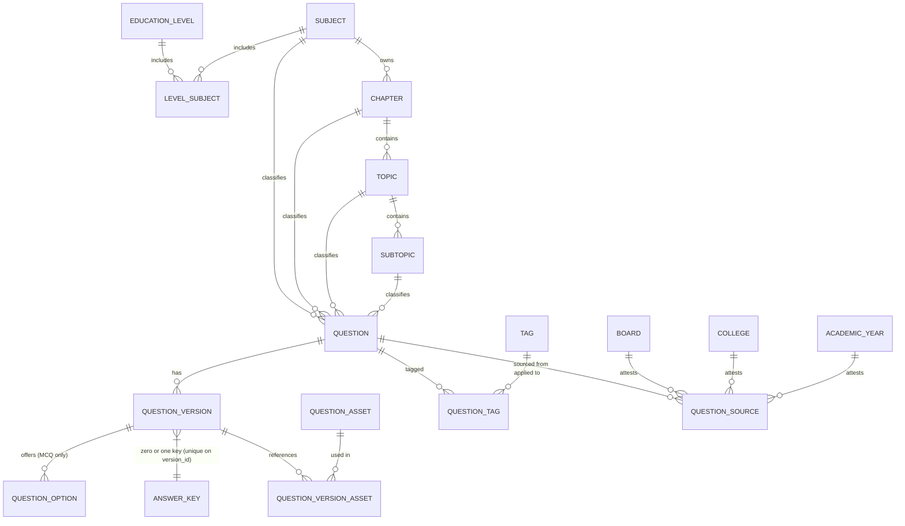

# Phase 04A — Question Bank Physical Schema: Approval Report

**Project:** ICT Atlas — HSC / ALIM ICT Question Bank & Online Examination Platform
**Branch:** `arena/bb085c32-hsc-alim-ict-question-bank` (base `8b37e1c4`)
**Author role:** Senior PostgreSQL database architect / Prisma engineer
**Status:** For approval — **no migration created, `prisma/schema.prisma` untouched, no application code written**
**Related docs:** README.md §2, §4.4, §6; `docs/database/`; `docs/architecture/technology-decisions.md` (open-decision register); `docs/modules/question-bank.md`; `docs/modules/examination-engine.md`; `docs/development/database-migrations.md`

---

## 1. Inspection findings

### 1.1 What exists in the repository

| Artifact | State |
|---|---|
| `README.md` | v2.2 blueprint — single source of truth; decision register §4.4; non-negotiables §15 |
| `docs/architecture/` | system-architecture, module-architecture, technology-decisions (locked baseline + open register OD-01…OD-32 + blueprint inconsistencies) |
| `docs/database/` | database-design, data-dictionary, entity-relationships (logical model only — explicitly **not** a physical schema) |
| `docs/modules/question-bank.md` | Question Bank module scope: taxonomy, MCQ/CQ, versions, keys, assets, sources, search |
| `prisma/schema.prisma` | Generator + datasource only. **No domain models**, by design (comments cite OD-08…OD-13 etc.) |
| `prisma/migrations/` | Does not exist. No migration has ever been created. |
| `lib/db.ts` | Lazy Prisma singleton via `@prisma/adapter-pg` on `DATABASE_URL`; server-only. No domain service uses it yet. |
| `package.json` | Prisma 7.10.1, `@prisma/client` 7.10.1, PostgreSQL datasource, Zod validation layer present but empty (`lib/validation/` has only a README) |

### 1.2 Inconsistencies found (must be resolved explicitly, not silently)

These are the blueprint's own documented conflicts, taken from `docs/architecture/technology-decisions.md` — "Blueprint inconsistencies and clarifications":

| # | Conflict | Where | Decision it maps to |
|---|---|---|---|
| 1 | §1.1 says provenance lives only in `QuestionSource` ("never as columns on `Question`"); §6.2 sketches direct board/year FKs on `Question`. | README | **OD-08** |
| 2 | §5.2 / §7.2.1 (immediate expiry) vs §7.2.2 (grace window + `SUBMITTED_LATE`). | README | **OD-11** |
| 3 | §7.2.2 vs O3: strict lock vs "evaluate last saved answers after expiry". | README | OD-03 / OD-11 |
| 4 | §1.2 / §7.2.5 (CQ answered on paper) vs §7.2.4 / §17.7.5 (typed rich-text CQ answers). | README | **OD-13** |
| 5 | L6/R8/§7.2.5 (AI must not grade or propose CQ marks) vs §7.2.4 / roadmap v3 (AI-assisted evaluation). | README/register | **OD-24** — stricter locked prohibition stands |
| 6 | §7.2.5 / §17.7.6 (reveal correct answer/rubric after finalization) vs this task (no official keys through **any** student-facing exam API, incl. results). | README/task | **OD-14** — no release exception assumed |
| 7 | O2 (serverless PDF option) vs §7.5.3 / §13 (Chromium must not run in a request path; dedicated worker). | README | **OD-02** |
| 8 | §7.5.4 claims `TextDecoder` fails on invalid UTF-8 (it replaces by default). | README | **OD-28** |
| 9 | §7.6.3a: parser draft "nothing saved yet" vs "enters a draft state". | README | **OD-27** |
| 10 | §4.4 R7 vs §7.4.3: AI example JSON repeats `studentAnswer`/`correctAnswer` without untrusted-input qualifications. | README | OD-14 / OD-29 |

**None of these is silently resolved in this proposal.** Each is mapped to its open decision below. The current empty `prisma/schema.prisma` is consistent with the documentation — no model has been defined because no physical decision is approved yet.

---

## 2. Decision review OD-08 … OD-13

Decision definitions are quoted from the open-decision register in `docs/architecture/technology-decisions.md`. I did not invent them.

### OD-08 — Source model

**Exact question (register):** "Source model: board/college/year exclusivity, `TEST_EXAM` taxonomy and whether any direct question FKs exist. README §1.1 says provenance via `QuestionSource`; §6.2 also sketches direct board/year fields."

**Why it matters:** Board/year/college are core filter facets (§7.1.1) and must be relational (README §2: never free-text). If we store them both on `Question` and in `QuestionSource`, the two will diverge and queries become ambiguous. If we store them nowhere relational, filtering and source attribution collapse to free text (violates L2/R6).

**Options:**

| Option | Description |
|---|---|
| **A** — Direct FKs (`boardId`, `academicYearId`, `collegeId`?) on `Question` **plus** `QuestionSource`. | Matches §6.2 sketch. Lets a question carry one "primary" board/year while sources carry history. |
| **B** — `QuestionSource` **only**: conditional `boardId` / `collegeId` / `academicYearId` FKs on source records; **no** academic FKs on `Question`. | Matches §1.1 ("Both are represented through the `QuestionSource` relation, never as columns on `Question`"). One question may carry multiple sources; a board question carries a board, a college/model-test question carries a college. |
| **C** — Hybrid: direct "primary" fields on `Question` for the current board/year, plus a source history table. | Redundant by construction; two sources of truth for the same filter. |

**Advantages / disadvantages:**

- A: simpler single-row lookup for "this question's board". ❌ Contradicts §1.1; cannot represent multiple boards/years for one question without schema change; update anomalies between `Question.boardId` and `QuestionSource.boardId`; college-only sources fit awkwardly.
- B: ✅ Single authoritative provenance model; multi-source per question is native; adding boards/years/colleges is data, not schema; §1.1 vs §6.2 conflict resolved in favor of §1.1. Requires a join for source filters (cheap, indexed).
- C: ❌ Worst of both; redundancy anomalies; rejected by the spirit of L2.

**Recommendation (awaiting your approval):** **Option B.** Source metadata lives exclusively in `QuestionSource` with conditional nullable FKs (`boardId`, `collegeId`, `academicYearId`). A CHECK constraint enforces at-most-one of `boardId`/`collegeId` per source row; service logic enforces source-type-appropriate requirement (BOARD ⇒ board, COLLEGE/TEST_EXAM ⇒ college; year optional on any source). `SourceType` enum: `BOARD | COLLEGE | MODEL_TEST | TEST_EXAM | INSTITUTION | ORIGINAL` (TEST_EXAM taxonomy per §1.1; MODEL_TEST/INSTITUTION/ORIGINAL per §7.1.1 filter list; the TEST_EXAM vs MODEL_TEST boundary is part of this decision).

**Technical consequences:** `Question` has no board/year/subject-as-text columns. All source filtering joins `question_sources`. Board code/year are data rows, not schema — no migration when a new board is added.

**Impact on future modules:** Exam Builder and Paper Studio filter questions by source via `QuestionSource` joins; no schema change needed when boards are added.

**Data integrity / scalability / migration complexity:** Integrity HIGH (CHECK + FKs). Scalability: join on an indexed FK is trivial at bank scale. Migration: greenfield, trivial.

---

### OD-09 — Education level / group / subject cardinalities

**Exact question:** "Education-level/group/subject cardinalities, curriculum revisions and optional topic/subtopic relationships. A multi-level relational taxonomy and first-class `Chapter` are required; joins and revision rules are not specified."

**Why it matters:** The filter cascade (level → subject → chapter → topic → subtopic) is the primary question-bank access path (§7.1.1). `Group` is a required filter concept but not an approved table (data dictionary). Getting the hierarchy wrong forces a question-table redesign later (README §2).

**Options:**

| Option | Description |
|---|---|
| **A** — `subjects.educationLevelId` FK (one level per subject). | Simple, but ICT is taught at both HSC and Alim; one subject cannot serve two levels without duplicate rows. |
| **B** — Explicit `levelSubjects` join table (many-to-many). | Subject may belong to multiple levels; matches "a subject may be relevant to multiple levels" (data dictionary). |
| **C** — Free-text `level` on `Question`. | ❌ Rejected: violates L2 (relations, never strings). |

**Recommendation (awaiting your approval):** **Option B.** `EducationLevel` (HSC, Alim), `Subject` (ICT), explicit `levelSubjects(levelId, subjectId)` join. Hierarchy: `Subject → Chapter → Topic → Subtopic`, all first-class entities with FKs. `Chapter` carries `chapterNumber`, `titleBn`, `titleEn` (§6.2 v2). Uniqueness: `(subjectId, chapterNumber)`.

Question classification: `subjectId` **mandatory**; `chapterId`, `topicId`, `subtopicId` **nullable** in the schema, with service-level enforcement at publish time (a published question should carry at least subject + chapter; mandatory-ness itself remains an OD-09 sub-decision — nullable now keeps the first migration coherent while allowing tightening later via an additive migration). `Group` is **not** modeled yet (not an approved table); flagged for when the group filter is specified.

Cross-hierarchy consistency (topic's chapter must match question's chapter) is enforced in the service layer, not by declarative SQL, because no cross-table CHECK is possible without triggers (triggers are barred by `docs/development/database-migrations.md`).

**Technical consequences:** Filter cascade = pure FK navigation; facet counts from `GROUP BY` aggregates; no free-text academic metadata anywhere.

**Impact on future modules:** Analytics (chapter-level accuracy, §7.3.5) and AI Tutor context both consume this taxonomy unchanged.

**Data integrity / scalability / migration complexity:** Integrity HIGH. Scalability HIGH (small dimension tables, indexed FKs). Migration: trivial now; making `chapterId` NOT NULL later is an additive, backward-compatible migration.

---

### OD-10 — Immutable versioning, snapshots, answer-key versioning

**Exact question:** "Exact immutable version/snapshot and answer-key versioning strategy, including corrections and historical scoring. Exams must retain what was seen and be reproducible; never expose stored keys. Physical tables and correction policy are not specified."

**Why it matters:** This is the core exam-safety property. If editing a question mutates the content students already saw, historical results become meaningless and re-grading is impossible. The answer key is authoritative correctness and must version with the content it certifies.

**Options:**

| Option | Description |
|---|---|
| **A** — Versionless: one content row per question; edits overwrite in place. | ❌ Breaks reproducible exams; directly contradicts the locked requirement (§3.2, §6.5) and README §6.2 ("historical content must not change when a question is edited"). |
| **B** — `QuestionVersion` rows (`versionNumber`, `status`); options and answer key attached to the version; exams reference `versionId` (Phase 05 tables); a revision publishes a new version number; old versions never mutated or deleted once referenced. | ✅ Reproducible snapshots; keys versioned with content; drafts may lack a verified key. |
| **C** — Option B plus a `currentVersionId` back-pointer on `Question`. | Circular FK (migration ordering complexity); "latest published version" is derivable (`MAX(versionNumber)` where `status='PUBLISHED'`), so the pointer adds nothing in v1. |

**Recommendation (awaiting your approval):** **Option B.**

- `question` = identity + classification (mutable taxonomy fields only).
- `question_version` = immutable content snapshot: `versionNumber` (1-based, unique per question), `status` (`DRAFT | PUBLISHED | ARCHIVED`), `content JSONB` (structured content blocks, OD-18 draft below).
- One **published** version per question enforced by a partial unique index on `(question_id) WHERE status = 'PUBLISHED'`; "current published version" = highest `versionNumber` with `status='PUBLISHED'` — derived, not stored (no circular FK).
- `question_options` attach to `question_version` (options freeze with the content they belong to).
- `answer_keys.versionId` is `UNIQUE` — one authoritative key per version (MCQ: correct option key; CQ: per-part rubric JSONB, §OD-13 below).
- Key correction = publish a new question version with a new key. Never mutate a key whose version is referenced by an exam (service-enforced; tested).
- Drafts may exist without a verified key (data dictionary explicitly allows it).
- Exam tables (`Exam`, `ExamQuestion`, `ExamSession`, `StudentAnswer`, `ExamResult`) are **deferred to Phase 05**, but `question_versions.id` is designed as the target of `ExamQuestion.versionId`, so no schema rework is needed later.

**Technical consequences:** Content edits never alter examined questions; historical scoring is reproducible; the answer key travels with its version.

**Impact on future modules:** Examination Engine snapshots versions, not text. AI Tutor cache keys include `questionVersionId` (§7.4.5). Saved questions can pin a version later (OD-10 sub-item) without rework.

**Data integrity / scalability / migration complexity:** Integrity HIGH (this is the immutability gate). Note: "immutable once used in an exam" cannot be declared declaratively without triggers, and triggers are banned by the migration workflow — enforced in the transactional service layer with tests. Scalability: versions grow with authoring volume (bounded, author-side only). Migration: greenfield, trivial.

---

### OD-11 — Exam state transitions, timestamps, grace (Phase 05 gate)

**Exact question:** "Exact state transitions, how the authoritative admission timestamp is captured, grace eligibility/evidence and late-finalization behavior. Five-second configurable default; … its immediate-expiry diagram conflicts with late submission. Preserve the no-new-answers-after-expiry rule."

**Review:** Options are (A) strict lock at `expiresAt` (reject everything after) vs (B) grace window: late **finalization** accepted only with a pre-expiry autosave, marked `SUBMITTED_LATE`; **no new or changed answers after `expiresAt`**. Recommendation direction: **B**, matching the README's detailed table (§7.2.2) and L3 (server-authoritative). Statuses: `CREATED | READY | IN_PROGRESS | SUBMITTED | SUBMITTED_LATE | EXPIRED | EVALUATED`. `startedAt`, `expiresAt`, `graceWindowMs` are server-captured (`DATABASE_URL`-side clock), never client-declared.

**Schema impact on this proposal:** None — `ExamSession`/`ExamResult` are Phase 05 tables. The Question Bank schema is compatible: version immutability (OD-10) guarantees an active session never sees content changes. Listed here for completeness only; **not** part of migration 0001.

---

### OD-12 — Idempotency scope/retention (Phase 05 gate)

**Exact question:** "Idempotency scope/retention, same-key different-payload behavior, concurrent autosave and multi-tab conflict resolution. One final result and deterministic retries are required; the storage and merge policy are not specified."

**Review:** Options: (A) per-answer idempotency key, identical replay = no-op, conflicting payload → deterministic service policy (e.g. first persisted wins / 409); (B) session-level only; (C) last-write-wins. Recommendation direction: **A**, plus a session-level finalization guard (one `ExamResult`, repeat submission returns existing result without re-scoring). Idempotency-key retention period is open (OD-20).

**Schema impact on this proposal:** None — deferred to Phase 05 exam tables.

---

### OD-13 — CQ input modality and per-part/result representation

**Exact question:** "CQ input modality and per-part/result representation, self-assessment revisions and teacher override. README describes paper answers, typed responses and a rich-text editor; mixed-result provenance must be representable. OD-01 governs which assessment is offered."

**Review for this schema:**
- `Question.type = CQ` carries **no option rows** (options exist only for MCQ).
- `answer_keys.cq_rubric JSONB` captures the per-part structure: parts ক/খ/গ/ঘ with max marks 1/2/3/4 and marking criteria — the authoritative evaluation basis, versioned with the question.
- CQ response storage, self-assessment slider, revision window, and teacher override are **deferred** (OD-01 governs whether self-assessment, teacher review, or both; Phase 05/08).
- Answer-key security (this task + locked baseline): `AnswerKey` rows are **never** returned by student-facing exam APIs, including result APIs. OD-14 must define any compliant post-finalization release path; no exception is assumed in this schema.

**Schema impact on this proposal:** `AnswerKey` gets `mcq_correct_option_key` and `cq_rubric` columns (both nullable; service enforces type-appropriate completeness at publish). That is the only OD-13-relevant structure in migration 0001.

---

## 3. Minimum coherent Question Bank schema — migration 0001 scope

**In scope (18 tables):** `education_levels`, `subjects`, `level_subjects`, `chapters`, `topics`, `subtopics`, `boards`, `colleges`, `academic_years`, `questions`, `question_versions`, `question_options`, `answer_keys`, `question_assets`, `question_version_assets`, `tags`, `question_tags`, `question_sources`.

**Out of scope (deferred):** `Exam`, `ExamQuestion`, `ExamSession`, `StudentAnswer`, `ExamResult` (Phase 05; OD-11/OD-12/OD-13); `User` linkage / `createdBy`/`updatedBy` (OD-15, Student Management owns users); moderation states beyond `DRAFT | PUBLISHED | ARCHIVED` (OD-27); full-text search indexes (OD-32); paper/export document model (OD-28).

**Rationale:** Phase 04 = taxonomy + MCQ/CQ bank + structured content + versions + keys + assets + sources. Examinations (Phase 05) consume `question_versions.id` but own their own tables. This is the smallest schema in which a question can be authored, classified relationally, versioned, keyed, sourced, and published — without inventing exam or identity decisions.

**JSONB boundaries (approved in principle, L2/R6; exact block schema is OD-18 and drafted below):**
- `question_versions.content` — structured document blocks (stem, subquestions, images, code, math) as validated typed blocks. Never the whole question record.
- `question_options.content` — option content blocks (options may contain math/images per C2).
- `answer_keys.cq_rubric` — per-part marking criteria.
- Not JSONB: board, year, chapter, topic, subject, type, status, marks, source, ownership — all relational.

---

## 4. Proposed ER diagram (Mermaid)



Notes: `QUESTION_VERSION ||--o{ ANSWER_KEY` is drawn one-to-many for diagramming convenience; `@unique` on `answer_keys.version_id` enforces zero-or-one. `QUESTION_VERSION_ASSET` is a join table — an asset may be reused by many versions; a version references many assets. Deferred exam tables (Phase 05) would add: `EXAM ||--o{ EXAM_QUESTION`, `EXAM_QUESTION }|--|| QUESTION_VERSION`, `EXAM ||--o{ EXAM_SESSION`, `EXAM_SESSION ||--o{ STUDENT_ANSWER`, `EXAM_SESSION ||--|| EXAM_RESULT`.

---

## 5. Table-by-table specification

All tables get `created_at timestamptz NOT NULL DEFAULT now()`; `updated_at timestamptz` where mutable. FKs: `ON DELETE RESTRICT` on dimension tables (protect taxonomy in use), `ON DELETE CASCADE` from `question` to its versions/options/sources/tags (owned children), `ON DELETE RESTRICT` from version to asset (shared asset). Column names are `snake_case` (Prisma maps camelCase fields automatically).

### 5.1 `education_levels`

| Column | PG type | Null | Default / Check | Notes |
|---|---|---|---|---|
| `id` | uuid | NO | PK | client-generated UUID (`uuid()`) |
| `code` | text | NO | UNIQUE | `HSC`, `ALIM` |
| `name_bn` | text | NO | | e.g. höher secondary |
| `name_en` | text | NO | | `HSC` / `Alim` |
| `is_active` | boolean | NO | `true` | soft retire |
| `created_at`, `updated_at` | timestamptz | NO | `now()` / auto | |

### 5.2 `subjects`

| Column | PG type | Null | Default / Check | Notes |
|---|---|---|---|---|
| `id` | uuid | NO | PK | |
| `code` | text | NO | UNIQUE | `ICT` |
| `name_bn`, `name_en` | text | NO | | |
| `is_active` | boolean | NO | `true` | |
| `created_at`, `updated_at` | timestamptz | NO | | |

### 5.3 `level_subjects` (many-to-many join)

| Column | PG type | Null | Notes |
|---|---|---|---|
| `level_id` | uuid | NO | FK → `education_levels.id`, CASCADE |
| `subject_id` | uuid | NO | FK → `subjects.id`, CASCADE |
| `created_at` | timestamptz | NO | `now()` |
| PK | (`level_id`, `subject_id`) | | |

### 5.4 `chapters` (first-class entity, §6.2 v2)

| Column | PG type | Null | Default / Check | Notes |
|---|---|---|---|---|
| `id` | uuid | NO | PK | |
| `subject_id` | uuid | NO | FK RESTRICT | |
| `chapter_number` | int | NO | > 0 | 1…6 for initial ICT curriculum |
| `title_bn`, `title_en` | text | NO | | bilingual titles |
| `is_active` | boolean | NO | `true` | |
| `created_at`, `updated_at` | timestamptz | NO | | |
| UNIQUE | (`subject_id`, `chapter_number`) | | | |

### 5.5 `topics`

| Column | PG type | Null | Default / Check | Notes |
|---|---|---|---|---|
| `id` | uuid | NO | PK | |
| `chapter_id` | uuid | NO | FK RESTRICT | |
| `name_bn`, `name_en` | text | NO | | |
| `order_index` | int | NO | `0` | position within chapter |
| `is_active` | boolean | NO | `true` | |
| `created_at`, `updated_at` | timestamptz | NO | | |
| UNIQUE | (`chapter_id`, `order_index`) | | | |

### 5.6 `subtopics`

| Column | PG type | Null | Notes |
|---|---|---|---|
| `id` | uuid | NO | PK |
| `topic_id` | uuid | NO | FK RESTRICT |
| `name_bn`, `name_en` | text | NO | |
| `is_active` | boolean | NO | `true` |
| `created_at`, `updated_at` | timestamptz | NO | |

### 5.7 `boards`

| Column | PG type | Null | Default / Check | Notes |
|---|---|---|---|---|
| `id` | uuid | NO | PK | |
| `code` | text | NO | UNIQUE | `DHAKA`, `RAJSHAHI`, `MADRASAH`, `BTEB`, … |
| `name_bn` | text | YES | | |
| `name_en` | text | NO | | |
| `type` | board_type enum | NO | `GENERAL` | `GENERAL | MADRASAH | TECHNICAL` (§1.1) |
| `is_active` | boolean | NO | `true` | |

### 5.8 `colleges`

| Column | PG type | Null | Notes |
|---|---|---|---|
| `id` | uuid | NO | PK |
| `name` | text | NO | UNIQUE |
| `code` | text | YES | e.g. EIIN where applicable |
| `is_active` | boolean | NO | `true` |
| `created_at`, `updated_at` | timestamptz | NO | |

### 5.9 `academic_years`

| Column | PG type | Null | Notes |
|---|---|---|---|
| `id` | uuid | NO | PK |
| `label` | text | NO | UNIQUE | e.g. `2024`, `2024-25` |
| `year` | int | YES | UNIQUE | numeric value for range filters |
| `is_active` | boolean | NO | `true` |
| `created_at`, `updated_at` | timestamptz | NO | |

### 5.10 `questions` (identity + classification only — content lives in versions)

| Column | PG type | Null | Default / Check | Notes |
|---|---|---|---|---|
| `id` | uuid | NO | PK | |
| `type` | question_type enum | NO | | `MCQ | CQ` |
| `status` | question_status enum | NO | `DRAFT` | `DRAFT | PUBLISHED | ARCHIVED` (OD-27 may add more) |
| `difficulty` | question_difficulty enum | NO | `MEDIUM` | `EASY | MEDIUM | HARD` |
| `created_via` | question_origin enum | NO | `MANUAL` | `MANUAL | BULK_IMPORT | AI_PARSER` (AI_PARSER gated by OD-05) |
| `subject_id` | uuid | NO | FK RESTRICT | mandatory classification |
| `chapter_id` | uuid | YES | FK RESTRICT | nullable now; service enforces at publish (OD-09) |
| `topic_id` | uuid | YES | FK RESTRICT | |
| `subtopic_id` | uuid | YES | FK RESTRICT | |
| `marks` | int | NO | `1` | `>= 0`; MCQ default 1; CQ total max marks (10) |
| `negative_marks` | int | NO | `0` | `>= 0` (OD-21 floor open — v1: no negative marking) |
| `created_at`, `updated_at` | timestamptz | NO | | |

Indexes: `subject_id`; `chapter_id`; `topic_id`; `subtopic_id`; `(type, status)`; `(status, type, difficulty)`; `(subject_id, chapter_id, topic_id)` (cascade filter).

### 5.11 `question_versions` (immutable content snapshot)

| Column | PG type | Null | Default / Check | Notes |
|---|---|---|---|---|
| `id` | uuid | NO | PK | |
| `question_id` | uuid | NO | FK CASCADE | |
| `version_number` | int | NO | `1`, `> 0` | 1-based per question |
| `status` | version_status enum | NO | `DRAFT` | `DRAFT | PUBLISHED | ARCHIVED` |
| `content` | jsonb | NO | | structured content blocks (OD-18 draft) |
| `created_at` | timestamptz | NO | `now()` | no `updated_at` — revisions create new rows |
| UNIQUE | (`question_id`, `version_number`) | | | |
| Indexes | `question_id`; `status`; `(question_id, status)` | | | |

Partial unique index (raw SQL): one published version per question — `WHERE status = 'PUBLISHED'`.

### 5.12 `question_options` (MCQ choices, attached to a version)

| Column | PG type | Null | Default / Check | Notes |
|---|---|---|---|---|
| `id` | uuid | NO | PK | |
| `version_id` | uuid | NO | FK CASCADE | |
| `key` | text | NO | `char_length(key) = 1` | `A`…`D` or `ক`…`ঘ` |
| `content` | jsonb | NO | | structured option block |
| `order_index` | int | NO | `0` | display order |
| `is_correct` | boolean | NO | `false` | exactly one `true` per MCQ version (service + partial index) |
| Indexes | `version_id`; `(version_id, is_correct)` | | | |

Partial unique index (raw SQL): at most one correct option per version — `WHERE is_correct = true`. CQ versions simply have no option rows.

### 5.13 `answer_keys` (authoritative correctness — server-only)

| Column | PG type | Null | Default / Check | Notes |
|---|---|---|---|---|
| `id` | uuid | NO | PK | |
| `version_id` | uuid | NO | UNIQUE, FK CASCADE | one key per version |
| `mcq_correct_option_key` | text | YES | | option `key` for MCQ versions |
| `cq_rubric` | jsonb | YES | | per-part rubric (ক/খ/গ/ঘ: maxMarks 1/2/3/4 + criteria) |
| `is_verified` | boolean | NO | `false` | human-verified key |
| `verified_at` | timestamptz | YES | | |
| `notes` | text | YES | | |
| `created_at`, `updated_at` | timestamptz | NO | | |

Type-appropriate completeness (`mcq_correct_option_key` for MCQ, `cq_rubric` for CQ) is enforced in the service layer at publish (cross-table rule; drafts may lack a verified key). **Never projected to student-facing DTOs** (task rule + locked baseline; OD-14 governs any later release).

### 5.14 `question_assets` (metadata only — bytes live in object storage)

| Column | PG type | Null | Default / Check | Notes |
|---|---|---|---|---|
| `id` | uuid | NO | PK | |
| `storage_key` | text | NO | UNIQUE | immutable object-storage path (new upload = new row) |
| `mime_type` | text | NO | | validated at upload (OD-19) |
| `size_bytes` | int | NO | `> 0` | |
| `width`, `height` | int | YES | | for images/diagrams |
| `alt_text` | text | NO | | accessible description |
| `long_description` | text | YES | | for complex diagrams |
| `checksum` | text | YES | | integrity of stored bytes |
| `created_at` | timestamptz | NO | `now()` | |

### 5.15 `question_version_assets` (version ↔ asset join)

| Column | PG type | Null | Notes |
|---|---|---|---|
| `version_id` | uuid | NO | FK CASCADE → `question_versions.id` |
| `asset_id` | uuid | NO | FK RESTRICT → `question_assets.id` |
| `block_ref` | text | YES | JSON pointer into `version.content` blocks |
| PK | (`version_id`, `asset_id`) | | |
| Index | `asset_id` | | reverse lookup (which versions render this asset) |

Pins the exact assets a historical version rendered — versions keep rendering if asset metadata changes.

### 5.16 `tags`

| Column | PG type | Null | Notes |
|---|---|---|---|
| `id` | uuid | NO | PK |
| `name` | text | NO | UNIQUE |
| `slug` | text | NO | UNIQUE |
| `created_at` | timestamptz | NO | |

### 5.17 `question_tags` (question ↔ tag join; tags classify the question, not a version)

| Column | PG type | Null | Notes |
|---|---|---|---|
| `question_id` | uuid | NO | FK CASCADE |
| `tag_id` | uuid | NO | FK CASCADE |
| PK | (`question_id`, `tag_id`) | | |
| Index | `tag_id` | | facet counts |

### 5.18 `question_sources` (provenance — OD-08)

| Column | PG type | Null | Default / Check | Notes |
|---|---|---|---|---|
| `id` | uuid | NO | PK | |
| `question_id` | uuid | NO | FK CASCADE | |
| `source_type` | source_type enum | NO | | `BOARD | COLLEGE | MODEL_TEST | TEST_EXAM | INSTITUTION | ORIGINAL` |
| `board_id` | uuid | YES | FK RESTRICT | required when `source_type = BOARD` |
| `college_id` | uuid | YES | FK RESTRICT | required when `COLLEGE` / `TEST_EXAM` |
| `academic_year_id` | uuid | YES | FK RESTRICT | optional on any source |
| `source_name` | text | YES | | free text for INSTITUTION/ORIGINAL without an org record |
| `created_at` | timestamptz | NO | `now()` | |
| CHECK | | | `(board_id IS NULL) OR (college_id IS NULL)` | at most one org per source |
| Indexes | `question_id`; `source_type`; `board_id`; `college_id`; `academic_year_id` | | | |

Partial unique index (raw SQL): prevent duplicate fully-specified source records — on `(question_id, source_type, board_id, college_id, academic_year_id)` where all are non-null.

---

## 6. Relationships and cardinalities

| Relationship | Cardinality | Enforcement |
|---|---|---|
| EducationLevel → LevelSubject ← Subject | many-to-many | join table PK; CASCADE both sides |
| Subject → Chapter | 1:N | FK RESTRICT |
| Chapter → Topic → Subtopic | 1:N each | FK RESTRICT |
| Question → Subject / Chapter / Topic / Subtopic | N:1 each (chapter+ nullable) | FK RESTRICT; cross-hierarchy consistency in service |
| Question → QuestionVersion | 1:N | FK CASCADE; unique `(question_id, version_number)` |
| QuestionVersion → published | 0:1 per question | partial unique index `WHERE status='PUBLISHED'` |
| QuestionVersion → QuestionOption | 1:N (MCQ only) | FK CASCADE; at-most-one-correct partial index |
| QuestionVersion → AnswerKey | 1:0..1 | `@unique` on `version_id` |
| QuestionVersion → QuestionVersionAsset ← QuestionAsset | 1:N / 1:N | join table; asset shared across versions |
| Question → QuestionTag ← Tag | N:M | join table PK |
| Question → QuestionSource | 1:N | FK CASCADE |
| QuestionSource → Board / College / AcademicYear | N:1 each (optional) | FK RESTRICT; CHECK at most one of board/college |
| (future, Phase 05) ExamQuestion → QuestionVersion | N:1 | FK to `question_versions.id` — pre-designed, not created yet |

**No free-text board/year/chapter/topic/subject on `Question`** — every academic attribute is a foreign key (README §2, L2). **No content/bytes in `questions`** — content is versioned JSONB; assets are object-storage references (preserve content/asset distinction).

---

## 7. Proposed Prisma models (candidate — NOT applied)

The block below is the proposed `prisma/schema.prisma` content. It becomes effective only after your approval of the numbered decisions at the end of this report, and only via `npm run db:migrate --name <...>` against a disposable database, followed by SQL review (`docs/development/database-migrations.md`).

```prisma
// ICT Atlas — Phase 04A Question Bank physical schema (PROPOSAL)
//
// DO NOT APPLY until the approval decisions at the end of the accompanying
// report are accepted. Migration 0001 is created with `npm run db:migrate`
// against a disposable database and reviewed before any deployment.

generator client {
  provider = "prisma-client"
  output   = "../lib/generated/prisma"
}

datasource db {
  provider = "postgresql"
  url      = env("DATABASE_URL")
}

enum BoardType {
  GENERAL
  MADRASAH
  TECHNICAL
}

enum QuestionType {
  MCQ
  CQ
}

enum QuestionStatus {
  DRAFT
  PUBLISHED
  ARCHIVED
}

enum QuestionDifficulty {
  EASY
  MEDIUM
  HARD
}

enum QuestionOrigin {
  MANUAL
  BULK_IMPORT
  AI_PARSER
}

enum VersionStatus {
  DRAFT
  PUBLISHED
  ARCHIVED
}

enum SourceType {
  BOARD
  COLLEGE
  MODEL_TEST
  TEST_EXAM
  INSTITUTION
  ORIGINAL
}

model EducationLevel {
  id        String       @id @default(uuid())
  code      String       @unique
  nameBn    String
  nameEn    String
  isActive  Boolean      @default(true)
  createdAt DateTime     @default(now())
  updatedAt DateTime     @updatedAt
  levelSubjects LevelSubject[]
  @@map("education_levels")
}

model Subject {
  id            String       @id @default(uuid())
  code          String       @unique
  nameBn        String
  nameEn        String
  isActive      Boolean      @default(true)
  createdAt     DateTime     @default(now())
  updatedAt     DateTime     @updatedAt
  levelSubjects LevelSubject[]
  chapters      Chapter[]
  questions     Question[]
  @@map("subjects")
}

model LevelSubject {
  levelId    String
  subjectId  String
  level      EducationLevel @relation(fields: [levelId], references: [id], onDelete: Cascade)
  subject    Subject        @relation(fields: [subjectId], references: [id], onDelete: Cascade)
  createdAt  DateTime       @default(now())
  @@id([levelId, subjectId])
  @@map("level_subjects")
}

model Chapter {
  id          String   @id @default(uuid())
  subjectId   String
  chapterNumber Int     @default(1)
  titleBn     String
  titleEn     String
  isActive    Boolean  @default(true)
  createdAt   DateTime @default(now())
  updatedAt   DateTime @updatedAt
  subject     Subject  @relation(fields: [subjectId], references: [id], onDelete: Restrict)
  topics      Topic[]
  questions   Question[]
  @@unique([subjectId, chapterNumber])
  @@map("chapters")
}

model Topic {
  id          String   @id @default(uuid())
  chapterId   String
  nameBn      String
  nameEn      String
  orderIndex  Int      @default(0)
  isActive    Boolean  @default(true)
  createdAt   DateTime @default(now())
  updatedAt   DateTime @updatedAt
  chapter     Chapter  @relation(fields: [chapterId], references: [id], onDelete: Restrict)
  subtopics   Subtopic[]
  questions   Question[]
  @@unique([chapterId, orderIndex])
  @@map("topics")
}

model Subtopic {
  id          String   @id @default(uuid())
  topicId     String
  nameBn      String
  nameEn      String
  isActive    Boolean  @default(true)
  createdAt   DateTime @default(now())
  updatedAt   DateTime @updatedAt
  topic       Topic    @relation(fields: [topicId], references: [id], onDelete: Restrict)
  questions   Question[]
  @@map("subtopics")
}

model Board {
  id        String   @id @default(uuid())
  code      String   @unique
  nameBn    String?
  nameEn    String
  type      BoardType @default(GENERAL)
  isActive  Boolean  @default(true)
  createdAt DateTime @default(now())
  updatedAt DateTime @updatedAt
  sources   QuestionSource[]
  @@map("boards")
}

model College {
  id        String   @id @default(uuid())
  name      String   @unique
  code      String?
  isActive  Boolean  @default(true)
  createdAt DateTime @default(now())
  updatedAt DateTime @updatedAt
  sources   QuestionSource[]
  @@map("colleges")
}

model AcademicYear {
  id        String   @id @default(uuid())
  label     String   @unique
  year      Int?     @unique
  isActive  Boolean  @default(true)
  createdAt DateTime @default(now())
  updatedAt DateTime @updatedAt
  sources   QuestionSource[]
  @@map("academic_years")
}

model Question {
  id            String           @id @default(uuid())
  type          QuestionType
  status        QuestionStatus   @default(DRAFT)
  difficulty    QuestionDifficulty @default(MEDIUM)
  createdVia    QuestionOrigin   @default(MANUAL)
  subjectId     String
  chapterId     String?
  topicId       String?
  subtopicId    String?
  marks         Int              @default(1)
  negativeMarks Int              @default(0)
  createdAt     DateTime         @default(now())
  updatedAt     DateTime         @updatedAt
  subject       Subject          @relation(fields: [subjectId], references: [id], onDelete: Restrict)
  chapter       Chapter?         @relation(fields: [chapterId], references: [id], onDelete: Restrict)
  topic         Topic?           @relation(fields: [topicId], references: [id], onDelete: Restrict)
  subtopic      Subtopic?        @relation(fields: [subtopicId], references: [id], onDelete: Restrict)
  versions      QuestionVersion[]
  sources       QuestionSource[]
  tags          QuestionTag[]
  @@index([subjectId])
  @@index([chapterId])
  @@index([topicId])
  @@index([subtopicId])
  @@index([type, status])
  @@index([status, type, difficulty])
  @@index([subjectId, chapterId, topicId])
  @@map("questions")
}

model QuestionVersion {
  id        String      @id @default(uuid())
  questionId String
  versionNumber Int    @default(1)
  status    VersionStatus @default(DRAFT)
  content   Json
  createdAt DateTime    @default(now())
  question  Question    @relation(fields: [questionId], references: [id], onDelete: Cascade)
  options   QuestionOption[]
  answerKey AnswerKey?
  assets    QuestionVersionAsset[]
  @@unique([questionId, versionNumber])
  @@index([questionId])
  @@index([status])
  @@index([questionId, status])
  @@map("question_versions")
}

model QuestionOption {
  id        String   @id @default(uuid())
  versionId String
  key       String   // "A"…"D" or "ক"…"ঘ"
  content   Json
  order     Int      @default(0)
  isCorrect Boolean @default(false)
  version   QuestionVersion @relation(fields: [versionId], references: [id], onDelete: Cascade)
  @@index([versionId])
  @@index([versionId, isCorrect])
  @@map("question_options")
}

model AnswerKey {
  id             String   @id @default(uuid())
  versionId      String   @unique
  mcqCorrectOptionKey String?
  cqRubric       Json?
  isVerified     Boolean  @default(false)
  verifiedAt     DateTime?
  notes          String?
  createdAt      DateTime @default(now())
  updatedAt      DateTime @updatedAt
  version        QuestionVersion @relation(fields: [versionId], references: [id], onDelete: Cascade)
  @@map("answer_keys")
}

model QuestionAsset {
  id             String   @id @default(uuid())
  storageKey     String   @unique
  mimeType       String
  sizeBytes      Int
  width          Int?
  height         Int?
  altText        String
  longDescription String?
  checksum       String?
  createdAt      DateTime @default(now())
  versions       QuestionVersionAsset[]
  @@map("question_assets")
}

model QuestionVersionAsset {
  versionId  String
  assetId    String
  blockRef   String?
  version    QuestionVersion @relation(fields: [versionId], references: [id], onDelete: Cascade)
  asset      QuestionAsset   @relation(fields: [assetId], references: [id], onDelete: Restrict)
  @@id([versionId, assetId])
  @@index([assetId])
  @@map("question_version_assets")
}

model Tag {
  id        String   @id @default(uuid())
  name      String   @unique
  slug      String   @unique
  createdAt DateTime @default(now())
  questions QuestionTag[]
  @@map("tags")
}

model QuestionTag {
  questionId String
  tagId      String
  question   Question @relation(fields: [questionId], references: [id], onDelete: Cascade)
  tag        Tag      @relation(fields: [tagId], references: [id], onDelete: Cascade)
  @@id([questionId, tagId])
  @@index([tagId])
  @@map("question_tags")
}

model QuestionSource {
  id             String      @id @default(uuid())
  questionId     String
  sourceType     SourceType
  boardId        String?
  collegeId      String?
  academicYearId String?
  sourceName     String?
  createdAt      DateTime    @default(now())
  question       Question    @relation(fields: [questionId], references: [id], onDelete: Cascade)
  board          Board?      @relation(fields: [boardId], references: [id], onDelete: Restrict)
  college        College?    @relation(fields: [collegeId], references: [id], onDelete: Restrict)
  academicYear   AcademicYear? @relation(fields: [academicYearId], references: [id], onDelete: Restrict)
  @@index([questionId])
  @@index([sourceType])
  @@index([boardId])
  @@index([collegeId])
  @@index([academicYearId])
  @@map("question_sources")
}
```

**Supplementary migration SQL (partial indexes & checks not expressible in Prisma):**

```sql
-- one published version per question
CREATE UNIQUE INDEX one_published_version_per_question
  ON question_versions(question_id) WHERE status = 'PUBLISHED';

-- at most one correct option per version
CREATE UNIQUE INDEX at_most_one_correct_option_per_version
  ON question_options(version_id) WHERE is_correct = true;

-- no duplicate fully-specified source record
CREATE UNIQUE INDEX no_duplicate_question_source
  ON question_sources(question_id, source_type, board_id, college_id, academic_year_id)
  WHERE board_id IS NOT NULL AND college_id IS NOT NULL AND academic_year_id IS NOT NULL;

-- domain checks
ALTER TABLE questions ADD CONSTRAINT questions_marks_nonnegative CHECK (marks >= 0);
ALTER TABLE questions ADD CONSTRAINT questions_negative_marks_nonnegative CHECK (negative_marks >= 0);
ALTER TABLE question_versions ADD CONSTRAINT qv_version_number_positive CHECK (version_number > 0);
ALTER TABLE question_options ADD CONSTRAINT qo_key_single_char CHECK (char_length(key) = 1);
ALTER TABLE question_sources ADD CONSTRAINT qs_board_or_college_not_both CHECK ((board_id IS NULL) OR (college_id IS NULL));
ALTER TABLE question_assets ADD CONSTRAINT qa_size_positive CHECK (size_bytes > 0);
```

**OD-18 draft — content block schema (recommended, awaiting approval):** `content` is an array of typed blocks: `{ type, data }` where `type ∈ {paragraph, heading, list, table, image, math, code, flowchart, callout, subquestion}`. `image` blocks carry `assetId` resolved through `question_version_assets.block_ref`. Exact block schemas and sanitization remain OD-18; the DB stores `Json` and validates shape in the service layer.

---

## 8. Index and constraint rationale

- **FK indexes on every foreign key** — filter paths (subject/chapter/topic/subtopic/type/difficulty/source joins) are the entire question-bank access pattern (§7.1.1).
- **Composite `(subject_id, chapter_id, topic_id)`** — serves the level→subject→chapter→topic cascade without scanning.
- **`(status, type, difficulty)`** — published listing with type/difficulty facets.
- **Partial unique indexes** — publish-safety (one current version), answer integrity (one correct MCQ option), source dedup — declarative where PostgreSQL allows it.
- **Checks** — `marks >= 0`, `negative_marks >= 0`, `version_number > 0`, single-char option key, at-most-one org per source: cheap, immutable guardrails.
- **No GIN/full-text indexes yet** — search indexing/tokenization is OD-32; a `GIN` on `question_versions.content` can be added additively.
- **No `ORDER BY RANDOM()`-friendly structures** — random selection is a service algorithm (§7.1.3), not a schema concern.

---

## 9. Data integrity and deletion policy

- **Taxonomy rows:** `RESTRICT` on delete while referenced; soft-retire via `is_active = false`. Hard delete only when nothing references the row.
- **Questions:** never hard-deleted once any version is referenced by an exam (Phase 05) or any answer exists. `status = ARCHIVED` is the soft-delete. Hard-delete permitted only for draft, unreferenced questions.
- **Question versions:** never deleted once published or referenced by an exam; draft versions deletable only when unreferenced. "Immutable once used in an exam" is enforced in the transactional service layer (triggers banned by the migration workflow) and covered by tests.
- **Options / answer keys / version-asset links:** cascade with question deletion; never mutated historically — a correction publishes a new version.
- **Assets:** bytes are immutable in object storage (new upload = new `storage_key` row); asset metadata may be updated; the version→asset join pins historical rendering. Orphan cleanup and retention periods are OD-20.
- **Answer keys:** never exposed through student-facing exam APIs, including result endpoints (task rule; stricter than README's pre-submission restriction). Any post-finalization release requires OD-14.
- **Created/updated-by linkage to `users`:** not in this migration (OD-15/OD-16); added when Student Management lands, with an additive migration.

---

## 10. MCQ / CQ representation, answer-key security, assets, sources (summary)

- **MCQ:** `Question.type = MCQ`; `version.content` = stem blocks; four `question_options` rows keyed `A`/`B`/`C`/`D` (or ক/খ/গ/ঘ), exactly one `is_correct = true` (service-validated + partial unique index); `AnswerKey.mcq_correct_option_key`; `marks` default 1.
- **CQ:** `Question.type = CQ`; `version.content` = stimulus + four subquestion blocks; **no option rows**; `AnswerKey.cq_rubric` = per-part criteria with max marks 1/2/3/4; `marks` = total (10) for UI, rubric authoritative. CQ answers/responses, self-assessment, and teacher override are deferred (OD-01/OD-13, Phase 05/08).
- **Answer-key security:** `AnswerKey` exists in the schema but is excluded from every student-facing projection; services select explicit columns only (no `SELECT *` leakage into exam or result DTOs).
- **Assets:** content blocks reference assets via `question_version_assets.block_ref`; bytes never stored in PostgreSQL (object storage, validated uploads — OD-19).
- **Sources:** exclusively `QuestionSource` (OD-08); conditional board/college/year FKs; `TEST_EXAM` in the taxonomy.

---

## 11. Classification of decisions

### Already approved (baseline — no action needed)
Modular monolith (L1); PostgreSQL + Prisma with JSONB limited to structured content/snapshots (L2, R6); server-authoritative exams (L3); answer keys never exposed to clients (task rule: extended to **all** student-facing exam APIs incl. results); structured, versioned question content; AI behind adapter, Gemini default, AI never awards marks (L6, L7, R8); print-first selectable-vector PDF; design tokens + WCAG 2.2 AA; audit logging and automated testing.

### Recommended — awaiting your approval (this report)
1. OD-08 — `QuestionSource`-only provenance, conditional FKs, `TEST_EXAM` taxonomy.
2. OD-09 — `levelSubjects` join; Subject→Chapter→Topic→Subtopic; `subjectId` mandatory, chapter/topic/subtopic nullable with publish-time service enforcement; no `Group` table.
3. OD-10 — version rows with `versionNumber` + status; one published version per question (partial unique index); options and keys version-attached; key correction via new version; immutability service-enforced; `Exam*` tables deferred.
4. Migration 0001 scope — the 18 tables above (Exam* deferred to Phase 05).
5. JSONB usage boundaries and OD-18 content-block schema direction.
6. Deletion and integrity policy (soft deletes; immutability once examined; no hard delete of answered/exam-used content).

### Reviewed — direction noted, gated to Phase 05 (exams), not migration 0001
7. OD-11 — grace window + `SUBMITTED_LATE`, server-captured `startedAt`/`expiresAt`, no new answers after expiry.
8. OD-12 — per-answer idempotency key, deterministic conflict policy, one result per session.
9. OD-13 — CQ rubric JSONB in `answer_keys` (included); CQ responses/self-assessment/teacher override deferred.

### Explicitly unresolved (not decided here; do not implement against)
Group entity; `createdBy`/`updatedBy` user linkage (OD-15); moderation states beyond `DRAFT|PUBLISHED|ARCHIVED` (OD-27); RLS (OD-16); full-text search/tokenization (OD-32); retention periods (OD-20); rate-limit store (OD-06); CQ assessment modality (OD-01); strict-expiry vs auto-submit (OD-03); guest practice (OD-04); post-release answer review (OD-14); PDF worker host (OD-02); paper/export model (OD-28); AI cache/isolation (OD-29).

---

## 12. Migration impact assessment

- **Greenfield:** no production data exists, so migration 0001 creates all 18 tables, enums, indexes, and checks with **zero data-migration risk**.
- **Workflow:** edit `prisma/schema.prisma` → `npm run db:migrate --name <descriptive>` against a disposable database → review generated SQL in `prisma/migrations/` → `npm run db:validate` + `npm run db:generate` → test against isolated PostgreSQL → `npm run db:deploy` on staging/production (migrations apply before dependent code). Never edit applied migrations; no `db push --force-reset` or `DROP/TRUNCATE` on shared databases.
- **No triggers or stored procedures:** all business rules (version immutability once examined, source-type FK requirements, answer-key type matching) live in `server/` domain services, per the migration workflow and module architecture.
- **Rollback:** forward-only migrations (never edit applied); development databases are disposable and may be reset.
- **Forward compatibility:** `question_versions.id` is pre-designed as the target of Phase 05's `ExamQuestion.versionId`; adding exam tables later is purely additive.
- **Client regeneration:** any schema change requires `npm run db:generate`; `lib/db.ts` needs no changes.
- **Blast radius:** editing `prisma/schema.prisma` does not affect any running application until a migration is applied, the client regenerated, and dependent code written — none of which happens in this phase.

---

## 13. Decisions required from you (numbered list)

1. **Approve OD-08 — Option B:** provenance exclusively via `QuestionSource`; conditional `boardId`/`collegeId`/`academicYearId` FKs with at-most-one-of board/college CHECK; `SourceType` enum including `TEST_EXAM`; **no** direct board/year/college columns on `Question`. **[Blocks migration 0001]**
2. **Approve OD-09 — Option B:** `EducationLevel`, `Subject` linked via explicit `levelSubjects` join table; `Subject → Chapter → Topic → Subtopic` hierarchy; `Question.subjectId` mandatory, `chapterId`/`topicId`/`subtopicId` nullable with publish-time service enforcement; no `Group` table yet. **[Blocks migration 0001]**
3. **Approve OD-10 — Option B:** `QuestionVersion` (`versionNumber` + `status`); one published version per question via partial unique index; options and `AnswerKey` attached to versions (`versionId` unique); key correction = new version; versions immutable once used in an exam (service-enforced); `Exam*` tables deferred to Phase 05. **[Blocks migration 0001]**
4. **Approve migration 0001 scope:** the 18 tables in §5 (taxonomy, questions, versions, options, keys, assets, tags, sources); `Exam`/`ExamSession`/`ExamResult`/answer tables explicitly deferred. **[Blocks migration 0001]**
5. **Approve JSONB boundaries:** content blocks on `question_versions.content` and `question_options.content`, `cq_rubric` on `answer_keys`; no whole-question JSONB; OD-18 block schema as drafted. **[Blocks migration 0001]**
6. **Approve deletion and integrity policy:** soft-delete taxonomy (`is_active`) and questions (`status = ARCHIVED`); never hard-delete answered or exam-referenced content; version immutability service-enforced; answer keys never in student-facing DTOs. **[Blocks migration 0001]**
7. **Acknowledge OD-11 / OD-12 / OD-13:** reviewed above; direction recorded; required before Phase 05 (examinations), not before migration 0001.

**I will not create or apply any migration, modify `prisma/schema.prisma`, create services, or write business logic until you explicitly approve the above. Please confirm which of decisions 1–7 you approve, or ask for changes.**

--- 

*Prepared from: README.md (v2.2), docs/architecture/, docs/database/, docs/modules/, docs/development/database-migrations.md, prisma/schema.prisma, package.json, lib/db.ts. Decision definitions quoted verbatim from docs/architecture/technology-decisions.md.*