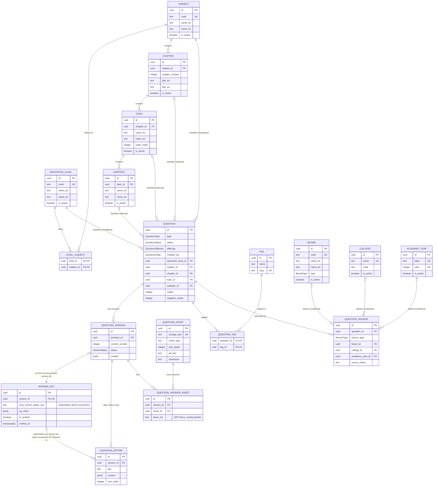
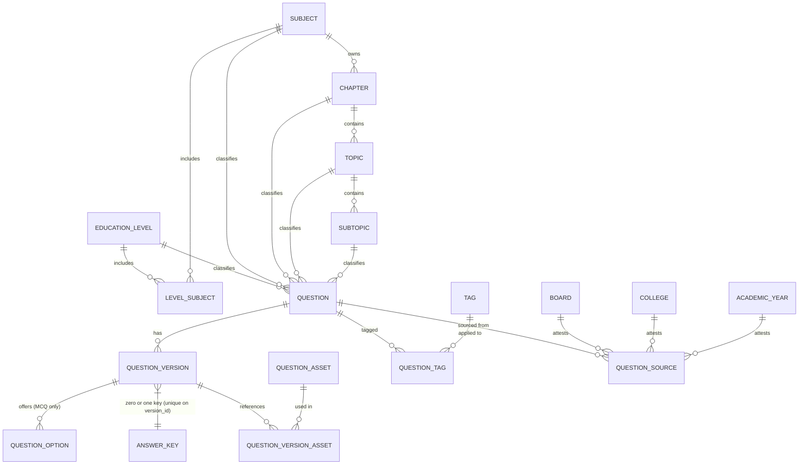

# Phase 04A — Question Bank Physical Schema: Approval Report (Revision 3)

**Project:** ICT Atlas — HSC / ALIM ICT Question Bank & Online Examination Platform
**Branch:** `arena/1042a18a-hsc-alim-ict-question-bank` (base `153ef5c`)
**Revision 3 scope:** review findings applied — MCQ correctness authority resolved (request **D**), asset-pointer integrity resolved (`block_ref` `NOT NULL` + rooted grammar), the five composite foreign keys restated as request **C** with a mandatory Prisma-drift gate, and request **E** broken out into an item-by-item review. Revision 2 completed §3 and §7; revision 1 (decision review, ER sketch, Prisma sketch, policy) is preserved below and remains the record of the approved decisions.
**Author role:** Senior PostgreSQL database architect / Prisma engineer
**Status:** Documentation only — **no migration created, no `prisma/migrations/` directory, `prisma/schema.prisma` untouched, no application code written**
**Related docs:** README.md §2, §4.4, §6; `docs/database/`; `docs/architecture/technology-decisions.md` (open-decision register OD-01…OD-32 + blueprint inconsistencies); `docs/modules/question-bank.md`; `docs/modules/examination-engine.md`; `docs/development/database-migrations.md`

---

## Revision history

| Revision | Scope | State |
|---|---|---|
| 1 | Inspection findings, OD-08/OD-09/OD-10 review, abbreviated table list, ER sketch, Prisma sketch, index rationale, JSONB-in-principle, deletion policy | Preserved in full below; its approved decisions are unchanged |
| 2 | **§3 completed** (full 18-table inventory with types, nullability, defaults, keys, FKs, constraints, indexes, archival rules, complete ER diagram, dependency-ordered creation, supporting-table justification, partial unique index SQL, domain `CHECK`s, the `educationLevelId`+`subjectId` composite-FK analysis, migration impact and rollback) and **§7 completed** (OD-18 envelope, ten block types with valid *and* invalid examples, profiles, document versioning, rejection behaviour, sanitization and Zod strategy, rubric schema, hard limits) | Documentation only. §3 and §7 await approval (requests **A** and **B**); three further schema decisions raised as **C**, **D** and **E** |
| 3 (this revision) | **Review findings applied.** ① Request **D resolved**: `question_options.is_correct` removed, `uq_question_options_one_correct_per_version` removed, `answer_keys.mcq_correct_option_key` made the single authority, guarantee re-expressed via `UNIQUE (answer_keys.version_id)` + composite FK, publish gate retained (I‑4, I‑13). ② **Asset pointers**: `block_ref` is `NOT NULL` with a rooted grammar covering stem, option and nested-subquestion content, `UNIQUE (version_id, block_ref)`, new §7.6.5 worked example. ③ **Request C** restated as five named composite FKs with a mandatory six-step Prisma-drift spike; no claim that Prisma represents them. ④ **Request E** split into 17 individually reviewed items with recommendation, consequence and "changes the model?" per item. ⑤ Consistency sweep across ER diagram, SQL, Prisma sketch, examples and the register. | Documentation only. Requests **A**, **B** and **C** plus 14 open **E** items await disposition; **D** (E‑16) and the asset-pointer decision (E‑2/E‑17) are resolved. No migration, no schema change, no application code |

---

## Reviewer decision summary

| # | Decision | Reviewer disposition |
|---|---|---|
| 1 | OD-08 — Source model | **APPROVED** (Option B) |
| 2 | OD-09 — Taxonomy / education level | **APPROVED WITH CHANGE** — add `educationLevelId` to `Question`; enforce subject↔level membership |
| 3 | OD-10 — Versioning / snapshots / keys | **APPROVED WITH CONDITIONS** (Option B) |
| 4 | Migration 0001 scope | **SPECIFIED IN FULL (§3) — NOT YET APPROVED** — 18-table inventory, creation order, constraints and rollback are complete; scope approval is request **A** in §11 |
| 5 | JSONB usage | **APPROVED IN PRINCIPLE** — OD-18 content-block schema **specified in full (§7)**; final approval is request **B** in §11 |
| 6 | Deletion and integrity | **APPROVED WITH CLARIFICATIONS** |
| 7 | OD-11 / OD-12 / OD-13 | **ACKNOWLEDGED** — deferred to Phase 05; **no values invented in this revision** |
| 8 | MCQ correctness authority (request **D**) | **RESOLVED — reviewer accepted**: `answer_keys.mcq_correct_option_key` is the sole authority; `question_options.is_correct` and its partial unique index removed |
| 9 | Asset pointer integrity | **RESOLVED — reviewer accepted**: `question_version_assets.block_ref` `NOT NULL`, rooted `/content…` or `/options/{KEY}…` grammar, unique per version, covers stem/option/nested-subquestion content |
| 10 | Composite foreign keys (request **C**) | **PENDING** — five FKs retained and strengthened by D; Prisma cannot represent them; disposable PostgreSQL drift spike is a mandatory gate |
| 11 | Physical-schema tightenings (request **E**) | **PENDING — item by item** — §3.15 reviews 17 items; E‑7, E‑9 and E‑10 explicitly not recommended for silent approval |

---

## 1. Inspection findings

### 1.1 What exists in the repository

| Artifact | State |
|---|---|
| `README.md` | v2.2 blueprint — single source of truth; decision register §4.4; non-negotiables §15 |
| `docs/architecture/` | system-architecture, module-architecture, technology-decisions (locked baseline + open register OD-01…OD-32 + blueprint inconsistencies) |
| `docs/database/` | database-design, data-dictionary, entity-relationships (logical model only — explicitly **not** a physical schema) |
| `docs/modules/question-bank.md` | Question Bank module scope: taxonomy, MCQ/CQ, versions, keys, assets, sources, search |
| `prisma/schema.prisma` | Generator + datasource only. **No domain models**, by design (comments cite OD-08…OD-13 etc.) |
| `prisma/migrations/` | Does not exist. No migration has ever been created. |
| `lib/db.ts` | Lazy Prisma singleton via `@prisma/adapter-pg` on `DATABASE_URL`; server-only. No domain service uses it yet. |
| `package.json` | Prisma 7.10.1, `@prisma/client` 7.10.1, PostgreSQL datasource, Zod validation layer present but empty (`lib/validation/` has only a README) |

### 1.2 Inconsistencies found (mapped to decisions, not silently resolved)

| # | Conflict | Where | Decision it maps to |
|---|---|---|---|
| 1 | §1.1 says provenance lives only in `QuestionSource`; §6.2 sketches direct board/year FKs on `Question`. | README | **OD-08** |
| 2 | §5.2 / §7.2.1 (immediate expiry) vs §7.2.2 (grace window + `SUBMITTED_LATE`). | README | **OD-11** |
| 3 | §7.2.2 vs O3: strict lock vs "evaluate last saved answers after expiry". | README | OD-03 / OD-11 |
| 4 | §1.2 / §7.2.5 (CQ answered on paper) vs §7.2.4 / §17.7.5 (typed rich-text CQ answers). | README | **OD-13** |
| 5 | L6/R8/§7.2.5 (AI must not grade CQ) vs §7.2.4 / roadmap v3 (AI-assisted evaluation). | README/register | **OD-24** — stricter locked prohibition stands |
| 6 | §7.2.5 / §17.7.6 (reveal answer/rubric after finalization) vs no keys through any student-facing API. | README/task | **OD-14** — no exception assumed |
| 7 | O2 (serverless PDF) vs §7.5.3 / §13 (Chromium not in request path). | README | **OD-02** |
| 8 | §7.5.4 claims `TextDecoder` fails on invalid UTF-8 (it replaces by default). | README | **OD-28** |
| 9 | §7.6.3a: parser draft "nothing saved yet" vs "enters a draft state". | README | **OD-27** |
| 10 | §4.4 R7 vs §7.4.3: AI example JSON repeats fields without untrusted-input qualifications. | README | OD-14 / OD-29 |

None of these is silently resolved in this proposal; each maps to its open decision.

---

## 2. Decision review OD-08 … OD-13

Decision definitions are quoted from the open-decision register in `docs/architecture/technology-decisions.md`.

### OD-08 — Source model — APPROVED (Option B)

**Exact question:** "Source model: board/college/year exclusivity, `TEST_EXAM` taxonomy and whether any direct question FKs exist. README §1.1 says provenance via `QuestionSource`; §6.2 also sketches direct board/year fields."

**Approved option:** `QuestionSource` exclusively carries provenance; conditional nullable FKs `boardId` / `collegeId` / `academicYearId`; database CHECK ensures at most one of `boardId`/`collegeId` per source row; `SourceType` enum includes `TEST_EXAM`; **no** direct board/year/college columns on `Question`.

**Technical consequences:** `question_sources.question_id` → `questions.id` (CASCADE); `question_sources.boardId` → `boards.id` (RESTRICT); `question_sources.collegeId` → `colleges.id` (RESTRICT); `question_sources.academicYearId` → `academic_years.id` (RESTRICT). Service logic enforces source-type-appropriate requirement (BOARD ⇒ board, COLLEGE / TEST_EXAM ⇒ college; year optional on any source).

**Migration-0001 impact:** table `question_sources` plus dimension tables `boards`, `colleges`, `academic_years`.

---

### OD-09 — Education level / subject cardinalities — APPROVED WITH CHANGE

**Exact question:** "Education-level/group/subject cardinalities, curriculum revisions and optional topic/subtopic relationships. A multi-level relational taxonomy and first-class `Chapter` are required; joins and revision rules are not specified."

**Approved option:** Explicit `level_subjects` join table (many-to-many); hierarchy `Subject → Chapter → Topic → Subtopic`; `Chapter` carries `chapterNumber`, `titleBn`, `titleEn`; `subjectId` mandatory on `Question`; `chapterId`/`topicId`/`subtopicId` nullable with publish-time service enforcement; **no `Group` table yet**.

**REQUIRED CHANGE:** Add `educationLevelId` to `Question` so a question's education level is unambiguously and directly identifiable (primary filter facet per README §7.1.1). Enforce that the selected `subjectId` belongs to that `educationLevelId` via the `level_subjects` join table. Enforcement is server-side at authoring/publish time (cross-table rule; triggers are banned by the migration workflow). Alternative considered and rejected: deriving level solely through `subjectId → level_subjects` (requires a join for every level filter; level is a top-level filter and deserves a direct column).

**Question FKs on `Question`:** `subjectId` (mandatory, RESTRICT), `educationLevelId` (mandatory, RESTRICT), `chapterId`/`topicId`/`subtopicId` (nullable, RESTRICT). Service enforces cross-hierarchy consistency (topic's chapter matches question's chapter; subject belongs to education level).

**Migration-0001 impact:** `education_levels`, `subjects`, `level_subjects`, `chapters`, `topics`, `subtopics`, `questions` (with `educationLevelId`).

---

### OD-10 — Immutable versioning / snapshots / answer-key versioning — APPROVED WITH CONDITIONS (Option B)

**Exact question:** "Exact immutable version/snapshot and answer-key versioning strategy, including corrections and historical scoring. Exams must retain what was seen and be reproducible; never expose stored keys. Physical tables and correction policy are not specified."

**Approved option:** `QuestionVersion` rows (`versionNumber` 1-based per question, `status`); options and answer key attached to versions (`AnswerKey.versionId` unique); one published version per question enforced by partial unique index `WHERE status = 'PUBLISHED'`; key correction publishes a new version (never mutate an examined version); immutability once referenced by an examination enforced server-side (triggers banned); `Exam*` tables deferred to Phase 05. Drafts may lack a verified key.

**Migration-0001 impact:** `questions` (identity only), `question_versions`, `question_options`, `answer_keys`.

---

### OD-11 / OD-12 / OD-13 — ACKNOWLEDGED

Direction noted in the earlier report; required before Phase 05 (examinations), not before migration 0001. No values invented during Phase 04.

---

## 3. Migration 0001 — complete 18-table inventory

**Status: SPECIFICATION COMPLETE — NOT YET APPROVED, except two items resolved by review.** This section replaces the earlier abbreviated inventory. It is a reviewable design, not authorization to create a migration: `prisma/schema.prisma` stays untouched and no `prisma/migrations/` directory is created until the reviewer approves §3 and §7 ([§11](#11-decisions-still-awaiting-your-final-approval)).

Every table below is **PROPOSED**. Items marked **(P)** are physical details that this document proposes beyond what the earlier report settled; each maps to an **E‑n** row in [§3.15](#315-corrections-and-tightenings--individual-review-request-e) and to request **E** in [§11](#11-decisions-still-awaiting-your-final-approval) — **none is approved by being written down.** Two schema decisions are marked **(review)** instead of (P) because the reviewer resolved them in this round: MCQ correctness authority (request **D**) and asset-pointer integrity. Nothing in this section changes an approved decision: [§3.1.4](#314-approved-decisions-this-section-preserves) maps each preserved decision to the artifact that enforces it.

### 3.1 Scope, conventions and preserved decisions

#### 3.1.1 Physical conventions

| Topic | Decision in this specification | Reason |
|---|---|---|
| Identifier type | `uuid` primary keys on every table | Stable, non-enumerable identifiers in URLs, exports and exam snapshots. |
| Identifier generation | Generated by the Prisma client (`@default(uuid())`); **no** database default | One generator only. A database default plus a client default would let two writers disagree. Raw-SQL inserts must supply an explicit `id` — acceptable because migrations and seed scripts are reviewed. |
| Timestamps | `timestamptz(3)`, stored in UTC | Exam timing, publication order and audit comparisons are server-authoritative and must not depend on server time zone. Requires `@db.Timestamptz(3)` on every `DateTime` ([§3.12](#312-prisma--postgresql-type-mapping)). |
| `created_at` | `NOT NULL DEFAULT now()` | Prisma emits this database default for `@default(now())`. |
| `updated_at` | `NOT NULL`, no database default, written by Prisma `@updatedAt` | A missing application write should fail loudly rather than silently reuse a stale default. |
| Naming | `snake_case` tables and columns | Predictable raw SQL, index and constraint names. Prisma models stay PascalCase with explicit `@@map`/`@map`. |
| Reserved words | No column is named `order`; the option ordering column is `sort_order` | `order` is a reserved word in PostgreSQL and would require quoting in every hand-written statement. Prisma field stays `order` with `@map("sort_order")`. |
| Text columns | `text` plus an explicit `CHECK` for format or length | Keeps Prisma and PostgreSQL aligned without `@db.VarChar(n)` annotations, while still bounding input. |
| Enumerations | Native PostgreSQL enum types | Closed sets are cheap to enforce and cheap to index. |
| JSONB | Only `question_versions.content`, `question_options.content`, `answer_keys.cq_rubric` | Approved JSONB boundary (L2/R6). Never the whole question record. |
| Triggers / procedures | None | Banned by [database migrations](../development/database-migrations.md). Invariants that would need them are listed in [§3.13](#313-invariants-that-cannot-be-enforced-declaratively). |
| Row-level security | None in 0001 | RLS, roles and policies remain **OD-16**; server authorization is the only approved control. |
| Constraint naming | Prisma-generated names by default; hand-written artifacts use `ck_`, `uq_`, `ix_` prefixes | Hand-written artifacts are exactly those PostgreSQL features Prisma cannot express (partial indexes, `CHECK`s, and the five composite foreign keys of request **C** in [§3.11.6](#3116-composite-foreign-keys-request-c)). |

#### 3.1.2 Deletion-action matrix

| Child column | Parent | `ON UPDATE` | `ON DELETE` | Why |
|---|---|---|---|---|
| `level_subjects.level_id` | `education_levels.id` | CASCADE | **RESTRICT** | Membership rows are cheap to delete explicitly; a level must never disappear while a question, or a membership still in use, depends on it. |
| `level_subjects.subject_id` | `subjects.id` | CASCADE | **RESTRICT** | Same reasoning; the earlier draft's `Cascade` was corrected — item **E‑1**. |
| `chapters.subject_id` | `subjects.id` | CASCADE | **RESTRICT** | A subject with chapters is never hard-deleted (retire with `is_active = false`). |
| `topics.chapter_id` | `chapters.id` | CASCADE | **RESTRICT** | Curriculum history is preserved. |
| `subtopics.topic_id` | `topics.id` | CASCADE | **RESTRICT** | Curriculum history is preserved. |
| `questions.education_level_id`, `subject_id`, `chapter_id`, `topic_id`, `subtopic_id` | taxonomy | CASCADE | **RESTRICT** | A taxonomy row that classifies questions cannot be deleted; retire instead. |
| `question_versions.question_id` | `questions.id` | CASCADE | **CASCADE** | A draft question's versions are an owned component. Published versions are protected by the retention rules in [§8](#8-data-integrity-and-deletion-policy--approved-with-clarifications), not by the FK. |
| `question_options.version_id` | `question_versions.id` | CASCADE | **CASCADE** | Options are an owned component of an immutable version. |
| `answer_keys.version_id` | `question_versions.id` | CASCADE | **CASCADE** | A key cannot outlive its version. |
| `question_version_assets.version_id` | `question_versions.id` | CASCADE | **CASCADE** | The rendering pin dies with the version, which can only happen when nothing references it. |
| `question_version_assets.asset_id` | `question_assets.id` | CASCADE | **RESTRICT** | An asset referenced by any version cannot be deleted; retention is **OD-20**. |
| `answer_keys.(version_id, mcq_correct_option_key)` | `question_options(version_id, key)` | CASCADE | **RESTRICT** (request **C**) | The key must name an option of its own version; deleting a published version's option cannot silently orphan the authoritative key. |
| `question_tags.question_id` | `questions.id` | CASCADE | **CASCADE** | Tag associations are not historical evidence. |
| `question_tags.tag_id` | `tags.id` | CASCADE | **CASCADE** | Removing a tag removes its associations. |
| `question_sources.question_id` | `questions.id` | CASCADE | **CASCADE** | Provenance rows belong to the question identity. |
| `question_sources.board_id`, `college_id`, `academic_year_id` | `boards`, `colleges`, `academic_years` | CASCADE | **RESTRICT** | Source dimensions are historical evidence; they are retired, never deleted while referenced. |

#### 3.1.3 Cardinality summary

| Relationship | Cardinality | Enforced by |
|---|---|---|
| `question_versions` per `questions` | 1 : 0..n | FK + `UNIQUE (question_id, version_number)` |
| Published `question_versions` per `questions` | 1 : 0..1 | Partial unique index ([§3.10](#310-partial-and-expression-unique-index-sql)) |
| `question_options` per `question_versions` | 1 : 0..n | FK; "exactly four for an MCQ version" is a service invariant (I‑4) |
| correct MCQ option per MCQ `question_versions` | exactly 1 option named by 0..1 key row | `UNIQUE (answer_keys.version_id)` + composite FK to `question_options(version_id, key)`; presence is I‑13 |
| `answer_keys` per `question_versions` | 1 : 0..1 | `UNIQUE (version_id)` |
| `question_sources` per `questions` | 1 : 0..n | FK |
| `questions` per `level_subjects` | n : 1 | Two FK columns; academic validity of the pair in [§3.11](#311-can-educationlevelid--subjectid-be-an-invalid-pair) |
| `question_assets` per `question_versions` | n : m through `question_version_assets` | `UNIQUE (version_id, block_ref)` — one asset per located block; the same asset may appear at many pointers |
| `question_assets` per located block | at most 1 | `UNIQUE (version_id, block_ref)` + I‑8 (`assetId` at that pointer must match) |

#### 3.1.4 Approved decisions this section preserves

| Decision | How migration 0001 honours it | Explicitly absent |
|---|---|---|
| **OD-08** — provenance exclusively through `QuestionSource` | `question_sources` is the only provenance table; it carries `board_id`, `college_id`, `academic_year_id` and `source_type`; at most one of board/college per row is a database `CHECK` | **No** `board_id`, `college_id`, `academic_year_id`, `board`, `year`, `paper_year`, `institution` or similar column on `questions` |
| **OD-09** — `level_subjects` join; mandatory `educationLevelId`/`subjectId` on `Question` | `level_subjects` join table; `questions.education_level_id` and `questions.subject_id` are `NOT NULL`; `chapter_id`/`topic_id`/`subtopic_id` are `NULL` with a chain `CHECK` | No `Group` table, no group column on `questions` |
| **OD-10** — versioned questions; options and keys on the version | `question_versions`, `question_options.version_id`, `answer_keys.version_id UNIQUE`, one published version per question | No mutable "current key" column on `questions`; no options attached to `questions` |
| Phase 05 deferral | Not created in 0001 | `Exam`, `ExamQuestion`, `ExamSession`, `StudentAnswer`/exam-answer tables, `ExamResult` |
| User linkage deferred (**OD-15/OD-16**) | Not created in 0001 | `created_by`, `updated_by`, `verified_by`, any `users` FK |
| Moderation beyond the three approved states (**OD-27**) | `QuestionStatus` and `VersionStatus` stay `DRAFT/PUBLISHED/ARCHIVED` | `IN_REVIEW`, `APPROVED`, rejection reasons |

### 3.2 Table catalogue

Fourteen **essential** tables are required to author, classify, version, publish and render a question. The `#` column below is a **stable table identifier used throughout this section**, not a creation order — the last column gives the dependencies, and the authoritative creation sequence is [§3.6](#36-dependency-based-creation-order-single-migration-0001). Four **supporting** tables supply provenance and the dimensions that provenance references; they are in scope for 0001 for the reasons in [§3.7](#37-why-each-supporting-table-belongs-in-migration-0001).

| # | Table | Group | Purpose | Depends on (creation order) |
|---|---|---|---|---|
| 1 | `education_levels` | Essential | Curriculum level dimension (HSC, Alim, …) | — |
| 2 | `subjects` | Essential | Subject dimension (ICT, …) | — |
| 3 | `level_subjects` | Essential | Which subjects belong to which level (many-to-many, OD-09) | 1, 2 |
| 4 | `chapters` | Essential | First-class chapter under a subject | 2 |
| 5 | `topics` | Essential | Topic under a chapter | 4 |
| 6 | `subtopics` | Essential | Subtopic under a topic | 5 |
| 7 | `questions` | Essential | Question identity and classification (no content) | 1, 2, 4, 5, 6 |
| 8 | `question_versions` | Essential | Immutable structured content revision | 7 |
| 9 | `question_options` | Essential | MCQ choices for a version | 8 |
| 10 | `answer_keys` | Essential | Authoritative MCQ key or CQ marking guide; **the only home of MCQ correctness** | 8, 9 |
| 11 | `question_assets` | Essential | Asset metadata; bytes in object storage | — |
| 12 | `question_version_assets` | Essential | Pins which assets a version renders, by JSON Pointer | 8, 11 |
| 13 | `tags` | Essential | Tag dimension | — |
| 14 | `question_tags` | Essential | Question ↔ tag association | 7, 13 |
| 15 | `boards` | Supporting | Education board dimension | — |
| 16 | `colleges` | Supporting | Institution dimension | — |
| 17 | `academic_years` | Supporting | Examination year dimension | — |
| 18 | `question_sources` | Supporting | Provenance attribution (OD-08) | 7, 15, 16, 17 |

Enum types created before any table: `BoardType`, `QuestionType`, `QuestionStatus`, `QuestionDifficulty`, `QuestionOrigin`, `VersionStatus`, `SourceType` — the values are the ones declared in the [§5](#5-proposed-prisma-model-sketch-illustrative--3-is-normative) sketch, unchanged by this revision.

### 3.3 Essential tables (14)

#### 3.3.1 `education_levels` — curriculum level dimension

**Purpose.** The closed, curated list of curriculum levels (initial content: HSC and Alim). It exists so a question's level is a relational facet, never free text, and so `level_subjects` can constrain which subjects are legal at that level.

**Columns.**

| Column | PostgreSQL type | Null | Default | Notes |
|---|---|---|---|---|
| `id` | `uuid` | no | none (client-generated) | Primary key |
| `code` | `text` | no | none | Stable machine code, e.g. `HSC`, `ALIM`; unique |
| `name_bn` | `text` | no | none | Bangla display name |
| `name_en` | `text` | no | none | English display name |
| `is_active` | `boolean` | no | `true` | Soft-retire flag |
| `created_at` | `timestamptz(3)` | no | `now()` | |
| `updated_at` | `timestamptz(3)` | no | none | Written by Prisma |

**Primary key.** `(id)`.

**Foreign keys.** None.

**Unique / CHECK.** `UNIQUE (code)`; `ck_education_levels_code_format` (`code ~ '^[A-Z][A-Z0-9_]{1,31}$'`); `ck_education_levels_name_en_not_blank`; `ck_education_levels_name_bn_not_blank` ([§3.9](#39-required-domain-check-constraints)), plus the optional §3.11.6 support key on `(id, …)`.

**Indexes.** Primary key only. The dimension is small (single-digit rows); `is_active` needs no index.

**Soft delete / archival.** `is_active = false`. Hard delete is allowed only when no `level_subjects` row, no `questions` row and no composite-FK reference uses the row — in practice never, because FK actions are `RESTRICT`.

**Dependencies.** None. Every taxonomy table downstream depends on it.

#### 3.3.2 `subjects` — subject dimension

**Purpose.** Curated subjects (initial content: ICT). Carries the subject identity that chapters hang from and that questions are filtered by.

**Columns.**

| Column | PostgreSQL type | Null | Default | Notes |
|---|---|---|---|---|
| `id` | `uuid` | no | none | Primary key |
| `code` | `text` | no | none | e.g. `ICT`; unique |
| `name_bn` | `text` | no | none | |
| `name_en` | `text` | no | none | |
| `is_active` | `boolean` | no | `true` | Soft-retire flag |
| `created_at` | `timestamptz(3)` | no | `now()` | |
| `updated_at` | `timestamptz(3)` | no | none | |

**Primary key.** `(id)`.

**Foreign keys.** None.

**Unique / CHECK.** `UNIQUE (code)`; `ck_subjects_code_format`; non-blank name checks.

**Indexes.** Primary key only.

**Soft delete / archival.** `is_active = false`; deletion `RESTRICT`ed by `level_subjects`, `chapters` and `questions`.

**Dependencies.** None.

**Note on multi-level subjects.** A subject deliberately has **no** `education_level_id` column. A subject's levels come from `level_subjects` (OD-09). Adding a level column here would re-create the one-to-many assumption that OD-09 rejected.

#### 3.3.3 `level_subjects` — level ↔ subject membership

**Purpose.** The approved many-to-many join that defines which subjects are offered at which level. It is the referential anchor that makes a question's `(education_level_id, subject_id)` pair checkable ([§3.11](#311-can-educationlevelid--subjectid-be-an-invalid-pair)) and the source of facet values for the level→subject filter cascade.

**Columns.**

| Column | PostgreSQL type | Null | Default | Notes |
|---|---|---|---|---|
| `level_id` | `uuid` | no | none | FK → `education_levels.id` (RESTRICT) |
| `subject_id` | `uuid` | no | none | FK → `subjects.id` (RESTRICT) |
| `created_at` | `timestamptz(3)` | no | `now()` | |

**Primary key.** `(level_id, subject_id)` — also the unique key that a composite foreign key from `questions` can reference, because the column order matches `(education_level_id, subject_id)`.

**Foreign keys.** `level_id` → `education_levels(id)`; `subject_id` → `subjects(id)`. Both `RESTRICT` on delete.

**Unique / CHECK.** Primary key supplies `UNIQUE (level_id, subject_id)`. No further `CHECK`.

**Indexes.** PK covers `level_id` prefixes. Add `ix_level_subjects_subject_id` on `(subject_id)` for the reverse lookup ("which levels offer this subject").

**Soft delete / archival.** None. Membership is either present or absent. Removal must be restricted while questions reference the pair (via the request‑C composite FK C‑1) or must be preceded by re-classifying those questions (service responsibility, I‑1).

**Dependencies.** `education_levels`, `subjects`.

#### 3.3.4 `chapters` — first-class chapter

**Purpose.** A chapter is a real entity, not an integer on the question (README §6.2 v2 rule): chapter titles are bilingual and change with curriculum revision, analytics groups by chapter, and renumbering must not break filters. Initial ICT content has six chapters.

**Columns.**

| Column | PostgreSQL type | Null | Default | Notes |
|---|---|---|---|---|
| `id` | `uuid` | no | none | Primary key |
| `subject_id` | `uuid` | no | none | FK → `subjects.id` (RESTRICT) |
| `chapter_number` | `integer` | no | `1` | Curriculum numbering within the subject |
| `title_bn` | `text` | no | none | |
| `title_en` | `text` | no | none | |
| `is_active` | `boolean` | no | `true` | Soft-retire flag |
| `created_at` | `timestamptz(3)` | no | `now()` | |
| `updated_at` | `timestamptz(3)` | no | none | |

**Primary key.** `(id)`.

**Foreign keys.** `subject_id` → `subjects(id)` `RESTRICT`.

**Unique / CHECK.** `UNIQUE (id, subject_id)` — the support key for composite FK C‑2 in [§3.11.6](#3116-composite-foreign-keys-request-c), needed only if request **C** is approved; it is what lets `questions(chapter_id, subject_id)` prove the chapter belongs to the question's subject. Active-number uniqueness via the partial index `uq_chapters_subject_number_active` on `(subject_id, chapter_number) WHERE is_active` (item **E‑7**, which **needs an explicit curriculum-numbering decision**) instead of a plain unique constraint, so a retired chapter's number can be reused after a curriculum revision. `CHECK (chapter_number > 0)`; non-blank title checks.

**Indexes.** The partial unique index above covers `subject_id` prefixes. If the plain `UNIQUE (subject_id, chapter_number)` is preferred over the partial index, it also covers them.

**Soft delete / archival.** `is_active = false`; a chapter stays visible to historical questions through its FK. Deletion is `RESTRICT`ed while any topic or question references it.

**Dependencies.** `subjects`.

#### 3.3.5 `topics` — topic under a chapter

**Purpose.** Curriculum topic; the facet behind `(subject, chapter, topic)` filtering and topic-level analytics.

**Columns.**

| Column | PostgreSQL type | Null | Default | Notes |
|---|---|---|---|---|
| `id` | `uuid` | no | none | Primary key |
| `chapter_id` | `uuid` | no | none | FK → `chapters.id` (RESTRICT) |
| `name_bn` | `text` | no | none | |
| `name_en` | `text` | no | none | |
| `order_index` | `integer` | no | `0` | Display order within the chapter |
| `is_active` | `boolean` | no | `true` | Soft-retire flag |
| `created_at` | `timestamptz(3)` | no | `now()` | |
| `updated_at` | `timestamptz(3)` | no | none | |

**Primary key.** `(id)`.

**Foreign keys.** `chapter_id` → `chapters(id)` `RESTRICT`.

**Unique / CHECK.** `UNIQUE (id, chapter_id)` (support key for composite FK C‑3, request **C**); `uq_topics_chapter_order_active` on `(chapter_id, order_index) WHERE is_active` (item **E‑7**); `CHECK (order_index >= 0)`; non-blank name checks.

**Indexes.** The partial unique index covers `chapter_id` prefixes.

**Soft delete / archival.** As `chapters`.

**Dependencies.** `chapters`.

#### 3.3.6 `subtopics` — subtopic under a topic

**Purpose.** The finest approved taxonomy level; `questions.subtopic_id` is optional.

**Columns.**

| Column | PostgreSQL type | Null | Default | Notes |
|---|---|---|---|---|
| `id` | `uuid` | no | none | Primary key |
| `topic_id` | `uuid` | no | none | FK → `topics.id` (RESTRICT) |
| `name_bn` | `text` | no | none | |
| `name_en` | `text` | no | none | |
| `is_active` | `boolean` | no | `true` | Soft-retire flag |
| `created_at` | `timestamptz(3)` | no | `now()` | |
| `updated_at` | `timestamptz(3)` | no | none | |

**Primary key.** `(id)`.

**Foreign keys.** `topic_id` → `topics(id)` `RESTRICT`.

**Unique / CHECK.** `UNIQUE (id, topic_id)` (P, for the composite FK); non-blank name checks. No order column in 0001: subtopics are rendered alphabetically/insertion-order and ordering was never approved. Adding `order_index` later is additive.

**Indexes.** `ix_subtopics_topic_id` on `(topic_id)`.

**Soft delete / archival.** As `chapters`.

**Dependencies.** `topics`.

#### 3.3.7 `questions` — question identity and classification

**Purpose.** The stable, non-versioned identity of a question: its type, lifecycle status, difficulty, ingestion origin, academic classification and marks. **No content, no options, no answers and no provenance columns live here** — those are in `question_versions`, `question_options`, `answer_keys` and `question_sources`.

**Columns.**

| Column | PostgreSQL type | Null | Default | Notes |
|---|---|---|---|---|
| `id` | `uuid` | no | none | Primary key |
| `type` | `"QuestionType"` | no | none | `MCQ` \| `CQ`; immutable after the first published version (I‑6) |
| `status` | `"QuestionStatus"` | no | `'DRAFT'` | `DRAFT` \| `PUBLISHED` \| `ARCHIVED`; rollup of version status (I‑3) |
| `difficulty` | `"QuestionDifficulty"` | no | `'MEDIUM'` | `EASY` \| `MEDIUM` \| `HARD` |
| `created_via` | `"QuestionOrigin"` | no | `'MANUAL'` | `MANUAL` \| `BULK_IMPORT` \| `AI_PARSER` (README §6.2) |
| `education_level_id` | `uuid` | no | none | FK → `education_levels.id` (RESTRICT); **mandatory** (OD-09) |
| `subject_id` | `uuid` | no | none | FK → `subjects.id` (RESTRICT); **mandatory** (OD-09) |
| `chapter_id` | `uuid` | yes | `NULL` | FK → `chapters.id` (RESTRICT) |
| `topic_id` | `uuid` | yes | `NULL` | FK → `topics.id` (RESTRICT); requires `chapter_id` |
| `subtopic_id` | `uuid` | yes | `NULL` | FK → `subtopics.id` (RESTRICT); requires `topic_id` |
| `marks` | `integer` | no | `1` | MCQ: mark value. CQ: total of the four parts = 10 |
| `negative_marks` | `integer` | no | `0` | Negative marking is an exam-scoring input, not question content |
| `created_at` | `timestamptz(3)` | no | `now()` | |
| `updated_at` | `timestamptz(3)` | no | none | |

**Primary key.** `(id)`.

**Foreign keys.** Five, all `RESTRICT` on delete: `education_level_id`, `subject_id`, `chapter_id`, `topic_id`, `subtopic_id`.

**Unique / CHECK.** No natural unique key: two identical-looking stems are two questions until content hashing is decided (**OD-27**). Checks: `marks >= 0`; `negative_marks >= 0`; `negative_marks <= marks` (item **E‑9**, flagged — interacts with the open OD‑21 negative-mark floor); `topic_id IS NULL OR chapter_id IS NOT NULL`; `subtopic_id IS NULL OR topic_id IS NOT NULL`; `type <> 'CQ' OR marks = 10` (item **E‑10** — **not recommended for silent approval**: it hard-codes the current curriculum's 10-mark CQ shape); `type <> 'MCQ' OR marks >= 1` (item **E‑11**).

**Indexes.** `(education_level_id)`, `(subject_id)`, `(chapter_id)`, `(topic_id)`, `(subtopic_id)`, `(education_level_id, subject_id)` (level→subject facet entry point), `(subject_id, chapter_id, topic_id)` (chapter→topic cascade), `(type, status)`, `(status, type, difficulty)` (published listing with facets). Optional, not proposed for 0001: `(created_at DESC)` for "recently added" admin listings (no measured need yet). No GIN or full-text index — search is **OD-32**.

**Soft delete / archival.** `status = 'ARCHIVED'` is the soft delete ([§8](#8-data-integrity-and-deletion-policy--approved-with-clarifications)). No `deleted_at` column: two deletion mechanisms (`status` and a timestamp) would let a row be archived-but-not-deleted, or deleted-but-active. Hard delete is permitted only for a draft question with no published version, no source-row history worth keeping and no exam reference (none can exist in Phase 04). "Why no `archived_at`" is recorded in [§3.15](#315-corrections-and-tightenings--individual-review-request-e): status-transition timestamps belong to the audit log (**OD-27**), which is not in 0001.

**Dependencies.** `education_levels`, `subjects`, `chapters`, `topics`, `subtopics`.

#### 3.3.8 `question_versions` — immutable content revision

**Purpose.** Holds the structured content (`content` JSONB, [§7](#7-od-18-content-block-schema--complete-specification)) that a student actually sees, so an exam can reproduce exactly what was shown. Rows are content-immutable once published; a correction publishes a new version (OD-10).

**Columns.**

| Column | PostgreSQL type | Null | Default | Notes |
|---|---|---|---|---|
| `id` | `uuid` | no | none | Primary key; the target of Phase 05 `ExamQuestion.version_id` |
| `question_id` | `uuid` | no | none | FK → `questions.id` (CASCADE) |
| `version_number` | `integer` | no | `1` | 1-based, contiguous per question |
| `status` | `"VersionStatus"` | no | `'DRAFT'` | `DRAFT` \| `PUBLISHED` \| `ARCHIVED` |
| `content` | `jsonb` | no | none | OD-18 document ([§7.2](#72-envelope-and-document-structure)) |
| `created_at` | `timestamptz(3)` | no | `now()` | Authoring time |
| `updated_at` | `timestamptz(3)` | no | none | Only `status` may change; content never changes after `PUBLISHED` (I‑5) |

**Primary key.** `(id)`.

**Foreign keys.** `question_id` → `questions(id)` `CASCADE`.

**Unique / CHECK.** `UNIQUE (question_id, version_number)`; `CHECK (version_number > 0)`; `CHECK (jsonb_typeof(content) = 'object')`; envelope-presence check `content ? 'format' AND content ? 'version' AND content ? 'blocks'` (a syntax guard only, **not** a content validator); size cap `pg_column_size(content) <= 262144` (matches the [§7.12](#712-hard-limits) limit). The published-uniqueness rule is a partial index, not a constraint ([§3.10](#310-partial-and-expression-unique-index-sql)).

**Indexes.** `(question_id)` (also covered by the unique constraint's prefix), `(status)`, `(question_id, status)`, and the partial unique index below. A GIN index on `content` is deliberately deferred until **OD-32** defines the search need.

**Soft delete / archival.** `status = 'ARCHIVED'`. Never deleted once published or once referenced by an exam (Phase 05); draft versions are deletable while unreferenced. Immutability is not a database rule — see I‑5.

**Dependencies.** `questions`.

#### 3.3.9 `question_options` — MCQ choices for a version

**Purpose.** The four choices of an MCQ version. Content is a structured block document ([§7.6](#76-worked-examples)), never a string, so options can carry math, small images or code. Attached to the **version**, not the question (OD-10), so historical exams keep their options.

**Columns.**

| Column | PostgreSQL type | Null | Default | Notes |
|---|---|---|---|---|
| `id` | `uuid` | no | none | Primary key |
| `version_id` | `uuid` | no | none | FK → `question_versions.id` (CASCADE) |
| `key` | `text` | no | none | One character: `A`–`D` for the initial format (also accepts `ক`–`ঘ`) |
| `content` | `jsonb` | no | none | Inline-only block document ([§7.6.2](#762-four-option-mcq--stem-plus-option-content)) |
| `sort_order` | `integer` | no | `0` | Render order; `order` avoided as a reserved word (item **E‑3**) |
| `created_at` | `timestamptz(3)` | no | `now()` | |

**There is no `is_correct` column** (review disposition, request **D**). Correctness lives only in `answer_keys.mcq_correct_option_key`; see "Correctness authority" below.

**Primary key.** `(id)`.

**Foreign keys.** `version_id` → `question_versions(id)` `CASCADE`.

**Unique / CHECK.** `UNIQUE (version_id, key)`; `CHECK (char_length(key) = 1)`; `CHECK (key IN ('A','B','C','D','ক','খ','গ','ঘ'))`; `CHECK (sort_order >= 0)`; `CHECK (jsonb_typeof(content) = 'object')`. There is **no** "one correct option per version" partial unique index any more — that index referenced the dropped `is_correct` column, and the guarantee is now provided by `answer_keys` + the composite FK ([§3.3.10](#3310-answer_keys--authoritative-correctness-or-cq-marking-guide)). "Exactly four options per MCQ version, zero per CQ version" cannot be a `CHECK` (it is a row-count rule) — it is I‑4.

**Indexes.** `(version_id)` and `UNIQUE (version_id, key)`. The `(version_id, is_correct)` index is **removed** with the column. `UNIQUE (version_id, key)` now carries a second duty: it is the unique key that the composite FK `answer_keys(version_id, mcq_correct_option_key) → question_options(version_id, key)` references ([§3.11.6](#3116-composite-foreign-keys-request-c)). No index on `key` means correctness is never a query entry point.

**Soft delete / archival.** None: options are an owned component of an immutable version. They disappear only when the version row is deleted, which the retention rules prevent for published or examined versions. Individual option edits are forbidden after publish; publish a new version instead (I‑5).

**Correctness authority (resolved by review — request D).** `answer_keys.mcq_correct_option_key` is the **single** source of MCQ correctness. There is no correctness column on `question_options`, so the two-writable-sources-of-truth problem the earlier revision flagged cannot arise: a reader either joins the key (staff/server paths) or has no access to correctness at all. Options are pure render rows — `key`, `content`, `sort_order` — and a leaked option row leaks nothing.

How "exactly one valid correct option per MCQ version" is then guaranteed, without a correctness column:

| Requirement | Guaranteed by |
|---|---|
| **At most one** answer key per version | `UNIQUE (version_id)` on `answer_keys` |
| The key names **a real option of that same version** | composite FK `(version_id, mcq_correct_option_key) → question_options(version_id, key)` ([§3.11.6](#3116-composite-foreign-keys-request-c)) |
| The key can match **at most one** option row (no ambiguity) | the FK's referenced key is unique: `UNIQUE (version_id, key)` on `question_options` |
| An MCQ version **must have** a key, and a CQ version must not have an MCQ key | `CHECK (num_nonnulls(mcq_correct_option_key, cq_rubric) = 1)` on `answer_keys` + I‑13 (publish gate, because it depends on `questions.type`) |
| **Exactly four** distinct option rows per MCQ version | I‑4 (publish gate, row-count rule) — `UNIQUE (version_id, key)` supplies the distinctness half |

So the composite FK does the job the partial index used to do, and does it more strongly: the index only proved "one row says it is correct", whereas the FK proves "the single key names an option that actually exists in this version". The FK is `MATCH SIMPLE` and `mcq_correct_option_key` is nullable, so a CQ rubric row is skipped — correct behaviour for the rubric case. What the composite FK cannot express is that an MCQ's key *must be present*; that is I‑13.

**Publish-time validation is retained and is mandatory.** The database cannot count rows, cannot see `questions.type`, and cannot check that four options were authored. The publish gate therefore still requires, in one transaction: (1) exactly four distinct option keys for an MCQ version and zero for a CQ version; (2) exactly one valid MCQ answer key naming one of those four keys (or, for CQ, exactly one rubric and no MCQ key); (3) `answer_keys` written before the version transitions to `PUBLISHED`, so a published MCQ version can never be keyless. See [§3.13](#313-invariants-that-cannot-be-enforced-declaratively) I‑4 and I‑13, and [§7.11](#711-zod-validation-strategy-server-side) step 6.

**Dependencies.** `question_versions`. With request **C** adopted, `answer_keys` also depends on `question_options` (the composite FK). If **C** is declined, the FK is absent and only the publish gate prevents a key naming a non-existent option — which is exactly why declining **C** has a real cost.

#### 3.3.10 `answer_keys` — authoritative correctness or CQ marking guide

**Purpose.** The server-only answer authority for a version: one MCQ key **or** one CQ marking rubric. Never projected into any student-facing exam DTO, including result endpoints. Since request **D**, this table is the **only** home of MCQ correctness anywhere in the schema.

**Columns.**

| Column | PostgreSQL type | Null | Default | Notes |
|---|---|---|---|---|
| `id` | `uuid` | no | none | Primary key |
| `version_id` | `uuid` | no | none | FK → `question_versions.id` (CASCADE); unique, so at most one key per version |
| `mcq_correct_option_key` | `text` | yes | `NULL` | **Authoritative** for MCQ. One of the same version's `question_options.key` values, enforced by the composite FK ([§3.11.6](#3116-composite-foreign-keys-request-c)) |
| `cq_rubric` | `jsonb` | yes | `NULL` | OD-18 rubric document ([§7.7](#77-answer_keyscq_rubric-schema-and-example)) |
| `is_verified` | `boolean` | no | `false` | Drafts may publish without a verified key (OD-10 condition) |
| `verified_at` | `timestamptz(3)` | yes | `NULL` | Required when `is_verified` |
| `notes` | `text` | yes | `NULL` | Internal reviewer note; never student-facing |
| `created_at` | `timestamptz(3)` | no | `now()` | |
| `updated_at` | `timestamptz(3)` | no | none | |

**Primary key.** `(id)`.

**Foreign keys.** `version_id` → `question_versions(id)` `CASCADE`. Plus request **C**: composite FK `(version_id, mcq_correct_option_key)` → `question_options(version_id, key)`, `ON UPDATE CASCADE ON DELETE RESTRICT` — see [§3.11.6](#3116-composite-foreign-keys-request-c).

**Composite FK is not optional decoration.** With `is_correct` removed this FK is the only declarative proof that the authoritative key points at an option that exists in the same version. It is still Request **C** because Prisma cannot model it, so it requires hand-written migration SQL and the Prisma-drift spike; but declining **C** now removes a correctness guarantee rather than merely a redundancy, and the approval register says so.

**Unique / CHECK.** `UNIQUE (version_id)`; `CHECK (num_nonnulls(mcq_correct_option_key, cq_rubric) = 1)` — exactly one payload, so an MCQ key can never carry a rubric and a CQ version can never carry an MCQ key; `CHECK (mcq_correct_option_key IS NULL OR char_length(mcq_correct_option_key) = 1)`; `CHECK (NOT is_verified OR verified_at IS NOT NULL)`; `CHECK (cq_rubric IS NULL OR jsonb_typeof(cq_rubric) = 'object')`.

**Indexes.** `UNIQUE (version_id)` is the only required index: keys are always loaded by version. No index on `mcq_correct_option_key` — correctness must never be a query entry point. The composite FK adds no child-side index (PostgreSQL does not require one; the referenced `question_options(version_id, key)` index does the lookup).

**Soft delete / archival.** Cascade with the version. A key is never "soft deleted": correcting a key means publishing a new version (OD-10). The row is the most sensitive data in 0001 and is audited at the service layer.

**Dependencies.** `question_versions`, and `question_options` (request **C** composite FK) — which is why `answer_keys` is created after `question_options` in [§3.6](#36-dependency-based-creation-order-single-migration-0001).

#### 3.3.11 `question_assets` — asset metadata

**Purpose.** Metadata for images, diagrams, flowcharts and other approved attachments whose bytes live in object storage. The row is the only handle a renderer may resolve; content JSONB never carries a URL.

**Columns.**

| Column | PostgreSQL type | Null | Default | Notes |
|---|---|---|---|---|
| `id` | `uuid` | no | none | Primary key; referenced by block `assetId` |
| `storage_key` | `text` | no | none | Object-storage key; unique; immutable per uploaded object |
| `mime_type` | `text` | no | none | Validated by service and `CHECK` |
| `size_bytes` | `integer` | no | none | `> 0`; `integer` caps at ~2 GiB, which is adequate for approved image/SVG assets |
| `width` | `integer` | yes | `NULL` | Pixels, when known |
| `height` | `integer` | yes | `NULL` | Pixels, when known |
| `alt_text` | `text` | no | none | Accessibility baseline (README §17.9); `NOT NULL` |
| `long_description` | `text` | yes | `NULL` | For complex diagrams |
| `checksum` | `text` | yes | `NULL` | `sha256:<64 hex>` for de-duplication and integrity |
| `created_at` | `timestamptz(3)` | no | `now()` | |
| `updated_at` | `timestamptz(3)` | no | none | Metadata may be corrected — item **E‑5** |

**Primary key.** `(id)`.

**Foreign keys.** None inbound except `question_version_assets.asset_id` (`RESTRICT`).

**Unique / CHECK.** `UNIQUE (storage_key)`; `CHECK (size_bytes > 0)`; `CHECK (mime_type ~ '^[a-z0-9][a-z0-9!#$&^_.+-]*/[a-z0-9][a-z0-9!#$&^_.+-]*$')`; `CHECK (width IS NULL OR width > 0)`; `CHECK (height IS NULL OR height > 0)`; `CHECK (btrim(alt_text) <> '')`; `CHECK (checksum IS NULL OR checksum ~ '^sha256:[0-9a-f]{64}$')`.

**Indexes.** `UNIQUE (storage_key)` (also the resolve path); `ix_question_assets_checksum` on `(checksum) WHERE checksum IS NOT NULL` for de-duplication; no index on `mime_type` (low selectivity, not a filter path).

**Soft delete / archival.** No deletion flag in 0001: bytes are immutable and a new upload always creates a new row and a new `storage_key`. Deletion is `RESTRICT`ed while any version pins the asset. Orphan cleanup, retention periods and lifecycle rules are **OD-20**; the *policy* must not be invented here. Metadata rows are never reused for different bytes.

**Dependencies.** None (standalone), which is why it can be created early.

#### 3.3.12 `question_version_assets` — version → asset pin

**Purpose.** Records which assets a specific version renders **and exactly where**, so historical rendering survives later asset changes and so publish-time validation can prove that every `assetId` in the version's content is legitimately linked, at the pointer where it appears.

**Columns.**

| Column | PostgreSQL type | Null | Default | Notes |
|---|---|---|---|---|
| `id` | `uuid` | no | none | Primary key |
| `version_id` | `uuid` | no | none | FK → `question_versions.id` (CASCADE) |
| `asset_id` | `uuid` | no | none | FK → `question_assets.id` (RESTRICT) |
| `block_ref` | `text` | **no** (review disposition) | none | **Canonical asset pointer** — see the namespace below |
| `created_at` | `timestamptz(3)` | no | `now()` | |

**`block_ref` is `NOT NULL`.** The earlier revision left it nullable "in case a version links an asset without naming a location". That state is not legitimate: an asset a version renders is *always* rendered by some block, and a link with no pointer cannot be resolved by the renderer, cannot be validated against content, and cannot be cleaned up safely (which asset belongs to which block becomes unknowable). Making it `NOT NULL` also lets the uniqueness rule below be a plain `UNIQUE`/primary-key-shaped constraint instead of a partial index. Consequence: links are created only from a parsed content document during publish, never ad hoc — which is how they are created anyway.

**The pointer namespace — one canonical grammar covering all three content homes.** An asset location must be unique within a *question version*, but a version's renderable content spans three places: the version document, the option documents, and the blocks nested inside CQ subquestions. `block_ref` is therefore a **rooted path string**, not a bare RFC 6901 pointer into `question_versions.content`, and the root segment selects which document it addresses:

| Root | Addresses | JSONB column actually indexed | Example | Max depth |
|---|---|---|---|---|
| `/content` | a block in the version's stem/stimulus document | `question_versions.content` | `/content/blocks/2` | 3 segments |
| `/content/…/data/blocks` | a block nested inside a CQ `subquestion` | `question_versions.content` | `/content/blocks/3/data/blocks/0` | 5 segments |
| `/options/{KEY}` | one MCQ option's document | `question_options.content` **where `key = {KEY}`** | `/options/A/blocks/0` | 3 segments |

Grammar (all segments are literal; no escaping, no `~0`/`~1`, no empty segments, no trailing slash):

```text
block_ref := "/content/blocks/" index ("/data/blocks/" index)?
           | "/options/" option_key "/blocks/" index
option_key := "A" | "B" | "C" | "D" | "ক" | "খ" | "গ" | "ঘ"
index      := "0" | [1-9][0-9]{0,2}      (no leading zeros)
```

Rules that make the mapping unique:

1. **A root is mandatory.** A bare `/blocks/2` is rejected, because the same token would be ambiguous between stem and option documents.
2. **`/options/{KEY}` is keyed by `key`, not by row id or `sort_order`.** `key` is immutable for a version and is already `UNIQUE (version_id, key)`, so the pointer stays valid if sort order is ever corrected, and it cannot drift when an option row is re-ordered. Option `id`s are deliberately not used: they are internal, and a pointer stored in an immutable version should not encode a surrogate.
3. **Nesting is addressed by data path, not by a subquestion index.** A CQ part's blocks sit at `content.blocks[i].data.blocks[j]`, so the pointer is `/content/blocks/i/data/blocks/j`. Depth is bounded at 5 segments precisely because `subquestion` may not nest (OD-18).
4. **Resolution is exact.** `block_ref` must resolve to a block object whose own `data.assetId` equals this row's `asset_id`. A pointer that resolves to a block of another type, or to a block exposing a different asset, is a publish error (I‑8).
5. **Uniqueness is per version, across all three roots.** Because the roots are disjoint and each grammar is unambiguous, one `UNIQUE` constraint over `(version_id, block_ref)` guarantees "one asset per location"; the reverse is **not** unique — the same asset may legitimately appear at several pointers (a reused diagram), which is why `(version_id, asset_id)` is not the key.

**Primary key.** `(id)`. A surrogate key plus `UNIQUE (version_id, block_ref)` (both P). The earlier revision's `(version_id, asset_id)` key could only represent an asset once per version and broke reused images.

**Foreign keys.** `version_id` → `question_versions(id)` `CASCADE`; `asset_id` → `question_assets(id)` `RESTRICT`.

**Unique / CHECK.** `UNIQUE (version_id, block_ref)`; `ck_question_version_assets_block_ref_pointer` — `CHECK (block_ref ~ '^(/content/blocks/(0|[1-9][0-9]{0,2})(/data/blocks/(0|[1-9][0-9]{0,2}))?|/options/[ABCDকখগঘ]/blocks/(0|[1-9][0-9]{0,2}))$')` ([§3.9](#39-required-domain-check-constraints)). An index segment must be `0` or a non-zero-padded number, so `/content/blocks/01` is rejected — an ambiguous index is a pointer that can resolve to a different block under a different parser. This is a **grammar** guard only: it proves the pointer is well-formed and rooted, never that it resolves. Resolution, the `assetId` match, and "the asset is actually reachable" are I‑8 at the publish gate, because they require parsing JSONB.

**Indexes.** `(asset_id)` (required for "where is this asset used" and for the `RESTRICT` check). `(version_id)` is covered by the `UNIQUE (version_id, block_ref)` prefix. No index on `block_ref` alone: it is only ever read as part of a version load.

**Soft delete / archival.** No flag: rows are part of the immutable version snapshot and cascade with it. Because `asset_id` is `RESTRICT` and `block_ref` is `NOT NULL`, an asset cannot be orphaned by a link row and a link row cannot exist without a location.

**Dependencies.** `question_versions`, `question_assets`.

#### 3.3.13 `tags` — tag dimension

**Purpose.** Free-form topical classification (e.g. "logic gate", "boolean algebra") that is orthogonal to the curated taxonomy. It does not replace chapters, topics or sources.

**Columns.**

| Column | PostgreSQL type | Null | Default | Notes |
|---|---|---|---|---|
| `id` | `uuid` | no | none | Primary key |
| `name` | `text` | no | none | Display name, may be Bangla or English |
| `slug` | `text` | no | none | URL/filter-safe identifier |
| `created_at` | `timestamptz(3)` | no | `now()` | |

**Primary key.** `(id)`.

**Foreign keys.** None inbound except `question_tags.tag_id` (`CASCADE`).

**Unique / CHECK.** `UNIQUE (slug)`; `CHECK (slug ~ '^[a-z0-9]+(-[a-z0-9]+)*$')`; `CHECK (btrim(name) <> '')`; `UNIQUE (lower(name))` as an expression index instead of a plain `UNIQUE (name)`, so "Logic Gate" and "logic gate" cannot both exist.

**Indexes.** The two unique indexes above. `question_tags(tag_id)` covers the "questions with tag" join.

**Soft delete / archival.** No flag. Deleting a tag removes its associations; tag *merging* is a service operation, and whether historical tags must be retained is **OD-27**-adjacent and not invented here.

**Dependencies.** None.

#### 3.3.14 `question_tags` — question ↔ tag association

**Purpose.** The many-to-many association between a question identity and tags. Tags attach to the question, not the version: a typo fix does not re-tag.

**Columns.**

| Column | PostgreSQL type | Null | Default | Notes |
|---|---|---|---|---|
| `question_id` | `uuid` | no | none | FK → `questions.id` (CASCADE) |
| `tag_id` | `uuid` | no | none | FK → `tags.id` (CASCADE) |
| `created_at` | `timestamptz(3)` | no | `now()` | |

**Primary key.** `(question_id, tag_id)` — also prevents duplicate tagging.

**Foreign keys.** Both `CASCADE` on delete.

**Unique / CHECK.** The primary key is the only uniqueness rule; no `CHECK`.

**Indexes.** `ix_question_tags_tag_id` on `(tag_id)`; the PK covers `question_id`.

**Soft delete / archival.** None; an association is present or absent.

**Dependencies.** `questions`, `tags`.

### 3.4 Supporting tables (4)

#### 3.4.1 `boards` — education board dimension

**Purpose.** The board that attested a question (Dhaka, Rajshahi, Madrasah, BTEB, …). Only reachable through `question_sources`; it is never referenced from `questions`.

**Columns.**

| Column | PostgreSQL type | Null | Default | Notes |
|---|---|---|---|---|
| `id` | `uuid` | no | none | Primary key |
| `code` | `text` | no | none | e.g. `DHAKA`, `MADRASAH`, `BTEB`; unique |
| `name_bn` | `text` | yes | `NULL` | Not every board has an approved Bangla short name yet |
| `name_en` | `text` | no | none | |
| `type` | `"BoardType"` | no | `'GENERAL'` | `GENERAL` \| `MADRASAH` \| `TECHNICAL` |
| `is_active` | `boolean` | no | `true` | Soft-retire flag |
| `created_at` | `timestamptz(3)` | no | `now()` | |
| `updated_at` | `timestamptz(3)` | no | none | |

**Primary key.** `(id)`.

**Foreign keys.** None inbound except `question_sources.board_id` (`RESTRICT`).

**Unique / CHECK.** `UNIQUE (code)`; `ck_boards_code_format`; `CHECK (btrim(name_en) <> '')`.

**Indexes.** Primary key plus the unique `code`. No `is_active` index (single-digit rows).

**Soft delete / archival.** `is_active = false`; a board named by any source row can never be deleted.

**Dependencies.** None.

#### 3.4.2 `colleges` — institution dimension

**Purpose.** The college/institution that attested a question (test-exam and college sources, OD-08). Deliberately minimal: a full institution hierarchy (university, district, EIIN) was never approved and is not invented.

**Columns.**

| Column | PostgreSQL type | Null | Default | Notes |
|---|---|---|---|---|
| `id` | `uuid` | no | none | Primary key |
| `name` | `text` | no | none | Institution name as published |
| `code` | `text` | yes | `NULL` | Optional short code, e.g. `NDC` |
| `is_active` | `boolean` | no | `true` | Soft-retire flag |
| `created_at` | `timestamptz(3)` | no | `now()` | |
| `updated_at` | `timestamptz(3)` | no | none | |

**Primary key.** `(id)`.

**Foreign keys.** None inbound except `question_sources.college_id` (`RESTRICT`).

**Unique / CHECK.** `UNIQUE (name)`; expression unique `UNIQUE (lower(name))` instead of the plain one; `CHECK (btrim(name) <> '')`; `CHECK (code IS NULL OR code ~ '^[A-Z0-9][A-Z0-9_-]{1,15}$')`.

**Indexes.** The unique name index; `code` needs no index until it is used as a filter (**OD-32**).

**Soft delete / archival.** `is_active = false`; deletion `RESTRICT`ed while any source references it.

**Dependencies.** None.

#### 3.4.3 `academic_years` — examination year dimension

**Purpose.** The examination year attributed by a source row. Both a display `label` and a numeric `year` exist so "2024–2025" or "জুলাই ২০২৪" style labels do not force a fake integer.

**Columns.**

| Column | PostgreSQL type | Null | Default | Notes |
|---|---|---|---|---|
| `id` | `uuid` | no | none | Primary key |
| `label` | `text` | no | none | Display label, e.g. `2024`, `2024 (জুলাই)`; unique |
| `year` | `integer` | yes | `NULL` | Sortable numeric year when one exists; unique |
| `is_active` | `boolean` | no | `true` | Soft-retire flag |
| `created_at` | `timestamptz(3)` | no | `now()` | |
| `updated_at` | `timestamptz(3)` | no | none | |

**Primary key.** `(id)`.

**Foreign keys.** None inbound except `question_sources.academic_year_id` (`RESTRICT`).

**Unique / CHECK.** `UNIQUE (label)`; `UNIQUE (year)` (multiple `NULL`s allowed, which is the intended behaviour); `CHECK (year IS NULL OR (year >= 1000 AND year <= 9999))` (P — a four-digit format guard, not a curriculum claim); `CHECK (btrim(label) <> '')`.

**Indexes.** The two unique indexes; `(year)` is also the sort key for ascending/descending year lists.

**Soft delete / archival.** `is_active = false`; deletion `RESTRICT`ed while referenced.

**Dependencies.** None.

#### 3.4.4 `question_sources` — provenance attribution (OD-08)

**Purpose.** The **only** place provenance exists: which board, college or institution a question came from, in which year, under which source type. One question may have several source rows (a board question repeated by three colleges, a question reused across years).

**Columns.**

| Column | PostgreSQL type | Null | Default | Notes |
|---|---|---|---|---|
| `id` | `uuid` | no | none | Primary key |
| `question_id` | `uuid` | no | none | FK → `questions.id` (CASCADE) |
| `source_type` | `"SourceType"` | no | none | `BOARD` \| `COLLEGE` \| `MODEL_TEST` \| `TEST_EXAM` \| `INSTITUTION` \| `ORIGINAL` |
| `board_id` | `uuid` | yes | `NULL` | FK → `boards.id` (RESTRICT) |
| `college_id` | `uuid` | yes | `NULL` | FK → `colleges.id` (RESTRICT) |
| `academic_year_id` | `uuid` | yes | `NULL` | FK → `academic_years.id` (RESTRICT) |
| `source_name` | `text` | yes | `NULL` | Free-text detail only, e.g. an unnamed model-test title; never a substitute for the FKs |
| `created_at` | `timestamptz(3)` | no | `now()` | |

**Primary key.** `(id)`.

**Foreign keys.** `question_id` `CASCADE`; three conditional dimensions `RESTRICT`.

**Unique / CHECK.** `ck_question_sources_board_or_college_not_both` — `CHECK (board_id IS NULL OR college_id IS NULL)` (the approved OD-08 database guard); `CHECK (source_name IS NULL OR btrim(source_name) <> '')`. Deduplication uses the unique index with `NULLS NOT DISTINCT` ([§3.10](#310-partial-and-expression-unique-index-sql)), item **E‑8**. The *source-type-specific requirement* (a `BOARD` row must have `board_id`, a `COLLEGE`/`TEST_EXAM` row must have `college_id`, and so on) is enforced by the service, exactly as approved in OD-08 — a `CHECK` covering every `SourceType` value would have to invent rules for `MODEL_TEST`, `INSTITUTION` and `ORIGINAL`, so it is **not** added here ([§3.13](#313-invariants-that-cannot-be-enforced-declaratively), I‑2).

**Indexes.** `(question_id)`, `(source_type)`, `(board_id)`, `(college_id)`, `(academic_year_id)`, and `(board_id, academic_year_id)` for the common "board paper in year Y" filter.

**Soft delete / archival.** Append-only by convention: no `updated_at`, because provenance rows are historical evidence. Corrections add a row and delete the wrong one; the service never rewrites a row in place.

**Dependencies.** `questions`, `boards`, `colleges`, `academic_years`.

### 3.5 Complete ER diagram



Diagram notes:

- `QUESTION_VERSION |o--|| ANSWER_KEY` is drawn zero-or-one to exactly-one from the version side; `UNIQUE (version_id)` plus `NOT NULL version_id` is what makes it zero-or-one in practice.
- `ANSWER_KEY |o--o{ QUESTION_OPTION` is the composite foreign key from [§3.11.6](#3116-composite-foreign-keys-request-c). It is drawn as **Request C** — recommended and required for a declarative correctness guarantee, but not created until **C** is approved, because Prisma cannot model it. It is **not** a Prisma-native relation, and the candidate model in §5 cannot express it.
- `QUESTION_OPTION` has **no correctness attribute** (request **D**): the only correctness in this diagram is `ANSWER_KEY.mcq_correct_option_key`, which the composite FK binds to a unique `(version_id, key)` pair.
- `QUESTION_VERSION_ASSET.block_ref` is `NOT NULL` and is the rooted pointer `/content/...` or `/options/{KEY}/…` ([§3.3.12](#3312-question_version_assets--version--asset-pin)); the asset-location mapping is unique per version across stem, option and nested-subquestion content.
- `CHAPTER |o--o{ QUESTION` and its `TOPIC`/`SUBTOPIC` twins are optional parents: the question may omit them, but a chosen parent must be consistent with the question's subject and ancestors ([§3.11](#311-can-educationlevelid--subjectid-be-an-invalid-pair)).
- No `EXAM*`, `USER*`, `AdminAuditLog` or RLS policy appears: all are out of scope for 0001 ([§3.8](#38-not-in-migration-0001)).

### 3.6 Dependency-based creation order (single migration 0001)

Enums first, then tables in this order. Creating the whole set in one migration is recommended for a greenfield database: no intermediate state is ever observable and no partially usable schema is deployed. If the reviewer prefers to split, the order **within** each block must be preserved and no split may cut a foreign-key parent away from its child.

| Order | Object | Requires |
|---|---|---|
| 0 | Enum types (`BoardType`, `QuestionType`, `QuestionStatus`, `QuestionDifficulty`, `QuestionOrigin`, `VersionStatus`, `SourceType`) | — |
| 1 | `education_levels` | — |
| 2 | `subjects` | — |
| 3 | `boards` | — |
| 4 | `colleges` | — |
| 5 | `academic_years` | — |
| 6 | `level_subjects` | 1, 2 |
| 7 | `chapters` | 2 |
| 8 | `topics` | 7 |
| 9 | `subtopics` | 8 |
| 10 | `questions` | 1, 2, 7, 8, 9 |
| 11 | `question_versions` | 10 |
| 12 | `question_options` | 11 |
| 13 | `answer_keys` | 11, **12** (the request‑C composite FK references `question_options(version_id, key)`, so this order is mandatory if **C** is approved, and harmless otherwise) |
| 14 | `question_assets` | — (independent; may be created at any point before 15) |
| 15 | `question_version_assets` | 11, 14 |
| 16 | `tags` | — (independent; before 17) |
| 17 | `question_tags` | 10, 16 |
| 18 | `question_sources` | 10, 3, 4, 5 |
| 19 | Hand-written artifacts: `CHECK` constraints, partial/expression unique indexes, and — if request **C** is approved — the five composite foreign keys plus three support unique keys ([§3.9](#39-required-domain-check-constraints), [§3.10](#310-partial-and-expression-unique-index-sql), [§3.11.6](#3116-composite-foreign-keys-request-c)) | All tables above |

Steps 3–5, 14 and 16 are order-independent among themselves; Prisma emits them in declaration order, which is sufficient. Step 19 must run **after** the tables it constrains, and — critically — before the migration is applied anywhere, so a single migration file remains the source of truth.

### 3.7 Why each supporting table belongs in migration 0001

"Supporting" describes **ownership and shape**, not importance: these four are small reference tables plus one association table, owned by the provenance concern rather than the question-content aggregate. They are in scope for 0001 because an essential table cannot function without them.

| Table | Why it cannot be deferred |
|---|---|
| `question_sources` | OD-08 approved `QuestionSource` as the **exclusive** provenance channel. The bank's primary ingestion path is board questions, and board/year are top-level filter facets (README §7.1.1). A `questions` table without `question_sources` can store a question but cannot record where it came from, so migration 0001 would produce a schema that cannot hold the first real import. |
| `boards` | `question_sources.board_id` is a foreign key: the parent must exist before the child can be created. Deferring it would force either a nullable text column (reintroducing free-text provenance, which OD-08 forbids) or a second migration before any board question can be recorded. |
| `academic_years` | Same FK-parent argument for `question_sources.academic_year_id`; additionally, year is the sort key and a required facet of every board-source listing. It is also the table whose "year is optional" rule lets a source be recorded while its year is still unknown. |
| `colleges` | Same FK-parent argument for `question_sources.college_id`, which serves both `COLLEGE` and `TEST_EXAM` sources (OD-08). Model tests and college tests are part of the initial content plan, so the dimension cannot wait. |

Cost of including them: four small tables with no inbound dependency on the question aggregate, no exam coupling, no user coupling and no policy decisions of their own; their only open question (which source types require which dimension) is a service rule already approved under OD-08. Cost of excluding them: a 0001 that violates OD-08 in practice or requires an immediate 0002 before ingestion, plus a rework of any interim free-text provenance. The trade-off is therefore clearly in favour of inclusion.

### 3.8 Not in migration 0001

| Deferred object / feature | Decision / phase | Consequence of deferral |
|---|---|---|
| `Exam`, `ExamQuestion`, `ExamSession`, `StudentAnswer` (exam-answer table), `ExamResult` | Phase 05; OD-10/OD-11/OD-12/OD-13 | Purely additive: Phase 05 adds tables whose `version_id` FK targets `question_versions.id`, which already exists. No 0001 column changes. |
| `created_by`/`updated_by`/`verified_by`, `users` FK | OD-15/OD-16 | Actor identity is not stored in 0001. Audit attribution arrives with the audit log and user tables, additively. |
| Moderation states beyond `DRAFT`/`PUBLISHED`/`ARCHIVED` | OD-27 | Adding enum labels is additive (`ALTER TYPE ... ADD VALUE`); the values are not guessed now. |
| Audit log, system settings, RLS policies, rate-limit counters | OD-16/OD-20/OD-27 | Nothing in 0001 depends on them. |
| Full-text/Bangla search indexes, `ORDER BY RANDOM()` helpers | OD-32 | Published-status and facet indexes ship; search indexes are added when tokenization is decided. |
| Retention/cleanup jobs for assets and archived versions | OD-20 | `RESTRICT` guards prevent premature loss; no deletion period is invented. |
| Paper/export document model, AI cache tables | OD-28/OD-29 | Independent of the question-bank schema. |

### 3.9 Required domain CHECK constraints

Prisma cannot express `CHECK` constraints, so all of the following are added to the migration SQL in step 19. Each is immutable-input validation that no service path may need to override; anything that a legitimate edit would need to violate belongs in [§3.13](#313-invariants-that-cannot-be-enforced-declaratively) instead.

```sql
-- ── Taxonomy format guards ────────────────────────────────────────────────
ALTER TABLE education_levels
  ADD CONSTRAINT ck_education_levels_code_format
    CHECK (code ~ '^[A-Z][A-Z0-9_]{1,31}$'),
  ADD CONSTRAINT ck_education_levels_name_en_not_blank CHECK (btrim(name_en) <> ''),
  ADD CONSTRAINT ck_education_levels_name_bn_not_blank CHECK (btrim(name_bn) <> '');

ALTER TABLE subjects
  ADD CONSTRAINT ck_subjects_code_format
    CHECK (code ~ '^[A-Z][A-Z0-9_]{1,31}$'),
  ADD CONSTRAINT ck_subjects_name_en_not_blank CHECK (btrim(name_en) <> ''),
  ADD CONSTRAINT ck_subjects_name_bn_not_blank CHECK (btrim(name_bn) <> '');

ALTER TABLE chapters
  ADD CONSTRAINT ck_chapters_number_positive CHECK (chapter_number > 0),
  ADD CONSTRAINT ck_chapters_title_en_not_blank CHECK (btrim(title_en) <> ''),
  ADD CONSTRAINT ck_chapters_title_bn_not_blank CHECK (btrim(title_bn) <> '');

ALTER TABLE topics
  ADD CONSTRAINT ck_topics_order_index_nonnegative CHECK (order_index >= 0),
  ADD CONSTRAINT ck_topics_name_en_not_blank CHECK (btrim(name_en) <> ''),
  ADD CONSTRAINT ck_topics_name_bn_not_blank CHECK (btrim(name_bn) <> '');

ALTER TABLE subtopics
  ADD CONSTRAINT ck_subtopics_name_en_not_blank CHECK (btrim(name_en) <> ''),
  ADD CONSTRAINT ck_subtopics_name_bn_not_blank CHECK (btrim(name_bn) <> '');

-- ── Questions: marks, hierarchy chain, CQ shape ───────────────────────────
ALTER TABLE questions
  ADD CONSTRAINT ck_questions_marks_nonnegative CHECK (marks >= 0),
  ADD CONSTRAINT ck_questions_negative_marks_nonnegative CHECK (negative_marks >= 0),
  -- (E-9, flagged: interacts with the open OD-21 negative-mark floor) a penalty
  -- may never exceed the mark it applies to
  ADD CONSTRAINT ck_questions_negative_marks_not_above_marks CHECK (negative_marks <= marks),
  -- an optional parent chain may not have holes: topic requires chapter, subtopic requires topic
  ADD CONSTRAINT ck_questions_topic_requires_chapter
    CHECK (topic_id IS NULL OR chapter_id IS NOT NULL),
  ADD CONSTRAINT ck_questions_subtopic_requires_topic
    CHECK (subtopic_id IS NULL OR topic_id IS NOT NULL),
  -- (E-10, NOT recommended: hard-codes the current curriculum's 10-mark CQ shape)
  ADD CONSTRAINT ck_questions_cq_total_marks CHECK (type <> 'CQ' OR marks = 10),
  -- (E-11) an MCQ is worth at least one mark
  ADD CONSTRAINT ck_questions_mcq_marks_positive CHECK (type <> 'MCQ' OR marks >= 1);

-- ── Versions and options ─────────────────────────────────────────────────
ALTER TABLE question_versions
  ADD CONSTRAINT ck_question_versions_number_positive CHECK (version_number > 0),
  ADD CONSTRAINT ck_question_versions_content_object
    CHECK (jsonb_typeof(content) = 'object'),
  -- envelope guard only; block shapes are validated by Zod (§7.11)
  ADD CONSTRAINT ck_question_versions_content_envelope
    CHECK (content ? 'format' AND content ? 'version' AND content ? 'blocks'),
  -- hard ceiling matching the §7.12 content limit
  ADD CONSTRAINT ck_question_versions_content_size
    CHECK (pg_column_size(content) <= 262144);

ALTER TABLE question_options
  ADD CONSTRAINT ck_question_options_key_single_char CHECK (char_length(key) = 1),
  -- only the two approved labelling alphabets
  ADD CONSTRAINT ck_question_options_key_allowed
    CHECK (key IN ('A','B','C','D','ক','খ','গ','ঘ')),
  ADD CONSTRAINT ck_question_options_sort_order_nonnegative CHECK (sort_order >= 0),
  ADD CONSTRAINT ck_question_options_content_object
    CHECK (jsonb_typeof(content) = 'object');

-- ── Answer keys: exactly one payload, verified implies timestamp ──────────
ALTER TABLE answer_keys
  ADD CONSTRAINT ck_answer_keys_exactly_one_payload
    CHECK (num_nonnulls(mcq_correct_option_key, cq_rubric) = 1),
  ADD CONSTRAINT ck_answer_keys_mcq_key_single_char
    CHECK (mcq_correct_option_key IS NULL OR char_length(mcq_correct_option_key) = 1),
  ADD CONSTRAINT ck_answer_keys_verified_has_timestamp
    CHECK (NOT is_verified OR verified_at IS NOT NULL),
  ADD CONSTRAINT ck_answer_keys_rubric_object
    CHECK (cq_rubric IS NULL OR jsonb_typeof(cq_rubric) = 'object');

-- ── Assets ───────────────────────────────────────────────────────────────
ALTER TABLE question_assets
  ADD CONSTRAINT ck_question_assets_size_positive CHECK (size_bytes > 0),
  ADD CONSTRAINT ck_question_assets_mime_format
    CHECK (mime_type ~ '^[a-z0-9][a-z0-9!#$&^_.+-]*/[a-z0-9][a-z0-9!#$&^_.+-]*$'),
  ADD CONSTRAINT ck_question_assets_width_positive CHECK (width IS NULL OR width > 0),
  ADD CONSTRAINT ck_question_assets_height_positive CHECK (height IS NULL OR height > 0),
  ADD CONSTRAINT ck_question_assets_alt_not_blank CHECK (btrim(alt_text) <> ''),
  ADD CONSTRAINT ck_question_assets_checksum_format
    CHECK (checksum IS NULL OR checksum ~ '^sha256:[0-9a-f]{64}$');

-- (review) block_ref is NOT NULL; this CHECK proves the pointer is *rooted and
-- well-formed*, never that it resolves. Resolution is I-8 at the publish gate.
ALTER TABLE question_version_assets
  ADD CONSTRAINT ck_question_version_assets_block_ref_pointer
    CHECK (block_ref ~ '^(/content/blocks/(0|[1-9][0-9]{0,2})(/data/blocks/(0|[1-9][0-9]{0,2}))?'
                    || '|/options/[ABCDকখগঘ]/blocks/(0|[1-9][0-9]{0,2}))$');

-- ── Tags and provenance dimensions ───────────────────────────────────────
ALTER TABLE tags
  ADD CONSTRAINT ck_tags_slug_format CHECK (slug ~ '^[a-z0-9]+(-[a-z0-9]+)*$'),
  ADD CONSTRAINT ck_tags_name_not_blank CHECK (btrim(name) <> '');

ALTER TABLE boards
  ADD CONSTRAINT ck_boards_code_format CHECK (code ~ '^[A-Z][A-Z0-9_]{1,15}$'),
  ADD CONSTRAINT ck_boards_name_en_not_blank CHECK (btrim(name_en) <> '');

ALTER TABLE colleges
  ADD CONSTRAINT ck_colleges_name_not_blank CHECK (btrim(name) <> ''),
  ADD CONSTRAINT ck_colleges_code_format
    CHECK (code IS NULL OR code ~ '^[A-Z0-9][A-Z0-9_-]{1,15}$');

ALTER TABLE academic_years
  ADD CONSTRAINT ck_academic_years_label_not_blank CHECK (btrim(label) <> ''),
  -- four-digit format guard only, not a curriculum claim
  ADD CONSTRAINT ck_academic_years_year_range
    CHECK (year IS NULL OR (year >= 1000 AND year <= 9999));

-- ── Provenance: the approved OD-08 guard ─────────────────────────────────
ALTER TABLE question_sources
  ADD CONSTRAINT ck_question_sources_board_or_college_not_both
    CHECK (board_id IS NULL OR college_id IS NULL),
  ADD CONSTRAINT ck_question_sources_name_not_blank
    CHECK (source_name IS NULL OR btrim(source_name) <> '');
```

Constraints deliberately **not** added:

- A per-`source_type` requirement matrix. OD-08 approved "database CHECK ensures at most one of board/college" and left the *type-specific requirement* to the service, because the rules for `MODEL_TEST`, `INSTITUTION` and `ORIGINAL` were never specified. Adding one would invent approved-looking semantics.
- "Exactly four options per MCQ version" and "no options on a CQ version": row-count and cross-table rules that `CHECK` cannot express (I‑4).
- "Content block shapes are valid": a JSONB schema validator in disguise; [§7.11](#711-zod-validation-strategy-server-side) places it in Zod, and a database-side mini-validator would become a second, drifting specification.
- Anything requiring `users`, exams or moderation states: those tables do not exist in 0001.

### 3.10 Partial and expression unique index SQL

**Required by the task: one published `QuestionVersion` per `Question`.**

```sql
CREATE UNIQUE INDEX uq_question_versions_one_published_per_question
  ON question_versions (question_id)
  WHERE status = 'PUBLISHED';
```

Why a partial unique index rather than a constraint: the rule is "at most one row per `question_id` **among rows with status `PUBLISHED`**". A plain `UNIQUE (question_id, status)` would forbid two `DRAFT` versions, which OD-10 explicitly allows, and a plain `UNIQUE (question_id)` would forbid versioning entirely. The `WHERE` clause is the only declarative way to scope uniqueness to one enum value.

Concurrency behaviour: two concurrent publishes of the same question both attempt to set `status = 'PUBLISHED'`; the second transaction fails with a unique violation (`23505`) at commit, which is exactly the desired outcome. The publish service must therefore (1) run in one transaction, (2) archive the previously published version in the same transaction, and (3) translate `23505` into a retryable conflict, never into a 500. Ordering matters: archive-then-publish inside one transaction means the intermediate state is invisible outside it and the index never sees two published rows.

**Other required hand-written indexes.**

```sql
-- REMOVED in this revision (review, request D): the former
--   CREATE UNIQUE INDEX uq_question_options_one_correct_per_version
--     ON question_options (version_id) WHERE is_correct;
-- is gone with question_options.is_correct. MCQ correctness is now
-- answer_keys.mcq_correct_option_key, protected by UNIQUE (version_id) plus the
-- composite FK (version_id, mcq_correct_option_key) -> question_options(version_id, key)
-- in §3.11.6. Nothing replaces the index: no correctness column means no partial
-- predicate to index.

-- provenance de-duplication: identical attributions cannot be repeated
-- PostgreSQL 15+; requires UNIQUE NULLS NOT DISTINCT so partial sources
-- (e.g. board + year with no college) are also de-duplicated
CREATE UNIQUE INDEX uq_question_sources_identity
  ON question_sources (question_id, source_type, board_id, college_id, academic_year_id)
  NULLS NOT DISTINCT;

-- active taxonomy uniqueness: a retired chapter number may be reused
CREATE UNIQUE INDEX uq_chapters_subject_number_active
  ON chapters (subject_id, chapter_number) WHERE is_active;

CREATE UNIQUE INDEX uq_topics_chapter_order_active
  ON topics (chapter_id, order_index) WHERE is_active;

-- human-facing uniqueness must ignore case
CREATE UNIQUE INDEX uq_tags_name_lower ON tags (lower(name));
CREATE UNIQUE INDEX uq_colleges_name_lower ON colleges (lower(name));
```

Fallback if the target PostgreSQL is older than 15 (it is not, for the planned Supabase instance — but the choice must be recorded): replace `uq_question_sources_identity` with three partial indexes — one where all three dimensions are non-null, one where `college_id` and `academic_year_id` are null, and one where `academic_year_id` is null — or accept service-level de-duplication (weaker). This is approval request **E** in [§11](#11-decisions-still-awaiting-your-final-approval).

Prisma treats partial and expression indexes as unsupported features: they must be added to the generated migration SQL **before** the migration is first applied, and every later `prisma migrate dev` run must be reviewed to confirm it does not emit a `DROP INDEX` for them. That review step is part of the workflow in [database-migrations.md](../development/database-migrations.md).

### 3.11 Can `educationLevelId` + `subjectId` be an invalid pair?

#### 3.11.1 The problem

**The question.** `questions.education_level_id` and `questions.subject_id` are two independent foreign keys. Independently valid values can still form an invalid academic relationship: a subject offered only at Alim could be attached to a question marked HSC. Nothing in the two single-column foreign keys prevents that. Both columns are `NOT NULL`, so the pair is always present — but presence is not validity.

#### 3.11.2 Options considered

**Answer.** The pair **can** be invalid under a two-FK-only design; it is representable today, so it must be prevented. Three candidate mechanisms exist, and only one is airtight at the storage layer.

| Option | Mechanism | Holds under every write path (including raw SQL, bulk import, future services)? | Prisma-representable? |
|---|---|---|---|
| A | Service validation only (Zod + lookup of `level_subjects` inside the writing transaction) | No — a bug or a manual `INSERT` can persist an invalid pair | Yes (no schema artifact) |
| B | Composite FK `questions(education_level_id, subject_id)` → `level_subjects(level_id, subject_id)` | Yes | No — requires hand-written SQL |
| C | Denormalized `level_subject_id` column on `questions`, FK to a surrogate key of `level_subjects` | Yes, and it also stores the membership identity | Partly — the 3-column unique key and FK still need raw SQL, and it adds a third column to keep in sync |

#### 3.11.3 Recommendation — a composite foreign key *plus* service validation

**Recommendation: Option B, plus service validation (both, not either).**

Option B is valid because `level_subjects`'s primary key is exactly `(level_id, subject_id)` — the composite FK's column list matches a unique key in the referencing order, and both referencing columns are `NOT NULL`, so `MATCH SIMPLE` never lets the constraint be silently skipped (it is skipped only when at least one referencing column is `NULL`). `ON DELETE RESTRICT` additionally means a membership row cannot vanish while questions depend on it, which closes the "delete the membership, orphan the pair" hole.

```sql
ALTER TABLE questions
  ADD CONSTRAINT fk_questions_level_subject
  FOREIGN KEY (education_level_id, subject_id)
  REFERENCES level_subjects (level_id, subject_id)
  ON UPDATE CASCADE
  ON DELETE RESTRICT;
```

**Why this does not replace service validation.** OD-09 approved service-side enforcement at authoring/publish time, and that approval stands: Zod must reject a bad pair *before* the write with a usable field-level error, and the service must additionally verify the chapter/topic/subtopic chain against the subject (below). The composite FK is defense in depth — it turns a service bug into a failed transaction instead of corrupt data. Nothing about the FK relaxes the approved service rule.

#### 3.11.4 Costs and the honest caveat

Three costs must be accepted explicitly:

1. **Prisma invisibility.** Prisma models relations, not arbitrary composite FKs. Keeping the two single-column relations that Prisma already models *and* adding this FK means the constraint exists in PostgreSQL but not in `prisma/schema.prisma`. `prisma migrate dev` diffing schema against database may therefore treat it as drift in a later run. This must be verified in a disposable-database spike before 0001 is written; if Prisma insists on dropping it, the documented fallback is Option A plus a scheduled integrity query and a publish-gate re-check — not a silent loss of the constraint.
2. **Two overlapping constraints per column.** `education_level_id` and `subject_id` each keep their own single-column FK (so Prisma Client keeps `question.educationLevel` and `question.subject` and so the FK indexes remain useful) *and* participate in the composite FK. This is redundant but harmless: the redundant checks cost one index probe per write.
3. **Deletion coupling.** Deleting a `level_subjects` row becomes impossible while any question uses the pair. That is the intended behaviour, but the taxonomy service must surface it as a clear "re-classify these questions first" error rather than a raw constraint violation.

#### 3.11.5 Decision status

Option B is **not yet approved**. It is a new schema artifact that OD-09's disposition did not consider, so it must not be created silently. Approval request **C** in [§11](#11-decisions-still-awaiting-your-final-approval) covers it, including the Prisma-drift spike. If the reviewer declines, Option A applies with no schema change and the mitigation in [§3.13](#313-invariants-that-cannot-be-enforced-declaratively).

#### 3.11.6 Composite foreign keys (Request C)

Five composite foreign keys are proposed, all as **request C**. They are kept exactly as previously proposed — this revision does not withdraw or weaken any of them. Together they turn each "two independent FKs that could form an invalid pair" problem into a constraint the database enforces.

**C‑1 — education level + subject membership.** `questions(education_level_id, subject_id)` → `level_subjects(level_id, subject_id)`. Referenced key is that table's primary key, so no extra unique key is needed and both referencing columns are `NOT NULL`, so `MATCH SIMPLE` never skips it.

```sql
ALTER TABLE questions
  ADD CONSTRAINT fk_questions_level_subject
  FOREIGN KEY (education_level_id, subject_id)
  REFERENCES level_subjects (level_id, subject_id)
  ON UPDATE CASCADE ON DELETE RESTRICT;
```

**C‑2, C‑3, C‑4 — chapter/topic/subtopic consistency.** Each needs a support `UNIQUE (id, parent_id)` on the parent so the child's pair has a legal referenced key. The children stay optional: `MATCH SIMPLE` skips the check only when the child column is `NULL`, which is exactly the approved OD-09 optionality.

```sql
ALTER TABLE chapters  ADD CONSTRAINT uq_chapters_id_subject  UNIQUE (id, subject_id);
ALTER TABLE topics    ADD CONSTRAINT uq_topics_id_chapter    UNIQUE (id, chapter_id);
ALTER TABLE subtopics ADD CONSTRAINT uq_subtopics_id_topic   UNIQUE (id, topic_id);

-- C-2 chapter belongs to the question's subject
ALTER TABLE questions
  ADD CONSTRAINT fk_questions_chapter_subject
  FOREIGN KEY (chapter_id, subject_id)
  REFERENCES chapters (id, subject_id)
  ON UPDATE CASCADE ON DELETE RESTRICT;

-- C-3 topic belongs to the question's chapter
ALTER TABLE questions
  ADD CONSTRAINT fk_questions_topic_chapter
  FOREIGN KEY (topic_id, chapter_id)
  REFERENCES topics (id, chapter_id)
  ON UPDATE CASCADE ON DELETE RESTRICT;

-- C-4 subtopic belongs to the question's topic
ALTER TABLE questions
  ADD CONSTRAINT fk_questions_subtopic_topic
  FOREIGN KEY (subtopic_id, topic_id)
  REFERENCES subtopics (id, topic_id)
  ON UPDATE CASCADE ON DELETE RESTRICT;
```

Combined with the chain `CHECK`s in [§3.9](#39-required-domain-check-constraints) (`topic_id` requires `chapter_id`; `subtopic_id` requires `topic_id`), an inconsistent hierarchy becomes unrepresentable rather than merely unlikely.

**C‑5 — answer key + option consistency.** `answer_keys(version_id, mcq_correct_option_key)` → `question_options(version_id, key)`. `question_options` already has `UNIQUE (version_id, key)`, so no support key is needed. `mcq_correct_option_key` is nullable, so `MATCH SIMPLE` skips the check for a CQ rubric row — which is correct.

```sql
ALTER TABLE answer_keys
  ADD CONSTRAINT fk_answer_keys_option_of_version
  FOREIGN KEY (version_id, mcq_correct_option_key)
  REFERENCES question_options (version_id, key)
  ON UPDATE CASCADE ON DELETE RESTRICT;
```

Since request **D** removed `question_options.is_correct`, **C‑5 is the only declarative guarantee that the authoritative MCQ key names an option that exists in the same version.** It does not prove the key is *present*, does not prove there are exactly four options, and does not know the question type — those remain I‑4 and I‑13 at the publish gate.

**Prisma does not represent any of these natively.** Prisma models one relation per foreign key between *models*, and it cannot express a foreign key over a composite key that is not the referenced model's own `@@id`, cannot express two relations that share a column, and does not understand `MATCH SIMPLE` skip semantics. The candidate model sketch in [§5](#5-proposed-prisma-model-sketch-illustrative--3-is-normative) therefore keeps only the single-column relations, and these five constraints exist **only** as hand-written SQL appended to the generated migration. Claims to the contrary would be false; that is the whole reason for the gate below.

**Mandatory pre-migration gate — the disposable PostgreSQL Prisma-drift spike.** These constraints must not be merged on the assumption that Prisma will tolerate them. Before migration 0001 is created, on a **disposable** database and never on a shared one:

1. Create the schema with the composite FKs applied by hand-written SQL in the migration.
2. Run `prisma migrate dev` with **no** schema change and confirm it generates an **empty** migration (no `DROP CONSTRAINT` for the five).
3. Run `prisma migrate dev` after an unrelated additive change and confirm the five constraints survive; inspect the generated SQL line by line.
4. Run `prisma migrate diff --from-migrations --to-schema-datamodel --script` and confirm it reports no diff for these constraints.
5. Exercise each constraint with a deliberately invalid write and confirm PostgreSQL rejects it; then exercise Prisma Client writes through the single-column relations and confirm legitimately valid writes still succeed.
6. Record the outcome in this document (result, Prisma version, date). **If Prisma drops or fights the constraints, request C is not silently abandoned:** the fallback is Option A (service validation) plus a scheduled integrity query and a publish-gate re-check, recorded as an explicit deviation.

**What still requires server validation even with all five.** A chapter whose `subject_id` matches the question's subject does **not** prove the chapter is *active*, does not prove the topic selection is complete, and does not prove the version's content, options and key agree with `questions.type`. Publish-time Zod validation therefore remains mandatory for: type/content agreement (I‑4, I‑6, I‑13), source-type requirements (I‑2), content-block validity (§7), rubric/subquestion agreement (I‑7), asset linkage (I‑8), and status rollups (I‑3).

### 3.12 Prisma ↔ PostgreSQL type mapping

| Prisma declaration | PostgreSQL column | Notes |
|---|---|---|
| `String @id @default(uuid())` | `uuid NOT NULL` | Client-generated; no database default (see §3.1.1) |
| `String` | `text` | Length/format rules come from `CHECK`s, not `varchar(n)` |
| `Int` | `integer` | `size_bytes` relies on the 2 GiB ceiling being adequate |
| `Boolean` | `boolean` | |
| `DateTime @default(now())` | `timestamptz(3) NOT NULL DEFAULT now()` | Requires the `@db.Timestamptz(3)` annotation; Prisma's default `timestamp(3)` is time-zone-naive and must not be used for exam-relevant times |
| `DateTime @updatedAt` | `timestamptz(3) NOT NULL` | No database default; Prisma writes it |
| `DateTime?` | `timestamptz(3) NULL` | |
| `Json` / `Json?` | `jsonb NOT NULL` / `jsonb NULL` | Prisma maps `Json` to `jsonb` |
| enum declaration | native enum type with the declared labels | Type names and labels are used verbatim (`"VersionStatus"`, `'PUBLISHED'`); renaming later requires a reviewed migration |
| `@@map("...")` / `@map("...")` | snake_case table/column names | `order` → `sort_order` |

The physical types in this section are authoritative. Where [§5](#5-proposed-prisma-model-sketch-illustrative--3-is-normative) shows a bare `DateTime`, read it as `timestamptz(3)` and add the annotation when the proposal is applied.

### 3.13 Invariants that cannot be enforced declaratively

| ID | Invariant | Why not declarative | Enforcement point |
|---|---|---|---|
| I‑1 | A question's subject is offered at its education level, and its chapter/topic/subtopic belong to that subject | Cross-row; a `CHECK` cannot query another table. Composite FKs (Option B, §3.11) make it storage-enforced **if approved** | Declarative composite FKs if **C** is approved; always Zod + transactional lookup at the publish gate |
| I‑2 | `question_sources.source_type` requirements (`BOARD` ⇒ board, `COLLEGE`/`TEST_EXAM` ⇒ college) | Rules for the remaining source types were never specified (OD-08) | Source service, validated on write |
| I‑3 | `questions.status` is a rollup of its versions (`PUBLISHED` iff a published version exists; `ARCHIVED` iff all versions archived) | Cross-table aggregate | Publish/archive service in one transaction; reconciliation query in tests |
| I‑4 | An MCQ version has exactly four options; a CQ version has none; the four keys are distinct | Row-count rule; `CHECK` cannot count rows | Publish gate (retained, mandatory); `UNIQUE (version_id, key)` backs the distinctness half |
| I‑5 | A published version's content, options and key never change; corrections create a new version | Temporal/immutability rule | Version service; triggers banned; covered by tests |
| I‑6 | `questions.type` cannot change after a published version exists | Cross-table | Question service |
| I‑7 | `answer_keys.cq_rubric` parts match the version's four subquestion blocks and their marks | Cross-document (JSONB ↔ JSONB) | Publish gate comparing parsed content to parsed rubric |
| I‑8 | Every `assetId` in the stem, option and nested-subquestion content is linked to the version at **that exact rooted pointer**, and every link resolves to a block exposing that asset | JSONB ↔ join table; requires parsing three documents | Publish gate: walk the content, compute `/content/...` and `/options/{KEY}/...` pointers, compare to `question_version_assets`; `UNIQUE (version_id, block_ref)` guards one-asset-per-location |
| I‑13 | An **MCQ** version has exactly one valid MCQ answer key naming one of its four options; a **CQ** version has a rubric and no MCQ key | Depends on `questions.type` (cross-table) and on key *presence*, which no FK can require | Publish gate, one transaction, key written before `status = 'PUBLISHED'`; `UNIQUE (version_id)` and the composite FK provide the "at most one" and "must exist in this version" halves |
| I‑10 | A rubric carries no MCQ payload and vice versa | Already declarative (`num_nonnulls = 1`) | Database |
| I‑11 | `version_number` is contiguous from 1 with no gaps | Sequence rule | Version service (a gap is a lost version, not a schema error) |
| I‑12 | Archived/retired rows are never the target of new references | Temporal rule | Services resolve only active rows; historical references remain valid by FK |
| I‑14 | `question_version_assets.block_ref` resolves inside the version it names — the root selects the document and the path exists there | Grammar is a `CHECK`; existence is JSONB-dependent | `ck_question_version_assets_block_ref_pointer` proves the grammar; the publish gate proves each pointer exists (part of I‑8) |

Each invariant needs at least one integration test against a disposable PostgreSQL instance before 0001 is considered done (**OD‑26** still owns the pipeline). Note that I‑9 no longer exists: removing `question_options.is_correct` (request **D**) eliminated the two-writable-sources-of-truth problem it described, and I‑13 replaces it with the requirement that actually matters — one valid key per MCQ version, none for a CQ.

### 3.14 Migration impact and rollback

**Impact at creation (greenfield).**

- 18 tables (17 surrogate `uuid` primary keys + 1 composite join key), 7 enum types, **21 single-column foreign keys** (plus 5 composite FKs and 3 support `UNIQUE (id, parent_id)` keys if request **C** is approved), **50 hand-written `CHECK` constraints**, and **6 hand-written indexes** (3 `WHERE is_active` partial uniques, 1 `WHERE status = 'PUBLISHED'` partial unique, 1 `NULLS NOT DISTINCT` unique, 2 case-insensitive expression uniques) — down from 7 in the previous revision because `uq_question_options_one_correct_per_version` is removed with `question_options.is_correct` (request **D**). All in addition to what Prisma generates.
- Zero data migration: no production or staging data exists, so creation cannot corrupt anything. The only real risks are (a) a wrong `CHECK` that rejects legitimate seed data, and (b) a wrong delete action that makes a legitimate operation fail. Both are found by seeding the six ICT chapters, a handful of subjects/boards/years and one MCQ + one CQ end-to-end fixture in a disposable database **before** the migration is committed.
- No application code is required: `lib/db.ts` is schema-agnostic and the generated client is git-ignored.
- Exam tables are unaffected and will attach additively in Phase 05 through `question_versions.id`.

**Rollback.**

- Prisma Migrate is **forward-only**: it does not generate down-migrations. Rollback therefore means one of: (1) restore from backup, (2) apply a reviewed compensating migration, or (3) on a disposable development database only, drop and recreate.
- Before any data exists, dropping is safe **in this order** (children before parents, and enum types last):

```text
question_sources → question_tags → question_version_assets → answer_keys →
question_options → question_versions → questions → subtopics → topics →
chapters → level_subjects → colleges → boards → academic_years → tags →
question_assets → subjects → education_levels → (enum types)
```

- After data exists, a plain drop is **not** a rollback: it destroys authored content and provenance. The approved recovery path is backup/restore under **OD-20/OD-22**, plus a tested restore drill before production. Dropping any single table also requires revisiting every `RESTRICT` that references it — that is precisely why the delete actions in [§3.1.2](#312-deletion-action-matrix) are documented per column.
- Destructive commands (`migrate reset`, `db push --force-reset`, manual `TRUNCATE`) stay forbidden outside a disposable database ([database-migrations.md](../development/database-migrations.md)).
- Because 0001 is created as one migration, "undo the last migration" is never a partial state: it is a full schema removal. If the reviewer prefers smaller migrations, the split must follow [§3.6](#36-dependency-based-creation-order-single-migration-0001) and each later migration must remain independently reversible at the data level.

**Verification checklist before commit.**

1. `npm run db:validate`, then generate against a disposable database.
2. Apply to an empty database, seed realistic taxonomy + one MCQ + one CQ, and run the integrity checks in [§3.13](#313-invariants-that-cannot-be-enforced-declaratively).
3. Re-run `prisma migrate dev` with no schema change and confirm it produces an **empty** migration (proves the hand-written artifacts did not create drift).
4. Attempt every forbidden operation and confirm each fails at the right layer: two published versions, duplicate `(version_id, key)`, an answer key naming a key that is not in the version, `block_ref` without a `/content` or `/options/{KEY}` root, board+college on one source, topic without chapter, duplicate source row → **database** rejects. Two answer keys for one version, an MCQ version with three options or no key, a CQ version with an MCQ key, an option `content` carrying a `table` block → **publish gate** rejects (I‑4, I‑13). Both layers are exercised; neither is assumed.

### 3.15 Corrections and tightenings — individual review (Request E)

Every item previously bundled into "request E" is reviewed here on its own merits. The point of this table is that none of them is approved by being written down: "Recommendation" is what this document advises, "Consequence" is what changes in the database if it is accepted, and "Changes the approved physical model?" answers the governance question explicitly. **Items already decided by this review round are marked RESOLVED** and are no longer part of request E.

Legend: **Model change** = *No* means it is consistent with, or a clarification of, something already approved; *Yes* means it introduces a physical detail that no approved decision covers and therefore needs a recorded decision.

| # | Item | Recommendation | Technical consequence if accepted | Changes the approved physical model? | Status |
|---|---|---|---|---|---|
| E‑1 | `level_subjects` delete actions from `CASCADE` to `RESTRICT` | **Accept** | Deleting a level or subject row fails while an unremoved membership exists; removing membership becomes an explicit, auditable service step instead of a silent cascade. Prevents "delete a subject → question classification silently orphaned". Requires the taxonomy service to surface a clear error. | **No** — OD‑09 approved the join table; delete action was never specified. | Pending |
| E‑2 | Surrogate `id` + `UNIQUE (version_id, block_ref)` on `question_version_assets` (replacing `(version_id, asset_id)`) | **Accept** (partly superseded) | Needed because one asset legitimately appears at several pointers in one version. This revision goes one step further and makes `block_ref` **NOT NULL** with a rooted grammar — see §3.3.12. Accepting E‑2 without the `NOT NULL` half leaves an unresolvable-link state. | **No** — join-table shape and asset-pointer storage were open under OD‑18/OD‑19. | **RESOLVED in this revision** (as part of the asset-pointer decision) |
| E‑3 | `question_options.order` renamed to `sort_order` (Prisma field keeps `order` via `@map`) | **Accept** | `order` is a reserved word in PostgreSQL and must be double-quoted in every hand-written statement; the rename removes a class of SQL-authoring bug. Prisma field name is unchanged, so no service code is affected. | **No** — naming only; no column semantics change. | Pending |
| E‑4 | `question_versions.updated_at` added | **Accept** | `status` legitimately transitions `DRAFT → PUBLISHED → ARCHIVED` on an otherwise immutable row, so an updated timestamp is meaningful. Content immutability is unaffected (I‑5). Cost: one column and a write per transition. | **No** — timestamp presence was unspecified; this does not make content mutable. | Pending |
| E‑5 | `question_assets.updated_at` added | **Accept** | Metadata (alt text, long description) is explicitly correctable while bytes are immutable; without the column a metadata fix is invisible. | **No** | Pending |
| E‑6 | All timestamps typed `timestamptz(3)` | **Accept — strongly** | Prisma's default `timestamp(3)` is timezone-naive. For server-authoritative exam timing, a naive timestamp is a correctness bug waiting to happen at the first timezone or DST change. Requires `@db.Timestamptz(3)` annotations and a schema-test that fails if any `DateTime` lacks it. | **No** — L3 already makes server timing authoritative; this is the physical expression of it. | Pending |
| E‑7 | `WHERE is_active` partial uniques for `(subject_id, chapter_number)` and `(chapter_id, order_index)` | **Accept** | A retired chapter's number becomes reusable after a curriculum revision, which a plain unique constraint forbids. Cost: two partial indexes Prisma cannot model, so they join the hand-written set and the drift review. | **Yes** — a curriculum-revision policy for numbering (retire-and-reuse) had not been decided; OD‑09 mentions "curriculum revisions" without a rule. **Needs a recorded decision**: either retire-and-reuse (partial unique) or keep numbers globally unique per subject (plain unique). | Pending — decision required |
| E‑8 | Source de-duplication using `NULLS NOT DISTINCT` | **Accept** | The earlier `WHERE board_id IS NOT NULL AND college_id IS NOT NULL AND …` partial index silently skipped every partially-specified source, so duplicates slipped through. `NULLS NOT DISTINCT` (PostgreSQL 15+) closes that. Requires PostgreSQL 15+ — true for the planned Supabase instance, but must be recorded, with the three-partial-index fallback documented in §3.10. | **No** — dedup was approved under OD‑08; only its expression was wrong. | Pending |
| E‑9 | `questions.negative_marks <= marks` | **Recommend, with a caveat** | Prevents a penalty larger than the mark it applies to. **Caveat:** negative-marking policy is a scoring question, and OD‑21 owns "negative-mark floor". This constraint is a data-shape guard, not a scoring policy — but if OD‑21 later allows a per-question penalty above the mark value, the constraint must be dropped by migration. | **Marginal** — it constrains data, not scoring. Recommended, flagged because OD‑21 is open. | Pending — flagged |
| E‑10 | `questions.type = 'CQ' ⇒ marks = 10` | **Recommend, with a caveat** | Encodes the approved 1+2+3+4 shape. **Caveat:** it hard-codes the current curriculum's CQ total. A future level with a different CQ structure (approved under OD‑09's "must support other levels") would collide. Safer variant: leave the total to the publish gate (which already sums the rubric) and keep only `marks >= 0`. | **Yes** — a hard 10 for all CQ types is a curriculum assumption not stated in any approved decision. | Pending — **do not accept silently** |
| E‑11 | `questions.type = 'MCQ' ⇒ marks >= 1` | **Accept** | An MCQ worth zero marks is not a question. Cheap and harmless. | **No** | Pending |
| E‑12 | `questions.negative_marks >= 0` (previous revision) | **Accept** | Already stated as a blueprint rule ("marks and negative marks cannot be negative"); the `CHECK` is its expression. | **No** | Pending |
| E‑13 | Identifier generation client-side only (no database `default`) | **Accept** | One generator, one truth. Raw SQL inserts must supply ids explicitly — acceptable because such writes are reviewed scripts. | **No** | Pending |
| E‑14 | `updated_at` has no database default | **Accept** | A missed application write then fails loudly (`NOT NULL` violation) instead of silently reusing `now()`. | **No** | Pending |
| E‑15 | No `deleted_at` / no `archived_at` on `questions` | **Accept** | `status = 'ARCHIVED'` is the single soft-delete mechanism (§3.3.7); status-transition timestamps belong to the audit log, which **OD‑27** owns and which is not in 0001. Two deletion mechanisms would allow an archived-but-not-deleted or deleted-but-active row. | **No** | Pending |
| E‑16 | Correctness authority: `answer_keys.mcq_correct_option_key` sole source; drop `is_correct` and `uq_question_options_one_correct_per_version` | **ACCEPTED by review** | The partial unique index is removed with the column; the guarantee moves to `UNIQUE (answer_keys.version_id)` + the composite FK to `question_options(version_id, key)` (**C‑5**), with four-options/one-key presence enforced at the publish gate (I‑4, I‑13). | **Yes** — but **approved by the reviewer** in this round, not assumed. | **RESOLVED — approved** |
| E‑17 | `question_version_assets.block_ref` `NOT NULL`, rooted pointer grammar covering stem, option and nested-subquestion content | **ACCEPTED by review** | Unique asset-per-location across all three content homes; the `CHECK` enforces the grammar, I‑8/I‑14 enforce resolution. See §3.3.12. | **Yes** — but **approved by the reviewer** in this round. | **RESOLVED — approved** |

**Summary of request E as it now stands.** Seventeen items are listed. **Fourteen remain for disposition**; **three are resolved** — E‑2 (subsumed by the asset-pointer decision), E‑16 (request **D**) and E‑17 (asset pointers). Three items are *not* recommended for silent approval: **E‑7** (needs an explicit curriculum-numbering policy), **E‑9** (interacts with the open OD‑21 negative-mark floor) and **E‑10** (hard-codes a curriculum total). Everything else is a low-risk physical detail that is consistent with an approved decision.

## 4. Entity map (candidate view — superseded by §3.5)



Notes:
- `QUESTION` now carries `educationLevelId` directly (OD-09 change).
- `QUESTION_VERSION ||--o{ ANSWER_KEY` is drawn one-to-many for diagramming convenience; `@unique` on `answer_keys.version_id` enforces zero-or-one.
- `QUESTION_VERSION_ASSET` is a join table — an asset may be reused by many versions; a version references many assets.
- Deferred exam tables (Phase 05) would add: `EXAM ||--o{ EXAM_QUESTION`, `EXAM_QUESTION }|--|| QUESTION_VERSION`, `EXAM ||--o{ EXAM_SESSION`, `EXAM_SESSION ||--o{ STUDENT_ANSWER`, `EXAM_SESSION ||--|| EXAM_RESULT`.

---


## 5. Proposed Prisma model sketch (illustrative — §3 is normative)

> **Prisma cannot express the five composite foreign keys of request C** ([§3.11.6](#3116-composite-foreign-keys-request-c)). The sketch below is what `prisma/schema.prisma` could represent; the real schema is that plus hand-written SQL, and the disposable-database drift spike is a mandatory gate before migration 0001. Note also that `QuestionOption` carries no correctness field (request D) and `QuestionVersionAsset.blockRef` is non-nullable.

```prisma
// ICT Atlas — Phase 04A Question Bank physical schema (PROPOSAL — REVISED)
//
// DO NOT APPLY until the reviewer confirms migration 0001 scope (18-table
// inventory in §3) and the OD-18 content-block schema (§7). Migration 0001
// is created with `npm run db:migrate` against a disposable database and
// reviewed before any deployment. `prisma/schema.prisma` is NOT modified
// in this phase.

generator client {
  provider = "prisma-client"
  output   = "../lib/generated/prisma"
}

datasource db {
  provider = "postgresql"
  url      = env("DATABASE_URL")
}

enum BoardType {
  GENERAL
  MADRASAH
  TECHNICAL
}

enum QuestionType {
  MCQ
  CQ
}

enum QuestionStatus {
  DRAFT
  PUBLISHED
  ARCHIVED
}

enum QuestionDifficulty {
  EASY
  MEDIUM
  HARD
}

enum QuestionOrigin {
  MANUAL
  BULK_IMPORT
  AI_PARSER
}

enum VersionStatus {
  DRAFT
  PUBLISHED
  ARCHIVED
}

enum SourceType {
  BOARD
  COLLEGE
  MODEL_TEST
  TEST_EXAM
  INSTITUTION
  ORIGINAL
}

model EducationLevel {
  id        String       @id @default(uuid())
  code      String       @unique
  nameBn    String
  nameEn    String
  isActive  Boolean      @default(true)
  createdAt DateTime     @default(now())
  updatedAt DateTime     @updatedAt
  levelSubjects LevelSubject[]
  questions   Question[]
  @@map("education_levels")
}

model Subject {
  id            String       @id @default(uuid())
  code          String       @unique
  nameBn        String
  nameEn        String
  isActive      Boolean      @default(true)
  createdAt     DateTime     @default(now())
  updatedAt     DateTime     @updatedAt
  levelSubjects LevelSubject[]
  chapters      Chapter[]
  questions     Question[]
  @@map("subjects")
}

model LevelSubject {
  levelId    String
  subjectId  String
  level      EducationLevel @relation(fields: [levelId], references: [id], onDelete: Cascade)
  subject    Subject        @relation(fields: [subjectId], references: [id], onDelete: Cascade)
  createdAt  DateTime       @default(now())
  @@id([levelId, subjectId])
  @@map("level_subjects")
}

model Chapter {
  id          String   @id @default(uuid())
  subjectId   String
  chapterNumber Int     @default(1)
  titleBn     String
  titleEn     String
  isActive    Boolean  @default(true)
  createdAt   DateTime @default(now())
  updatedAt   DateTime @updatedAt
  subject     Subject  @relation(fields: [subjectId], references: [id], onDelete: Restrict)
  topics      Topic[]
  questions   Question[]
  @@unique([subjectId, chapterNumber])
  @@map("chapters")
}

model Topic {
  id          String   @id @default(uuid())
  chapterId   String
  nameBn      String
  nameEn      String
  orderIndex  Int      @default(0)
  isActive    Boolean  @default(true)
  createdAt   DateTime @default(now())
  updatedAt   DateTime @updatedAt
  chapter     Chapter  @relation(fields: [chapterId], references: [id], onDelete: Restrict)
  subtopics   Subtopic[]
  questions   Question[]
  @@unique([chapterId, orderIndex])
  @@map("topics")
}

model Subtopic {
  id          String   @id @default(uuid())
  topicId     String
  nameBn      String
  nameEn      String
  isActive    Boolean  @default(true)
  createdAt   DateTime @default(now())
  updatedAt   DateTime @updatedAt
  topic       Topic    @relation(fields: [topicId], references: [id], onDelete: Restrict)
  questions   Question[]
  @@map("subtopics")
}

model Board {
  id        String   @id @default(uuid())
  code      String   @unique
  nameBn    String?
  nameEn    String
  type      BoardType @default(GENERAL)
  isActive  Boolean  @default(true)
  createdAt DateTime @default(now())
  updatedAt DateTime @updatedAt
  sources   QuestionSource[]
  @@map("boards")
}

model College {
  id        String   @id @default(uuid())
  name      String   @unique
  code      String?
  isActive  Boolean  @default(true)
  createdAt DateTime @default(now())
  updatedAt DateTime @updatedAt
  sources   QuestionSource[]
  @@map("colleges")
}

model AcademicYear {
  id        String   @id @default(uuid())
  label     String   @unique
  year      Int?     @unique
  isActive  Boolean  @default(true)
  createdAt DateTime @default(now())
  updatedAt DateTime @updatedAt
  sources   QuestionSource[]
  @@map("academic_years")
}

model Question {
  id             String           @id @default(uuid())
  type           QuestionType
  status         QuestionStatus   @default(DRAFT)
  difficulty     QuestionDifficulty @default(MEDIUM)
  createdVia     QuestionOrigin   @default(MANUAL)
  educationLevelId String
  subjectId      String
  chapterId      String?
  topicId        String?
  subtopicId     String?
  marks          Int              @default(1)
  negativeMarks  Int              @default(0)
  createdAt      DateTime         @default(now())
  updatedAt      DateTime         @updatedAt
  educationLevel EducationLevel @relation(fields: [educationLevelId], references: [id], onDelete: Restrict)
  subject        Subject          @relation(fields: [subjectId], references: [id], onDelete: Restrict)
  chapter        Chapter?         @relation(fields: [chapterId], references: [id], onDelete: Restrict)
  topic          Topic?           @relation(fields: [topicId], references: [id], onDelete: Restrict)
  subtopic       Subtopic?        @relation(fields: [subtopicId], references: [id], onDelete: Restrict)
  versions       QuestionVersion[]
  sources        QuestionSource[]
  tags           QuestionTag[]
  @@index([educationLevelId])
  @@index([subjectId])
  @@index([chapterId])
  @@index([topicId])
  @@index([subtopicId])
  @@index([educationLevelId, subjectId])
  @@index([type, status])
  @@index([status, type, difficulty])
  @@index([subjectId, chapterId, topicId])
  @@map("questions")
}

model QuestionVersion {
  id        String      @id @default(uuid())
  questionId String
  versionNumber Int    @default(1)
  status    VersionStatus @default(DRAFT)
  content   Json
  createdAt DateTime    @default(now())
  question  Question    @relation(fields: [questionId], references: [id], onDelete: Cascade)
  options   QuestionOption[]
  answerKey AnswerKey?
  assets    QuestionVersionAsset[]
  @@unique([questionId, versionNumber])
  @@index([questionId])
  @@index([status])
  @@index([questionId, status])
  @@map("question_versions")
}

model QuestionOption {
  id        String   @id @default(uuid())
  versionId String
  key       String   // "A"…"D" or "ক"…"ঘ"
  content   Json
  order     Int      @default(0) @map("sort_order")
  version   QuestionVersion @relation(fields: [versionId], references: [id], onDelete: Cascade)
  // No correctness column (review, request D): correctness is answer_keys.mcqCorrectOptionKey.
  // The composite FK (versionId, mcqCorrectOptionKey) -> (versionId, key) cannot be
  // expressed here at all; it is hand-written SQL (request C, §3.11.6).
  @@unique([versionId, key])
  @@index([versionId])
  @@map("question_options")
}

model AnswerKey {
  id             String   @id @default(uuid())
  versionId      String   @unique
  // Authoritative MCQ correctness (review, request D). The composite FK to
  // question_options(version_id, key) is hand-written SQL (request C, §3.11.6).
  mcqCorrectOptionKey String?
  cqRubric       Json?
  isVerified     Boolean  @default(false)
  verifiedAt     DateTime?
  notes          String?
  createdAt      DateTime @default(now())
  updatedAt      DateTime @updatedAt
  version        QuestionVersion @relation(fields: [versionId], references: [id], onDelete: Cascade)
  @@map("answer_keys")
}

model QuestionAsset {
  id             String   @id @default(uuid())
  storageKey     String   @unique
  mimeType       String
  sizeBytes      Int
  width          Int?
  height         Int?
  altText        String
  longDescription String?
  checksum       String?
  createdAt      DateTime @default(now())
  versions       QuestionVersionAsset[]
  @@map("question_assets")
}

model QuestionVersionAsset {
  id         String   @id @default(uuid())
  versionId  String
  assetId    String
  blockRef   String   // NOT NULL: rooted pointer, "/content/..." or "/options/{KEY}/..."
  version    QuestionVersion @relation(fields: [versionId], references: [id], onDelete: Cascade)
  asset      QuestionAsset   @relation(fields: [assetId], references: [id], onDelete: Restrict)
  @@unique([versionId, blockRef])
  @@index([assetId])
  @@map("question_version_assets")
}

model Tag {
  id        String   @id @default(uuid())
  name      String   @unique
  slug      String   @unique
  createdAt DateTime @default(now())
  questions QuestionTag[]
  @@map("tags")
}

model QuestionTag {
  questionId String
  tagId      String
  question   Question @relation(fields: [questionId], references: [id], onDelete: Cascade)
  tag        Tag      @relation(fields: [tagId], references: [id], onDelete: Cascade)
  @@id([questionId, tagId])
  @@index([tagId])
  @@map("question_tags")
}

model QuestionSource {
  id             String      @id @default(uuid())
  questionId     String
  sourceType     SourceType
  boardId        String?
  collegeId      String?
  academicYearId String?
  sourceName     String?
  createdAt      DateTime    @default(now())
  question       Question    @relation(fields: [questionId], references: [id], onDelete: Cascade)
  board          Board?      @relation(fields: [boardId], references: [id], onDelete: Restrict)
  college        College?    @relation(fields: [collegeId], references: [id], onDelete: Restrict)
  academicYear   AcademicYear? @relation(fields: [academicYearId], references: [id], onDelete: Restrict)
  @@index([questionId])
  @@index([sourceType])
  @@index([boardId])
  @@index([collegeId])
  @@index([academicYearId])
  @@map("question_sources")
}
```

**Supplementary migration SQL (partial indexes and `CHECK` constraints Prisma cannot express):**

The authoritative SQL is in [§3.9](#39-required-domain-check-constraints) (domain `CHECK` constraints), [§3.10](#310-partial-and-expression-unique-index-sql) (partial and expression unique indexes) and [§3.11.6](#3116-composite-foreign-keys-request-c) (the five composite foreign keys of request **C**). The earlier draft's inline SQL is superseded and deliberately not repeated: two copies of a constraint list is how a "fixed" index gets re-broken by a partial edit. **Two of the three artifact groups it contained survive** — one published version per question, and the OD-08 board/college guard. The third, "at most one correct option per version", is **gone**: it depended on `question_options.is_correct`, which this revision removes (request **D**); the guarantee now comes from `UNIQUE (answer_keys.version_id)` plus composite FK C‑5.

**Model-level deviations from the SQL in §3.** Where the Prisma sketch above and §3 disagree, §3 wins; the differences are enumerated in [§3.15](#315-corrections-and-tightenings--individual-review-request-e) (`sort_order` vs `order` — **E‑3**; surrogate `id` + `UNIQUE (version_id, block_ref)` + non-null rooted `block_ref` on `question_version_assets` — **E‑2**, resolved; `RESTRICT` on `level_subjects` — **E‑1**; `updated_at` on `question_versions`/`question_assets` — **E‑4/E‑5**; `timestamptz(3)` everywhere — **E‑6**).

---


## 6. Index and constraint rationale (annotated — SQL lives in §3)

> **Expanded.** [§3.3](#33-essential-tables-14)–[§3.4](#34-supporting-tables-4) list the required indexes per table, [§3.10](#310-partial-and-expression-unique-index-sql) holds the authoritative hand-written SQL, and [§3.9](#39-required-domain-check-constraints) holds every `CHECK`. The rationale below is unchanged and is annotated against what §3 actually proposes.

- **FK indexes on every foreign key** — filter paths (level/subject/chapter/topic/subtopic/type/difficulty/source joins) are the entire question-bank access pattern (README §7.1.1). §3.3/§3.4 confirm one index per FK column.
- **Composite `(education_level_id, subject_id)`** — serves the level→subject filter cascade entry point.
- **Composite `(subject_id, chapter_id, topic_id)`** — serves the chapter→topic cascade.
- **`(status, type, difficulty)`** — published listing with type/difficulty facets.
- **Partial unique indexes** — publish-safety (one current version, §3.10 `uq_question_versions_one_published_per_question`), source dedup (`uq_question_sources_identity`), active-taxonomy uniqueness. The former `uq_question_options_one_correct_per_version` is **removed** with `question_options.is_correct` (request D); MCQ correctness is now `answer_keys.mcq_correct_option_key` under `UNIQUE (answer_keys.version_id)` plus the request‑C composite FK to `question_options(version_id, key)`.
- **Checks** — `marks >= 0`, `negative_marks >= 0`, `version_number > 0`, single-char option key, at-most-one organisation per source. §3.9 keeps all of these and adds hierarchy-chain, CQ-total, envelope and format guards.
- **`WHERE is_active` partial uniques** *(new in this revision)* — a retired chapter number or topic order must be reusable after a curriculum revision, which a plain unique constraint forbids.
- **No GIN/full-text indexes yet** — search indexing/tokenization is **OD-32**; a `GIN` on `question_versions.content` can be added additively.
- **No `ORDER BY RANDOM()`-friendly structures** — random selection is a service algorithm (README §7.1.3), not a schema concern.

---

## 7. OD-18 content-block schema — complete specification

**Status: SPECIFICATION COMPLETE — APPROVED IN PRINCIPLE, PENDING FINAL APPROVAL.** The earlier draft fixed the block list but left the shapes, limits, rejection behaviour and validation strategy open. This section completes them. It changes no approved decision: typed blocks stay mandatory, HTML execution stays forbidden, and JSONB stays confined to the three homes in [§7.1](#71-the-three-jsonb-homes-and-their-separation).

Section references used elsewhere in this report: [§7.11](#711-zod-validation-strategy-server-side) for validation, [§7.12](#712-hard-limits) for the limits that constrains the `CHECK` in [§3.9](#39-required-domain-check-constraints).

### 7.1 The three JSONB homes and their separation

Three columns hold JSONB, and they are **not** interchangeable:

| | `question_versions.content` | `question_options.content` | `answer_keys.cq_rubric` |
|---|---|---|---|
| What it is | The student-facing stem document of one version | One MCQ choice, inline only | The marking guide for a CQ version |
| Envelope | `{format, version, blocks}` ([§7.2](#72-envelope-and-document-structure)) | `{format, version, blocks}` | `{format, version, parts, totalMaxMarks}` ([§7.7](#77-answer_keyscq_rubric-schema-and-example)) |
| Document profile | `mcq_stem` or `cq_stem` ([§7.5](#75-document-profiles)) | `option` | `cq_rubric` |
| Block types allowed | all ten (profile-restricted) | `paragraph`, `math`, `image`, `code` only | none — rubrics are structured criteria, not blocks |
| May contain `subquestion` | only in `cq_stem` | **no** | **no** |
| May contain correctness information | **never** | **never** (options carry no correctness at all — it lives only in `answer_keys`) | **yes** — the **only** home of MCQ correctness and CQ rubrics |
| Who may read it | student (authorized projection) | student (authorized projection) | server only; never any student-facing DTO, including results |
| Validated by | `ContentDocumentSchema` + profile | `OptionContentSchema` | `CqRubricSchema` |

**Hard rule (restates the task constraint): an answer key never appears inside a student-facing question document.** Concretely, `question_versions.content` objects are **strict**: the names `answerKey`, `answer`, `correctAnswer`, `correctOption`, `solution`, `rubric`, `markingGuide`, `modelAnswer` and `explanation` are rejected at any depth, in `content` and in `question_options.content`. A field named `marks` is legitimate (it is the question's mark value, not a key). Marking criteria belong to `answer_keys.cq_rubric` and are rendered only in an authorized staff view, which is a different surface fed by a different query.

**Why three homes rather than one.** Options are relational rows so they can be ordered, counted, uniquely keyed (`A`–`D`) and partially indexed for "one correct option" ([§3.10](#310-partial-and-expression-unique-index-sql)); embedding them in the stem document would move all four rules into service code. The rubric is separate because it must be readable only under a different authorization rule than the stem; keeping it in a different column makes the student-facing projection a column allowlist instead of a JSON pruning exercise.

**Why the options are not in the stem document either.** A stem document may *refer* to "the options below", but it never contains them. This keeps the render order (`sort_order`), the key set (`key`) and the correctness flag under the database's control.

### 7.2 Envelope and document structure

Every content document is an object with exactly three top-level properties:

```json
{
  "format": "rich_blocks",
  "version": 1,
  "blocks": []
}
```

| Property | Type | Required | Allowed values | Rules |
|---|---|---|---|---|
| `format` | string | yes | the literal `"rich_blocks"` | Discriminates this document kind from any future kind. Any other value is rejected; there is no fallback. |
| `version` | integer | yes | `1` today ([§7.8](#78-schema-versioning-strategy)) | Document schema version, not the question's `version_number`. Unknown values are rejected. |
| `blocks` | array | yes | 1 … 200 items ([§7.12](#712-hard-limits)) | Order is render order. Empty arrays are rejected. |

Objects are **strict everywhere**: an unexpected property is an error, not something to ignore. Ignoring unknown properties is what lets a typo (`"typo": ...`) or an injected field (`"answerKey": ...`) travel silently through publish and appear in a renderer years later.

```jsonc
// INVALID — rejected
{
  "format": "rich_blocks",
  "version": 1,
  "blocks": [ { "type": "paragraph", "data": { "text": "…" }, "answerKey": "B" } ]
}
```

Rejected because the block object has a property (`answerKey`) that the block envelope does not define. A publish attempt fails with `blocks[0].answerKey: unrecognized key`.

### 7.3 Common block rules

Every block is an object with this envelope:

| Property | Type | Required | Rules |
|---|---|---|---|
| `type` | string | yes | One of the ten approved types; anything else is rejected ([§7.9](#79-unknown-block-type-rejection)) |
| `data` | object | yes | Shape defined per type in [§7.4](#74-block-catalogue); strict; no extra keys |
| `id` | string | no | Editor-stability aid only: `^[a-z0-9]{8,24}$`. Never used for asset resolution (that uses `block_ref` JSON Pointers) and never rendered. Two blocks in one document may not share an `id` |

Shared rules across all text-bearing blocks:

- **Text is plain text.** It is escaped at render; it is never parsed as HTML or Markdown. Line breaks are `\n` (maximum 8 consecutive newlines). Control characters other than `\n` and `\t` are rejected.
- **Inline math** is available inside `paragraph`, `list` items, `table` cells, `callout` and `subquestion.instruction`: `$…$` delimiters, maximum 200 characters per expression, no nested or unbalanced `$`, and a literal dollar sign is written `\$`. Inline math is rendered by KaTeX with the same trust settings as the `math` block ([§7.10](#710-rendering-and-sanitization-security-rules)).
- **`lang`** is optional, `"bn"` or `"en"`, and defaults to the document default (`"bn"` for the initial ICT content). It selects a font stack and line-breaking rules only; it never selects translation. Mixed Bengali/English inside one string is legal and expected.
- **No URLs.** No block carries a link, `src`, `href` or `url` property. Images and flowcharts carry an `assetId` (UUID) that the server resolves; this removes the entire class of URL-injection, SSRF and open-redirect problems from question content.
- **No styling.** No block carries `className`, `style`, colour or font properties. Presentation comes from the design tokens and the renderer.
- **Depth**: blocks nest only through `subquestion.data.blocks`, and only one level deep ([§7.4.10](#7410-subquestion)).

### 7.4 Block catalogue

Ten types: `paragraph`, `heading`, `list`, `table`, `image`, `math`, `code`, `flowchart`, `callout`, `subquestion`.

#### 7.4.1 `paragraph`

| Property (`data`) | Type | Required | Allowed values | Rules |
|---|---|---|---|---|
| `text` | string | yes | 1 … 5000 chars | Plain text with optional `$…$` inline math |
| `lang` | string | no | `"bn"`, `"en"` | Default `"bn"` |
| `align` | string | no | `"start"`, `"center"`, `"end"` | Default `"start"`; logical, not `left`/`right` |

**Validation.** Required non-blank `text`; trim-equal strings rejected; no HTML tags required to be escaped because escaping is unconditional at render.

**Valid.**

```json
{
  "type": "paragraph",
  "data": {
    "text": "নিচের কোডটি লক্ষ করো। আউটপুটে $\\sqrt{16}$ অর্থাৎ 4 দেখাবে।",
    "lang": "bn",
    "align": "start"
  }
}
```

**Invalid.**

```json
{ "type": "paragraph", "data": { "text": "<b>গুরুত্বপূর্ণ</b> প্রশ্ন" } }
```

Rejected: `data.text` contains `<b>`. Raw HTML in a text field is rejected rather than escaped-and-hoped-for, because a future renderer change must not be able to turn stored markup into live HTML. (A legitimate need for emphasis must be expressed with a `callout` block or `heading`.)

```json
{ "type": "paragraph", "data": { "text": "", "lang": "bn" } }
```

Rejected: empty `text` — an empty paragraph is a layout artefact, not content.

```json
{ "type": "paragraph", "data": { "text": "Fill in the blank", "lang": "fr" } }
```

Rejected: `lang` is not one of the approved values.

#### 7.4.2 `heading`

| Property (`data`) | Type | Required | Allowed values | Rules |
|---|---|---|---|---|
| `text` | string | yes | 1 … 200 chars | Plain text, no inline math |
| `level` | integer | yes | `1`, `2`, `3` | Maps to the print/DOM heading level; `1` is a section title |
| `lang` | string | no | `"bn"`, `"en"` | Default `"bn"` |

**Validation.** A document may contain at most 10 headings; headings may not be the first block of an `mcq_stem` (the stem starts with its question text); a heading may not be the last block. Heading text is the only block whose text does not accept `$…$`.

**Valid.**

```json
{ "type": "heading", "data": { "text": "অধ্যায় ৪ — HTML ও ওয়েব ডিজাইন", "level": 2, "lang": "bn" } }
```

**Invalid.**

```json
{ "type": "heading", "data": { "text": "Part A", "level": 4 } }
```

Rejected: `level` outside 1–3; the design system defines three heading sizes (README §17.9 block inventory), and a fourth level has no rendering contract.

```json
{ "type": "heading", "data": { "text": "Formula: $E = mc^2$", "level": 1 } }
```

Rejected: headings do not accept inline math, because heading sizes are fixed typography and KaTeX metrics do not match them.

#### 7.4.3 `list`

| Property (`data`) | Type | Required | Allowed values | Rules |
|---|---|---|---|---|
| `ordered` | boolean | yes | `true` / `false` | `false` renders bullets |
| `items` | array of objects | yes | 1 … 30 items | Each item: `{ "text": string (1…2000), "lang"?: "bn"\|"en" }` |
| `start` | integer | no | 1 … 999 | Only legal when `ordered` is `true`; default `1` |
| `lang` | string | no | `"bn"`, `"en"` | Default `"bn"`; applies to items without their own `lang` |

**Validation.** Items are non-empty strings; duplicate consecutive identical items are allowed (legitimate) but an item may not itself be a list — nesting is expressed as a `subquestion` or as separate lists.

**Valid.**

```json
{
  "type": "list",
  "data": {
    "ordered": true,
    "start": 1,
    "lang": "bn",
    "items": [
      { "text": "ক) বাইনারি সংখ্যা পদ্ধতি" },
      { "text": "খ) অক্টাল সংখ্যা পদ্ধতি" },
      { "text": "গ) দশমিক সংখ্যা পদ্ধতি" }
    ]
  }
}
```

**Invalid.**

```json
{ "type": "list", "data": { "ordered": false, "start": 3, "items": [ { "text": "One" } ] } }
```

Rejected: `start` is only meaningful for an ordered list; accepting it silently would hide an authoring bug.

```json
{ "type": "list", "data": { "ordered": false, "items": [] } }
```

Rejected: an empty list renders as a dangling bullet; `items` requires at least one entry.

#### 7.4.4 `table`

| Property (`data`) | Type | Required | Allowed values | Rules |
|---|---|---|---|---|
| `rows` | array of arrays | yes | 1 … 30 rows; 1 … 8 cells per row | Cell is either a string (1…1000 chars) or `{ "text": string, "lang"?: "bn"\|"en", "header"?: boolean, "align"?: "start"\|"center"\|"end", "colspan"?: 1…8 }` |
| `headerRow` | boolean | no | `true` / `false` | Default `true`; marks `rows[0]` as the header |
| `caption` | string | no | 1 … 300 chars | Rendered above the table and used as the accessible name |
| `lang` | string | no | `"bn"`, `"en"` | Default `"bn"` |

**Validation.** Every row has the same **effective** width after `colspan` expansion; `colspan` never exceeds the row width; a table with `headerRow: true` needs at least two rows (a header with no data is meaningless); cells may hold inline math but not nested blocks. Eight columns is a print-width ceiling, not a data-model opinion.

**Valid.**

```json
{
  "type": "table",
  "data": {
    "headerRow": true,
    "caption": "সংখ্যা পদ্ধতির তুলনা",
    "lang": "bn",
    "rows": [
      [ { "text": "পদ্ধতি" }, { "text": "ভিত্তি" }, { "text": "অঙ্ক" } ],
      [ { "text": "বাইনারি" }, { "text": "2" }, { "text": "0, 1" } ],
      [ { "text": "দশমিক" }, { "text": "10" }, { "text": "0–9" } ]
    ]
  }
}
```

**Invalid.**

```json
{
  "type": "table",
  "data": { "rows": [ [ { "text": "ক" }, { "text": "খ" } ], [ { "text": "গ" } ] ] }
}
```

Rejected: row 2 has one cell, row 1 has two — the rendered table would misalign and print unpredictably.

> Note: `"0–9"` above uses an en dash and is valid text. Values like `"\u0007"` (BEL) or a cell containing a raw `\n\n\n\n\n` run would be rejected by the shared text rules.

#### 7.4.5 `image`

| Property (`data`) | Type | Required | Allowed values | Rules |
|---|---|---|---|---|
| `assetId` | string | yes | UUID | Must exist in `question_assets` and be linked at **this block's rooted pointer** — `/content/blocks/{i}` in a stem, `/content/blocks/{i}/data/blocks/{j}` inside a CQ subquestion, or `/options/{KEY}/blocks/{i}` in an option ([§3.3.12](#3312-question_version_assets--version--asset-pin)) |
| `alt` | string | no | 1 … 300 chars | Falls back to `question_assets.alt_text`, which is `NOT NULL`; an explicit `alt` may refine it |
| `longDescription` | string | no | 1 … 2000 chars | For complex diagrams; falls back to `question_assets.long_description` |
| `display` | string | no | `"inline"`, `"block"` | Default `"block"` |
| `caption` | string | no | 1 … 300 chars | Rendered below the image |

**Validation.** `assetId` must be a well-formed UUID; resolution is by asset id only — **no URL, no data URI, no path is accepted**. The service verifies that the asset exists, is linked to this version **at the pointer where this block sits** (the pointer is computed from the block's position in the document being validated, including inside option documents and nested subquestions), and that its `mime_type` is an approved image type (**OD-19** still owns the type/size list; the schema does not pre-empt it). An `image` block whose asset cannot be resolved is a publish error, never a render-time fallback.

**Valid.**

```json
{
  "type": "image",
  "data": {
    "assetId": "6f1c2f8e-3c4b-4a2f-9d0e-1f2a3b4c5d6e",
    "alt": "AND গেটের প্রতীক",
    "longDescription": "দুইটি ইনপুট ও একটি আউটপুট বিশিষ্ট AND গেট; আউটপুট ১ হয় কেবল যখন উভয় ইনপুট ১।",
    "display": "block",
    "caption": "চিত্র ১: AND গেট"
  }
}
```

**Invalid.**

```json
{ "type": "image", "data": { "assetId": "https://example.com/diagram.png" } }
```

Rejected: `assetId` must be a UUID. A URL would make the database a delivery channel for arbitrary remote content, bypassing asset validation, signed links and retention (**OD-19**).

```json
{ "type": "image", "data": { "assetId": "6f1c2f8e-3c4b-4a2f-9d0e-1f2a3b4c5d6e", "src": "/files/x.png" } }
```

Rejected: `src` is not an allowed property, and the asset is the only content source.

#### 7.4.6 `math`

| Property (`data`) | Type | Required | Allowed values | Rules |
|---|---|---|---|---|
| `latex` | string | yes | 1 … 2000 chars | KaTeX-compatible LaTeX, no `$` delimiters, no HTML |
| `display` | string | no | `"inline"`, `"block"` | Default `"block"` |
| `label` | string | no | 1 … 500 chars | Accessible description announced instead of raw LaTeX; recommended for anything a screen reader cannot read usefully |

**Validation.** `latex` must not contain `$`, `<`, `>` or `&` entities; backslash commands are allowlisted by KaTeX's own parser with `trust: false` ([§7.10](#710-rendering-and-sanitization-security-rules)); unbalanced braces are rejected at publish by rendering the expression server-side during validation (a failed KaTeX parse is a validation failure, not a runtime surprise). `\href`, `\url`, `\includegraphics`, `\htmlId`, `\htmlClass`, `\htmlStyle`, `\class` and `\style` are explicitly rejected even though `trust: false` already disables them — defence in depth.

**Valid.**

```json
{
  "type": "math",
  "data": {
    "latex": "(1011)_2 + (1101)_2 = (11000)_2",
    "display": "block",
    "label": "১০১১ যোগ ১১০১ সমান ১১০০০ (বাইনারিতে)"
  }
}
```

**Invalid.**

```json
{ "type": "math", "data": { "latex": "$x^2 + y^2$" } }
```

Rejected: delimiters belong to inline math inside text, not to `math.latex`; a literal `$` would be rendered as a math error.

```json
{ "type": "math", "data": { "latex": "\\href{javascript:alert(1)}{click}" } }
```

Rejected: link-producing commands are forbidden. Even with `trust: false`, storing such a payload in question content is a latent vulnerability for any downstream renderer that forgets the option.

#### 7.4.7 `code`

| Property (`data`) | Type | Required | Allowed values | Rules |
|---|---|---|---|---|
| `language` | string | yes | `"c"`, `"html"`, `"sql"`, `"pseudo"` | The four languages the ICT curriculum exercises |
| `code` | string | yes | 1 … 5000 chars | Verbatim source; no syntax marking, no inline math, no tabs-then-spaces conversion |
| `caption` | string | no | 1 … 300 chars | Rendered above the block |
| `showLineNumbers` | boolean | no | `true` / `false` | Default `false` |

**Validation.** `code` is stored verbatim and never HTML-escaped at save time (escape at render, so the stored source can be copied and re-exported faithfully). It may contain `<script>` — as text. Null bytes and control characters other than `\n` and `\t` are rejected. A `code` block may not contain `$…$` inline math; math next to code is a separate `math` block.

**Valid.**

```json
{
  "type": "code",
  "data": {
    "language": "html",
    "code": "<!DOCTYPE html>\n<html>\n  <body>\n    <h1>Hello</h1>\n  </body>\n</html>",
    "caption": "নমুনা HTML কোড",
    "showLineNumbers": true
  }
}
```

**Invalid.**

```json
{ "type": "code", "data": { "language": "python", "code": "print('hi')" } }
```

Rejected: `language` outside the approved set. Silently highlighting an unsupported language would produce an unstyled block and a false promise to the author; a new language is an additive schema change ([§7.8](#78-schema-versioning-strategy)), not a free-form string.

```json
{ "type": "code", "data": { "language": "c", "code": "", "highlight": [1, 2] } }
```

Rejected twice: empty `code`, and `highlight` is not an approved property (highlight ranges are a renderer feature, not content).

#### 7.4.8 `flowchart`

| Property (`data`) | Type | Required | Allowed values | Rules |
|---|---|---|---|---|
| `assetId` | string | yes | UUID | A vetted SVG (preferred) or high-resolution raster, linked at this block's rooted pointer (same namespace as `image`, [§3.3.12](#3312-question_version_assets--version--asset-pin)) |
| `alt` | string | yes | 1 … 300 chars | **Required here, unlike `image`**, because a flowchart is a self-contained process description with no fallback text in the asset row |
| `description` | string | no | 1 … 2000 chars | Prose walkthrough of the algorithm, used for print and long descriptions |
| `caption` | string | no | 1 … 300 chars | |

**Validation.** Same asset-linkage rules as `image`. SVG handling, sanitization and whether SVG may be served at all are **OD-19**; the schema only guarantees that the block can express the reference. **Mermaid/FuPy source is not accepted as content**: rendering a text diagram language means executing a parser on untrusted input in the request path, which the approved baseline forbids ("HTML execution is forbidden", typed blocks only). A future client-side diagram engine would be a rendering-feature decision requiring its own proposal.

**Valid.**

```json
{
  "type": "flowchart",
  "data": {
    "assetId": "b2d4e6f8-1a3c-4e5f-8a9b-0c1d2e3f4a5b",
    "alt": "সংখ্যা জোড় না বিজোড় নির্ণয়ের ফ্লোচার্ট",
    "description": "শুরু → সংখ্যা ইনপুট → ২ দ্বারা ভাগশেষ ০? → হ্যাঁ: জোড়, না: বিজোড় → শেষ",
    "caption": "চিত্র ২: জোড়/বিজোড় নির্ণয়"
  }
}
```

**Invalid.**

```json
{ "type": "flowchart", "data": { "assetId": "b2d4e6f8-1a3c-4e5f-8a9b-0c1d2e3f4a5b", "description": "…" } }
```

Rejected: `alt` is missing. A diagram without a text alternative fails the accessibility baseline (README §17.9) at the only point where it can still be fixed — authoring.

```json
{ "type": "flowchart", "data": { "assetId": "b2d4e6f8-1a3c-4e5f-8a9b-0c1d2e3f4a5b", "alt": "Flow", "mermaid": "graph TD; A-->B" } }
```

Rejected: `mermaid` is not an allowed property; diagram source languages are not content ([§7.10](#710-rendering-and-sanitization-security-rules)).

#### 7.4.9 `callout`

| Property (`data`) | Type | Required | Allowed values | Rules |
|---|---|---|---|---|
| `kind` | string | yes | `"info"`, `"warning"`, `"important"` | Maps to an approved token pair; no colour is carried in content |
| `text` | string | yes | 1 … 1000 chars | Plain text with optional inline math |
| `title` | string | no | 1 … 120 chars | Optional bold lead-in |
| `lang` | string | no | `"bn"`, `"en"` | Default `"bn"` |

**Validation.** `kind` is a closed enum; callouts never nest inside callouts; at most 10 callouts per document.

**Valid.**

```json
{
  "type": "callout",
  "data": {
    "kind": "important",
    "title": "মনে রাখো",
    "text": "১ বাইট = ৮ বিট; অর্থাৎ $2^8 = 256$টি ভিন্ন মান প্রকাশ করা যায়।",
    "lang": "bn"
  }
}
```

**Invalid.**

```json
{ "type": "callout", "data": { "kind": "danger", "text": "…" } }
```

Rejected: `danger` is not an approved kind. A free-form kind would let content select unstyled or missing presentation; colour and icon choices belong to the design tokens.

```json
{ "type": "callout", "data": { "kind": "info", "text": "…", "style": "background:#f00" } }
```

Rejected: styling is not content. A `style` property is a CSS-injection vector through any renderer that forwards it.

#### 7.4.10 `subquestion`

| Property (`data`) | Type | Required | Allowed values | Rules |
|---|---|---|---|---|
| `part` | string | yes | `"ক"`, `"খ"`, `"গ"`, `"ঘ"` | Unique within a `cq_stem`; all four required |
| `maxMarks` | integer | yes | `1`, `2`, `3`, `4` | Must equal the fixed part mapping: ক = 1, খ = 2, গ = 3, ঘ = 4 |
| `instruction` | string | no | 1 … 1000 chars | The question text of the part; plain text with inline math |
| `blocks` | array | no | 0 … 10 blocks | Nested content for the part: `paragraph`, `list`, `table`, `image`, `math`, `code`, `flowchart`, `callout`. **Not** `subquestion` (no nesting) and **not** `heading` (structure belongs to the document) |

**Validation.** `part` and `maxMarks` must agree with the approved mapping — a `"ক"` part declaring 4 marks is rejected rather than "fixed up", because the mismatch means the author mis-structured the question. At least one of `instruction`/`blocks` must be present. A `cq_stem` document must contain exactly four `subquestion` blocks, one per part, in the order ক, খ, গ, ঘ, and its `questions.marks` must be 10.

**Valid.**

```json
{
  "type": "subquestion",
  "data": {
    "part": "খ",
    "maxMarks": 2,
    "instruction": "(১০১)₂ কে দশমিকে রূপান্তর করো।",
    "blocks": [
      { "type": "math", "data": { "latex": "1\\times2^2 + 0\\times2^1 + 1\\times2^0 = 5" } }
    ]
  }
}
```

**Invalid.**

```json
{ "type": "subquestion", "data": { "part": "খ", "maxMarks": 4, "instruction": "ব্যাখ্যা করো।" } }
```

Rejected: part খ carries 2 marks. Accepting `maxMarks: 4` would desynchronise the stem from the rubric (`answer_keys.cq_rubric`, which also declares 2) and from the fixed 1+2+3+4 total.

```json
{
  "type": "subquestion",
  "data": {
    "part": "গ",
    "maxMarks": 3,
    "instruction": "…",
    "blocks": [
      { "type": "subquestion", "data": { "part": "ঘ", "maxMarks": 4, "instruction": "…" } }
    ]
  }
}
```

Rejected: a subquestion inside a subquestion. The CQ format is exactly two levels; a nested subquestion has no marks home in the rubric and no print layout.

### 7.5 Document profiles

The envelope is shared, but what a *valid document* means depends on where it is stored. Four profiles:

| Profile | Column | Required composition | Forbidden |
|---|---|---|---|
| `mcq_stem` | `question_versions.content` where `questions.type = 'MCQ'` | ≥ 1 block; ≥ 1 `paragraph`; at least one text-bearing block | `subquestion`; `heading` as the first block; any answer-revealing property name |
| `cq_stem` | `question_versions.content` where `questions.type = 'CQ'` | ≥ 1 stimulus block (a block that is not `subquestion`), then **exactly four** `subquestion` blocks in ক→ঘ order with marks 1/2/3/4 | a fifth `subquestion`; duplicate or missing parts; `heading` inside a subquestion |
| `option` | `question_options.content` | 1 … 3 blocks, each `paragraph`, `math`, `image` or `code` | `heading`, `list`, `table`, `callout`, `flowchart`, `subquestion`; nested blocks; answer-revealing properties |
| `cq_rubric` | `answer_keys.cq_rubric` | See [§7.7](#77-answer_keyscq_rubric-schema-and-example) | every block type; options; assets |

**Why options are narrower than stems.** An option renders inside a 4-column grid and inside a single table cell in print. A table, list or flowchart inside an option breaks both layouts and makes the option unreadable at print size. Restricting the profile at publish time is the only place the constraint can be enforced honestly.

**Why the profiles live in Zod, not in the database.** The database stores `jsonb` and checks only the envelope ([§3.9](#39-required-domain-check-constraints)). Composition rules depend on `questions.type` — a cross-table fact — so they belong to the publish gate. The trade-off is explicit: a raw `UPDATE` could store a `subquestion` block in an MCQ stem, and the renderer would still render it, because rendering is structural. Publish validation plus the "cannot mutate a published version" rule (I‑5) make that path unreachable through the application.

### 7.6 Worked examples

#### 7.6.1 MCQ stem (`question_versions.content`, profile `mcq_stem`)

```json
{
  "format": "rich_blocks",
  "version": 1,
  "blocks": [
    {
      "type": "paragraph",
      "data": { "text": "নিচের HTML কোডটি লক্ষ করো:", "lang": "bn" }
    },
    {
      "type": "code",
      "data": {
        "language": "html",
        "code": "<h1>Hello World</h1>\n<p>Welcome</p>",
        "caption": "নমুনা কোড",
        "showLineNumbers": false
      }
    },
    {
      "type": "paragraph",
      "data": { "text": "উপরের কোডে কোন element ব্যবহৃত হয়েছে?", "lang": "bn" }
    }
  ]
}
```

Note what is **not** here: no `correctAnswer`, no option text, no explanation. The corresponding `answer_keys` row holds `mcq_correct_option_key = "A"`; the four `question_options` rows hold the choices ([§7.6.2](#762-four-option-mcq--stem-plus-option-content)).

#### 7.6.2 Four-option MCQ — stem plus option content

One question version (stem above) with four `question_options` rows. `key` is `A`–`D`; `sort_order` is 0–3. **No option row carries correctness** — the single `answer_keys` row for this version holds `mcq_correct_option_key = "A"`, and the composite FK (request **C**) binds that value to this version's `(version_id, key)` set.

**Option A — `question_options.content` (profile `option`).**

```json
{
  "format": "rich_blocks",
  "version": 1,
  "blocks": [
    { "type": "paragraph", "data": { "text": "Heading element", "lang": "en" } }
  ]
}
```

**Option B.**

```json
{
  "format": "rich_blocks",
  "version": 1,
  "blocks": [
    { "type": "paragraph", "data": { "text": "Paragraph element", "lang": "en" } }
  ]
}
```

**Option C — an option that needs math.**

```json
{
  "format": "rich_blocks",
  "version": 1,
  "blocks": [
    { "type": "paragraph", "data": { "text": "Image element" }, "id": "optc0001" }
  ]
}
```

**Option D — an option that needs code and math.**

```json
{
  "format": "rich_blocks",
  "version": 1,
  "blocks": [
    { "type": "code", "data": { "language": "html", "code": "<p>" } },
    { "type": "math", "data": { "latex": "\\texttt{<p>}" } }
  ]
}
```

The four rows together:

| `key` | `sort_order` | Content |
|---|---|---|
| `A` | 0 | "Heading element" |
| `B` | 1 | "Paragraph element" |
| `C` | 2 | "Image element" |
| `D` | 3 | code + math |

Plus one `answer_keys` row for this version: `{ "version_id": …, "mcq_correct_option_key": "A", "cq_rubric": null }`. That row — not any option — is the authoritative answer, and it is never projected to a student.

**Invalid option content.**

```json
{
  "format": "rich_blocks",
  "version": 1,
  "blocks": [
    { "type": "table", "data": { "rows": [ [ { "text": "a" }, { "text": "b" } ] ] } }
  ]
}
```

Rejected for profile `option`: a table cannot render in the option grid or the print column. The author must simplify the option or move the table into the stem.

```json
{
  "format": "rich_blocks",
  "version": 1,
  "blocks": [ { "type": "paragraph", "data": { "text": "Binary" } } ],
  "answerKey": "B"
}
```

Rejected: an answer key inside student-facing option content — the single most dangerous mistake this schema can make, and the reason every object is strict and `answerKey` is a denied name at any depth.

#### 7.6.3 CQ — stimulus plus four subquestions (marks ক = 1, খ = 2, গ = 3, ঘ = 4)

```json
{
  "format": "rich_blocks",
  "version": 1,
  "blocks": [
    {
      "type": "paragraph",
      "data": {
        "text": "রফিক তার কম্পিউটারে তথ্য সংরক্ষণের জন্য বাইনারি সংখ্যা পদ্ধতি ব্যবহার করে। সে (১০১১)₂ এবং (১১০১)₂ সংখ্যা দুটি নিয়ে কাজ করছে।",
        "lang": "bn"
      }
    },
    {
      "type": "table",
      "data": {
        "headerRow": true,
        "caption": "সংখ্যা পদ্ধতির তুলনা",
        "rows": [
          [ { "text": "পদ্ধতি" }, { "text": "ভিত্তি" }, { "text": "অঙ্ক" } ],
          [ { "text": "বাইনারি" }, { "text": "2" }, { "text": "0, 1" } ],
          [ { "text": "দশমিক" }, { "text": "10" }, { "text": "0–9" } ]
        ]
      }
    },
    {
      "type": "subquestion",
      "data": {
        "part": "ক",
        "maxMarks": 1,
        "instruction": "বাইনারি সংখ্যা পদ্ধতি বলতে কী বোঝায়?"
      }
    },
    {
      "type": "subquestion",
      "data": {
        "part": "খ",
        "maxMarks": 2,
        "instruction": "(১০১১)₂ কে দশমিকে রূপান্তর করো।"
      }
    },
    {
      "type": "subquestion",
      "data": {
        "part": "গ",
        "maxMarks": 3,
        "instruction": "দশমিক ১৩ কে বাইনারিতে রূপান্তর করো।",
        "blocks": [
          { "type": "callout", "data": { "kind": "info", "text": "পদ্ধতি: ২ দ্বারা ধারাবাহিক ভাগ।" } }
        ]
      }
    },
    {
      "type": "subquestion",
      "data": {
        "part": "ঘ",
        "maxMarks": 4,
        "instruction": "(১১০১)₂ + (১০১১)₂ এর যোগফল নির্ণয় করে বিশ্লেষণ করো।"
      }
    }
  ]
}
```

Mark accounting: 1 + 2 + 3 + 4 = 10, which is what `questions.marks` must hold for a `CQ` ([§3.9](#39-required-domain-check-constraints)). The rubric in `answer_keys.cq_rubric` ([§7.7](#77-answer_keyscq_rubric-schema-and-example)) must declare the same four parts with the same marks. **No solution appears in this document** — not in the stimulus, not in a subquestion's `blocks`, not in an `instruction`.

**Invalid CQ documents.**

```json
{
  "format": "rich_blocks",
  "version": 1,
  "blocks": [
    { "type": "paragraph", "data": { "text": "উদ্দীপক…" } },
    { "type": "subquestion", "data": { "part": "ক", "maxMarks": 1, "instruction": "…" } },
    { "type": "subquestion", "data": { "part": "খ", "maxMarks": 2, "instruction": "…" } },
    { "type": "subquestion", "data": { "part": "ঘ", "maxMarks": 4, "instruction": "…" } }
  ]
}
```

Rejected: part গ is missing. A CQ without four parts has no total of 10 and no rubric alignment.

```json
{
  "format": "rich_blocks",
  "version": 1,
  "blocks": [
    { "type": "paragraph", "data": { "text": "উদ্দীপক…" } },
    { "type": "subquestion", "data": { "part": "ঘ", "maxMarks": 4, "instruction": "…" } },
    { "type": "subquestion", "data": { "part": "ক", "maxMarks": 1, "instruction": "…" } },
    { "type": "subquestion", "data": { "part": "খ", "maxMarks": 2, "instruction": "…" } },
    { "type": "subquestion", "data": { "part": "গ", "maxMarks": 3, "instruction": "…" } }
  ]
}
```

Rejected: parts out of order. Print layout and marking order are fixed ক→ঘ; accepting a shuffled order would produce a paper whose marks do not read 1, 2, 3, 4.

```json
{
  "format": "rich_blocks",
  "version": 1,
  "blocks": [
    { "type": "subquestion", "data": { "part": "ক", "maxMarks": 1, "instruction": "…" } },
    { "type": "subquestion", "data": { "part": "খ", "maxMarks": 2, "instruction": "…" } },
    { "type": "subquestion", "data": { "part": "গ", "maxMarks": 3, "instruction": "…" } },
    { "type": "subquestion", "data": { "part": "ঘ", "maxMarks": 4, "instruction": "…" } }
  ]
}
```

Rejected: no stimulus block. The CQ format requires stimulus (উদ্দীপক) before the parts; a four-part question with no context is a different assessment format that was never approved.

#### 7.6.4 Math-, code-, image- and flowchart-heavy stem

```json
{
  "format": "rich_blocks",
  "version": 1,
  "blocks": [
    {
      "type": "heading",
      "data": { "text": "লজিক গেট ও বুলিয়ান অ্যালজেবরা", "level": 2, "lang": "bn" }
    },
    {
      "type": "paragraph",
      "data": { "text": "নিচের বর্তনীটি লক্ষ করো এবং সত্যক সারণি তৈরি করো।", "lang": "bn" }
    },
    {
      "type": "image",
      "data": {
        "assetId": "0f7e6d5c-4b3a-4291-8877-665544332211",
        "alt": "দুই ইনপুটের AND গেট সংযুক্ত একটি বর্তনী",
        "longDescription": "ইনপুট A ও B একটি AND গেটে যুক্ত; গেটের আউটপুট Y।",
        "display": "block",
        "caption": "চিত্র ১: বর্তনী"
      }
    },
    {
      "type": "math",
      "data": {
        "latex": "Y = A \\cdot B",
        "display": "block",
        "label": "Y সমান A গুণ B"
      }
    },
    {
      "type": "flowchart",
      "data": {
        "assetId": "1a2b3c4d-5e6f-4a7b-8c9d-0e1f2a3b4c5d",
        "alt": "সত্যক সারণি নির্ণয়ের ধাপ",
        "description": "শুরু → ইনপুট A, B → A·B নির্ণয় → Y লিখন → শেষ",
        "caption": "চিত্র ২: অ্যালগরিদম"
      }
    },
    {
      "type": "code",
      "data": {
        "language": "c",
        "code": "int and_gate(int a, int b) {\n    return a && b;\n}",
        "caption": "C ফাংশন",
        "showLineNumbers": true
      }
    },
    {
      "type": "code",
      "data": {
        "language": "sql",
        "code": "SELECT a, b, (a AND b) AS y FROM truth_inputs;",
        "caption": "SQL সমতুল্য"
      }
    },
    {
      "type": "list",
      "data": {
        "ordered": false,
        "lang": "bn",
        "items": [
          { "text": "A ও B এর চারটি সমন্বয় লেখো।" },
          { "text": "প্রতিটি সমন্বয়ের জন্য Y নির্ণয় করো।" }
        ]
      }
    },
    {
      "type": "callout",
      "data": {
        "kind": "warning",
        "title": "সতর্কতা",
        "text": "AND গেটে উভয় ইনপুট ১ না হলে আউটপুট ১ হবে না।",
        "lang": "bn"
      }
    }
  ]
}
```

#### 7.6.5 Asset pointers across the three content homes

The same question version can carry assets in its stem, in an MCQ option, and inside a CQ subquestion. Each asset location gets exactly one `question_version_assets` row, and `block_ref` is the **rooted pointer** that says which document and which block ([§3.3.12](#3312-question_version_assets--version--asset-pin)).

Given this version content:

```json
{
  "format": "rich_blocks",
  "version": 1,
  "blocks": [
    { "type": "paragraph", "data": { "text": "নিচের চিত্রটি লক্ষ করো:" } },
    { "type": "image", "data": { "assetId": "0f7e6d5c-4b3a-4291-8877-665544332211", "alt": "বর্তনী" } },
    { "type": "subquestion", "data": { "part": "গ", "maxMarks": 3, "instruction": "চিত্রসহ ব্যাখ্যা করো।",
        "blocks": [
          { "type": "flowchart", "data": { "assetId": "1a2b3c4d-5e6f-4a7b-8c9d-0e1f2a3b4c5d", "alt": "ধাপ" } }
        ] } }
  ]
}
```

and this option content for key `B`:

```json
{
  "format": "rich_blocks",
  "version": 1,
  "blocks": [
    { "type": "image", "data": { "assetId": "aa11bb22-cc33-4d44-8e55-ff6677889900", "alt": "সংকেত" } }
  ]
}
```

…the three link rows are exactly:

| `version_id` | `asset_id` | `block_ref` | Root | Resolves to |
|---|---|---|---|---|
| *(same)* | `0f7e6d5c-…-665544332211` | `/content/blocks/1` | `/content` | `blocks[1]`, whose `data.assetId` matches |
| *(same)* | `1a2b3c4d-…-0e1f2a3b4c5d` | `/content/blocks/2/data/blocks/0` | `/content` (nested) | the `flowchart` inside the গ subquestion |
| *(same)* | `aa11bb22-…-ff6677889900` | `/options/B/blocks/0` | `/options/B` | `question_options` row with `key = 'B'`, `blocks[0]` |

**Invalid pointers and why.**

| `block_ref` | Rejected because |
|---|---|
| `/blocks/1` | No root — ambiguous between the stem document and an option document. |
| `/content` | Names the document, not a block — an asset is always rendered by a block. |
| `/content/1` | Missing the `blocks` segment; not the grammar. |
| `/content/blocks/01` | Leading zero in the index: ambiguous, and `blocks[1]` is the only valid form. |
| `/options/2/blocks/0` | Options are addressed by `key`, not by `sort_order` (order can be corrected; the key is immutable). |
| `/options/A/blocks/0` on a version with no option `A` | Grammar-valid, but resolution fails at the publish gate (I‑8/I‑14). |
| `NULL` | The column is `NOT NULL` (request E‑17): an asset the version renders always has a location. |
| `/content/blocks/1` where `blocks[1].data.assetId` is a different UUID | The location exists but does not expose this asset — I‑8 rejects it. |

**Why the pointer is stored at all rather than re-derived at render time.** Re-deriving means walking three JSONB documents on every render, for every asset, on every exam screen — and it cannot answer "is this asset still used?" without a full scan. Storing the pointer makes the mapping queryable and makes orphan detection a join.

### 7.7 `answer_keys.cq_rubric` schema and example

The rubric is **not** a block document. It is a small, strict, part-indexed marking guide that mirrors the four subquestions and adds criteria. It is read only by staff-authorized surfaces.

**Envelope.**

| Property | Type | Required | Allowed values | Rules |
|---|---|---|---|---|
| `format` | string | yes | the literal `"cq_rubric"` | Distinguishes it from a content document |
| `version` | integer | yes | `1` | Rubric schema version |
| `totalMaxMarks` | integer | yes | `10` | Must equal the sum of `parts[].maxMarks` and `questions.marks` |
| `parts` | array | yes | exactly 4 items | One per part, in ক→ঘ order |

**Part object.**

| Property | Type | Required | Allowed values | Rules |
|---|---|---|---|---|
| `part` | string | yes | `"ক"`, `"খ"`, `"গ"`, `"ঘ"` | Unique; matches the stem's subquestion parts |
| `maxMarks` | integer | yes | `1`, `2`, `3`, `4` | Must equal the fixed mapping and the stem's `maxMarks` |
| `criteria` | array of objects | yes | 1 … 6 items | Each: `{ "description": string (1…500), "marks": integer ≥ 1, "kind"?: "knowledge"\|"comprehension"\|"application"\|"analysis" }` |
| `expectedAnswer` | string | no | 1 … 2000 chars | Model answer for the marker; may include inline math |
| `notes` | string | no | 1 … 1000 chars | Marker guidance; never rendered to a student |

**Cross-document validation (publish gate).**

1. `parts[].part` equals the stem's `subquestion` parts, as a set and in order.
2. `parts[].maxMarks` equals each subquestion's `maxMarks` and the fixed mapping.
3. `Σ parts[].criteria[].marks` equals `parts[].maxMarks` for every part — otherwise the rubric cannot award the part's full mark.
4. `totalMaxMarks` = 10 = `questions.marks` for a `CQ`.
5. `is_verified` may be `false` on a draft; a **published** CQ version requires a verified rubric, and a published MCQ version requires a verified MCQ key (OD-10's condition, enforced by the publish gate).

**Valid example.**

```json
{
  "format": "cq_rubric",
  "version": 1,
  "totalMaxMarks": 10,
  "parts": [
    {
      "part": "ক",
      "maxMarks": 1,
      "criteria": [
        { "description": "শুধু ০ ও ১ ব্যবহার করে সংখ্যা প্রকাশের পদ্ধতি বলা হয়েছে।", "marks": 1, "kind": "knowledge" }
      ],
      "expectedAnswer": "যে সংখ্যা পদ্ধতিতে কেবল ০ ও ১ ব্যবহৃত হয় তাকে বাইনারি সংখ্যা পদ্ধতি বলে।"
    },
    {
      "part": "খ",
      "maxMarks": 2,
      "criteria": [
        { "description": "স্থানীয় মান বসিয়ে যোগফল দেখানো হয়েছে।", "marks": 1, "kind": "application" },
        { "description": "সঠিক ফলাফল (১১)₁₀ লেখা হয়েছে।", "marks": 1, "kind": "application" }
      ],
      "expectedAnswer": "(১০১১)₂ = 1×2³ + 0×2² + 1×2¹ + 1×2⁰ = 8 + 0 + 2 + 1 = (১১)₁₀"
    },
    {
      "part": "গ",
      "maxMarks": 3,
      "criteria": [
        { "description": "২ দ্বারা ধারাবাহিক ভাগ পদ্ধতি সঠিকভাবে প্রয়োগ করা হয়েছে।", "marks": 1, "kind": "application" },
        { "description": "ভাগশেষগুলো সঠিক ক্রমে লেখা হয়েছে।", "marks": 1, "kind": "application" },
        { "description": "সঠিক উত্তর (১১০১)₂ লেখা হয়েছে।", "marks": 1, "kind": "application" }
      ],
      "expectedAnswer": "১৩ ÷ ২ = ৬ ভাগশেষ ১; ৬ ÷ ২ = ৩ ভাগশেষ ০; ৩ ÷ ২ = ১ ভাগশেষ ১; ১ ÷ ২ = ০ ভাগশেষ ১ ⇒ (১১০১)₂",
      "notes": "ভাগশেষ নিচ থেকে উপরে পড়তে হবে — ক্রম ভুল হলে ১ নম্বর কাটা যাবে।"
    },
    {
      "part": "ঘ",
      "maxMarks": 4,
      "criteria": [
        { "description": "উভয় সংখ্যাকে সঠিকভাবে সাজানো হয়েছে।", "marks": 1, "kind": "comprehension" },
        { "description": "স্থানীয় মান অনুযায়ী যোগ সম্পন্ন হয়েছে।", "marks": 2, "kind": "application" },
        { "description": "যোগফল ও হাত-রাশি (carry) সঠিকভাবে দেখানো হয়েছে এবং ফলাফল বিশ্লেষণ করা হয়েছে।", "marks": 1, "kind": "analysis" }
      ],
      "expectedAnswer": "(১১০১)₂ + (১০১১)₂ = (১১০০০)₂ = (২৪)₁₀; চার বিটের যোগফলে পঞ্চম বিট প্রয়োজন হয়েছে।"
    }
  ]
}
```

**Invalid rubric examples.**

```json
{ "format": "cq_rubric", "version": 1, "totalMaxMarks": 10, "parts": [ { "part": "ক", "maxMarks": 1, "criteria": [ { "description": "…", "marks": 1 } ] } ] }
```

Rejected: one part only. The rubric must mirror all four parts; a partial rubric cannot award the question's 10 marks.

```json
{
  "format": "cq_rubric",
  "version": 1,
  "totalMaxMarks": 10,
  "parts": [
    { "part": "ক", "maxMarks": 1, "criteria": [ { "description": "…", "marks": 2 } ] },
    { "part": "খ", "maxMarks": 2, "criteria": [ { "description": "…", "marks": 2 } ] },
    { "part": "গ", "maxMarks": 3, "criteria": [ { "description": "…", "marks": 3 } ] },
    { "part": "ঘ", "maxMarks": 4, "criteria": [ { "description": "…", "marks": 4 } ] }
  ]
}
```

Rejected: part ক's criteria total 2 against `maxMarks: 1`. A marker could award more than the part is worth, which silently breaks the 10-mark total and every downstream score.

```json
{
  "format": "cq_rubric",
  "version": 1,
  "totalMaxMarks": 10,
  "parts": [
    { "part": "ক", "maxMarks": 1, "criteria": [ { "description": "…", "marks": 1 } ] },
    { "part": "খ", "maxMarks": 2, "criteria": [ { "description": "…", "marks": 2 } ] },
    { "part": "গ", "maxMarks": 3, "criteria": [ { "description": "…", "marks": 3 } ] },
    { "part": "ঘ", "maxMarks": 4, "criteria": [ { "description": "…", "marks": 4 } ] }
  ],
  "answerKeyText": "some answer text"
}
```

Rejected: unknown top-level property (`answerKeyText`). All rubric objects are strict, so a rubric carrying an extra free-text "answer" field — the most likely place for a key to leak into a document that a careless query might join back to the stem — fails rather than being silently stored.


### 7.8 Schema versioning strategy

Three different "versions" meet here and must not be confused:

| Version | Where | Meaning | Changes when |
|---|---|---|---|
| `question_versions.version_number` | column | The question's content revision | A correction publishes a new version (OD-10) |
| `questions.…` `QuestionVersion.id` | column | The identity exams pin | Never changes |
| `content.version` | **inside the JSONB** | The **document schema** version | The block schema itself changes |

**Policy.**

1. **One supported read version at a time, with an explicit converter.** Today `version: 1` is the only value. A `version: 2` is added by shipping, in the same change: the v2 Zod schema, a pure `v1ToV2(document)` converter, tests over a stored v1 corpus, and the renderer support for both. Readers dispatch on the stored `version`, never on "latest".
2. **Writers always write the latest version.** A new document is never written as v1 once v2 exists (except by the converter's own output, which targets v2).
3. **Published documents are never rewritten in place.** A published `QuestionVersion` is immutable (I‑5), so a v1 document stays v1 forever and must remain renderable. Upgrading the schema therefore means "render old documents correctly", not "migrate the corpus".
4. **What forces a version bump.**

| Change | Bump? | Why |
|---|---|---|
| Add a new block type | **Yes** | An old renderer cannot render it; it must reject the document rather than silently drop a block |
| Add a **required** property, or narrow an enum/limit | **Yes** | Old documents become invalid under the new schema |
| Rename or repurpose a property | **Yes** | Old documents would be misread |
| Add an **optional** property with a default that a v1 renderer can ignore without loss | No (record it in the change log) | Rendering is unchanged; strictness is preserved by the writer, which only emits it after the reader supports it |
| Widen a limit (e.g. 5000 → 8000 chars) | No | Old documents stay valid; new documents may exceed an old reader's display assumption, so the widening is recorded and reviewed |
| Change only validation strictness (reject more) | **Yes** | Previously valid stored documents could now fail to render |

   The deciding question is always: *would a renderer built against the previous schema produce a wrong or incomplete result for a document written under the new schema?* If yes, bump.
5. **Unknown document version is a hard failure, not a fallback.** Publish rejects it; a renderer shows an "unsupported content" state and logs the version. Guessing "it's probably v1" is how renderers corrupt published papers.
6. **The `format` literal allows a future second document kind** (for example an imported plain-text document, or a paper-layout document under **OD-28**). Only `rich_blocks` and `cq_rubric` are defined here; `format` is never defaulted.
7. **`question_versions.content` carries the document version inside the JSONB, not in a column.** The alternative — a `content_schema_version` column — was considered and rejected: it splits one document's truth across two places and lets a row claim v2 while holding v1 JSON. The database `CHECK` in [§3.9](#39-required-domain-check-constraints) verifies the envelope keys exist; Zod decides whether the version value is supported.

### 7.9 Unknown block-type rejection

The block list is a **closed allowlist**, resolved recursively at every level of the tree. There is no "unknown block" placeholder type, no skip-with-warning and no passthrough of unrecognised `data`.

| Situation | Publish / save | Render | Rationale |
|---|---|---|---|
| `type` not in the ten approved values | **Reject** with `blocks[i].type: unknown block type "…"` | Render the document's unsupported-content state; log a structured error with the version id and the offending pointer | Fail closed at both ends: a typo must never reach a student as a blank space |
| `type` known, `data` has an unknown property | **Reject** | Unreachable for well-formed data; render defensively by ignoring unknown properties | Publish is the only writer, so strictness belongs there |
| `type` known, required property missing | **Reject** | Render a placeholder for that block, never execute | Partial content is a data error, not a rendering decision |
| Document `version` unknown | **Reject** | Unsupported-content state | See [§7.8](#78-schema-versioning-strategy) |
| Nested block type invalid inside `subquestion` | **Reject** | As above | The nested allowlist is narrower than the document allowlist |

**Why not tolerate unknown types at render.** A tolerant renderer is a silent data-loss mechanism: an author's diagram disappears from a printed paper and nobody notices until the exam. Since the server is the only writer and validates before storing, tolerate-at-render buys nothing and hides everything. The one concession is the unsupported-document state, which is *visible* — never silent.

**Why no `type: "html"` escape hatch.** Requested repeatedly in similar systems; rejected here because it converts a validated document into an arbitrary-HTML document one block at a time, defeats every sanitization guarantee in [§7.10](#710-rendering-and-sanitization-security-rules), and cannot be re-exported to PDF/TXT without scraping HTML — the exact failure mode README R6 rejects.

### 7.10 Rendering and sanitization security rules

Controls, in the order they apply. Each is mandatory; a renderer that implements only some of them is not compliant.

**Storage boundary.**

1. Content is accepted only through Zod-strict parsing ([§7.11](#711-zod-validation-strategy-server-side)); raw JSON from a request body is never stored.
2. No block carries a URL, a style, a class or executable markup ([§7.3](#73-common-block-rules)); the schema itself removes the injection surface rather than filtering it.
3. Text fields (`paragraph`, `heading`, `list`, `table` cells, `callout`, `instruction`, rubric strings) reject `<` and `>` at save time. Storing angle brackets in a text field is never legitimate — code and math blocks exist for those cases.
4. Answer-revealing property names are denied at any depth in the two student-facing documents ([§7.1](#71-the-three-jsonb-homes-and-their-separation)).

**Render boundary.**

5. **No HTML sink.** No renderer uses `dangerouslySetInnerHTML`, `innerHTML`, `v-html`, or equivalent for question content. Text is rendered as a React text node (escaped by construction).
6. **Code blocks** are tokenised by Shiki at build/render time into spans the renderer owns, never by injecting a highlighter's HTML for arbitrary input, and never by `eval`. Copy and print use the stored `code` string verbatim.
7. **Math** is rendered by KaTeX with `trust: false`, `strict: "ignore"` for authoring niceties but `throwOnError: false` plus an error boundary that shows the raw LaTeX and an inline error to staff — never a crash, never an unescaped fallback. Macros are limited to an allowlist; no `\href`, `\url`, `\includegraphics`, `\html*`, `\class`, `\style`, `\cssId`, `\unicode` (KaTeX's own `trust` gate plus the explicit denylist in [§7.4.6](#746-math)). KaTeX output is produced by a trusted library from validated input and is the *only* place HTML is generated, and only from the library's own templates.
8. **Assets** are resolved server-side from `assetId` to a controlled URL on the object-storage host, using only the link rows whose rooted `block_ref` covers stem, option and nested-subquestion content ([§3.3.12](#3312-question_version_assets--version--asset-pin)). A renderer never derives a URL from content, and never resolves an asset that has no link at the pointer it is rendering. No client-supplied URL is ever fetched. SVG is served as `` only (never inline SVG injected into the DOM, so its scripts cannot run) or sanitized per **OD-19** if inline rendering is ever approved; `Content-Security-Policy: default-src 'none'; style-src 'unsafe-inline'` and `Content-Disposition: inline` on the asset response. Approved image MIME types, size limits and scanning are **OD-19** and are not pre-empted here.
9. **Flowcharts** are assets for the same reason: a diagram engine that parses text is an execution surface in the request path.
10. **No client-side computation of content.** The renderer receives a parsed, typed model. It never parses raw JSONB, never calls `JSON.parse` on markup and never allows a content string to select a component by name (`component: "…"` maps through a fixed table, if it exists at all).
11. **CSP and framing.** The application CSP forbids inline scripts, allows no `unsafe-eval`, sets `object-src 'none'`, and restricts `img-src`/`font-src` to the storage host and the app origin. The exact CSP is an implementation-time review under [security-guidelines.md](../security/security-guidelines.md), not invented here.
12. **Accessibility is part of sanitization.** `image.alt` falls back to `question_assets.alt_text` (`NOT NULL`); `flowchart.alt` is required; `math.label` is recommended and required for expressions over 40 characters; tables expose `headerRow` and `caption`. A block that cannot produce a text alternative fails validation rather than rendering silently inaccessible.
13. **Print/PDF path.** The Chromium worker (**OD-02**) renders the same component tree from the same typed model — no separate HTML string, no template that re-interprets content. Print CSS must not introduce `content: url(...)` or `attr()`-driven properties fed by content strings.

**Review checkpoints.** XSS payloads in every text field, a KaTeX payload, an SVG carrying a script, an oversized document, a deeply nested `subquestion`, an unknown block type, an answer-revealing property, and a document written under an older `version` — each is a required negative test before the renderer ships (**OD-26** owns the pipeline; the tests themselves are not optional).

### 7.11 Zod validation strategy (server-side)

**Why Zod, and where.** `zod` is already a dependency and `lib/validation/` already states the rule ("parse at the boundary, never `any`"). Content validation is a trust-boundary concern like every request body, so it belongs in Zod, not in a database function and not in the renderer.

**Proposed module layout** (documentation only; nothing is created in this phase):

```text
lib/validation/content-blocks/
  envelope.ts        # format/version/blocks, shared limits, text primitives
  blocks.ts          # one schema per block type + discriminated union + z.lazy recursion
  profiles.ts        # mcq_stem | cq_stem | option + cross-block refinements
  rubric.ts          # CqRubricSchema
  versions.ts        # version → schema registry; v1 only today
  index.ts           # public parse functions + inferred types
  fixtures/          # one valid + one invalid fixture per block type and per rule
```

**Design rules.**

1. **One source of truth.** The Zod schemas are the specification's executable form; TypeScript types are `z.infer<>` of them. No parallel hand-written interface, no `as` assertion on parsed content.
2. **Discriminated union on `type`.** `z.discriminatedUnion('type', [...])` gives an exhaustive compile-time list and O(1) dispatch. A new block type cannot be added without adding a schema branch, and an unknown branch is unrepresentable.
3. **Strict objects everywhere.** `z.strictObject` (or `.strict()`) on the envelope, every block, every nested item and the rubric. Unknown keys are errors, so typos and injected answer fields fail loudly.
4. **Recursion is explicit and bounded.** `subquestion.data.blocks` uses the nested allowlist with `z.lazy`. Depth is bounded structurally (no `subquestion` inside `subquestion`) rather than by a runtime depth counter, so there is no unbounded recursion to exploit.
5. **Ordering and composition as refinements.** Rules a field schema cannot express — parts in ক→ঘ order, exactly four of them, `start` only on ordered lists, table row widths after `colspan`, rubric sums, cross-document part/mark agreement — are `.superRefine` checks that emit precise paths (`blocks[4].data.part: expected "গ"`).
6. **Cross-document validation is a separate function.** `validateVersionForPublish({ question, version, options, answerKey })` composes `ContentDocumentSchema` (with the profile chosen from `question.type`), `OptionContentSchema` × 4, `CqRubricSchema`, and the cross-document checks in [§3.13](#313-invariants-that-cannot-be-enforced-declaratively): **I‑4** (exactly four distinct option keys for MCQ, none for CQ), **I‑13** (exactly one valid MCQ answer key, or a rubric and no MCQ key), **I‑7** (rubric parts match subquestions), **I‑8** (every `assetId` linked at its computed rooted pointer, and every link used) and **I‑2**. Keeping it separate stops the pure schema from needing database access. The function **computes** each asset pointer from the block's position — it never trusts a client-supplied pointer.
7. **Two call sites, two behaviours.** Publish/save uses `parse()` and lets the error propagate to the API layer as a validated 422 with field paths. Read/render uses `safeParse()`; on failure it logs a structured error (version id, pointer, schema version) and renders the unsupported-content state. Never `parse()` inside a render path — a validation failure must not become a 500 on an exam screen.
8. **Version registry.** `versions.ts` maps `1 → v1Schema`. Parsing reads `version` **only after** confirming it is an integer, then dispatches; an unknown version is a validation error, not a fallback to the newest schema ([§7.8](#78-schema-versioning-strategy)).
9. **Performance.** A document is parsed once per request at the boundary and once per publish; the parsed tree is what the renderer receives. `superRefine` checks stay O(blocks). No database round-trip inside a schema. If profiling ever shows the parse is hot on listing pages, the fix is to cache the parsed projection for a version id — not to skip validation.
10. **Fixtures and tests.** Every rule in [§7.4](#74-block-catalogue)–[§7.7](#77-answer_keyscq_rubric-schema-and-example) has a paired valid/invalid fixture; the invalid fixture asserts the failing path, not just "it threw". The publish gate gets integration tests against a disposable PostgreSQL instance (**OD-26**).
11. **Error contract.** Errors are mapped to `{ path, code, message }`; messages must not echo the rejected value in full (a rubric leak through an error message is still a leak). The wire shape is **OD-17** and is not fixed here.

**What Zod deliberately does not do.** It does not sanitize: it validates shape and rejects dangerous constructs. Sanitization ([§7.10](#710-rendering-and-sanitization-security-rules)) is a renderer property, because a sanitizer that rewrites stored content would break the immutability of a published version and make a document mean something different from what the author approved.

### 7.12 Hard limits

| Limit | Value | Why |
|---|---|---|
| Blocks per document | 200 | Bounds render and PDF cost; a question with 200 blocks is a paper, not a question |
| Nested blocks per `subquestion` | 10 | Keeps each part to roughly one printed column |
| Document JSON size | 256 KiB | Matches `ck_question_versions_content_size` ([§3.9](#39-required-domain-check-constraints)) |
| Assets per version | 50 | Each needs one `question_version_assets` row; 50 located assets in one question is already beyond any realistic ICT item, and the bound keeps the link table and the publish-time pointer walk cheap |
| Pointer depth (`block_ref` segments) | 5 | Follows from `/content/blocks/{i}/data/blocks/{j}` being the deepest legal pointer; a deeper pointer cannot exist because `subquestion` does not nest ([§3.3.12](#3312-question_version_assets--version--asset-pin)) |
| `paragraph.text` | 5000 chars | Beyond this, use multiple paragraphs |
| `heading.text` | 200 chars | Heading typography is fixed |
| `list.items` | 30 items × 2000 chars | Print-column constraint |
| `table.rows` / columns | 30 × 8 | Print width |
| `code.code` | 5000 chars | A longer listing belongs in an asset or a figure |
| `math.latex` | 2000 chars | KaTeX layout and parse time |
| Inline math per expression | 200 chars | Keeps inline metrics predictable |
| `callout.text` / `instruction` | 1000 chars | Readability |
| `alt` / `caption` | 300 chars | Accessibility guidance |
| `longDescription` / `description` | 2000 chars | |
| Rubric criteria per part | 6 | A marking guide with more is a different document |
| `id` uniqueness | within a document | Editor stability only |

Every limit is enforced in Zod and documented here; the only one duplicated in the database is the document size, because that one protects the column itself.

### 7.13 Summary of what this section fixes

| Item | Previous state | Now |
|---|---|---|
| Envelope | `format`/`version`/`blocks` sketched | Exact, strict, with the `format` literal and a version policy |
| Block shapes | Table of required fields only | Per-block property tables, allowed values, types and limits |
| Validation rules | Five bullets | Per-block rules, profile rules, cross-document rules, precise rejection semantics |
| Examples | Two valid examples | Valid **and** invalid examples for every block, plus MCQ, four-option, CQ, math/code/image/flowchart and rubric |
| Rubric | Flat `kriteria` strings | Part-indexed criteria with mark accounting and cross-document agreement |
| Separation of the three JSONB homes | Implicit | Explicit table with the "no keys in student-facing content" rule |
| Unknown types | Not specified | Closed allowlist with fail-closed publish and render behaviour |
| Sanitization | "avoid HTML" | Thirteen concrete controls, including KaTeX settings, asset/SVG handling and CSP boundaries |
| Zod | One sentence | Module layout, eleven design rules, error contract, test expectations |

## 8. Data integrity and deletion policy — APPROVED WITH CLARIFICATIONS

> Per-column delete actions, the archival behaviour of each of the 18 tables and the "why no `deleted_at`" reasoning are stated table-by-table in [§3.1.2](#312-deletion-action-matrix) and [§3.3](#33-essential-tables-14)–[§3.4](#34-supporting-tables-4). This section remains the policy statement of record; §3 does not widen it.

- **Taxonomy rows:** `RESTRICT` on delete while referenced; soft-retire via `is_active = false`. Hard delete only when nothing references the row.
- **Questions:** never hard-deleted once any version is published or referenced by an exam (Phase 05) or any student answer exists. `status = ARCHIVED` is the soft-delete. Hard-delete permitted only for draft, unreferenced questions.
- **Question versions:** never deleted once published or referenced by an exam; draft versions deletable only when unreferenced. "Immutable once used in an exam" is enforced in the transactional service layer (triggers banned by the migration workflow) and covered by tests.
- **Options / answer keys / version-asset links:** cascade with question deletion; never mutated historically — a correction publishes a new version.
- **Assets:** bytes are immutable in object storage (new upload = new `storage_key` row); asset metadata may be updated; the version→asset join pins historical rendering. Orphan cleanup and retention periods are OD-20.
- **Answer keys:** never exposed through student-facing exam APIs, including result endpoints (task rule; stricter than README's pre-submission restriction). Any post-finalization release requires OD-14.
- **Created/updated-by linkage to `users`:** not in this migration (OD-15/OD-16); added when Student Management lands, with an additive migration.

---


## 9. Migration impact assessment (see also §3.14)

> [§3.14](#314-migration-impact-and-rollback) is the operative impact and rollback section, including the drop order and the pre-commit verification checklist. The summary below is retained unchanged.

- **Greenfield:** no production data exists, so migration 0001 creates all 18 tables, enums, indexes, and checks with **zero data-migration risk**.
- **Workflow:** edit `prisma/schema.prisma` → `npm run db:migrate --name <descriptive>` against a disposable database → review generated SQL in `prisma/migrations/` → `npm run db:validate` + `npm run db:generate` → test against isolated PostgreSQL → `npm run db:deploy` on staging/production (migrations apply before dependent code). Never edit applied migrations; no `db push --force-reset` or `DROP/TRUNCATE` on shared databases.
- **No triggers or stored procedures:** all business rules (version immutability once examined, source-type FK requirements, answer-key type matching, subject↔level membership) live in `server/` domain services, per the migration workflow and module architecture.
- **Rollback:** forward-only migrations (never edit applied); development databases are disposable and may be reset.
- **Forward compatibility:** `question_versions.id` is pre-designed as the target of Phase 05's `ExamQuestion.versionId`; adding exam tables later is purely additive.
- **Client regeneration:** any schema change requires `npm run db:generate`; `lib/db.ts` needs no changes.
- **Blast radius:** editing `prisma/schema.prisma` does not affect any running application until a migration is applied, the client regenerated, and dependent code written — none of which happens in this phase.

---


## 10. Classification of decisions (current state)

### Already approved (baseline — no action needed)
Modular monolith (L1); PostgreSQL + Prisma with JSONB limited to structured content/snapshots (L2, R6); server-authoritative exams (L3); answer keys never exposed to clients (task rule: extended to **all** student-facing exam APIs incl. results); structured, versioned question content; AI behind adapter, Gemini default, AI never awards marks (L6, L7, R8); print-first selectable-vector PDF; design tokens + WCAG 2.2 AA; audit logging and automated testing.

### Approved by reviewer (this report)

1. OD-08 — Option B (`QuestionSource` exclusively).
2. OD-09 — `levelSubjects` join + `educationLevelId` on `Question`; subject↔level membership enforced server-side; no `Group` table.
3. OD-10 — Option B versioning with conditions (immutable once examined; corrections via new version; `Exam*` deferred).
4. JSONB boundaries — in principle. The OD-18 content-block schema is **specified in full** (§7) and awaits final approval; no JSONB column may be used before that approval.
5. Deletion/integrity policy — with clarifications.
6. **MCQ correctness authority (review round 3)** — `answer_keys.mcq_correct_option_key` is the single source of MCQ correctness; `question_options.is_correct` and `uq_question_options_one_correct_per_version` are removed; four-options/one-key presence is enforced at the publish gate (I‑4, I‑13).
7. **Asset-pointer integrity (review round 3)** — `question_version_assets.block_ref` is `NOT NULL` with the rooted `/content…` or `/options/{KEY}…` grammar, unique per version, covering stem, option and nested-subquestion content.

### Reviewed — direction noted, gated to Phase 05 (exams), not migration 0001
8. OD-11 — grace window + `SUBMITTED_LATE`.
9. OD-12 — per-answer idempotency key, one result per session.
10. OD-13 — CQ rubric JSONB in `answer_keys` (included); responses/self-assessment/teacher override deferred.

### Completed in earlier revisions (specified in full — still awaiting approval)
11. Migration 0001 scope — the 18-table inventory is specified in full in §3. Approval request **A**.
12. OD-18 content-block schema — the ten block types, envelope, profiles, validation, examples, document versioning, rejection behaviour, sanitization controls, Zod strategy and hard limits are specified in full in §7. Approval request **B**.
13. Composite foreign keys — approval request **C** in §3.11.6 and §11; Prisma does not represent them, and the disposable-database drift spike is mandatory.
14. Physical-schema tightenings — approval request **E**, reviewed item by item in §3.15.

### Explicitly unresolved (not decided here; do not implement against)
Group entity; user linkage (OD-15); moderation states beyond draft/published/archived (OD-27); RLS (OD-16); full-text search (OD-32); retention periods (OD-20); rate-limit store (OD-06); CQ assessment modality (OD-01); strict-expiry vs auto-submit (OD-03); guest practice (OD-04); post-release answer review (OD-14); PDF worker host (OD-02); paper/export model (OD-28); AI cache/isolation (OD-29).

---

## 11. Decisions still awaiting your final approval

Nothing in §3 or §7 is approved by being written down. This register is the complete set of items needing an explicit disposition before `prisma/schema.prisma` is edited or migration 0001 is created.

| ID | Request | Status | Where | If declined |
|---|---|---|---|---|
| **A** | Approve the **18-table inventory**, the 14/4 grouping, the dependency order and the migration-0001 scope. | **Pending** | §3.2–§3.8 | No migration 0001; the question bank cannot be implemented. |
| **B** | Approve the **OD‑18 content-block specification**: envelope, ten block types, profiles, validation, examples, document versioning, unknown-type rejection, sanitization, Zod strategy, hard limits. | **Pending** | §7 | JSONB content columns unusable; no editor, renderer or publish gate. |
| **C** | Approve the **five composite foreign keys** — C‑1 level+subject, C‑2 chapter+subject, C‑3 topic+chapter, C‑4 subtopic+topic, C‑5 answer key+option — plus the three `UNIQUE (id, parent_id)` support keys, **and** accept the mandatory disposable-PostgreSQL Prisma-drift spike as a pre-migration gate. | **Pending — strengthened by request D**: C‑5 is now the *only* declarative proof that the authoritative MCQ key exists in its version. | §3.11.6 | Option A: service-only validation, a scheduled integrity query and a publish-gate re-check. **Cost is now higher than before D**: no database guarantee that a key names an existing option. |
| **D** | MCQ correctness authority: `answer_keys.mcq_correct_option_key` as the single source; remove `question_options.is_correct` and `uq_question_options_one_correct_per_version`; keep publish-time validation of exactly four distinct option keys and exactly one valid MCQ key. | **RESOLVED — accepted by review in this round**; implemented throughout this revision | §3.3.9, §3.3.10, §3.10, §3.13 (I‑4, I‑13), §5, §7.1, §7.6.2 | n/a — decided. Recorded here so the change is traceable, not silent. |
| **E** | The individual physical-schema tightenings, reviewed one by one in §3.15. | **Pending — 14 items open**, 3 resolved of 17 (E‑2 subsumed, E‑16 = request D, E‑17 = asset pointers). **E‑7, E‑9 and E‑10 are explicitly *not* recommended for silent approval** (curriculum numbering policy; interaction with the open OD‑21 negative-mark floor; hard-coding the CQ total of 10). | §3.15 | Each item reverts to the earlier draft's form individually; consequences are stated per row. |

**Also resolved in this round (not a standing request):** `question_version_assets.block_ref` is now `NOT NULL` with the rooted pointer grammar `/content/...` or `/options/{KEY}/...`, covering stem, option and nested-subquestion content, with `UNIQUE (version_id, block_ref)` and I‑8/I‑14 as the resolution checks (§3.3.12, §7.6.5). This includes the previous revision's request‑E item E‑2.

**Not requested here, and deliberately left open:** OD‑11, OD‑12 and OD‑13 — no values are invented in this revision; they remain as the earlier report left them, deferred to Phase 05. Also open: OD‑09's curriculum-revision numbering rule (E‑7), OD‑21's negative-mark floor (E‑9) and the CQ total for future levels (E‑10), plus the unapproved items under "Explicitly unresolved" in §10.

**What happens on approval.** On approval of A, B and a disposition for C and E: edit `prisma/schema.prisma` to match §3 → run the **Prisma-drift spike** from §3.11.6 on a disposable database and record the result here → generate migration 0001 → append the hand-written artifacts from §3.9/§3.10/§3.11.6 → run the §3.14 verification checklist → implement the Zod schemas from §7.11 → wire the publish gate. **None of that happens in this documentation phase**, and no step begins without an explicit signal.
