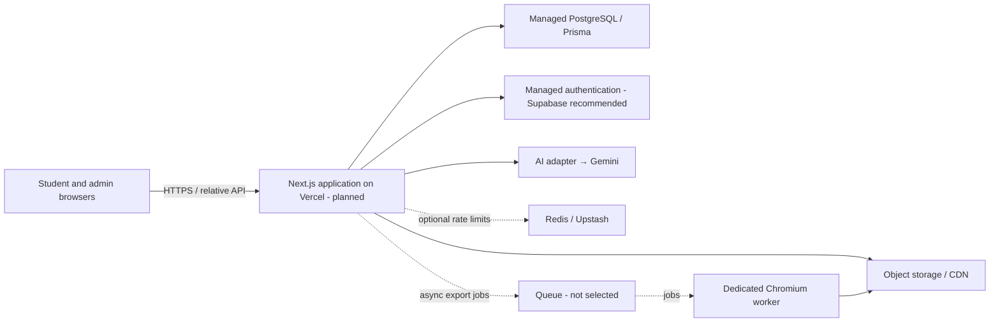

# Deployment architecture

**Purpose and scope.** Describe the blueprint's intended managed hosting, infrastructure dependencies, failure isolation and production-readiness requirements. This is a target architecture, not an inventory of deployed resources.

## Responsibilities and boundaries

The Next.js application is the modular monolith. The export worker is a separate background execution environment for rendering, not a new business-domain service. PostgreSQL remains the relational authority; object storage holds file bytes; provider results do not become authoritative grading data. Supabase and Vercel are blueprint recommendations; account, region and operational choices are not confirmed.

| Dependency | Intended use | Failure boundary |
|---|---|---|
| Managed PostgreSQL | Questions, versions, users, attempts, results and audit data via Prisma | Protect transactions and connections; inability to persist must not be shown as a saved answer. |
| Managed auth | Verify identities and manage sessions | Protected operations fail safely if identity cannot be verified. |
| Object storage/CDN | Authorized diagrams, images, paper artifacts | Serve safe content types and authorized references; private content is not made public through cache or long-lived URLs. |
| AI provider | On-demand tutor/parser through adapter | Timeout/unavailable response is localized; exam flow and server scoring remain independent. |
| Rate-limit store | Atomic quotas for auth, autosave, AI and export | Backend choice and behavior during failure are open; do not claim limits are enforced until tested. |
| Queue + Chromium worker | Async server PDF snapshots only | Authenticate jobs, limit resource use and protect output; retries/host/queue are open. Browser print remains primary. |

## Production readiness

- Use HTTPS and environment separation; keep private keys server-side. Design server-facing worker/provider calls so the browser never needs localhost or infrastructure credentials.
- Provide backups and tested restore, monitoring/logging with redaction, migration review, alerts and an incident/rollback plan. Define RPO/RTO, ownership, capacity and cost limits before real data or traffic.
- Account for exam spikes and mobile-network interruptions. Keep autosave operations small and idempotent; client mirrors are not authoritative. The blueprint's exam-route target is approximately 200 KB gzipped initial JavaScript; verify rather than asserting it has been met.
- Optimize images, reserve dimensions, deliver/subset fonts responsibly and test Bangladesh-oriented 3G/mobile scenarios. Verify font rights and shaping in both browser and worker.
- Never run expensive Chromium rendering inline in a web request. Enqueue snapshot work, isolate its resource usage and re-check artifact authorization. Queue semantics, job idempotency and worker scale-to-zero are planning details, not established deployment facts.

## Dependencies

Depends on [environment isolation](environments.md), [database design](../database/database-design.md), [security](../security/security-guidelines.md), [AI Tutor](../modules/ai-tutor.md), [Paper Studio](../modules/paper-studio.md) and the [testing strategy](../development/testing-strategy.md). The worker and optional cache do not change domain ownership.

## OPEN DECISION

[OD-02, OD-06, OD-15–OD-16, OD-19–OD-20, OD-22 and OD-25–OD-29](../architecture/technology-decisions.md#open-decision-register) cover worker/queue, rate limits, identity, storage, privacy, operations, fonts, test infrastructure, export and AI policies. Alternative hosting or architectural decomposition requires documented justification and approval.

## Related documentation

[System architecture](../architecture/system-architecture.md) · [Environments](environments.md) · [Paper Studio](../modules/paper-studio.md) · [Testing](../development/testing-strategy.md)
